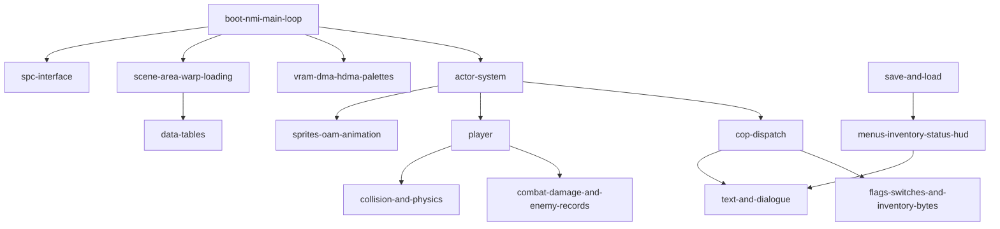

# Soul Blazer Code Documentation

*Part of the [Soul Blazer Documentation](../README.md)*

> The hub of the code documentation: where every block of the 1 MiB source ROM sits, which file holds it, how the files include each other, the conventions every document relies on, and which of the fifteen topic documents, seven world pages and reference pages explains what. Routine descriptions live in the topic documents, never here.

**Source:** [`extracted/`](../../extracted/) (136 `.asm` files plus the asset folders) · [`us/blocks.json`](../../us/blocks.json) · [`us/files.json`](../../us/files.json) · [`us/config.json`](../../us/config.json) · [`us/labels.json`](../../us/labels.json)

---

## Overview

Soul Blazer (US) is a 1 MiB LoROM cartridge with 8 KB of battery RAM. The source ROM is split into **blocks** (`us/blocks.json`: code and data, one block per `.asm` file) and **files** (`us/files.json`: compressed or raw assets such as bitmaps, tilemaps, palettes, spritemaps and music). The engine is one main loop (`RunMainLoop`) and one interrupt (`HandleVBlank`); everything the player sees in a room is an **actor**, a script that runs once per frame and talks to the engine through `COP` commands.

| Metric | Value |
|--------|-------|
| ROM size / banks | 1,048,576 bytes (source ROM), 32 banks `$00`-`$1F` of 32 KB |
| Extracted assembly | 136 `.asm` files in 4 shared folders and 7 world folders |
| Asset files | 353 (Bitmap 70, Spritemap 30, Palette 83, Music 21, Tilemap 115, Tileset 34) in 23 folders, 239 compressed |
| Sound effects | 33 in `extracted/sfx/` (the SFX region starts at file offset 229376) |
| Worlds / areas / scenes | 7 worlds, 22 areas, 97 scenes |
| COP | 108 handlers, 11,025 command sites in scripts, 289 `BRK #n` sound requests |
| Names, notes, comments | 2,765 names, 135 block notes, 1,684 part notes, 1,401 inline comments |
| SHA-1 of the rebuilt ROM | `040a408a1f2b5fd4e759c3bcd789321df0b8f18a` (1,081,344 bytes) |

Addresses in these documents are **source-ROM addresses**: LoROM, bank = file offset ÷ `$8000`, address = `$8000` + the offset inside that bank. The rebuilt ROM places the blocks elsewhere ([`rebuilt/layout.json`](../../rebuilt/layout.json)); the two are never compared.

---

## Document suite

Read the topic documents in this order for a first pass: boot, actors, COP, then the subject you need.

### Topic documents (this folder)

| Document | Subject |
|----------|---------|
| [boot-nmi-main-loop.md](boot-nmi-main-loop.md) | Reset, the frame (work phase with NMI off, upload phase with NMI on), the sub-frame runners, the vblank handler |
| [actor-system.md](actor-system.md) | The 64-slot pool, run order, spawning from placements, lairs and scripts, removal |
| [cop-dispatch.md](cop-dispatch.md) | `COP [id]` to handler, operand reading, the seven exits, waits, `BRK #n` |
| [player.md](player.md) | The hero actor and its helpers, input, poses, swings, blade, soul orb, spells, level-up |
| [collision-and-physics.md](collision-and-physics.md) | Velocity to position, the tile type map, walls, pushes (conveyors, currents) |
| [combat-damage-and-enemy-records.md](combat-damage-and-enemy-records.md) | Hit sources and targets, damage rules, the 14-byte enemy record, death and drops |
| [scene-area-warp-loading.md](scene-area-warp-loading.md) | `scene_next`, the scene loader, asset lists, exits, the return trip |
| [data-tables.md](data-tables.md) | Every keyed table, its key, its terminator and its reader |
| [flags-switches-and-inventory-bytes.md](flags-switches-and-inventory-bytes.md) | The 256-byte progress block: flags, chests, lairs, switches, inventory |
| [menus-inventory-status-hud.md](menus-inventory-status-hud.md) | Equipment and status screens, the HUD, giving and paying for things |
| [text-and-dialogue.md](text-and-dialogue.md) | String format, dictionary, the two renderers, talk, choices, name entry |
| [sprites-oam-animation.md](sprites-oam-animation.md) | Animation lists, spritemaps, the draw list, OAM, the animation banks |
| [vram-dma-hdma-palettes.md](vram-dma-hdma-palettes.md) | VRAM layout, DMA channels, scrolling strips, palettes, the HDMA queue |
| [spc-interface.md](spc-interface.md) | The four APU ports, uploads, song and effect requests |
| [save-and-load.md](save-and-load.md) | The four SRAM slots, the Master's Record command, the file select |

### Reference documents

| Document | Subject |
|----------|---------|
| [../cop/index.md](../cop/index.md) | The COP command set: ids, operands, uses, families |
| [../wram-memory-map.md](../wram-memory-map.md) | Every named WRAM address with its evidence |
| [../areas-and-scenes.md](../areas-and-scenes.md) | Worlds, areas and scenes with their ids and ROM names |
| [../walkthrough-crosswalk.md](../walkthrough-crosswalk.md) | Walkthrough names matched to ROM labels, with confidence and the discrepancy index |
| [../audio/spc-engine.md](../audio/spc-engine.md) | The SPC700 sound engine |
| [../audio/spc-disassembly.md](../audio/spc-disassembly.md) | The SPC700 disassembly |
| [../walkthrough/README.md](../walkthrough/README.md) | The walkthrough chapters, items, magic, level-up, sidequests and bestiary (source of game names) |

### World pages

| World | `blocks.json` group | Meta list |
|-------|---------------------|-----------|
| [Grass Valley](../worlds/grass_valley.md) | `grass_valley` | `MetaGrassValley` |
| [Greenwood](../worlds/greenwood.md) | `greenwood` | `MetaGreenwood` |
| [St. Elles](../worlds/st_elles.md) | `st_elles` | `MetaStElles` |
| [Mountain of Souls](../worlds/mountain_of_souls.md) | `mountain_of_souls` | `MetaMountainOfSouls` |
| [Leo's Lab](../worlds/leos_lab.md) | `leos_lab` | `MetaLeosLab` |
| [Magridd's Castle](../worlds/magridds_castle.md) | `magridds_castle` | `MetaMagriddsCastle` |
| [World of Evil](../worlds/world_of_evil.md) | `world_of_evil` | `MetaWorldOfEvil` |

Each world page lists the areas and scenes of its world, its actor files, roster, enemies, boss and set pieces, and the walkthrough cross-check. The meta lists are in [`WorldMetaPointers.asm`](../../extracted/system/WorldMetaPointers.asm).

### How the documents relate



---

## ROM and bank map

The numbers below are computed from `us/blocks.json`, `us/files.json` and the SFX region of `us/config.json`; "unmapped" is bank-end filler and alignment slack.

```
Bank  Offset            Contents
----  ----------------  ----------------------------------------------------------
$00   $000000-$007FFF   Engine: boot, NMI, scheduler and sprites, combat hits, tile collision,
                        spawn/lairs/death, player, COP dispatch and core, title and file select;
                        the five COP family files; shared actor helpers (bank 0);
                        gv_front_end, Up Above actors, seven boss files, we_deathtolls_shrine_actors
$01   $008000-$00FFFF   WorldMetaPointers (7 meta lists), scene placements, chest, exit, plate lists,
                        lair records and formations, variant rules, engine tables
$02   $010000-$017FFF   Library of bank 02: map scroll, tile patches, tile triggers, HDMA effects, menus,
                        text renderer, scene loader, HUD, scene profiles, banner and title texts
$03   $018000-$01FFFF   Actors: Grass Valley, Greenwood, World of Evil; shared helpers (bank 3)
$04   $020000-$027FFF   Actors: Mountain of Souls, Leo's Lab, Magridd's Castle; library of bank 04
                        (boot and scene init, save system, player helpers, bit array); shared helpers (bank 4)
$05   $028000-$02FFFF   Scene asset lists, then assets
$06   $030000-$037FFF   SPC driver block, then assets
$07   $038000-$03FFFF   Sound effects (33 records start at file offset 229376)
$08   $040000-$047FFF   Sound effects (end), then assets
$09   $048000-$04FFFF   Iris frames and icon tiles, menu palettes and tile groups, assets
$0A   $050000-$057FFF   Animation bank: hero without weapon, assets
$0B   $058000-$05FFFF   Animation bank: hero with weapon, assets
$0C   $060000-$067FFF   Animation bank: weapon overlay, assets
$0D   $068000-$06FFFF   Animation bank: palette cycles, assets
$0E   $070000-$077FFF   Animation bank: shared effects, assets
$0F   $078000-$07FFFF   Animation bank: spells and Phoenix, assets
$10   $080000-$087FFF   Text dictionary, assets
$11-$1E                 Assets only (bitmaps, tilemaps, tilesets, palettes, spritemaps, music)
$1F   $0F8000-$0FFFFF   World enemy and actor files (all seven worlds, most of St. Elles),
                        unreferenced stubs, SPC upload code and the SPC engine block
```

The SNES banks above are the `?BANK` values of the extracted files. The notes files (`notes/blockNotes`, `partNotes`, `comments`) and the names files (`us/names/bankNN.json`) are keyed by **file offset ÷ 65536**, so there are 16 of each and a block that starts in the upper half of a 64 KiB pair is filed under an earlier number than its SNES bank. The label suffix of an actor or enemy is the file offset in hex.

### Address ranges by category

| Category | Source | Bytes | Share of the ROM |
|----------|--------|------:|-----------------:|
| Assets (graphics, tilemaps, spritemaps, palettes, music) | `us/files.json` | 748,730 | 71.4 % |
| World actor files (7 groups) | `blocks.json` | 102,107 | 9.7 % |
| Engine and tables (`system`) | `blocks.json` | 96,927 | 9.2 % |
| Sound effects | SFX region | 54,894 | 5.2 % |
| Library | `blocks.json` | 28,986 | 2.8 % |
| COP handlers | `blocks.json` | 3,285 | 0.3 % |
| Shared actor helpers | `blocks.json` | 1,672 | 0.2 % |
| Unmapped (filler, slack) | the rest | 11,975 | 1.1 % |

The assets split into Bitmap (435,199 bytes), Tilemap (120,572), Spritemap (68,170), Music (63,810), Tileset (46,739) and Palette (14,240).

---

## Block groups and file inventory

`us/blocks.json` has 11 groups; each block is one `.asm` file, each group is one folder under `extracted/`. The seven world groups are the seven worlds, so a world's actor code is always found under its own folder.

| Group | Blocks | Folder | Role |
|-------|-------:|--------|------|
| `system` | 35 | [`extracted/system/`](../../extracted/system/) | Engine, player, COP dispatch, tables, animation banks, SPC upload |
| `library` | 25 | [`extracted/library/`](../../extracted/library/) | Subroutines called from the engine and from scripts (banks 02 and 04) |
| `cop_handlers` | 5 | [`extracted/cop_handlers/`](../../extracted/cop_handlers/) | The 108 COP command handlers in five families |
| `actor_shared` | 4 | [`extracted/actor_shared/`](../../extracted/actor_shared/) | Helpers and texts shared by actors of several worlds (prefix `cm_`) |
| `grass_valley` | 17 | [`extracted/grass_valley/`](../../extracted/grass_valley/) | World 0 |
| `greenwood` | 8 | [`extracted/greenwood/`](../../extracted/greenwood/) | World 1 |
| `st_elles` | 12 | [`extracted/st_elles/`](../../extracted/st_elles/) | World 2 |
| `mountain_of_souls` | 9 | [`extracted/mountain_of_souls/`](../../extracted/mountain_of_souls/) | World 3 |
| `leos_lab` | 7 | [`extracted/leos_lab/`](../../extracted/leos_lab/) | World 4 |
| `magridds_castle` | 9 | [`extracted/magridds_castle/`](../../extracted/magridds_castle/) | World 5 |
| `world_of_evil` | 5 | [`extracted/world_of_evil/`](../../extracted/world_of_evil/) | World 6 |

### `system` (35 files)

| File | Contents |
|------|----------|
| [`engine_boot_main_loop`](../../extracted/system/engine_boot_main_loop.asm) | Reset, the main loop and the sub-frame runners |
| [`engine_unreferenced_code`](../../extracted/system/engine_unreferenced_code.asm) | Code nothing in the ROM calls |
| [`engine_vblank_nmi`](../../extracted/system/engine_vblank_nmi.asm) | The NMI handler and the DMA routines it calls |
| [`engine_actor_scheduler_and_sprites`](../../extracted/system/engine_actor_scheduler_and_sprites.asm) | Actor scheduler, draw-list sort, OAM builder, animation stepping |
| [`engine_combat_hits`](../../extracted/system/engine_combat_hits.asm) | Hit detection and damage |
| [`engine_tile_collision`](../../extracted/system/engine_tile_collision.asm) | Tile collision and actor motion |
| [`engine_spawn_lairs_death_drops`](../../extracted/system/engine_spawn_lairs_death_drops.asm) | Spawning, lair scripts, death and drop scripts |
| [`player_core`](../../extracted/system/player_core.asm) | The hero: spawn script, input, poses, swings, motion finish |
| [`player_spells_level_up`](../../extracted/system/player_spells_level_up.asm) | Blade layer, soul orb, spells, level-up watcher |
| [`engine_player_death_and_actor_helpers`](../../extracted/system/engine_player_death_and_actor_helpers.asm) | Player death check, held actors, the boss map patch |
| [`cop_dispatch`](../../extracted/system/cop_dispatch.asm) | COP and BRK dispatchers and the command tables |
| [`cop_core`](../../extracted/system/cop_core.asm) | The exit chain and helpers shared by every COP handler |
| [`engine_title_file_select`](../../extracted/system/engine_title_file_select.asm) | Title Mode 7 hook and the save-slot menu |
| [`WorldMetaPointers`](../../extracted/system/WorldMetaPointers.asm) | The seven meta lists of actor types |
| [`data_scene_placements`](../../extracted/system/data_scene_placements.asm) | Scene index and the actor placement lists |
| [`data_chest_lists`](../../extracted/system/data_chest_lists.asm) | Chest lists by location |
| [`data_exit_lists`](../../extracted/system/data_exit_lists.asm) | Exit lists by location |
| [`data_plate_lists`](../../extracted/system/data_plate_lists.asm) | Pressure plate lists |
| [`data_lair_records`](../../extracted/system/data_lair_records.asm) | Lair and release records |
| [`data_lair_formations`](../../extracted/system/data_lair_formations.asm) | Monster formations of the lairs |
| [`data_scene_variant_rules`](../../extracted/system/data_scene_variant_rules.asm) | Scene variant rows |
| [`data_engine_tables`](../../extracted/system/data_engine_tables.asm) | Sixteen small engine tables |
| [`data_scene_asset_lists`](../../extracted/system/data_scene_asset_lists.asm) | One asset record per scene |
| [`data_spc_driver`](../../extracted/system/data_spc_driver.asm) | The SPC700 driver block |
| [`data_iris_and_icon_tiles`](../../extracted/system/data_iris_and_icon_tiles.asm) | Iris frames and icon tile records |
| [`data_menu_palettes_and_groups`](../../extracted/system/data_menu_palettes_and_groups.asm) | Menu palettes and tile group map |
| [`data_anim_player_unarmed`](../../extracted/system/data_anim_player_unarmed.asm) | Animation bank `$0A` |
| [`data_anim_player`](../../extracted/system/data_anim_player.asm) | Animation bank `$0B` |
| [`data_anim_weapon_overlay`](../../extracted/system/data_anim_weapon_overlay.asm) | Animation bank `$0C` |
| [`data_anim_palette_cycles`](../../extracted/system/data_anim_palette_cycles.asm) | Animation bank `$0D` |
| [`data_anim_effects`](../../extracted/system/data_anim_effects.asm) | Animation bank `$0E` |
| [`data_anim_magic`](../../extracted/system/data_anim_magic.asm) | Animation bank `$0F` |
| [`data_dictionary`](../../extracted/system/data_dictionary.asm) | The 128-word text dictionary |
| [`unreferenced_stubs_bank1f`](../../extracted/system/unreferenced_stubs_bank1f.asm) | Two kill-self stubs in bank `$1F` |
| [`engine_spc_ipl_upload`](../../extracted/system/engine_spc_ipl_upload.asm) | SPC upload code and the SPC engine block |

### `library` (25 files)

| File | Bank | Contents |
|------|------|----------|
| [`lib_map_scroll_and_redraw`](../../extracted/library/lib_map_scroll_and_redraw.asm) | `$02` | Camera, scroll streaming, sweep redraw |
| [`lib_animation`](../../extracted/library/lib_animation.asm) | `$02` | Record stepper of the animation COP commands |
| [`lib_map_tile_patches`](../../extracted/library/lib_map_tile_patches.asm) | `$02` | Run-time and scene-load changes of the metatile maps |
| [`lib_tile_triggers_and_lair_return`](../../extracted/library/lib_tile_triggers_and_lair_return.asm) | `$02` | Tile triggers, lair release, the NPC return trip |
| [`lib_hdma_window_effects`](../../extracted/library/lib_hdma_window_effects.asm) | `$02` | HDMA effects and the Soul window effects |
| [`lib_system_helpers`](../../extracted/library/lib_system_helpers.asm) | `$02` | HDMA queue, NMI switches, boot PPU layout |
| [`lib_menus`](../../extracted/library/lib_menus.asm) | `$02` | Field menus, status and souls screens, item texts |
| [`lib_field_talk`](../../extracted/library/lib_field_talk.asm) | `$02` | The B-button talk |
| [`lib_inventory_store`](../../extracted/library/lib_inventory_store.asm) | `$02` | Inventory store |
| [`lib_choice_menus`](../../extracted/library/lib_choice_menus.asm) | `$02` | Row chooser, question chooser, cursor blink |
| [`lib_menu_screen_setup`](../../extracted/library/lib_menu_screen_setup.asm) | `$02` | Menu screen setup, graphics and palette loaders |
| [`lib_name_entry_and_staff_roll`](../../extracted/library/lib_name_entry_and_staff_roll.asm) | `$02` | Name entry screen, staff roll scroller |
| [`lib_hud`](../../extracted/library/lib_hud.asm) | `$02` | HUD update, enemy gauge, HUD strings |
| [`lib_text_render`](../../extracted/library/lib_text_render.asm) | `$02` | Menu renderer and dialogue renderer |
| [`lib_scene_asset_loader`](../../extracted/library/lib_scene_asset_loader.asm) | `$02` | Scene asset loader, Quintet LZ expander, hardware reset |
| [`lib_arithmetic`](../../extracted/library/lib_arithmetic.asm) | `$02` | Multiply, divide, BCD, random state |
| [`lib_banner_texts`](../../extracted/library/lib_banner_texts.asm) | `$02` | Banner strings, the location name list |
| [`lib_scene_profile_data`](../../extracted/library/lib_scene_profile_data.asm) | `$02` | Scene profile list and records |
| [`lib_save_system`](../../extracted/library/lib_save_system.asm) | `$04` | Save and load of the four SRAM slots |
| [`lib_boot_and_scene_init`](../../extracted/library/lib_boot_and_scene_init.asm) | `$04` | Boot buffers, scene change, scene initialisation |
| [`lib_main_loop_helpers`](../../extracted/library/lib_main_loop_helpers.asm) | `$04` | Animated strip request, pause banner |
| [`lib_unused_sine_wave_tables`](../../extracted/library/lib_unused_sine_wave_tables.asm) | `$04` | Unused sine tables |
| [`lib_map_index_helpers`](../../extracted/library/lib_map_index_helpers.asm) | `$04` | Pixel to map index, steppers, hazard test |
| [`lib_bit_array`](../../extracted/library/lib_bit_array.asm) | `$04` | Set, clear and test of a bit in a bit array |
| [`lib_player_helpers`](../../extracted/library/lib_player_helpers.asm) | `$04` | Facing, flip, weapon pose, heal and EXP pay-out, counters |

### `cop_handlers` (5 files) and `actor_shared` (4 files)

| File | Contents |
|------|----------|
| [`cop_script_flow_flags`](../../extracted/cop_handlers/cop_script_flow_flags.asm) | Script flow, event flags, scene changes, randomness, music loading |
| [`cop_items_stats_text`](../../extracted/cop_handlers/cop_items_stats_text.asm) | Text, menus, items, Gems, EXP, HP |
| [`cop_conditions`](../../extracted/cop_handlers/cop_conditions.asm) | Jumps on conditions about actors, the player and the screen |
| [`cop_actor_fields_animation`](../../extracted/cop_handlers/cop_actor_fields_animation.asm) | Position, parameters, animation, mirroring, order, palette |
| [`cop_tiles_spawn_kill`](../../extracted/cop_handlers/cop_tiles_spawn_kill.asm) | Tile map, spawning and killing actors |
| [`shared_actor_helpers_bank0`](../../extracted/actor_shared/shared_actor_helpers_bank0.asm) | Colour cycle, enemy aimed shot, the Master of the shrines |
| [`shared_choice_prompt_texts`](../../extracted/actor_shared/shared_choice_prompt_texts.asm) | Option windows of the choice menus |
| [`shared_actor_helpers_bank3`](../../extracted/actor_shared/shared_actor_helpers_bank3.asm) | Fairy-gem and captive helpers (bank 3) |
| [`shared_actor_helpers_bank4`](../../extracted/actor_shared/shared_actor_helpers_bank4.asm) | Fairy-gem idle loop, captive pleas, Mountain of Souls gem texts (bank 4) |

### World folders (67 files)

Each world page has the per-file role. The files below are grouped by the area folder they sit in.

| World | Files |
|-------|-------|
| [Grass Valley](../worlds/grass_valley.md) (17) | `front_end/`: `gv_front_end`, `gv_title_texts`, `gv_prologue_texts`, `gv_epilogue_texts` · `up_above/`: `gv_up_above_actors_and_name_entry`, `gv_up_above_trial_room_and_lisa_turbo_actors` · `grass_valley_village/`: `gv_village_actors_018000`, `gv_village_actors_019475` · `underground_castle/`: `gv_underground_castle_actors`, `gv_underground_castle_enemies` · `leos_paintings/`: `gv_leos_paintings_actors`, `gv_leos_paintings_enemies`, `gv_boss_metal_mantis` · top level: `gv_enemy_green_humanoid`, `gv_multi_area_actors`, `gv_watching_over_world_texts`, `gv_unreferenced_string_stub_01A4F9` |
| [Greenwood](../worlds/greenwood.md) (8) | `woods_of_greenwood/`: `gw_woods_actors_01B98D`, `gw_woods_actors_01D045` · `lostside_marsh/`: `gw_lostside_marsh_actors`, `gw_lostside_marsh_enemies`, `gw_boss_light_water_fire_statues` · top level: `gw_actor_fixed_gem_pickup`, `gw_enemies_without_placement`, `gw_watching_over_world_return_prompt_texts` |
| [St. Elles](../worlds/st_elles.md) (12) | `st_elles_coast/`: `se_st_elles_coast_actors`, `se_st_elles_coast_enemies` · `seabed_of_st_elles/`: `se_seabed_of_st_elles_actors`, `se_seabed_of_st_elles_enemies` · `seabed_sanctuary/`: `se_seabed_sanctuary_actors_0F8000`, `se_seabed_sanctuary_actors_0F8D58` · `ghost_ship/`: `se_ghost_ship_actors`, `se_ghost_ship_enemies`, `se_boss_floating_skull` · top level: `se_unused_enemy_drifting`, `w2_effect_player_overlay`, `w2_obj_fairy_idle_loop` |
| [Mountain of Souls](../worlds/mountain_of_souls.md) (9) | `soul_of_mountain_house/`: `ms_soul_of_mountain_house_actors_020000`, `ms_soul_of_mountain_house_actors_02100B` · `snow_mountain/`: `ms_snow_mountain_actors`, `ms_enemy_ice_crystal` · `mountain_of_souls_dungeon/`: `ms_dungeon_actors`, `ms_enemy_ice_maker`, `ms_boss_poseidon` · top level: `ms_multi_area_actors`, `ms_multi_area_enemies` |
| [Leo's Lab](../worlds/leos_lab.md) (7) | `leos_laboratory/`: `ll_laboratory_actors` · `laboratory_dungeon/`: `ll_laboratory_dungeon_actors`, `ll_laboratory_dungeon_enemies`, `ll_boss_tin_doll` · `town_models/`: `ll_town_models_actors`, `ll_town_models_enemies` · top level: `ll_watching_over_world_return_prompt_texts` |
| [Magridd's Castle](../worlds/magridds_castle.md) (9) | `airship_dock/`: `mc_airship_dock_actors`, `mc_boss_demon_falcon` · `castle_dungeon/`: `mc_castle_dungeon_actors`, `mc_castle_dungeon_enemies` · `castle_of_magridd/`: `mc_castle_actors` · `castle_towers/`: `mc_castle_towers_actors`, `mc_castle_towers_enemies` · top level: `mc_return_prompt_and_chest_hint_texts`, `mc_unreferenced_string_stub_02623C` |
| [World of Evil](../worlds/world_of_evil.md) (5) | `evil_world/`: `we_evil_world_actors`, `we_evil_world_enemies` · `deathtolls_shrine/`: `we_deathtolls_shrine_actors`, `we_fx_battle_bg2_hofs_bands` · `up_above/`: `we_obj_master_shrine_event` |

### Asset folders

`us/files.json` has 23 groups, one per area plus `system`; the folders of the same name under [`extracted/`](../../extracted/) hold the asset files (`.bin`, `.pal` and the other asset extensions), some in scene subfolders. The `system` group has 56 files.

| Group | Files | Group | Files | Group | Files |
|-------|------:|-------|------:|-------|------:|
| `system` | 56 | `lostside_marsh` | 32 | `snow_mountain` | 10 |
| `up_above` | 47 | `st_elles_coast` | 16 | `leos_laboratory` | 8 |
| `grass_valley_village` | 8 | `seabed_sanctuary` | 5 | `laboratory_dungeon` | 17 |
| `underground_castle` | 7 | `seabed_of_st_elles` | 11 | `town_models` | 8 |
| `leos_paintings` | 16 | `ghost_ship` | 7 | `castle_of_magridd` | 7 |
| `woods_of_greenwood` | 13 | `soul_of_mountain_house` | 4 | `castle_dungeon` | 9 |
| `mountain_of_souls_dungeon` | 19 | `castle_towers` | 19 | `airship_dock` | 10 |
| `evil_world` | 13 | `deathtolls_shrine` | 11 | | |

The sound effects are in [`extracted/sfx/`](../../extracted/sfx/) (`sfx00.sfx` to `sfx20.sfx`).

---

## Compilation units

Every `.asm` file is one compilation unit with a `?BANK` line (the SNES bank the unit is built into) and a list of `?INCLUDE` lines (compile-time dependencies). 88 of the 136 files include others. The include graph has four layers, from the bottom:

```
Layer 1  data and leaf library      data_*, lib_arithmetic, lib_bit_array, lib_system_helpers, ...
Layer 2  library and engine         lib_*, engine_*, player_*  (engine_boot_main_loop and
                                    engine_spawn_lairs_death_drops include most of layer 1 and 2)
Layer 3  COP                        cop_core  <-  cop_*  (five families)  <-  cop_dispatch
Layer 4  actors                     shared_actor_helpers_bank0/3/4, shared_choice_prompt_texts
                                    <-  every world file (gv_*, gw_*, se_*, ms_*, ll_*, mc_*, we_*)
Root     WorldMetaPointers          includes the animation banks and the actor files of all seven
                                    meta lists (63 includes): the meta list is the entry that
                                    makes an actor file part of the build
```

Three things follow from it.

- **Meta types make actors reachable.** An actor script is reached only through its meta entry in `WorldMetaPointers`; the placement lists (`data_scene_placements`) and the lair records (`data_lair_records`) name actors by type, never by address.
- **World files include shared files, not each other,** with a few exceptions inside one world (for example `gw_woods_actors_01B98D` and `gw_woods_actors_01D045`, or the `se_*` files that include `w2_obj_fairy_idle_loop`).
- **Bank reach decides the reference prefix.** A short reference (`$&label`) only reaches the referrer's own bank, so a file that calls into another bank is built with a long reference (`$@label`); the syntax is in the [assembler syntax guide](../../../gaia-knowledge/curated/gaialabs/assembler-syntax.md).

---

## Calling conventions

| Convention | Rule |
|------------|------|
| Script entry | An actor script is entered with `X` = slot, `D` = 0 and 16-bit accumulator, and leaves with `RTL`; the next entry is given by `$18` (and the bank in `$36`) and the wait counter `$14` ([actor-system.md](actor-system.md)) |
| `COP [id] ( operands )` | The handler reads operands through the script pointer `$38`/`$3A` and advances it by hand; `HandleCop` changes neither `DBR` nor `D` ([cop-dispatch.md](cop-dispatch.md)) |
| String COPs | Text pointers in `&ASCIIString$2` operands point into bank `$02` and the text renderer forces `DBR = $02` ([text-and-dialogue.md](text-and-dialogue.md)) |
| Engine calls | `JSR`/`RTS` inside a bank, `JSL`/`RTL` across banks; the reset code sets `DBR = $01` and every hardware register name in `extracted/` is resolved against that bank |
| Frame phases | Everything after `DisableNmi` in `RunMainLoop` must not be interrupted by the NMI; routines that wait for a vblank run only with the NMI on or through a sub-frame runner ([boot-nmi-main-loop.md](boot-nmi-main-loop.md)) |
| Scene change | A scene change is a value: write `scene_next` (and the arrival point), the main loop does the rest ([scene-area-warp-loading.md](scene-area-warp-loading.md)) |
| Word encodings | `Cop10` and `LocationAreaScene` hold `#$SSAA`; `scene_next` holds `#$AASS`; exit rows hold the two bytes separately |

Assembler references: `$&label` is a 2-byte short reference, `$@label` a 3-byte long reference, and label offsets (`label+20`) are hexadecimal.

---

## Key WRAM variables

The full table with the evidence for every name is [wram-memory-map.md](../wram-memory-map.md). These are the variables that tie several documents together.

| Address | Name | Where it matters |
|---------|------|------------------|
| `$0312` | `frame_counter` | [boot-nmi-main-loop.md](boot-nmi-main-loop.md) |
| `$0318` / `$0319` | `scene_next` / `area_next` | [scene-area-warp-loading.md](scene-area-warp-loading.md) |
| `$1C6A` | `location_id` | the key of most scene tables ([data-tables.md](data-tables.md)) |
| `$06A6` / `$06A8` | `actor_list_tail` / `actor_list_head` | [actor-system.md](actor-system.md) |
| `$0398` | `sound_request` | [spc-interface.md](spc-interface.md) |
| `$03B8` | `vram_upload_flags` | [vram-dma-hdma-palettes.md](vram-dma-hdma-palettes.md) |
| `$1A5E` | `event_flags` | [flags-switches-and-inventory-bytes.md](flags-switches-and-inventory-bytes.md) |
| `$1B1E` | `inventory` | [menus-inventory-status-hud.md](menus-inventory-status-hud.md) |
| `$1B88` | `player_hp` | [combat-damage-and-enemy-records.md](combat-damage-and-enemy-records.md) |
| `$1B90` | `saved_scene` | [save-and-load.md](save-and-load.md) |
| `$0445` | `file_select_request` | [save-and-load.md](save-and-load.md) |
| `$0482` | `front_end_step` | [`gv_front_end`](../../extracted/grass_valley/front_end/gv_front_end.asm) sequence |
| `$7F7000` | `bg3_tilemap_buffer` | [text-and-dialogue.md](text-and-dialogue.md) |

---

## Cross-file call chains

These chains cross file boundaries; each step is explained in the document named after it.

### Power-on to the first frame

```
BootGame (engine_boot_main_loop)
  -> InitHardwareAndClearWram, ApplyBootPpuLayout   (lib_scene_asset_loader, lib_system_helpers)
  -> InitFixedState, ClearBg3Buffer                 (lib_boot_and_scene_init)
  -> scene_next = $000C  (boot scene of gv_front_end)
  -> EnableNmi, ChangeSceneIfRequested -> RunMainLoop
```

See [boot-nmi-main-loop.md](boot-nmi-main-loop.md); the boot scene uploads the SPC engine ([spc-interface.md](spc-interface.md)) and starts the title.

### One frame

```
RunMainLoop (engine_boot_main_loop)
  WaitVBlank  (NMI: HandleVBlank in engine_vblank_nmi uploads OAM, CGRAM, BG3, scroll, strips, queue)
  -> ChangeSceneIfRequested
  -> DispatchFieldButtons (lib_menus), HandlePauseBanner (lib_main_loop_helpers)
  -> DisableNmi
  -> CheckPlayerTileTriggers (lib_tile_triggers_and_lair_return)
  -> RunActors, CullAndSortActors (engine_actor_scheduler_and_sprites)
  -> DetectHitSourceCollisions, DetectPlayerContact (engine_combat_hits), CheckPlayerDeath
  -> ScrollCameraByDelta, BuildScrollStrips (lib_map_scroll_and_redraw), BuildOamFromActors
  -> UpdateHud (lib_hud) -> EnableNmi
```

### Scene change

```
write scene_next   <- Cop10 (cop_script_flow_flags), CheckExitRegions and ReleaseLairAtSwitch
                      (lib_tile_triggers_and_lair_return), HandleFileSelectChoice
                      (engine_title_file_select), the Master's Move (shared_actor_helpers_bank0)
ChangeSceneIfRequested (lib_boot_and_scene_init)
  -> PlayTransitionOut -> ForceBlankNmiOff -> InitSceneState
       LoadSceneAssets (lib_scene_asset_loader)  <- data_scene_asset_lists, lib_scene_profile_data
       BuildTileTypeMap, InitActorPool
       SpawnSceneActors (engine_spawn_lairs_death_drops)  <- data_scene_placements, WorldMetaPointers
       ApplyLairStatesToScene (lib_map_tile_patches)  -> SpawnLairActor  <- data_lair_records
  -> EnableNmi, PlayTransitionIn
```

See [scene-area-warp-loading.md](scene-area-warp-loading.md) and [actor-system.md](actor-system.md).

### An actor script runs a command

```
RunActors -> RunActorList (engine_actor_scheduler_and_sprites)  -- RTS trick into the script at $18
  script: COP [id] ( operands )
  -> HandleCop (cop_dispatch) -> command table -> handler (one of the five cop_* families)
  -> handler reads operands via [$38], uses cop_core helpers
  -> exit chain (cop_core): continue, skip operands, jump, wait, or yield with RTL
script: BRK #n -> HandleBrk -> sound_request -> NMI WriteSoundPort -> APUIO2
```

See [cop-dispatch.md](cop-dispatch.md), [cop/index.md](../cop/index.md) and [spc-interface.md](spc-interface.md).

### Talking to an NPC

```
B button: DispatchFieldButtons -> RunTalkInteraction (lib_field_talk)
  -> ActivateTalkTarget -> the NPC's script (a world actor file)
  -> Cop01_ShowText (cop_items_stats_text) -> ShowDialogueText (lib_text_render)
       reads data_dictionary, writes bg3_tilemap_buffer, sets vram_upload_flags
  -> NMI: DmaBg3TilemapPage
```

See [text-and-dialogue.md](text-and-dialogue.md).

### A hit and a kill

```
RunMainLoop -> DetectHitSourceCollisions (engine_combat_hits)
  -> ApplySwordHit | ApplyProjectileHit -> KillOrSpareTarget -> SetEnemyGauge (lib_hud)
  -> RunEnemyDeath (engine_spawn_lairs_death_drops) -> FinishEnemyDeath -> NotifyLairOfDeath
  boss: RunBossDeath -> KillAllOtherActors -> the ending or the next scene
enemy numbers: the 14-byte entry in WorldMetaPointers (Meta<World>)
```

See [combat-damage-and-enemy-records.md](combat-damage-and-enemy-records.md) and [player.md](player.md).

### Opening a lair

```
CheckPlayerTileTriggers -> ReleaseLairAtSwitch (lib_tile_triggers_and_lair_return)
  <- data_lair_records, LocationAreaScene
  -> PlayLairReleaseScene -> RunSubFrameMapSweep, StepSweepRedraw (lib_map_scroll_and_redraw)
     -> ShowDialogueText
  monsters: RunLairRespawn -> SpawnLairMonster  <- data_lair_formations
```

See [actor-system.md](actor-system.md), [flags-switches-and-inventory-bytes.md](flags-switches-and-inventory-bytes.md) and [data-tables.md](data-tables.md).

### Saving and loading

```
Master's Record: cm_npc_master_record_0076EF (shared_actor_helpers_bank0) -> SaveGameToSlot (lib_save_system)
Title Start: file_select_request = 1 -> EnterFileSelect -> DrawSaveSlotMenu
  -> HandleFileSelectChoice (engine_title_file_select) -> LoadGameFromSlot -> scene_next = saved_scene
```

See [save-and-load.md](save-and-load.md).

### A song change

```
Cop31_FadeAndLoadMusic | Cop32_StopAndLoadMusic (cop_script_flow_flags)
  -> MusicLoadSendFade ... MusicLoadUpload -> UploadSpcStream (engine_spc_ipl_upload)
  scene music: LoadSceneMusic -> UploadSceneMusic (lib_scene_asset_loader)
```

See [spc-interface.md](spc-interface.md) and [audio/spc-engine.md](../audio/spc-engine.md).

---

## Design patterns

- **Block = file, group = world.** A block in `us/blocks.json` is one extracted file; a group is a folder. Actor files are named `<world prefix>_<role>_<what>_<offset hex>` with the prefixes `gv_`, `gw_`, `se_`, `ms_`, `ll_`, `mc_`, `we_` and `cm_` for shared actors. Every actor file starts with its block note and a roster.
- **Pinned blocks.** The COP handlers and the vector blocks are pinned to bank 0, `WorldMetaPointers` to bank 1, and string COPs read their text with `DBR = $02`; the selectors are in [`us/labels.json`](../../us/labels.json). A regroup that moves a pinned block breaks the build.
- **Data is keyed, not linked.** Scenes, locations and actor types are the keys; the tables behind them have pointer tables and terminators ([data-tables.md](data-tables.md)).
- **No preemption.** Actors yield with `RTL` and resume at a stored address; the engine never interrupts a script.
- **The NMI only uploads.** The work half of a frame fills WRAM staging buffers and queues; the next NMI sends them to VRAM, OAM and CGRAM.
- **A scene change is a value.** Writers set `scene_next`; one routine consumes it.
- **Place-name spelling.** The ROM prints an apostrophe as a blank, a period as `-` and a hyphen as `+` in place names; the extractor prints them as they are, so the quotation of a name in a document may differ from the walkthrough spelling without being a discrepancy.

---

## `blocks.json` structure

`us/blocks.json` maps group → block → part. A part has `start`, `end` and `type`; the extractor scaffolds anything between the known parts. The names are in [`us/names/`](../../us/names/) (16 files by file offset ÷ 65536), register-state corrections in [`us/overrides.json`](../../us/overrides.json), COP operand formats in [`us/copdef.json`](../../us/copdef.json), and per-block regex replacements applied at extraction in [`us/transforms.json`](../../us/transforms.json).

```json
"engine_boot_main_loop": {
  "parts": { "BootGame": { "start": 0, "end": 517, "type": "Code" } }
}
```

| File | Role |
|------|------|
| [`us/blocks.json`](../../us/blocks.json) | Code and data structure (11 groups, 136 blocks) |
| [`us/files.json`](../../us/files.json) | Asset files (23 groups) |
| [`us/groups.json`](../../us/groups.json) | Asset groups with their prefixes and scene ids |
| [`us/config.json`](../../us/config.json) | ROM layout, SFX region, SRAM size |
| [`us/mnemonics.json`](../../us/mnemonics.json) | WRAM address names |
| [`us/copdef.json`](../../us/copdef.json) | COP command definitions |

---

## Related resources

| Resource | Use |
|----------|-----|
| [`docs/README.md`](../README.md) | The documentation index |
| [`docs/walkthrough/README.md`](../walkthrough/README.md) | Game names and facts (the source of truth for names) |
| [`plans/mapping/mapping-action-plan.md`](../../plans/mapping/mapping-action-plan.md) | The mapping conventions and the pinned-block rules |
| [`plans/doc-audit/README.md`](../../plans/doc-audit/README.md) | How the documents were audited |
| [`plans/extracted-audit/questions/`](../../plans/extracted-audit/questions/) | The open questions (OQ ids) cited by the documents |
| [`gaia-core/docs/notes-and-comments.md`](../../../gaia-core/docs/notes-and-comments.md) | How notes, comments and names change (`npm run merge`, `npm run names`) |
| [`gaia-knowledge/curated/gaialabs/code-bank-documentation.md`](../../../gaia-knowledge/curated/gaialabs/code-bank-documentation.md) | The structure rules these documents follow |
| [65C816 Opcodes (Bruce Clark)](https://6502.org/tutorials/65c816opcodes.html) | CPU reference |
