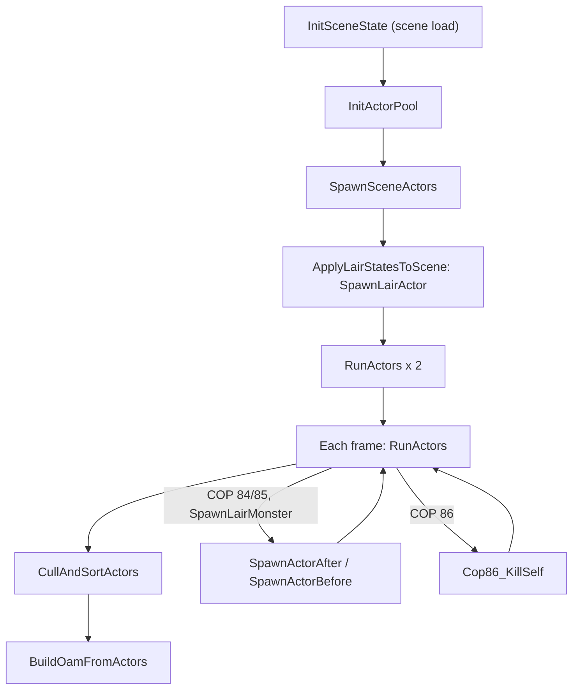
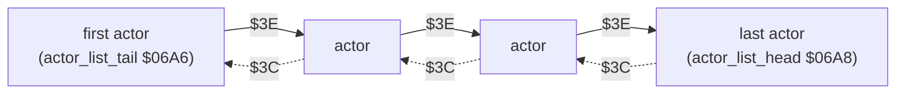

# Actor System — Slots, Scheduler and Spawning

*Part of the [Soul Blazer Code Documentation](README.md)*

> How every moving thing in a scene (the hero, enemies, NPCs, shots, puffs, pickups and invisible helper scripts) lives in one of 64 slots, runs as a script once per frame in list order, is created from placement data, lair records or other scripts, and is removed again.

**Source:**
[`engine_actor_scheduler_and_sprites.asm`](../../extracted/system/engine_actor_scheduler_and_sprites.asm) (`RunActors`, `RunActorList`, `CullAndSortActors`) ·
[`engine_spawn_lairs_death_drops.asm`](../../extracted/system/engine_spawn_lairs_death_drops.asm) (`InitActorPool`, the placement and lair spawners, the kill routines, `RespawnOrKillActor`) ·
[`cop_core.asm`](../../extracted/system/cop_core.asm) (`PopFreeSlot`, `SpawnActorAfter`, `SpawnActorBefore`, `InitSpawnedActor`, the exit chain) ·
[`cop_tiles_spawn_kill.asm`](../../extracted/cop_handlers/cop_tiles_spawn_kill.asm) (the spawn and kill commands) ·
[`cop_script_flow_flags.asm`](../../extracted/cop_handlers/cop_script_flow_flags.asm) (`Cop91_SetEntryHere`, `Cop1B_DelayThenGoto`, `Cop27_YieldThenGoto`) ·
[`cop_conditions.asm`](../../extracted/cop_handlers/cop_conditions.asm) (`CopAD_WaitUntilOnScreen`) ·
[`data_scene_placements.asm`](../../extracted/system/data_scene_placements.asm) ·
[`WorldMetaPointers.asm`](../../extracted/system/WorldMetaPointers.asm) ·
[`data_lair_records.asm`](../../extracted/system/data_lair_records.asm) ·
[`lib_boot_and_scene_init.asm`](../../extracted/library/lib_boot_and_scene_init.asm) (`InitSceneState`) ·
[`lib_map_tile_patches.asm`](../../extracted/library/lib_map_tile_patches.asm) (`ApplyLairStatesToScene`) ·
[`player_core.asm`](../../extracted/system/player_core.asm) (`InitPlayerActor`, as the worked example)

---

## Overview

A scene is a pool of **actors**. Each actor is a 64-byte slot (`$40` bytes) in WRAM at `$0800 + n × $40`, 64 slots in all, plus a **script**: a resume address (`$18`, bank `$36`) that the scheduler calls once when the actor's wait counter (`$14`) has run out. A script runs until it yields with `RTL`, and the next run starts where it asked to (`Cop91_SetEntryHere`, `Cop1B_DelayThenGoto`, `Cop27_YieldThenGoto`). Nothing is preemptive: the "AI" of an enemy is the order of its COP commands, and the engine around them is only the pool, the list, the scheduler and the spawn and kill routines described here. The hero, the sword layer, the soul orb, every monster, every puff and the music loader are all actors of the same kind.

The pool is wiped at every scene change. `InitSceneState` calls `InitActorPool`, `SpawnSceneActors` (one actor per row of the scene's placement list) and, through `ApplyLairStatesToScene`, `SpawnLairActor` for every Monster Lair that still has monsters; then it runs `RunActors` twice. From then on actors are created by other actors' scripts (COP 84, 85 and variants, `SpawnLairMonster`) and removed by COP 86.

Two chains link the live actors. **Run order** goes from `actor_list_tail` (`$06A6`) along the `$3E` links to the head; the **cull and sort pass** walks the other way, from `actor_list_head` (`$06A8`) along `$3C`. Who runs first matters: a script that reads another actor's fields sees that actor's state from this frame if it runs later and from the last frame if it runs earlier.

Solid arrows are the run order (`RunActors`, `KillAllOtherActors`); dashed arrows are the cull pass (`CullAndSortActors`). `$3C` therefore points toward the actor that runs *earlier*, and `$3E` toward the one that runs *later*. Older notes and documents called `$3C` "next" and `$3E` "previous"; that reads backwards against the scheduler, and the notes were corrected in iteration I044.

The actors' drawing (`BuildOamFromActors`, `BuildActorSprites`, `SetActorAnimFrame`) and their hit rules (`engine_combat_hits`) are separate subjects ([sprites-oam-animation.md](sprites-oam-animation.md) for the drawing); this document stops where the sorted draw list is finished.

Code addresses are source-ROM addresses (LoROM: bank = file offset ÷ `$8000`, address = `$8000` + the offset inside that bank); the rebuilt ROM places the blocks elsewhere (`rebuilt/layout.json`). WRAM addresses are the game's own.

**Related:** [boot-nmi-main-loop.md](boot-nmi-main-loop.md) · [wram-memory-map.md](../wram-memory-map.md) · [areas-and-scenes.md](../areas-and-scenes.md) · [cop/index.md](../cop/index.md)

---

## Memory Map

| Address | Name | Description |
|---------|------|-------------|
| `$00:85A6` | `RunActors` | Runs every actor script once (entered by `JSL`; ends through the RTS trick). |
| `$00:85BB` | `EndRunActors` | Landing point of the loop's closing `RTS`: restores `dp$38`–`$3A`, DBR and P. |
| `$00:85C4` | `CullAndSortActors` | Sets or clears the off-screen flag of every actor and builds the sorted draw list at `$1900`. |
| `$00:86EE` | `BuildOamFromActors` | Draw list to OAM buffer ([sprites-oam-animation.md](sprites-oam-animation.md)). |
| `$00:8761` | `BuildActorSprites` | Spritemap of one actor to OAM ([sprites-oam-animation.md](sprites-oam-animation.md)). |
| `$00:88F3` | `SetActorAnimFrame` | Animation step to frame record and extents ([sprites-oam-animation.md](sprites-oam-animation.md)). |
| `$00:89BC` | `NextActor` | Loads `$3E` of the current actor and falls into `RunActorList`. |
| `$00:89BF` | `RunActorList` | One actor's turn: hit stun, sub-frame filter, wait counter, script call. |
| `$00:8A22` | `StepActorMotion` | Return point of every script: tile collision, velocity, next actor. |
| `$00:92AF` | `InitActorPool` | Builds the free-slot stack and zeroes the 64 slots. |
| `$00:92DE` | `SpawnSceneActors` | Finds the scene's placement list and the world's meta list offset. |
| `$00:9314` | `SpawnPlacementList` | One actor per 4-byte placement row; places the hero. |
| `$00:93AB` | `InitActorFromPlacement` | Fills one actor from its placement row and meta entry (also used for respawn). |
| `$00:944F` | `SpawnLairActor` | Creates the invisible actor of one Monster Lair. |
| `$00:A8ED` | `SpawnLairMonster` | Creates one monster for a lair (before the lair actor). |
| `$00:A928` | `RunMonsterAppearPuff` | First script of a lair monster: puff, then `LoadMonsterFromMeta`. |
| `$00:A95E` | `LoadMonsterFromMeta` | Gives an actor the animation, banks and script of its meta entry. |
| `$00:AB7E` | `FinishEnemyDeath` | End of a death sequence: lair monster or `RespawnOrKillActor`. |
| `$00:AB86` | `NotifyLairOfDeath` | Decrements the lair's monster counter and ends the monster. |
| `$00:AC63` | `KillAllOtherActors` | Kills every actor without a keep bit (boss death). |
| `$00:AC7D` | `KillAllProjectiles` | Kills every actor with `$16` bit `$0020`. |
| `$00:AD40` | `RespawnOrKillActor` | Kills an enemy without a lair, or (by design) re-creates it later. |
| `$00:DECF`, `$00:DEEE` | `Cop84_SpawnActorAfter`, `Cop85_SpawnActorBefore` | Spawn with an entry address only. |
| `$00:E2FF`, `$00:E339`, `$00:E3E1`, `$00:E409`, `$00:E431`, `$00:E473` | `CopAB`, `CopAC`, `CopAF`, `CopB0`, `CopB1`, `CopB2` | Spawn variants with position and flags. |
| `$00:DF0D` | `Cop86_KillSelf` | Unlinks the caller and frees its slot. |
| `$00:E063` | `Cop91_SetEntryHere` | Saves the address after the command as the resume address. |
| `$00:DA88`, `$00:DBB1` | `Cop1B_DelayThenGoto`, `Cop27_YieldThenGoto` | Yield with a new resume address (and a delay for `1B`). |
| `$00:E373` | `CopAD_WaitUntilOnScreen` | Waits while the actor is off screen but inside the map. |
| `$00:E4C4`, `$00:E4C9` | `CopExitSaveResume`, `CopExitYield` | The two exits of the COP chain that return to the scheduler. |
| `$00:E63A` | `SpawnActorAfter` | Allocate, link on the `$3C` side of the caller, clone. |
| `$00:E662` | `SpawnActorBefore` | Allocate, link on the `$3E` side of the caller, clone. |
| `$00:E68A` | `PopFreeSlot` | Takes a slot from the free stack (`$06AA` and carry set when empty). |
| `$00:E6A3` | `InitSpawnedActor` | Copies `$3C` bytes of the caller into the new slot and sets its start flags. |
| `$04:F9B5` | `InitSceneState` | Scene loader entry that runs the sequence in the overview. |
| `$02:957E` | `ApplyLairStatesToScene` | Replays `lair_state` into the scene: lair actor or switch tile per record. |
| `$0800`–`$17FF` | actor slot table | 64 slots of `$40` bytes. |
| `$1800`–`$187F` | free-slot stack | 64 word entries; `dp$4A` points at the top. |
| `$06A6`, `$06A8` | `actor_list_tail`, `actor_list_head` | First and last actor in run order. |
| `$06AA` | scratch slot / "none" | Returned when the pool is empty; also the "no actor" value of `player_weapon_actor`, `soul_orb_actor` and `boss_actor` after `InitSceneState`. |
| `$039A`, `$039C`, `$039E`, `$03A0` | `boss_actor`, `player_actor`, `player_weapon_actor`, `soul_orb_actor` | Slots of the special actors. |
| `$03A6` | `subframe_active` | Non-zero during a sub-frame work phase. |
| `$03B0`, `$03BA` | `meta_table_offset`, `world_index` | Offset of the current world's meta list; world number 0–6. |
| `$1900` | `draw_list` | Sorted slot words, 0 ends. |
| `$0100`–`$02FF`, `$0486` | sort buckets, sort nodes | Scratch of `CullAndSortActors` (the nodes use the OAM buffer area). |
| `$1F00` | `actor_run_count` | Actors visited by the last `RunActors`. |
| `$7F0203` + n | `lair_state` | Monsters left per lair record; survives scene changes. |
| `$01:8000` | `WorldMetaPointers` | Seven list pointers, then the 14-byte meta rows. |
| `$01:99B4` | `ScenePlacementIndex` | 97 rows (area, scene, list pointer), then the placement lists. |
| `$01:BA0D` | `LairRecords` | 32-byte lair and release records. |

---

## The slot pool and the lists

### The 64-slot pool: InitActorPool and PopFreeSlot

`InitActorPool` runs once per scene load, from `InitSceneState` before `SpawnSceneActors`. It fills the free-slot stack at `$1800`–`$187F` with the 64 slot addresses (`$0800`, `$0840` … `$17C0`, loop `FillFreeSlotStack`), sets `dp$4A` to `$1800`, sets `actor_list_tail` to `$0800` and zeroes `$0800`–`$17FF` (`ClearActorPoolLoop`). The player sees nothing, but every actor of the old scene is gone, including the music loader and any helper script. `PopFreeSlot` takes the entry that `dp$4A` points at into Y, writes 0 over that entry, adds 2 to `dp$4A` and returns with carry clear. When the word at `dp$4A` is 0 (`PopFreeSlotEmpty`) it returns Y = `$06AA` with carry set. `Cop86_KillSelf` is the reverse: `KillPushSlot` subtracts 2 from `dp$4A` and stores the slot there, so the slot freed last is the next one handed out.

A stack of slot addresses lets a spawn take a slot in constant time without scanning 64 slots for an empty one. The pool is the hard limit of the scene: more than 64 live actors cannot exist, and a spawn that finds the pool empty is silently lost (see "When the pool is full"). The empty test depends on the word after the last entry (`$1880`) being 0; nothing in `extracted/` writes it (OQ-I044-2). `PopFreeSlot` clears the stack entry, not the slot, so a recycled slot still holds the old actor until the spawn code overwrites it.

### The actor list: tail, head, `$3C` and `$3E`

The list is touched whenever an actor appears or disappears, and read by `RunActors` (tail to head along `$3E`), `CullAndSortActors` (head to tail along `$3C`) and the two bulk kill routines (tail to head). The player sees the effect as order: an actor that runs earlier in the frame has its changes visible to the later ones in the same frame. Both directions exist so that a kill can unlink an actor in constant time and a spawn can insert next to its spawner.

| Operation | Links written | List ends updated |
|-----------|---------------|-------------------|
| `SpawnPlacementList` (each row after the first) | old head `$3E` = new, new `$3C` = old head | `actor_list_head` = new (`InitPlacementActor`); the first actor takes slot `$0800`, which `InitActorPool` made the tail |
| `SpawnActorAfter` (X = caller) | new `$3E` = X, new `$3C` = old `$3C` of X, X `$3C` = new, old `$3C` neighbour's `$3E` = new (`SpawnAfterLinkOldPrev`) | `actor_list_tail` = new when X was the tail |
| `SpawnActorBefore` (X = caller) | new `$3C` = X, new `$3E` = old `$3E` of X, X `$3E` = new, old `$3E` neighbour's `$3C` = new | `actor_list_head` = new when X was the head (`SpawnBeforeSetHead`) |
| `Cop86_KillSelf` | the neighbours' `$3E` and `$3C` are joined (`KillUnlinkInside`, `KillRelinkNeighbor`) | tail or head moved to the surviving neighbour; the dead slot keeps its links |

Because the loop follows `$3E`, `SpawnActorAfter` puts the new actor *in front of* its caller in run order (the loop has already passed that spot, so it first runs next frame) and `SpawnActorBefore` puts it right *after* the caller (it runs later in the same frame). The names "after" and "before" describe the position on the `$3C` or `$3E` side, not the run order (OQ-I044-4).

The hero is the worked example. `InitPlayerActor` spawns `WatchForLevelUp` (COP 84), `RunSoulOrb` (84), `FilterPlayerInput` (84), `FinishPlayerMove` (85) and `RunWeaponLayer` (85), each time with the hero as the caller:

| After this spawn | Run order (first to last) |
|------------------|---------------------------|
| hero placed | hero |
| `WatchForLevelUp` (84) | `WatchForLevelUp`, hero |
| `RunSoulOrb` (84) | `WatchForLevelUp`, `RunSoulOrb`, hero |
| `FilterPlayerInput` (84) | `WatchForLevelUp`, `RunSoulOrb`, `FilterPlayerInput`, hero |
| `FinishPlayerMove` (85) | … hero, `FinishPlayerMove` |
| `RunWeaponLayer` (85) | … hero, `RunWeaponLayer`, `FinishPlayerMove` |

This matches the run order in the `player_core` block note (the orb's controller, spawned by the orb itself, sits right behind it). The input filter has to run before the hero so that the hero's script sees the filtered buttons in the same frame, and the move finisher has to run after the hero so that it publishes the position that the hero's script just produced.

---

## Running the actors

### RunActors and the RTS trick

`RunActors` is called every frame from the work phase (the main loop, the reduced and return loops and the three sub-frame runners are six of its eight call sites; `InitSceneState` calls it twice at the end of a scene load, OQ-I044-1). The player sees every enemy, NPC and effect advance one step. The routine pushes P, DBR and `dp$38`–`$3A` (two `PEI`s), clears `actor_run_count`, loads A = `actor_list_tail`, pushes `EndRunActors − 1` and `RunActorList − 1` and executes `RTS`. That enters `RunActorList` with the first actor in A, and when the list ends the loop's own `RTS` (`EndActorList`) lands in `EndRunActors`, which restores everything and returns with `RTL` to the caller.

The trick lets the loop be a flat chain of branches (`StepActorMotion` ends in `BRA NextActor`, and `NextActor` falls into `RunActorList`) with one exit. The save of `dp$38`–`$3A` matters because those bytes are the script pointer of the COP handler that is running; by static reading a script can reach `RunActors` itself through a sub-frame (a text box), and the inner pass must not leave the outer script's pointer changed. `actor_run_count` has a single reader, the unreferenced `DebugShowPosition`.

### RunActorList: one actor's turn

For every actor from the tail to the head, `RunActorList` does these things in this order:

| Step | Label | What it does |
|------|-------|--------------|
| 1 | `RunActorList` | `A = 0` ends the loop (`EndActorList`); otherwise `actor_run_count` is incremented. |
| 2 | `HitStunCountDown`, `ClearHitStun` | `$16` bit `$0800` is hit stun, `$26` is its counter: positive counts down, negative counts up, and at 0 the flag is cleared. While stunned and `$1A` bit `$0040` is set, the actor is skipped completely (no script, no motion): `BRA NextActor`. |
| 3 | `FilterSubFrameActor` | While `subframe_active` is non-zero an actor without `$16` bit `$0010` is skipped (`NextActor`). |
| 4 | `CountDownAndRunScript` | `DEC $14`; while the result is 0 or more the script does not run and the actor goes straight to `StepActorMotion`. When it goes below 0, `$14` is set to 0 and the script is called. |
| 5 | `StepActorMotion` | Motion, then `NextActor`. |

The script is called with `RTL`: the scheduler pushes bank 0 and `StepActorMotion − 1`, then the script bank (`$36`) and `$18 − 1`, and `RTL` jumps to the script with X = the slot. The script yields with its own `RTL`, which lands in `StepActorMotion` with X unchanged. That is why a script never has to save the scheduler's state: the return address is already waiting on the stack.

The player sees three effects. A wait counter of N makes a script run every N + 1 frames (the script clears `$14` before each run, so a script that does not set it runs again next frame). A stunned enemy keeps running its script unless its `$1A` bit `$0040` is set, in which case it freezes (the sprite flash during stun is in `BuildActorSprites`). During a modal sub-frame, for instance a text box, only actors with `$16` bit `$0010` move, so the rest of the world stands still: `InitSpawnedActor` clears that bit on every clone and only a script that sets it again (`RunAppearPuff` does) keeps running.

### The script contract: yield and resume

A script is entered with X = slot, D = 0 and M = 16, and runs until it executes `RTL`, either directly or through the COP exit chain. Where it runs next is decided by two fields, `$18` (with the bank in `$36`) and `$14`:

| Command | Effect on `$18` and `$14` | Next run |
|---------|---------------------------|----------|
| plain `RTL` | none | the current `$18`, next frame |
| `Cop91_SetEntryHere` | `$18` = address after the command | later `RTL`s re-enter there every frame; the usual "entry point" of a looping actor |
| `Cop1B_DelayThenGoto` | `$18` = target, `$14` = delay | delay + 1 frames later |
| `Cop27_YieldThenGoto` | `$18` = target, `$14` = 0 | next frame; one state-machine step per frame |
| `CopAD_WaitUntilOnScreen` | `$18` = the command itself, `$14` = operand | repeats the test after that many frames while the actor is off screen (`$16` bit `$8000`) but inside the map; otherwise it skips itself |

`CopExitSaveResume` stores the current script pointer as `$18` and falls into `CopExitYield`, which pops the COP frame and returns with `RTL`; `CopExitYield` alone leaves `$18` as the command set it. The loop state of COP 03 and COP 04 lives in `$2C` and `$2E`, one loop per actor ([`cop_script_flow_flags.asm`](../../extracted/cop_handlers/cop_script_flow_flags.asm) block note). The command set itself is documented in [cop/index.md](../cop/index.md).

### StepActorMotion

`StepActorMotion` runs after every script return and for every actor that did not run its script this frame. When `$16` bit `$1000` is set it calls `MoveActorWithTileCollision` (`engine_tile_collision`), which tests the step against the tile type map and stops the actor at walls; then it always calls `ApplyActorVelocity`, and `BRA NextActor`. The player sees actors slide by their velocity (`$04`, `$06`) while their script waits: a wait counter delays the script, not the movement. Actors that are skipped by step 2 or 3 of `RunActorList` do not move. The motion follows the script because the script is what sets the velocity for this frame. A script that killed its own actor still passes through here once (the slot is already on the free stack, its links are intact, so `NextActor` still finds the right neighbour).

---

## The draw list

### CullAndSortActors

`CullAndSortActors` runs every frame right after `RunActors`, and in each sub-frame. It does two jobs for the player's eyes: it decides which actors are drawn and in which order (lower on the screen = in front), and it keeps `$16` bit `$8000` up to date, which means **off screen** when set. It has to be a separate pass because the order and the flag are needed after all scripts have moved: the sprites are built from the sorted list, and the lair scripts, `CopAD_WaitUntilOnScreen`, `Cop8D` and `Cop8E` read the flag.

Pass 1 walks from `actor_list_head` along `$3C` (`CullNextActor`). `CullTestX`, `CullTestRightEdge` and `CullTestY` test the extent box (`$08` left, `$0A` top, `$0C` right, `$0E` bottom, distances from x and y) against the 256 × 224 screen at `scroll_bg1_x` and `scroll_bg1_y`. A box that misses sets the flag (`MarkActorOffScreen`); a box that hits goes to `CullClassify`. Hidden actors (`$16` bit `$2000`) and not-drawn actors (`$1A` bit `$0080`) clear the flag but are not listed (`MarkActorOnScreen`). Every other actor gets a key and is stored with its slot as a pair at `$1900`:

| Key | When |
|-----|------|
| `(255 − (y − scroll_y)) × 2` | normal actors (`CullKeyFromY`, `CullKeyScale`); lower actors get smaller keys |
| 0 | `$1A` bit `$4000` (draw in front), or `y − scroll_y` outside 0–`$FF` (`CullKeyFront`) |
| `$01FE` | `$1A` bit `$2000` (draw behind everything) |

The `CMP #$0200 / BCS` before `CullStoreKey` branches back to itself: it would hang if a key above `$01FE` ever came up, and none can.

Pass 2 (`FillSortBuckets`) ends the pair list with `$FFFF`, then moves S to `$18FF` so that `PLX` and `PLA` pop the pairs from `$1900` upward, and pushes each slot into one of 256 linked buckets at `$0100`–`$02FF` (`SortNextPair`, `SortPushOnChain`); the bucket nodes are carved from the OAM buffer area at `$0486`, which `BuildOamFromActors` overwrites afterwards. Pass 3 (`FlattenSortBuckets`) moves S to `$00FF` so that `PLY` pops the 256 bucket heads in key order, copies each chain back to `$1900` (`FlattenNextHead`, `FlattenCopyChain`), clears every head with `PHA` / `PLA` (`ClearBucketHead`, with A = 0), and `TerminateDrawList` writes the closing 0 and restores S. Moving the stack pointer is safe only because the NMI is off during the work phase (OQ-I005-20, [boot-nmi-main-loop.md](boot-nmi-main-loop.md)). The result is `draw_list` at `$1900`: slot words in key order, 0 ends. `BuildOamFromActors` turns it into sprites.

---

## Creating actors

### Scene load: SpawnSceneActors, SpawnPlacementList, InitActorFromPlacement

Once per scene load, after `InitActorPool`. The player sees the scene's population (NPCs, chests' guards, wandering monsters and the hero) standing at its tiles when the screen fades in. The data is split in three: a **placement row** says where and which type, a **meta entry** says what that type is in the current world, and the routines expand one into the other, so one piece of code spawns any scene.

`SpawnSceneActors` reads `world_index`, takes the word at `WorldMetaPointers + 2 × world_index` and stores its offset from the start of the table in `meta_table_offset` (`$03B0`). It scans `ScenePlacementIndex` (`FindPlacementIndexRow`, 4-byte rows: area, scene, list pointer; a first byte of `$80` or more ends it) for the row that matches `area_current` and `scene_current`, calls `SpawnPlacementList` for the first match and stops (`SpawnSceneActorsDone`). There are 97 rows, one per scene.

`SpawnPlacementList` points `dp$29`–`$2B` at the list (bank `$01`), then loops over 4-byte rows until a `$FF` byte: x tile, y tile, a flags byte and the meta type. Each row gets a slot from `PopFreeSlot`, is linked in as the new head (`LinkPlacementActor`, `InitPlacementActor`), keeps its row pointer in `$3A` and is filled by `InitActorFromPlacement`. The first row of a list takes the first slot (`$0800`) and is therefore the first in run order; the others follow in row order. For a row whose meta flags contain `$0080` (the hero), the position comes from `warp_dest_x` and `warp_dest_y + 16` when either is non-zero (the arrival point of a warp), `warp_dest_anim` sets the animation, `warp_dest_x` and `warp_dest_y` are cleared, and `player_tile_x`, `player_tile_y` (`warp_dest` divided by 16), `player_x`, `player_y` and `player_actor` are set (`PublishPlayerPosition`).

`InitActorFromPlacement` fills one actor:

| Field | Source |
|-------|--------|
| `$00`, `$02` | row x tile × 16; row y tile × 16 + 16 (the y of an actor is its bottom edge) |
| `$1C` | row flags and `$C100` (flip bits, bit 0 as `$0100`) ORed with `scene_sprite_attr` |
| `$38` | pointer to the meta entry: `meta_table_offset` + type × 14 |
| `$25`, `$1E`, `$24`, `$36` | meta +2 (HP), +5 (animation id), +A (data bank), +D (script bank) |
| `$16` | meta +6 ORed with `$8000`: the actor starts off screen until the first cull |
| `$22`, `$18` | meta +8 (animation table), +B (script) |
| extents | `SetActorAnimFrame` (`PlacementAnimFrame`); for a hidden actor without `$16` bit `$0040` a fixed 16 × 16 box and no animation |
| `$14`, `$04`, `$06` | 0 (`PlacementClearMotion`) |

The type number only means something inside one world: type `$1F` is another actor in world 0 and in world 4 ([`WorldMetaPointers.asm`](../../extracted/system/WorldMetaPointers.asm) block note). Lair monsters are not in the placement lists; they come from the lair records. By static reading, four of the 97 lists have no hero row: `PlacementA00S09` (first row type `$53`) and `PlacementA00S0A`, `PlacementA00S0B`, `PlacementA00S0C` (one row each, types `$56`, `$57`, `$5B`); the other 93 start with meta type 0 (OQ-I044-5). `InitActorFromPlacement` is also the routine that would re-create an enemy later ("Respawn").

### Lair actors and their monsters

A Monster Lair is a script actor with a counter. `ApplyLairStatesToScene` runs at every scene change and walks `LairRecords`; for each record of the current location with `lair_state` above 0 it calls `SpawnLairActor` (state 0 paints the green-switch tile `$FE` instead; a state below 0 is a released lair and paints tile `$FF` and no longer counts in `lairs_left`). The player sees nothing of the lair actor itself: it is invisible (`$16` = `$A000`, hidden and off screen) and sits at the lair's tile. `SpawnLairActor` creates it with `SpawnActorBefore` after the current head, so the lair actors are the last in run order; it stores the lair index in `$34`, the monster count from `lair_state` in `$2E` and `$2F`, the spawn interval or formation index in `$26`, the script from the record (`+$10`, bank `+$12`) and a meta pointer for the monsters in `$38`. `lair_state` ($7F0203 + record index) is the memory that survives a scene change, because the pool does not; it is set to 0 only when the lair is cleared, so a half-cleared lair starts again with its full count (`SyncLairCount`).

The lair script is one of six, chosen by the record (`+$10`). `RunLairRespawn` shows the pattern: it starts with `RequireLairTile` (runs only while the map byte under the lair is `$FD`, an intact lair), then repeats: `Cop91_SetEntryHere`, wait while the lair is off screen (`$16` bit `$8000`), wait while the free stack is empty (`LDA ($4A)` and `Cop27_YieldThenGoto`), `BRK #$53`, `SpawnLairMonster`, `DelayBetweenSpawns`, `SyncLairCount`. `SpawnLairMonster` calls `SpawnActorBefore` with the lair as the caller, so the monster is a clone of the lair (position, flip bits, `$38`), sets `$16` = meta +6 ORed with `$8000`, makes `RunMonsterAppearPuff` its first script and stores the lair's slot in `$32`. The puff plays the effect animation, then sets `$16` = meta +6 ORed with `$8800` and `$26` = `$3C` (stunned for 60 frames) and joins `LoadMonsterFromMeta`, which copies bank, animation, animation table and script from the meta entry and enters the monster's script in the same frame by an RTS trick. `RunLairFormation` skips the puff and uses `LoadMonsterFromMeta` directly. `DelayBetweenSpawns` sets `$14` = 3 × `$26` − 1 and resumes after its own call. When a lair monster dies, `FinishEnemyDeath` sees `$32` non-zero and `NotifyLairOfDeath` decrements the lair's `$2E` and kills the monster; `SyncLairCount` notices the change next frame, and when `$2E` is 0 it clears `lair_state` and the lair script ends in `SealLair` (tile `$FE`, the green switch). The scripts' details are in the [`engine_spawn_lairs_death_drops.asm`](../../extracted/system/engine_spawn_lairs_death_drops.asm) block note.

### Script spawns: COP 84, 85 and their variants

An actor script creates another actor with one of eight commands. The player sees puffs, shots, pickups, monsters and helper actors appear next to their creator. They all go through the same two routines, `SpawnActorAfter` and `SpawnActorBefore`, and differ only in the link side and in what they overwrite after the clone:

| Handler | Link side (run order) | Operands | Overwrites after the clone | Scripts |
|---------|-----------------------|----------|----------------------------|---------|
| `Cop84_SpawnActorAfter` | `$3C` side (before the caller) | `@Code` | `$18`, `$36` | 13 |
| `Cop85_SpawnActorBefore` | `$3E` side (right after the caller) | `@Code` | `$18`, `$36` | 346 |
| `CopAF_SpawnAfterWithFlags` | `$3C` | `@Code`, flags | + `$16` | 12 |
| `CopB0_SpawnBeforeWithFlags` | `$3E` | `@Code`, flags | + `$16` | 76 |
| `CopAB_SpawnAfterAbsolute` | `$3C` | `@Code`, x, y, flags | + `$00`, `$02`, `$16` | 0 |
| `CopAC_SpawnBeforeAbsolute` | `$3E` | `@Code`, x, y, flags | + `$00`, `$02`, `$16` | 38 |
| `CopB1_SpawnAfterRelative` | `$3C` | `@Code`, dx, dy, flags | + position (caller's + offset), `$16` | 0 |
| `CopB2_SpawnBeforeRelative` | `$3E` | `@Code`, dx, dy, flags | + position (caller's + offset), `$16` | 114 |

`Cop30_SpawnIfEnteredViaRecord` (32 scripts) branches into `Cop85_SpawnActorBefore` only when the visit began at a given lair record, and `Cop31_FadeAndLoadMusic` and `Cop32_StopAndLoadMusic` spawn the music-load actor with a fixed script, both on the `$3E` side. The caller keeps running after the command, and Y holds the new slot, which is how a script can then write into the child.

`InitSpawnedActor` is why a child looks the way it does. It copies the first `$3C` bytes of the caller with `MVN` (position, velocity, extents, flags, the script fields and `$38`, `$3A`; not the links), sets `$16` bit `$2000` (hidden), clears `$16` bit `$0010` (no sub-frame running) and zeroes `$1A`, `$30` and `$14`. So a clone starts invisible and at the caller's place, and the first lines of its script decide what it is; `RunAppearPuff`, for example, clears the hidden bit with `AND #$DFFF` and sets `$0010`. The same two helpers serve the lair code (`SpawnLairActor`, `SpawnLairMonster`).

### When the pool is full

`PopFreeSlot` returns Y = `$06AA` with carry set, and both spawn helpers return without linking anything, but none of the COP spawn handlers tests the carry: they go on to write `$18`, `$36` and, for the variants, position and flags into `$06AA`. The new actor never exists, and the player sees a missing puff, shot or pickup. The lair scripts are the only code that checks beforehand (`LDA ($4A)` and `Cop27_YieldThenGoto`, so a lair waits a frame for a slot). The 64-slot pool is large for what a scene needs (the longest placement list, `PlacementA06S01`, has 33 rows), but whether play ever fills it is open (OQ-I044-3).

---

## Removing actors

### Cop86_KillSelf and the bulk kills

COP 86 (283 scripts, always followed by `RTL`) removes the caller: it unlinks it as in the table above and pushes its slot on the free stack (`KillPushSlot`). The script keeps running to its `RTL`, and the dead slot keeps its contents and links until the next spawn reuses it. The player sees the actor vanish.

Three other routines remove actors in bulk, all by walking from `actor_list_tail` along `$3E` and executing COP 86 on each hit (the freed slot's `$3E` is still valid for the next step):

| Routine | When | Which actors die |
|---------|------|------------------|
| `KillAllOtherActors` (`KillOthersNext`, `KillOthersTest`) | `RunBossDeath`, after the 32 explosions | every actor whose `$16` has none of the bits `$24D0` (`$2000`, `$0400`, `$0080`, `$0040`, `$0010`): the player group, hidden helpers (lair actors have `$2000`), dying actors and sub-frame actors stay |
| `KillAllProjectiles` (`KillProjectilesNext`, `KillProjectilesTest`) | the menu closes with a different magic equipped | every actor with `$16` bit `$0020` |
| `InitActorPool` | scene load | everything |

A lair monster's death goes through `FinishEnemyDeath` and `NotifyLairOfDeath` (above). The death animation, the drop and the EXP number are in [combat-damage-and-enemy-records.md](combat-damage-and-enemy-records.md).

### Respawn: RespawnOrKillActor

`FinishEnemyDeath` branches to `RespawnOrKillActor` for an enemy without a lair (`$32` = 0). With `$1A` bit `$1000` clear it kills the actor (`RespawnKill`). With the bit set it would keep the actor in its slot with `$26` = `$0258` and `Cop91_SetEntryHere`, count `$26` down only while `$16` bit `$8000` says off screen (`RespawnCountDown`), and when the count goes below 0 call `InitActorFromPlacement` to rebuild it from its row (`RespawnRebuild`): 601 off-screen frames, about 10 seconds at 60 frames a second. By static reading this never happens: the stores into `$1A` in `extracted/` set only `$0080`, `$0100`, `$0200`, `$0400`, `$0800`, `$2000`, `$4000` and `$8000`, never `$1000` (OQ-I044-6), so every enemy without a lair is killed here, and enemies come back only because the scene is rebuilt on reload.

---

## Walkthrough cross-check

| Game term in this document | Walkthrough | Result |
|---|---|---|
| Monster Lair, the lair opens and a green switch appears | `01-in-the-beginning.md`: "Monster Lair", "green switch"; `04-st-elles.md`: "trigger the switch beneath their lair" | Consistent with `SealLair` (tile `$FE`) and the `lair_state` counter. |
| A lair that sends monsters one at a time | `04-st-elles.md`: "Defeat the Apes as they come one by one and use their lair's switch to spawn a northbound bridge." | Consistent with `RunLairRespawn` (one monster alive, a new one when it dies). |
| A lair that sends a group | `06-dr-leos-lab.md`: "the Toy Soldiers from the nearby monster lair will all pop out in a single group against the trees" | Consistent with `RunLairFormation` or `RunLairSpawnAll`; which script that lair uses was not checked. |
| A lair that waits until the hero is close | `05-mountain-of-souls.md`: a lair with Cave Bats that "won't give them up until you're very close" | Consistent with `RunLairProximity`; the record was not matched to the scene. |
| Lair monsters that wander off are not replaced until the area is entered again | `04-st-elles.md`: "these Jellyfish have an odd tendency to go off-screen, never to be seen again. Just return to the Seabed Sanctuary and return here" | Consistent with the pool being wiped at every scene load and the lair actor being rebuilt from `lair_state` with its full count; nothing in the scene replaces a monster that left (and `RespawnOrKillActor` does not, OQ-I044-6). |

No mismatch between the walkthrough and the ROM text was found (no DISCREPANCY).

---

## Open questions

The questions this document could not settle are in `plans/extracted-audit/questions/I044_questions.md`: OQ-I044-1 (why `InitSceneState` runs `RunActors` twice), OQ-I044-2 (the free-stack end marker at `$1880`), OQ-I044-3 (whether the pool ever fills), OQ-I044-4 (the "after"/"before" names run against the run order), OQ-I044-5 (the four lists without a hero row) OQ-I044-6 (`$1A` bit `$1000` is never set) and OQ-I044-7 (a clone inherits the lair slot in `$32`). Earlier questions this document relies on: OQ-I005-20, OQ-I006-23.

---

## See Also

- [boot-nmi-main-loop.md](boot-nmi-main-loop.md): the frame that calls `RunActors` and `CullAndSortActors`, the sub-frame runners and the NMI that uploads the sprites.
- [cop/index.md](../cop/index.md): the COP dispatcher, the exit chain and the full command list (§2 actor fields, §4.7 spawning).
- [cop-dispatch.md](cop-dispatch.md): how a `COP` becomes a handler call, the exit chain, the wait pairs and the shared helpers.
- [wram-memory-map.md](../wram-memory-map.md): §4 the actor system variables in the full WRAM map.
- [areas-and-scenes.md](../areas-and-scenes.md): which (area, scene) is which place.
- [walkthrough/README.md](../walkthrough/README.md): game terms (Monster Lair, switch, release).
- [data-tables.md](data-tables.md): the `LairRecords` layout, the `FormationPointers` lists, the meta lists and which meta types are reached.
- [scene-area-warp-loading.md](scene-area-warp-loading.md): the placement tables, `InitSceneState` and the arrival point of the player that `SpawnPlacementList` places.
- [collision-and-physics.md](collision-and-physics.md): `StepActorMotion`'s tile test in detail, the tile type map, footprints, push zones and the moves that skip collision.
- [player.md](player.md): the hero's six actors, the action loop, the input filter, the orb, the spells and the level-up watcher built on this scheduler.
- [combat-damage-and-enemy-records.md](combat-damage-and-enemy-records.md): the hit masks over `$16` and `$1A`, the meta row behind `$38`, hit stun `$26`, and the death script a kill installs.
- [sprites-oam-animation.md](sprites-oam-animation.md): the draw list's other half: spritemaps, the OAM buffer, the animation lists and steps, the hero's streamed tiles and the EXP number.
- [vram-dma-hdma-palettes.md](vram-dma-hdma-palettes.md): the HDMA actors (the soul circle windows, the water waves) and what they queue, and the palette writers that actors reach through the colour stepper.
- [text-and-dialogue.md](text-and-dialogue.md): `RunTalkInteraction` and the `$16` bit `$0040` / `$30` talk script, and why only `$0010` actors run while a dialogue types.
- [menus-inventory-status-hud.md](menus-inventory-status-hud.md): the screens `DispatchFieldButtons` opens, the inventory the item commands change, and the HUD.
