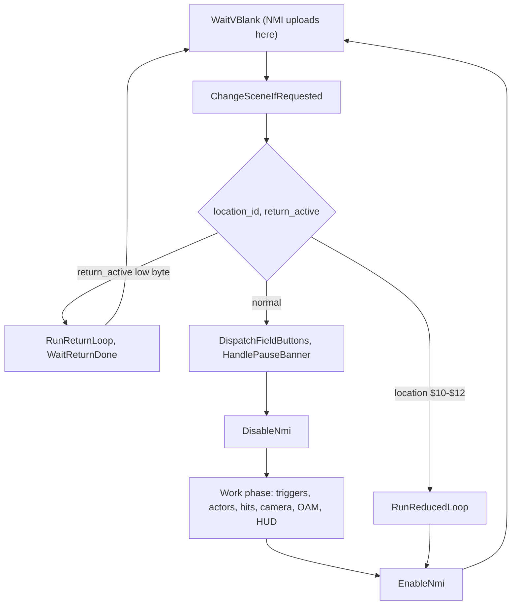
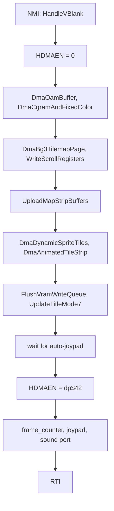

# Boot, NMI and Main Loop — `engine_boot_main_loop.asm`

*Part of the [Soul Blazer Code Documentation](README.md)*

> How the game starts, how one frame is built while the NMI is off and shown while the NMI is on, and what the vblank handler uploads and reads every frame.

**Source:**
[`engine_boot_main_loop.asm`](../../extracted/system/engine_boot_main_loop.asm) ·
[`engine_vblank_nmi.asm`](../../extracted/system/engine_vblank_nmi.asm) ·
[`lib_system_helpers.asm`](../../extracted/library/lib_system_helpers.asm) ·
[`lib_main_loop_helpers.asm`](../../extracted/library/lib_main_loop_helpers.asm) ·
[`lib_scene_asset_loader.asm`](../../extracted/library/lib_scene_asset_loader.asm) (`InitHardwareAndClearWram`) ·
[`lib_boot_and_scene_init.asm`](../../extracted/library/lib_boot_and_scene_init.asm) (`InitFixedState`, `ClearBg3Buffer`, `ChangeSceneIfRequested`) ·
[`lib_map_scroll_and_redraw.asm`](../../extracted/library/lib_map_scroll_and_redraw.asm) (`UploadScrollStrips`) ·
[`cop_dispatch.asm`](../../extracted/system/cop_dispatch.asm) (`HandleBrk`)

---

## Overview

Soul Blazer is built around one loop, `RunMainLoop`, and one interrupt, `HandleVBlank`. A frame has two halves. The **upload half** runs with NMI on: `WaitVBlank` returns once the NMI has copied everything the previous frame prepared (sprites, palette, tilemap, scroll, animated tiles) into OAM, CGRAM and VRAM, and has read the joypad. The **work half** runs with NMI off (`DisableNmi` … `EnableNmi`): tile triggers, actors, hit tests, camera, sprite building, HUD. The work half never touches VRAM; it only fills WRAM staging buffers and queues (`oam_buffer`, the palette at `$7F:0000`, `vram_write_queue`, the strip records), and the next NMI transfers them. What the player sees is therefore always one work phase behind the logic, and, by static reading, a work phase that is still running when vblank ends costs a whole extra frame, because `EnableNmi` discards the pending vblank flag (`RDNMI` read) and the loop waits for the next one.

Other routines run whole frames from inside a script, a menu, the text renderer or the scene loader: `RunSubFrameLoader`, `RunSubFrameMapSweep` and `RunSubFrame`. They repeat the work half, call `WaitVBlank` once, and mark the frame with `subframe_active` so that only the actors that belong to the modal routine run.

The reset code is `BootGame`; there is no separate title loop. The title, the file select and the ending are scenes with actors that run inside the same loop (the title is scene `$0A` of area 0, see `gv_front_end`), and the loop variants `RunReducedLoop` and `RunReturnLoop` exist for locations that need less of the frame.

Code addresses below are source-ROM addresses (LoROM: bank = file offset ÷ `$8000`, address = `$8000` + the offset inside that bank); the rebuilt ROM places the blocks elsewhere (`rebuilt/layout.json`). WRAM addresses are the game's own.

**Related:** [wram-memory-map.md](../wram-memory-map.md) · [areas-and-scenes.md](../areas-and-scenes.md) · [cop/index.md](../cop/index.md) · [audio/spc-engine.md](../audio/spc-engine.md)

---

## Memory Map

| Address | Name | Description |
|---------|------|-------------|
| `$00:8000` | `BootGame` | Reset vector: native mode, D = 0, S = `$1FFF`, DBR = `$01`, hardware init, first scene load, falls into `RunMainLoop`. |
| `$00:8032` | `RunMainLoop` | One game frame: `WaitVBlank`, scene change, menu and pause with NMI on, then the work phase with NMI off. |
| `$00:808F` | `RunReducedLoop` | Frame for `location_id` `$10`–`$12`: actors, sort and OAM only. |
| `$00:80AA` | `RunReturnLoop` | Frame while `return_active` is non-zero: actors, OAM and HUD, Start/Select/X cleared. |
| `$00:80DD` | `WaitReturnDone` | Runs `RunSubFrame` until the return flag clears, heals, waits `$78` frames, warps to the return point. |
| `$00:8127` | `RunSubFrameLoader` | One whole frame for the scene loader (NMI on exit, camera aimed at the player, HUD skipped while `scene_loading`). |
| `$00:8173` | `RunSubFrameMapSweep` | One whole frame for the lair release code, plus `StepSweepRedraw`. |
| `$00:81BE` | `RunSubFrame` | One whole frame for text and return waits. |
| `$00:8342` | `HandleVBlank` | NMI handler: all uploads, auto-joypad wait, `HDMAEN`, `frame_counter`, joypad, sound port. |
| `$00:8371` | `WaitAutoJoypad` | Spin on `HVBJOY` bit 0 until the auto-joypad read has finished. |
| `$00:83AA` | `StoreJoyPressed` | Join point: stores the final `joy_pressed`, then the sound-port decision. |
| `$00:83BC` | `WriteSoundPort` | Writes the sound word (or 0 on odd frames) to `APUIO2` and returns with `RTI`. |
| `$00:83C5` | `DmaOamBuffer` | Channel 0: 544 bytes from `oam_buffer` (`$0486`) to OAM. |
| `$00:83EA` | `DmaCgramAndFixedColor` | Channel 1: 512 bytes from `$7F:0000` to CGRAM, then three `COLDATA` writes. |
| `$00:8421` | `DmaBg3TilemapPage` | Channel 2: one 2048-byte BG3 tilemap page when `vram_upload_flags` asks. |
| `$00:846E` | `WriteScrollRegisters` | BG1, BG2 and BG3 scroll registers (10-bit, two writes each). |
| `$00:84AB` | `WriteScrollPair` | One horizontal and vertical scroll pair with the high-byte mask `$03`. |
| `$00:84C8` | `UploadMapStripBuffers` | Two calls of `UploadScrollStrips` for the BG1 and BG2 strip records. |
| `$00:84E5` | `DmaDynamicSpriteTiles` | Two-pass copy of the dynamic sprite tiles to VRAM `$2000` and `$2100`. |
| `$00:8524` | `DmaSpriteTileRecords` | One `$40`-byte DMA per `tile_dma_list` record. |
| `$00:8543` | `DmaAnimatedTileStrip` | One animated background strip: `$40` bytes to `vram_strip_dest`, `$40` bytes `$100` words higher. |
| `$00:858B` | `FlushVramWriteQueue` | Writes the `(VRAM address, data)` pairs of `vram_write_queue` with the stack pointer as queue cursor. |
| `$00:85A5` | `HandleIrq` | IRQ vector: a bare `RTI`. |
| `$00:D5FC` | `HandleBrk` | BRK vector: stores the sound request that the NMI sends. |
| `$02:857D` | `UploadScrollStrips` | Uploads one column record and one row record of map strips (4 × 64 bytes each). |
| `$02:985E` | `ResetHdmaQueue` | Per-frame reset of the HDMA channel queue (`dp$42`, `dp$44`, `dp$46`, `dp$48`). |
| `$02:B176` | `EnableDisplayAndNmi` | Waits for vblank, `NMITIMEN = $A1`, `INIDISP = $0F` (used by the equipment menu). |
| `$02:B18C` | `ForceBlankNmiOff` | Waits for vblank, then forced blank and NMI off (scene change). |
| `$02:B1A2` | `EnableNmi` | Reads `RDNMI`, `NMITIMEN = $A1`, `nmi_enabled` + 1. |
| `$02:B1AE` | `DisableNmi` | `NMITIMEN = $01`, `nmi_enabled` = 0. |
| `$02:B1B7` | `WaitVBlank` | The only frame wait; the NMI runs inside it when enabled. |
| `$02:B9AC` | `InitHardwareAndClearWram` | PPU, DMA and math registers to a known state; clears WRAM except the stack page. |
| `$02:BADA` | `ApplyBootPpuLayout` | Default Mode 1 layout used until the first scene profile. |
| `$04:F223` | `QueueAnimatedTileStrip` | Per-frame request of one animated background strip. |
| `$04:F258` | `AnimatedStripVramDests` | The four strip destinations `$2060`, `$2080`, `$20A0`, `$20C0`. |
| `$04:F572` | `HandlePauseBanner` | Start pause with the location name and the monster-lair count. |
| `$04:F5DC` | `WaitFrameForStart` | One frame of the pause wait with the frame counter held still. |
| `$04:F6EE` | `ClearBg3Buffer` | Fills the BG3 tilemap staging buffer with the blank word. |
| `$04:F781` | `ChangeSceneIfRequested` | Scene change when `scene_next` is non-zero (fade out, rebuild, fade in). |
| `$04:F912` | `InitFixedState` | Constant engine variables and the starting state of a new game. |

### State the loop reads and writes

| Address | Name | Role in this document |
|---------|------|-----------------------|
| `$0312` | `frame_counter` | Incremented by the NMI; bit 0 selects the sound-port write, low bits select the animated strip. |
| `$0318` / `$0319` | `scene_next` / `area_next` | Scene change request; boot sets `scene_next = $000C`. |
| `$0322`, `$0326`, `$032A` | `joy_pressed`, `joy_block_mask`, `joy_release_latch` | NMI-built input state. |
| `$0468` | `joy_override` | Non-zero: scripted input replaces the pad. |
| `$0398` | `sound_request` | Word filled by `HandleBrk`, sent by the NMI. |
| `$03A2` | `pause_latch` | Start-pause state of `HandlePauseBanner`. |
| `$03A6` | `subframe_active` | 1 while a sub-frame work phase runs. |
| `$03B6`, `$1A06` | `tile_dma_pending`, `tile_dma_list` | Dynamic sprite tile request. |
| `$03B8` | `vram_upload_flags` | Selects the BG3 page the NMI uploads. |
| `$03D2` | `nmi_enabled` | Non-zero while NMI is on. |
| `$03DB` | `bg_scroll_swap` | Swaps the BG1 and BG2 scroll pairs. |
| `$03DD`, `$03DF`, `$03E1` | `vram_strip_src`, `vram_strip_dest`, `vram_strip_pending` | Animated strip request. |
| `$03FB` | `return_active` | Return-point warp state. |
| `$0462` | `scene_loading` | Non-zero during the iris transition of the loader. |
| `$1C6A` | `location_id` | Selects the loop variant. |
| `$1C7B` | `vram_write_queue` | `(VRAM address, data)` word pairs. |
| `dp$42`, `dp$44`, `dp$46`, `dp$48` | HDMA queue | Pending channel mask, next channel bit, its register offset, unused `$6000`. |
| `$0486` | `oam_buffer` | 544 bytes for `DmaOamBuffer`. |
| `$7F:0000`, `$7F:0200` | palette, `coldata_buffer` | 512 palette bytes; three `COLDATA` bytes. |
| `$7F:7000`, `$7F:7800` | BG3 tilemap pages | Staging pages for `DmaBg3TilemapPage`. |
| `$3000`, `$3102`, `$3204`, `$3306` | strip records | BG1 column and row, BG2 column and row. |

---

## Boot

### BootGame

The reset vector: it runs once at power-on or reset and never returns. It leaves emulation mode (`SEI`, `CLC`, `XCE`), sets D = 0, S = `$1FFF` and DBR = `$01`, then calls `InitHardwareAndClearWram`, `ApplyBootPpuLayout`, `InitFixedState` and `ClearBg3Buffer`. It then stores `$000C` in `scene_next` (scene `$0C` of area 0, the boot scene of `gv_front_end`), calls `EnableNmi` and `ChangeSceneIfRequested`, and falls into `RunMainLoop`. The player sees a black screen until the boot scene has loaded, then the title (the boot scene prints `TileBlockText`, uploads the SPC engine and starts scene `$0A`, per `gv_front_end`). `BootGame` is a separate routine because the order is fixed: the PPU must be quiet before the layout is written, and the engine variables must exist before the first scene is built.
### InitHardwareAndClearWram

Called once from `BootGame`. The SNES powers up with undefined PPU and WRAM contents, so this routine writes `INIDISP = $80` (forced blank), zeroes the PPU layout and scroll registers, resets the Mode 7 matrix to identity, sets `VMAIN = $80`, `CGWSEL = $02`, `COLDATA = $E0`, `NMITIMEN = 0`, clears the DMA, HDMA, multiplier and divider registers, and clears WRAM bank `$7E` except the stack page `$1F00`–`$1FFF`, and all of bank `$7F`. The player sees nothing: the screen stays blanked. It needs DBR to map WRAM at `$0000`, which is why `BootGame` sets DBR = `$01` before calling it. The direct page lives inside the cleared area, so the routine writes the asset-list pointer (`dp$2F`–`dp$31`) only after the clear.

### ApplyBootPpuLayout

Called once from `BootGame` after the register reset. It writes `OBJSEL = $01`, `BGMODE = $09` (Mode 1 with BG3 priority), `BG1SC = $63`, `BG2SC = $73`, `BG3SC = $58`, `BG12NBA = 0`, `BG34NBA = 4`, windows 1 on every layer over columns 0–255, `CGWSEL = $82` and `TM = $07`. The screen is still in forced blank, so the player sees nothing yet; the layout is the one the first scenes expect, and it only matters until `ApplySceneProfile` writes the real values for the first scene. It is separate from the register reset because the reset zeroes every layer and this routine is the one place that names the default layout. `OBJSEL` is written twice in the whole program, both at boot (0 in `InitHardwareAndClearWram`, `$01` here), so the sprite character base this value selects stays in force for the whole session (OQ-I043-4).

### InitFixedState and ClearBg3Buffer

`InitFixedState` runs once from `BootGame`, before the first scene loads. It sets the constants the engine never changes (the BG map bases and tilemap VRAM addresses, the four strip record pointers `$3000`, `$3102`, `$3204`, `$3306` that `UploadMapStripBuffers` hands to the NMI, and the bank bytes `dp$34`, `dp$37` = `$7E` that complete them) and the state of a new game: HP 8, level 1, the lair states. A loaded save overwrites the player values later. `ClearBg3Buffer` fills the BG3 staging buffer at `$7F:7000` with the blank word `$2000` (priority bit, tile 0); it sets no upload flag, so nothing appears until a text routine prints and flags a page. It is also called about 25 times by the front-end sequence, the iris and `InitSceneState` to erase a text screen.

---

## The frame

### RunMainLoop

Entered from `BootGame`, `RunReducedLoop` and `WaitReturnDone`; one pass is one game frame. The player sees Blazer move, enemies act and the HUD update at the rate of this loop.

| Step | Routine | NMI |
|------|---------|-----|
| 1 | `WaitVBlank`: the NMI runs inside this wait and uploads the previous frame | on |
| 2 | `ChangeSceneIfRequested`: acts only when the low byte of `scene_next` is non-zero | on |
| 3 | Variant test: `location_id` − `$10` below 3 goes to `RunReducedLoop`; a non-zero low byte of `return_active` goes to `RunReturnLoop` | on |
| 4 | `DispatchFieldButtons` (Select or X: equipment menu; B: talk to the actor in front; A without a direction: status and souls screen) and `HandlePauseBanner` (Start) | on |
| 5 | `DisableNmi` | off |
| 6 | `CheckPlayerTileTriggers` (lair switch, pressure plate, chest and exit regions), `ResetHdmaQueue` | off |
| 7 | `RunActors`, `CullAndSortActors`, `DetectHitSourceCollisions`, `DetectPlayerContact`, `CheckPlayerDeath` (death check and automatic Medical Herb) | off |
| 8 | `ScrollCameraByDelta`, `BuildScrollStrips`, `BuildOamFromActors` | off |
| 9 | `UpdateHud`, `QueueBg3ScrollHdma`, `QueueAnimatedTileStrip`, `EnableNmi`, back to step 1 | off, then on |

The menu and the pause run before `DisableNmi` because they print text and wait for vblanks themselves, so the NMI has to stay on for them. Everything after `DisableNmi` must not be interrupted: `CullAndSortActors` and `BuildOamFromActors` move the stack pointer while they work, and an NMI in that window would push its registers onto that moved stack (the reason given at `DisableNmi`; whether every caller keeps this guarantee is OQ-I005-20). `CheckPlayerTileTriggers` runs before the actors, as its call-site comment says, so a plate, chest or exit region under the player is already evaluated when the actors run. `ResetHdmaQueue` runs before `RunActors` because actors queue their HDMA channels while they run (`QueueHdmaDirect`, `QueueHdmaIndirect`).

Steps 2 and 4 can take many frames: the scene loader runs its own frames through `RunSubFrameLoader`, and the pause, the menus and the dialogue call `WaitVBlank` or a sub-frame runner themselves. The loop is paused simply by not returning to it.

### RunReducedLoop

The frame for `location_id` `$10`, `$11` and `$12`. `RunMainLoop` branches here from step 3, so none of the player-facing work runs: no field buttons, no pause, no tile triggers, no hit tests, no HUD, no scroll update, no animated strip. The frame is `DisableNmi`, `ResetHdmaQueue`, `RunActors`, `CullAndSortActors`, `BuildOamFromActors`, `EnableNmi` and a jump back. `UpdateHud` and `QueueAnimatedTileStrip` also skip these locations when called from other loops (`UpdateHud` skips locations `$0F`–`$12`; `QueueAnimatedTileStrip` skips `$0F`–`$12` by the same test). By static reading the three locations are the front-end scenes of `gv_front_end`: the title (area 0 scene `$0A`) is `$10` (the only location in which `UpdateTitleMode7` acts in the NMI), the ending (scene `$0B`) is `$11` and the boot scene (`$0C`) is `$12`. The reason for the reduced frame is that these scenes have no player-driven combat or menu. The runtime check of the location numbers is OQ-I043-2.

### RunReturnLoop and WaitReturnDone

`RunMainLoop` branches to `RunReturnLoop` while the low byte of `return_active` is non-zero. `ReleaseLairAtSwitch` increments it when the freed person's home is in another location, and actor scripts of worlds 2 and 3 set it (OQ-I005-17). While it runs the world keeps animating without the player: each frame is `RunLairReleaseOnReturn`, `ResetHdmaQueue`, `RunActors`, `CullAndSortActors`, `BuildOamFromActors`, `UpdateHud`, `QueueBg3ScrollHdma` and `QueueAnimatedTileStrip`, and `STZ joy_pressed+1` clears Start, Select and X first so neither the pause nor the menu can open. It has no hit tests and no scroll update. After one frame (`EnableNmi`, `WaitVBlank`, `DisableNmi`) it enters `WaitReturnDone`, which calls `RunSubFrame` while bit 7 of the word at `return_active` is set. When the flag clears it adds `player_max_hp` / 8 to `heal_pending` (three `LSR`; `UpdateHud` plays the refill), waits `$78` frames with `WaitFrames`, sets `transition_type = $80` and copies `return_area`, `return_scene`, `return_x` and `return_y` into `area_next`, `scene_next`, `warp_dest_x` and `warp_dest_y`, then `EnableNmi` and a jump to `RunMainLoop`, where `ChangeSceneIfRequested` performs the warp. The loop exists to move the player back to a saved place with a short heal while the world keeps running.

### Sub-frame runners

`RunSubFrameLoader`, `RunSubFrameMapSweep` and `RunSubFrame` each run one complete work phase, one `WaitVBlank` and return, so a routine that must wait several frames (the scene loader, the lair release scenes, the text renderer, the return wait) can keep the game animating instead of returning to `RunMainLoop`. All three increment `subframe_active` for the work phase and clear it with `STZ` at the end; `RunActorList` then runs only actors whose `$16` bit `$0010` is set, so a modal routine keeps its own actors alive while the rest of the game stands still. The player actor code and `w2_effect_player_overlay` also read `subframe_active`. None of the three calls `CheckPlayerTileTriggers`, the hit tests, `CheckPlayerDeath` or the field buttons, so combat and menus cannot start inside a sub-frame. They differ only in setup:

| | `RunSubFrameLoader` | `RunSubFrameMapSweep` | `RunSubFrame` |
|---|---|---|---|
| Call sites | 12 in the scene loader, 1 in the menu code | 8 in the lair release code (`TriggerVariantPlate` 1, `ReleaseLairAtSwitch` 4, `PlayLairReleaseScene` 3) | 4 (`WaitReturnDone`, `WaitFrames`, `RunFrameReadButtons`, `ScrollStaffRollText`) |
| NMI on entry | any; it calls `DisableNmi` itself | must be off (OQ-I005-20) | must be off (OQ-I005-20) |
| NMI on exit | on (`EnableNmi`, `WaitVBlank`, no `DisableNmi`) | off (`DisableNmi` after the wait) | off |
| DBR | kept | set to `$01`, restored | set to `$01`, restored |
| Camera | `AimCameraAtPlayer`, `ScrollCameraByDelta`, `BuildScrollStrips` | `ScrollCameraByDelta`, `BuildScrollStrips` | same as map sweep |
| HUD | `UpdateHud` and `QueueBg3ScrollHdma` skipped while `scene_loading` is non-zero | always | always |
| Extra | none | `StepSweepRedraw` after `QueueAnimatedTileStrip` | none |

`scene_loading` is set by the iris transition in the scene loader, so `RunSubFrameLoader` draws no HUD while the iris runs. It also clears `subframe_active` before `EnableNmi`, so the flag is never set while the NMI uploads; the other two clear it after `DisableNmi`. All three save and restore B, A (both bytes), X and Y (`PHB`, `PHA`, `XBA`, `PHA`, `PHX`, `PHY`), so a caller's registers survive the frame.

### HandlePauseBanner and WaitFrameForStart

`HandlePauseBanner` is called once per frame from `RunMainLoop` (step 4, NMI on). Press Start and the game freezes, the name of the location is printed on the text layer and, in scenes with combat (`no_combat_scene` clear), the number of monster lairs left (`lairs_left`, converted by `ByteToPackedBcd` and printed by `LairCounterText`); press Start again and the text disappears and play resumes. Holding A (`JOY1L` bit 7) when Start is pressed pauses without the text (OQ-I013-7). The walkthrough describes the lair count as "found by pressing the Start Button". The pause runs inside the routine instead of in a menu: it sets `pause_latch`, writes `$F2` to `APUIO0` (the SPC freezes the sequence while the port holds it and resumes on the `$01` below, see [spc-interface.md](spc-interface.md)), sets `vram_upload_flags = 1` so `DmaBg3TilemapPage` shows the text, and loops in `WaitFrameForStart` first until Start is released and then until it is pressed again, prints `PauseCloseText` to erase the text, writes `$01` to `APUIO0` and returns. `pause_latch` stays 1 after the resume until Start is let go, so the Start that ended the pause does not begin a new one; while it is 1 the routine only watches for the release.

`WaitFrameForStart` decrements `frame_counter` before `WaitVBlank`. The NMI increments it every frame, so the net change is 0 and the animation phases that derive from it (`QueueAnimatedTileStrip`, the sound-port parity) stand still during the pause. It returns with Z clear while Start is down, which is what the two loops of `HandlePauseBanner` test.

### QueueAnimatedTileStrip

Called at the end of the work phase of `RunMainLoop`, `RunReturnLoop` and the three sub-frame runners (five call sites in `engine_boot_main_loop`). Each frame it prepares one animated background strip for the NMI: `vram_strip_src` = `$1000 + (frame_counter and $1F) × $80`, a source frame in the buffer at `$7F:1000` (32 frames of `$80` bytes), `vram_strip_dest` = `AnimatedStripVramDests[frame_counter and 3]` and an increment of `vram_strip_pending`. So each of the four VRAM slots (`$2060`, `$2080`, `$20A0`, `$20C0`, each a 2 × 2 block of 4bpp tiles, the second half one tile row lower) is refreshed every fourth frame and cycles through 8 of the 32 frames. The player sees animated background tiles; which tiles the maps use for it is OQ-I013-14. It is split from the NMI because the work phase may not touch VRAM; the request costs a few stores and `DmaAnimatedTileStrip` does the copy. Locations `$0F`–`$12` are skipped (`location_id` − `$0F` below 4), the same locations that have no HUD. It has no loop guard: it overwrites the three variables every call, so several calls in one frame change nothing.

### ResetHdmaQueue

Called once at the start of every work phase: six call sites, all in `engine_boot_main_loop` (`RunMainLoop`, `RunReducedLoop`, `RunReturnLoop` and the three sub-frame runners). It sets `dp$42` (the pending HDMA channel mask the NMI copies to `HDMAEN`) to 0, `dp$44` to `$10` (the bit of channel 4), `dp$46` to `$40` (the offset of channel 4's registers, `$4340`) and `dp$48` to `$6000` (written, never read). HDMA is a per-frame effect: scanline effects (title split, window circles, gradients) stop unless an actor queues its channel again in the same frame (`QueueHdmaDirect`, `QueueHdmaIndirect`, channels 4–7; channels 0–2 belong to the NMI). That is why the reset sits at the start of the work phase and not in the NMI.

---

## NMI switches

### EnableNmi, DisableNmi and WaitVBlank

`DisableNmi` writes `NMITIMEN = $01` (NMI off, auto-joypad on) and zeroes `nmi_enabled`; `EnableNmi` first reads `RDNMI` so a vblank flag that is still set does not fire at once, writes `NMITIMEN = $A1` and increments `nmi_enabled`. `WaitVBlank` reads `RDNMI` once to discard an old flag and then spins until bit 7 is set; when NMI is on, `HandleVBlank` runs inside that spin. It is the only frame wait in the game; code that polls `RDNMI` itself does not exist. The player sees nothing directly, but by static reading the pairing sets the frame rate: a work phase that outlasts vblank has its pending vblank flag discarded by the `RDNMI` read in `EnableNmi`, so the next upload waits for the following vblank. `nmi_enabled` is read by the text renderer's input wait (`WaitFrameReadButtons`): with NMI on it waits for the vblank, with NMI off it runs a whole `RunSubFrame` instead. The V-IRQ bit in `$A1` never fires because the I flag stays set (see `HandleIrq`).

### ForceBlankNmiOff and EnableDisplayAndNmi

A pair for rebuilding VRAM. `ForceBlankNmiOff` waits for a vblank, then sets `NMITIMEN = $01`, `INIDISP = $80` and `nmi_enabled = 0`: the scene-change code calls it before it rewrites VRAM, because VRAM can be written freely only in forced blank and an NMI during the rewrite would run the frame uploads. The player sees the screen go black. `EnableDisplayAndNmi` is the counterpart used by the equipment menu after its first page is printed: it waits for a vblank, writes `NMITIMEN = $A1` and `INIDISP = $0F` (full brightness) and increments `nmi_enabled`, so the menu appears at once.

---

## The NMI

### HandleVBlank

The NMI vector, run at every vblank while NMI is enabled. It saves P, B, A, X and Y (`PHP`, `PHB`, `PHA`, `PHX`, `PHY`), sets M = 1, X = 16-bit, DBR = `$01` and clears the decimal flag (`CLD`); it never sets D (no `TCD`), so it relies on D = 0 for its direct-page stores (`dp$32`–`dp$37`, `dp$42`; OQ-I043-3). It then runs this order of work, each step in its own section below:

1. `STZ HDMAEN`: HDMA off while the transfers run.
2. `DmaOamBuffer`, `DmaCgramAndFixedColor`, `DmaBg3TilemapPage`.
3. `WriteScrollRegisters`, `UploadMapStripBuffers`.
4. `DmaDynamicSpriteTiles`, `DmaAnimatedTileStrip`, `FlushVramWriteQueue`.
5. `engine_title_file_select.UpdateTitleMode7`: acts only when `location_id` is `$10`; it writes the Mode 7 matrix and centre of the title.
6. `WaitAutoJoypad`, then `HDMAEN = dp$42`.
7. `INC frame_counter`, joypad, sound port, restore registers, `RTI`.

The DMA uses channel 0 for OAM, channel 1 for CGRAM and channel 2 for every VRAM transfer. Everything graphical happens first, while the beam is in vblank; the joypad comes last because the auto-joypad read finishes some scanlines into vblank. The player sees every change of the frame appear here: sprites, palette and screen tint, text, scroll, animated tiles. Whether the whole batch always fits in vblank is OQ-I043-5.

### Joypad and sound in HandleVBlank

After `WaitAutoJoypad` (spin on `HVBJOY` bit 0) and `HDMAEN = dp$42`, `frame_counter` is incremented and the pad is read. `JOY1L` is read as one word; the X button (bit 6) is copied to the Select position (bit 13), so X and Select act as one button. The routine then builds `joy_pressed`:

- Raw buttons minus the bits of `joy_block_mask` (scripts block buttons with `TSB` and `TRB` on it).
- `joy_release_latch` gets a bit for every button seen up in this frame; the result is ANDed with the latch, so a button counts only while its latch bit is set. The users (player code, menus, level up) clear the latch bit with `TRB` after using a press, which makes a held button act once. Scene init sets the latch to `$FFFF`.
- `joy_override` non-zero (read first) skips all of this: `StoreJoyPressed` stores the override word as `joy_pressed` and leaves the latch alone. The Lisa and Turbo scene uses it for scripted input.

The sound request follows: `frame_counter` is already incremented, so on even frames `WriteSoundPort` sends `sound_request` to `APUIO2` and `STZ` clears it, on odd frames it sends 0. `HandleBrk` is the producer: `BRK #n` with bit 6 of n clear stores `n` in `sound_request`, with bit 6 set stores `n and $BF` in `$0399` (the high byte of the word: the request for sound voice 8, the low byte is voice 7); it overwrites, so two requests in one frame lose the first. The player hears the sound one or two frames after the BRK. The SPC keeps no previous value of the port, so the zero is what lets the same sound be requested again (the static half of OQ-I043-1); whether one pulse starts the sound once or twice is OQ-I056-1. The SPC's side of the ports is in [spc-interface.md](spc-interface.md) and [audio/spc-engine.md](../audio/spc-engine.md).

### DmaOamBuffer

Every NMI. Sets `OAMADD = 0` and copies the 544 bytes of `oam_buffer` (`$0486`; 512 bytes of low table and 32 bytes of high table) to OAM on channel 0 (`BBAD0 = $04`). The player sees the sprites that `BuildOamFromActors` built in the work phase. OAM can only be written in vblank, which is why the buffer exists.

### DmaCgramAndFixedColor

Every NMI. Copies the 512-byte palette buffer at `$7F:0000` to CGRAM (`CGADD = 0`, channel 1, `BBAD1 = $22`), then writes the three bytes at `$7F:0200`, `$7F:0201` and `$7F:0202` to `COLDATA`, so each is a raw `COLDATA` byte with its own channel-select bits. The player sees palette changes and the screen tint set by the fixed colour (the title and prologue colour ramps of `gv_front_end` write `coldata_buffer`). The work phase only edits the buffers.

### DmaBg3TilemapPage

Every NMI, but it returns at once when the high byte of the first word of `vram_write_queue` (`$1C7C`) is non-zero or `vram_upload_flags` is 0 (the first test is OQ-I005-19). With bit 1 clear it copies `$7F:7000` to VRAM `$5800` and clears all flags; with bit 1 set it copies `$7F:7800` to `$5C00` and clears only bit 1. Each copy is 2048 bytes on channel 2. The player sees the dialogue box, the pause text or the HUD appear: the text renderer draws into a staging page and flags it.
### WriteScrollRegisters and WriteScrollPair

Every NMI. `WriteScrollRegisters` writes BG3 from the low bytes of `scroll_bg3_x` and `scroll_bg3_y` (high byte 0), then calls `WriteScrollPair` for BG1 and BG2. `WriteScrollPair` writes each value as two bytes to the same register: the low byte, then the high byte masked with 3, so scroll values are 10 bits. While `bg_scroll_swap` is non-zero BG1 takes the BG2 scroll pair and BG2 the BG1 pair (the offsets 4 and 0 swap). The player sees the camera; the registers are written inside vblank so a frame never mixes two positions.

### UploadMapStripBuffers

Every NMI. The map is bigger than VRAM, so the edge strips revealed by scrolling are streamed in: `BuildScrollStrips` fills the strip records in the work phase and this routine uploads them. It sets `dp$32` and `dp$35` to the record pointers `$3000` and `$3102` (BG1 column and row), calls `UploadScrollStrips`, then repeats with `$3204` and `$3306` (BG2). The bank bytes `dp$34` and `dp$37` are not set here; `InitFixedState` set them to `$7E` once. `UploadScrollStrips` uploads each non-empty record (first word, the VRAM address, not 0) as four 64-byte blocks on channel 2 from bank `$7E` (a column record with `VMAIN = $81`, a row record with `VMAIN = $80`) and zeroes the first word of the record. It writes `VMAIN = $81` and later `VMAIN = $80` before it tests whether each record is empty, so every call leaves `VMAIN = $80`. This is the only `VMAIN` write in the NMI, and the later transfers of the same NMI (`DmaDynamicSpriteTiles`, `DmaAnimatedTileStrip`, `FlushVramWriteQueue`) and the first one of the next NMI (`DmaBg3TilemapPage`) run with that value. The player sees the map drawing in along the edge of the screen as Blazer walks.

### DmaDynamicSpriteTiles and DmaSpriteTileRecords

Runs in the NMI when `tile_dma_pending` is non-zero (set by `BuildActorSprites`). Actors flagged with `$1A` bit `$8000` (only the hero, set by `CopA9_SetDynamicTileSource` in `InitPlayerActor`, see [sprites-oam-animation.md](sprites-oam-animation.md)) draw their frames from tiles that are copied into VRAM every frame. `tile_dma_list` (`$1A06`) holds 3-byte records (source word, bank byte), 0 ends. Pass 1 sets `VMADD = $2000` and calls `DmaSpriteTileRecords`, which copies `$40` bytes per record (two 4bpp tiles, `$20` words of VRAM) on channel 2; the routine then adds `$0200` to the high byte of every record's source (two `INC`) and pass 2 repeats from `VMADD = $2100`, the bottom tile row of 16 × 16 sprites. `tile_dma_pending` is cleared at the end. There is no count limit on the list (OQ-I005-6), and the destinations of `DmaAnimatedTileStrip` (`$2060`–`$20C0` and `$100` words above each) lie inside the range that this routine fills record by record from `$2000` and `$2100` (OQ-I043-4). `DmaSpriteTileRecords` exists as a separate loop because both passes run it unchanged.

### DmaAnimatedTileStrip

Runs in the NMI when `vram_strip_pending` is non-zero, which `QueueAnimatedTileStrip` sets once per frame outside locations `$0F`–`$12`. It copies `$40` bytes from `vram_strip_src` (bank `$7F`) to `vram_strip_dest`, then `$40` bytes to the same address with the high byte of `VMADD` incremented (256 words higher), and clears `vram_strip_pending`. The player sees four background tile slots cycling, each refreshed every fourth frame. The work phase only queues the request, so it does not touch VRAM.

### FlushVramWriteQueue

The last transfer of the NMI. It reads `vram_write_queue` (`$1C7B`) as pairs of words (VRAM address, data), writes each pair with `VMADDL` and `VMDATAL`, and stops at an address of 0, then zeroes the first word of the queue. The player sees single tilemap or tile edits, such as the HUD digits and small texts. The work phase can request a few VRAM writes without setting up a DMA. It reads the queue with `PLA`: it moves the stack pointer to `$1C7A` (just below the queue) with `TCS`, restores it with `TXS` and returns with M = 8. This is safe inside the NMI because nothing interrupts the NMI.

---

## Interrupt vectors

### HandleIrq and HandleBrk

`HandleIrq` is a bare `RTI`. `BootGame` executes `SEI` and no code in `extracted/` clears the I flag, so the IRQ stays masked; `NMITIMEN = $A1` also sets a V-IRQ mode bit that therefore never fires. `HandleBrk` is the native-mode BRK vector and the engine's way to ask for a sound: 289 `BRK #n` sites (sword swings, spawns, pickups, deaths, scripts) ask for sound `n` with a two-byte instruction. It reads the signature byte after the BRK through `dp$3B`–`dp$3D` and fills `sound_request` or `$0399` as described in the NMI section; `HandleVBlank` forwards it to `APUIO2`.

---

## Walkthrough cross-check

| Game term in this document | Walkthrough | Result |
|---|---|---|
| Start press at the title leads to the file select | `01-in-the-beginning.md`: "you can press the Start Button to reach the file selection menu" | Consistent with `gv_obj_title_start_button_006B61` (`file_select_request`) per `gv_front_end`; the file select itself is in [save-and-load.md](save-and-load.md). |
| Start shows the number of monster lairs | `01-in-the-beginning.md`: "the number of which (in the area) can be found by pressing the Start Button" | Consistent with `HandlePauseBanner` (`lairs_left`, `LairCounterText`). |
| B speaks to a person | `01-in-the-beginning.md`: "speak with him (B Button)" | Consistent with `DispatchFieldButtons` (B: talk). |
| Medical Herb is used automatically at 0 HP | `items.md`: "Heals HP fully if it reaches zero" | Consistent with `CheckPlayerDeath`. |
| Monster lair, lair switch | `01-in-the-beginning.md`: "Monster Lair", "green switch" | The code names (`lairs_left`, `ReleaseLairAtSwitch`) use the same terms. |

No mismatch between the walkthrough and the ROM text was found (no DISCREPANCY).

---

## Open questions

The questions this document could not settle are in `plans/extracted-audit/questions/I043_questions.md`: OQ-I043-1 (the even/odd sound-port protocol), OQ-I043-2 (runtime `location_id` of the front-end scenes), OQ-I043-3 (D at NMI entry), OQ-I043-4 (VRAM `$2000`–`$21FF` shared by sprite tiles and animated strips) and OQ-I043-5 (worst-case NMI length). Earlier questions this document relies on: OQ-I005-6, OQ-I005-17, OQ-I005-19, OQ-I005-20, OQ-I013-6, OQ-I013-7, OQ-I013-14, OQ-I024-1.

---

## See Also

- [wram-memory-map.md](../wram-memory-map.md): the WRAM variables of this document in the full map.
- [areas-and-scenes.md](../areas-and-scenes.md): scene `$0A`, `$0B`, `$0C` and the other scenes of area 0.
- [cop/index.md](../cop/index.md): the COP dispatch that actors use while `RunActors` runs.
- [audio/spc-engine.md](../audio/spc-engine.md): the SPC side of `APUIO0` and `APUIO2`.
- [spc-interface.md](spc-interface.md): the CPU side of all four ports: the command channel, the `BRK` sound word after `WriteSoundPort`, the uploads and the music changes.
- [walkthrough/README.md](../walkthrough/README.md) and [walkthrough/01-in-the-beginning.md](../walkthrough/01-in-the-beginning.md): game terms for the first area.
- [actor-system.md](actor-system.md): the pool, the actor list, `RunActors`, `CullAndSortActors` and how actors are created and removed.
- [scene-area-warp-loading.md](scene-area-warp-loading.md): `ChangeSceneIfRequested`, the transitions, `InitSceneState`, the asset list, the placement and exit tables and the return trip.
- [player.md](player.md): how the hero reads `joy_pressed` and `joy_release_latch` (`FilterPlayerInput`, `EndSpellActor`) and what `CheckPlayerDeath` does after the frame's damage.
- [sprites-oam-animation.md](sprites-oam-animation.md): what `BuildOamFromActors` builds, the hero's tile records behind `DmaDynamicSpriteTiles`, and which VRAM tiles the sprite frames name (the strip slots of `DmaAnimatedTileStrip` and the hero's tiles are disjoint).
- [vram-dma-hdma-palettes.md](vram-dma-hdma-palettes.md): what each NMI transfer of this document carries, the VRAM word map, the DMA channel split, the CGRAM buffer and the HDMA queue that `ResetHdmaQueue` empties every work phase.
- [text-and-dialogue.md](text-and-dialogue.md): the routines that call `RunSubFrame` from `WaitFrames` and `RunFrameReadButtons`, and the pause banner strings.
- [menus-inventory-status-hud.md](menus-inventory-status-hud.md): `DispatchFieldButtons` (the X, B and A screens) and `UpdateHud` (the dirty mask, the heal and EXP drains, the enemy gauge) that the main loop calls.
