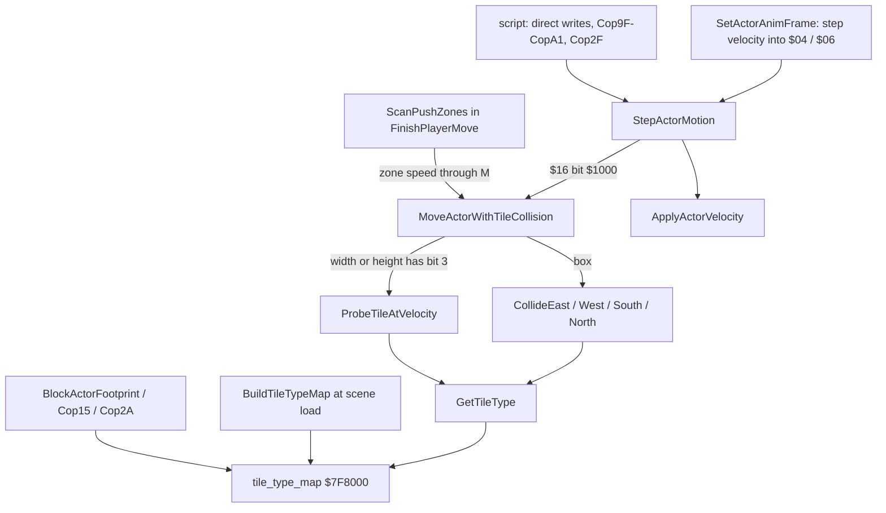

# Collision and Physics — `engine_tile_collision.asm`, `player_core.asm` and the tile COP commands

*Part of the [Soul Blazer Code Documentation](README.md)*

> How an actor's velocity becomes a position: where the velocity comes from, how the tile type map is built and indexed, which tiles stop an actor in each direction, how actors and scripts turn tiles into walls and back, how conveyor belts, currents and wind push the hero, and which moves skip the tile test altogether.

**Source:**
[`engine_tile_collision.asm`](../../extracted/system/engine_tile_collision.asm) ·
[`engine_actor_scheduler_and_sprites.asm`](../../extracted/system/engine_actor_scheduler_and_sprites.asm) (`RunActorList`, `StepActorMotion`, `SetActorAnimFrame`, `EndAnimation`) ·
[`player_core.asm`](../../extracted/system/player_core.asm) (`FinishPlayerMove`, `ScanPushZones`, `SlideAroundCorner`) ·
[`cop_core.asm`](../../extracted/system/cop_core.asm) (`BlockActorFootprint`, `ClearActorFootprint`) ·
[`lib_map_index_helpers.asm`](../../extracted/library/lib_map_index_helpers.asm) ·
[`lib_boot_and_scene_init.asm`](../../extracted/library/lib_boot_and_scene_init.asm) (`BuildTileTypeMap`, `FillTileTypeMap`) ·
[`lib_map_tile_patches.asm`](../../extracted/library/lib_map_tile_patches.asm) ·
[`cop_tiles_spawn_kill.asm`](../../extracted/cop_handlers/cop_tiles_spawn_kill.asm) ·
[`cop_actor_fields_animation.asm`](../../extracted/cop_handlers/cop_actor_fields_animation.asm) ·
[`cop_conditions.asm`](../../extracted/cop_handlers/cop_conditions.asm)

---

## Overview

Soul Blazer has one collision structure: `tile_type_map` (`$7F8000`), a byte per 16 × 16 pixel tile. Walls are never looked up in the graphics; at scene load `BuildTileTypeMap` folds the four solid flags of each metatile into the low nibble of one byte, and from then on every wall test is a read of that byte. Actors are not tested against each other for movement. An actor that must stop the hero (a statue, a door, a chest, a standing NPC) writes `$F0` into the bytes under itself (`BlockActorFootprint`), so to the motion code it is part of the map.

Movement is the last step of an actor's turn. The script (or the animation step before it) sets the velocity words `$04` and `$06`; `StepActorMotion` then calls `MoveActorWithTileCollision` for actors that asked for tile collision (`$16` bit `$1000`) and finally adds the velocity to the position (`ApplyActorVelocity`). The scheduler that calls it is in [actor-system.md](actor-system.md); the COP mechanics behind the tile commands are in [cop-dispatch.md](cop-dispatch.md). This document covers what happens inside `MoveActorWithTileCollision` and around the map it reads.

Coordinates follow the actor convention: `$00` is the x of the **left** edge, `$02` the y of the **bottom** edge, so an actor standing on tile row n has y = (n + 1) × 16 and its feet are in the row of the byte at y − 16. All positions are pixels; `$04` and `$06` are signed pixels per frame.

Code addresses are source-ROM addresses (LoROM: bank = file offset ÷ `$8000`); the rebuilt ROM places blocks elsewhere (`rebuilt/layout.json`). The walkthrough is the source of truth for game names (Mushroom Shoes, conveyor belt, current, the ship's wind); the ROM text is not needed for the terms used here.

**Related:** [wram-memory-map.md](../wram-memory-map.md) · [cop/index.md](../cop/index.md) · [actor-system.md](actor-system.md) · [cop-dispatch.md](cop-dispatch.md) · [scene-area-warp-loading.md](scene-area-warp-loading.md)

---

## Memory Map

### Code

| Address | Name | Description |
|---------|------|-------------|
| `$00:8A22` | `StepActorMotion` | Return point of every script: tile collision when `$16` bit `$1000`, then velocity. |
| `$00:8F28` | `MoveActorWithTileCollision` | x then y against the type map, or the one-point probe. |
| `$00:8F56` | `CollideEast` | Box test for dx > 0, no tile-boundary pre-check. |
| `$00:8FFF` | `CollideWest` | Box test for dx < 0, with a boundary pre-check. |
| `$00:90AF` | `CollideSouth` | Box test for dy > 0, no pre-check. |
| `$00:9154` | `CollideNorth` | Box test for dy < 0, with a pre-check. |
| `$00:9208` | `ProbeTileAtVelocity` | One-point test for actors whose width or height has bit 3 set. |
| `$00:9256` | `GetTileType` | Type of one tile: nibble, or `$0F` for a block mark or an index out of range. |
| `$00:929A` | `ApplyActorVelocity` | `$00 += $04`, `$02 += $06`. |
| `$00:88F3` | `SetActorAnimFrame` | Loads one animation step: duration, velocity, box, extents. |
| `$00:89B0` | `EndAnimation` | End marker: step 0, velocity 0, carry set. |
| `$00:E537` | `BlockActorFootprint` | ORs `$F0` into the tile bytes under an actor (counterpart: `ClearActorFootprint` at `$00:E5A7`). |
| `$04:F2B8` | `PixelToMapIndex` | Pixel position in dp`$16` / `$18` to the byte index of the map arrays. |
| `$04:F31A` | `StepMapIndexEast` | Index one tile east (page wrap rule). `StepMapIndexSouth` at `$04:F331`. |
| `$04:F723` | `BuildTileTypeMap` | Builds `tile_type_map` at scene load (`FillTileTypeMap` at `$04:F73D`). |
| `$04:F462` | `IsPlayerOnMetatile` | Is the BG1 metatile id under the hero a given id (the damage floors). |
| `$00:95E0` | `FinishPlayerMove` | Push zone or corner slide, even-pixel snap, published position, camera. |
| `$00:969C` | `ScanPushZones` | Finds the push zone record under the hero. |
| `$00:9733` | `SlideAroundCorner` | Slides the hero 2 px past a wall corner. |
| `$00:9892` | `GetMoveDirectionOfAnim` | Direction of the hero's animation from `PlayerMoveDirByAnim`. |

### COP handlers that touch the map or the position

| Address | Name | Description |
|---------|------|-------------|
| `$00:D9F4` / `$00:D9FB` | `Cop15_BlockOwnTiles` / `Cop16_UnblockOwnTiles` | Mark / clear the actor's own footprint (209 / 82 scripts). |
| `$00:DB15`, `$00:DB2B`, `$00:DB39`, `$00:DB4F`, `$00:DBC1` | `Cop21_JumpIfTileAbove`, `Cop22_JumpIfTileBelow`, `Cop23_JumpIfTileLeft`, `Cop24_JumpIfTileRight`, `Cop28_JumpIfTileHere` | Jump when the tile byte at a fixed offset is non-zero; shared tail `CopTileTestTail` (`$00:DBD0`). |
| `$00:E3A9` | `CopAE_JumpIfTileTypeNonZero` | Jump when the type nibble of the tile at an offset is non-zero (52 scripts). |
| `$00:DC1F` / `$00:DC50` | `Cop2A_BlockTileAt` / `Cop2B_UnblockTileAt` | Mark / clear one tile at an offset (20 scripts each). |
| `$00:E1B2` / `$00:E1D1` | `Cop9D_SetAnimationClearBlocked` / `Cop9E_WaitAnimationDoneOrJumpIfBlocked` | Start an animation and clear the blocked bit / wait and test it (51 scripts each). |
| `$00:E1EF`, `$00:E200`, `$00:E211` | `Cop9F_AddX`, `CopA0_AddY`, `CopA1_AddXY` | Add to the position at once, no collision (79, 39 and 58 scripts). |
| `$00:DC97` | `Cop2F_ShiftPlayerActors` | Shift the hero and the actor linked behind him by a signed amount (12 scripts). |
| `$00:D970` | `Cop11_MoveActorToTile` | Put another actor on a tile and clear its footprint there (32 scripts). |
| `$00:D8A9`, `$00:D90D`, `$00:DAFD`, `$00:DC81` | `Cop0C_JumpIfActorInBox`, `Cop0D_JumpIfActorAtTile`, `Cop20_JumpIfPlayerOffGrid`, `Cop2E_JumpIfActorInBoxWord` | Position tests (proximity, exact tile, hero between tiles). |

### State

| Address | Name | Description |
|---------|------|-------------|
| `$7F:8000` | `tile_type_map` | One byte per tile, pages of 256 bytes. Low nibble = type, `$F0` = actor footprint. At most `$4000` bytes (64 pages). |
| `$7E:8000` | BG1 metatile id map | Same index as `tile_type_map`; the source of `FillTileTypeMap` and of `IsPlayerOnMetatile`. |
| `$7E:2000` | metatile definitions | Eight bytes per id: four tile words, bit 9 of each is the solid flag. |
| `$0200`–`$02FF` | type mask table | One mask per metatile id, built by `FillTileTypeMap`; the sort bucket page, wiped at the end of `InitSceneState`. |
| `$0343` | `map_width_pages` | Width of the map in 256-pixel pages; the row stride of the index. |
| `$0326` | `joy_block_mask` | Bits cleared from the pad word (`$2F80` blocks the pad); also tested by `FinishPlayerMove`. |
| `$0374` / `$0376` | `player_x` / `player_y` | Published hero position (written by `ScanPushZones` and `FinishPlayerMove`). |
| `$0378` / `$037A` | `player_tile_x` / `player_tile_y` | x >> 4 and (y >> 4) − 1. |
| `$03A6` | `subframe_active` | Non-zero while a sub-frame (text box, scene) runs: no push. |
| `$03D4` / `$03D6` | `push_dx` / `push_dy` | Push of this frame, in pixels. |
| `$03D8` / `$03DA` | `push_zone_list` / `push_zone_bank` | Address and bank of the room's push records (0 = none). |

Actor fields used here (the full table is in [actor-system.md](actor-system.md)): `$00` x, `$02` y, `$04` dx, `$06` dy, `$08`/`$0A`/`$0C`/`$0E` hit extents, `$10` width, `$12` height, `$16` flags, `$1C` flip bits, `$1E` animation id, `$20` step. Flag bits used: `$1000` tile collision, `$0004` blocked, `$0800` hit stun, `$0010` also runs in sub-frames.

---

## How an actor moves

### Where the velocity comes from

Two sources write `$04` and `$06`. **Animation steps** do it for every actor that plays an animation: `SetActorAnimFrame` reads the step (an 8-byte record: duration word, dx word, dy word, pointer to the sprite record) and copies dx and dy into `$04` and `$06`. If `$1C` has bit 14 (flip X) dx is negated, bit 15 (flip Y) negates dy, so one animation walks in both directions. The velocity therefore changes at every step, not once per walk; an animation that ends (a negative duration) goes through `EndAnimation`, which zeroes both words. **Scripts** may write the words directly (the pearl ride and the lair return do), or start an animation (`Cop80`, `Cop9D_SetAnimationClearBlocked`) and leave the rest to the step data.

The same step loads the box. `SetActorAnimFrame` copies the width and height of the sprite record into `$10` and `$12` and the four extents into `$08`-`$0E` (mirrored for a flip). So the collision box is the box of the **current frame**: an actor whose frames differ in size changes its box with the animation, and the one-point probe below is chosen by the current frame, not by the actor type. (How big the hero's frames are is not read here; OQ-I047-3.)

### The turn: script, then motion

`RunActorList` runs the script only when the wait counter `$14` goes below 0; it always reaches `StepActorMotion`, so an actor with a waiting script still slides by its velocity (the order and the exceptions are in [actor-system.md](actor-system.md)). Two exceptions matter for physics: an actor frozen by the Psycho Sword (`$1A` bit `$0040` with hit stun) takes the `NextActor` branch and skips both script and motion, and while a sub-frame runs only actors with `$16` bit `$0010` move at all.

`StepActorMotion` tests `$16` bit `$1000`. With the bit clear the actor only gets `ApplyActorVelocity`: it walks through walls, through block marks and off the map. 71 of the 469 meta types of `WorldMetaPointers` start with the bit set (the seven hero rows, `$1180`, included); the other 398 do not test a tile unless a script sets the bit (or spawns the actor with it). Scripts do toggle it: the lunging enemy `ll_enemy_toy_lunge_0FDAED` of `ll_town_models_enemies` sets it around its three lunge animations and clears it after them, and the pearl ride (`se_obj_pearl_ride_out_0F8FAB`) clears it on the hero for 432 frames (`$01B0`), so that the dolphin carries him without any tile test.

### What `MoveActorWithTileCollision` does

It handles x first, then y, each axis only when its velocity is non-zero, and each with the tiles of the box, never with the distance moved: the four routines read the **sign** of the velocity and test the same tiles for a step of 1 and of 20. A blocked axis zeroes only its own velocity, so an actor pushed diagonally into a wall slides along it. When the width or the height has bit 3 set (8, 24, 40 ... pixels, anything that is not a multiple of 16) the box routines are skipped and `ProbeTileAtVelocity` is used instead.

---

## The tile type map

### How it is built

`BuildTileTypeMap` runs once per scene from `InitSceneState`, after the maps are loaded. It first builds a 256-entry mask table (`FillTileTypeMap`): for each metatile id it reads the four tile words at `$7E:2000` + id × 8, takes bit 9 of each (the high byte `AND #$02`) and packs them into a nibble with the first word as bit 0. The metatile definitions are top-left, top-right, bottom-left, bottom-right (`lib_map_scroll_and_redraw` block note), so the nibble reads:

| Bit | Value | Quadrant |
|-----|-------|----------|
| 0 | `$1` | top-left |
| 1 | `$2` | top-right |
| 2 | `$4` | bottom-left |
| 3 | `$8` | bottom-right |

It then copies `mask[id]` to `tile_type_map` for every tile of the map (`TypeMapCopyLoop`). The byte count is pages × `$100`, where pages = `map_width_pages × map_height_pages`: `BuildTileTypeMap` takes the product with `Multiply8x8` and keeps it in one byte (`XBA` / `TAY`), so the routine is right only for maps of at most 64 pages, which is also the size of the index limit below (OQ-I047-8).

`SetMetatileBg1` and `SetMetatileBg1Bg2` (`lib_map_tile_patches`) run the same fold when a script changes a metatile at run time (a lair seals, a chest opens): the type byte of that tile is rewritten from the new definition. A rewrite replaces the whole byte, so a block mark on that tile is gone with it.

### What the nibble means

Every blocking test in the engine compares a whole nibble, so a value is meaningful only if some routine tests it. The four box routines test these:

| Type | Quadrants | Blocks |
|------|-----------|--------|
| `$0F` | all four | all four directions |
| `$06` | top-right and bottom-left | all four directions |
| `$0A` | right half | leaving east (own tile); entering west (next tile) |
| `$05` | left half | leaving west; entering east |
| `$0C` | bottom half | leaving south; entering north |
| `$03` | top half | leaving north; entering south |

So the half types are one-way walls (a fence on one side of a tile), `$0F` is a full wall and `$06` is a diagonal pair that the code treats as a full wall. No box routine reacts to any other non-zero nibble (`$01`, `$02`, `$04`, `$07`, `$08`, `$09`, `$0B`, `$0D`, `$0E`): such a tile does not stop motion. Script probes (below) do see them, and the lair code uses type `$01` as a marker. Which values the shipped maps actually contain is OQ-I047-2.

The high nibble is separate: a non-zero high nibble means "an actor stands here" (`$F0`) and is never produced by the map fold.

### Index math

`PixelToMapIndex` and `GetTileType` read the same arrays with the same layout, once from pixels and once from tile coordinates. The map is stored in pages of 16 × 16 tiles (256 bytes), pages in rows of `map_width_pages`:

index = (`map_width_pages` × page row + page column) × 256 + (tile y & 15) × 16 + (tile x & 15)

where page row = y >> 8 and page column = x >> 8 in pixels (tile y >> 4 and tile x >> 4 in tiles). `PixelToMapIndex` returns 0 for an index of `$4000` or more; `GetTileType` treats it as blocked. The BG1 id map (`$7E:8000`), the BG2 map (`$7E:C000`) and `tile_type_map` share the index, which is why one routine serves them all. Two details bite callers: `PixelToMapIndex` adds the low byte of y **unmasked**, so an exact index needs y with a low nibble of 0 (OQ-I031-1); and it relies on the B byte holding the high byte of y when it calls `Multiply8x8`. `StepMapIndexEast` adds 1, or `$F1` in the last column of a page; `StepMapIndexSouth` adds `$10`, and at the end of a page adds `map_width_px` (one row of pages).

### Reading one tile

`GetTileType` takes the tile x in dp`$16` (a byte) and the tile y in dp`$18` (a word) and returns the type in A. With a clear high nibble it returns the low nibble and carry clear. With a non-zero high nibble, or an index of `$4000` or more, it returns `$0F` with carry **set**. The carry is how the box routines tell "a wall of the map" from "an actor or the edge of the map" (next section). It leaves the B byte stale, which matters to the one-point probe (OQ-I005-10).

---

## Moving against the map

### The four directions

Each routine tests two things: the **current** tile (the row or column the box already covers on the side of travel) for the half type of that side, and the **next** tile beyond it for the full types and the half type of the opposite side. For the rows (east, west) the routine scans the rows from the top of the box (`(y − height) >> 4`) for height ÷ 16 rows and then the bottom row `(y − 1) >> 4`; for the columns (south, north) the columns from `x >> 4` for width ÷ 16 and then the last column `(x + width − 1) >> 4`.

| Direction | Current tile (column or row) | Next tile blocks on | Pre-check |
|-----------|-----------------------------|---------------------|-----------|
| East (`CollideEast`, dx > 0) | `(x + width − 16) >> 4`: `$0A` | `$0F`, `$05`, `$06` | none |
| West (`CollideWest`, dx < 0) | `x >> 4`: `$05` | `$0F`, `$0A`, `$06` | only when `x + dx` crosses a 16-pixel line |
| South (`CollideSouth`, dy > 0) | `(y − 16) >> 4`: `$0C` | `$0F`, `$03`, `$06` | none |
| North (`CollideNorth`, dy < 0) | `(y − height) >> 4`: `$03` | `$0F`, `$0C`, `$06` | only when `y + dy` crosses a 16-pixel line |

For an actor that stands on the 16-pixel grid the current tile is the last tile it covers on the side of travel and the next tile is the one directly in front of it, so a wall in front stops it flush, at the grid line, at once. The asymmetry of the pre-check (east and south test every frame, west and north only when a line is crossed) changes nothing for such an actor; it can matter for an actor that is off the grid (OQ-I005-12).

A blocked move does three things: it sets `$16` bit `$0004` (blocked), snaps the position to the grid line below it (`AND #$FFF0`: x for east and west, y for south and north), and zeroes the velocity of that axis. A free move clears bit `$0004`. The snap goes **down** for all four directions, so an actor that is off the grid and blocked jumps back by up to 15 pixels.

One path does not set the bit. When the **next** tile read comes back with carry set (a footprint or an index of `$4000` or more), the routine jumps to its snap-and-stop code without touching `$0004`: the actor stops but is not marked blocked. The type `$0F` of a map wall takes the other path and sets the bit. So a walker that is stopped by a statue or an NPC (a footprint) does not get the bit that `Cop9E` and `SlideAroundCorner` test, while one that is stopped by a wall does. Whether a monster keeps walking in place against a statue is OQ-I047-1.

### The one-point probe

`ProbeTileAtVelocity` is the cheaper test for small actors (shots, effects, anything whose frame is 8, 24 ... pixels wide or high). It reads one tile, the one containing the point `(x + dx − 4, y + dy − 4)`, and blocks only when that tile reads `$0F`: a full wall of the map or any footprint. Half types and `$06` do not stop it. It zeroes **both** velocities and sets `$0004`. It returns at once when `$04` is 0: the routine ORs `$04` with itself instead of with `$06` (the line comment says so), so a small actor moving purely up or down is never tested and passes through walls. Which actors use the probe is OQ-I047-4.

---

## Actors as walls

### Footprints

`BlockActorFootprint` marks the tiles under an actor: it ORs `$F0` into the byte, keeping the type nibble. A box with width + height below `$21` (that is, a 16 × 16 actor) marks the single tile at `(x, y − 16)`; a bigger box marks width ÷ 16 columns by height ÷ 16 rows, from the top-left `(x, y − height)`, stepping with `StepMapIndexEast` and 16 pixels down. `Cop15_BlockOwnTiles` calls it for the caller (209 scripts: statues, doors, chests, standing NPCs). `ClearActorFootprint` is the counterpart, and `Cop16_UnblockOwnTiles` calls it (82 scripts).

`Cop2A_BlockTileAt` ORs `$F0` into one tile at an offset `(dx, dy − 16)` from the actor; `Cop2B_UnblockTileAt` clears it (20 scripts each). Both leave the actor's own footprint alone, which is how a script blocks a tile it does not stand on.

Three consequences follow from how the byte is written:

- **Clearing is not undoing.** `ClearActorFootprint` and `Cop2B_UnblockTileAt` do `AND #$FF00` on the word, which zeroes the whole low byte, type nibble included. A door that stands on a wall tile and then opens leaves a walkable tile. That is how doors and statues that move away work, and it also means a footprint cannot be removed without losing the tile's own type.
- **A footprint is seen only by the next-tile loop.** The block mark reads as `$0F` through `GetTileType`, so the first loop of a box routine (which looks for `$0A`, `$05`, `$0C` or `$03` in the current tile) never matches it; the next-tile loop does, and that loop ends in the path that does not set `$0004`.
- **A moving blocker must release its tiles.** `Cop11_MoveActorToTile` stores the new position of another actor and then calls `ClearActorFootprint` for it at the **new** position (OQ-I025-8), not at the old one. The old footprint is not cleared by this command.
---

## Asking the map from a script

Monsters and NPCs turn at walls because their scripts ask, not because the engine tells them. Five commands read the map.

| Command | Samples | Jumps when |
|---------|---------|------------|
| `Cop21_JumpIfTileAbove` | `(x, y − 16 − height)` | the whole byte is non-zero |
| `Cop22_JumpIfTileBelow` | `(x, y)` | the whole byte is non-zero |
| `Cop23_JumpIfTileLeft` | `(x − 16, y − 16)` | the whole byte is non-zero |
| `Cop24_JumpIfTileRight` | `(x + width, y − 16)` | the whole byte is non-zero |
| `Cop28_JumpIfTileHere` | `(x, y − 16)` | the whole byte is non-zero |
| `CopAE_JumpIfTileTypeNonZero` | `(x + dx, y + dy − 16)` | the type nibble is non-zero |

`Cop21-24` and `Cop28` share `CopTileTestTail`: any non-zero byte counts, so they see a block mark, every type (also the ones the box routines ignore) and a lair marker alike. They sample one point on the actor's own x or y, so they are exact for a 16-pixel actor on the grid. `CopAE` masks the type nibble only, so an actor's footprint (a type-0 tile with `$F0`) does **not** count for it; it is the command for "is there terrain ahead" (52 scripts). `Cop29_JumpIfTileIdDiffers` reads the BG1 id map instead; no script uses it.

`Cop9D_SetAnimationClearBlocked` starts an animation and clears `$16` bit `$0004`; `Cop9E_WaitAnimationDoneOrJumpIfBlocked` jumps when the bit is set and otherwise steps the animation and yields until it ends. Together they are the walk loop of 51 scripts: start the animation, let the engine move the actor, and branch the moment the engine reported a wall. The footprint exception above is why such a walker meets statues differently from walls.

---

## Moves that skip the test

### Position commands and forced moves

`Cop9F_AddX`, `CopA0_AddY` and `CopA1_AddXY` add a signed amount to the position at once (79, 39 and 58 scripts). They do not test tiles and do not touch the velocity. `Cop2F_ShiftPlayerActors` adds a signed `(dx, dy)` to the hero **and** to the actor at his `$3E` link (probably the sword layer, OQ-I025-9). It is the forced move of cutscenes and carriers: the Lostside Marsh carriers in `gw_lostside_marsh_actors` call it every frame with `(0, −2)`, `(0, 2)`, `(−2, 0)` or `(2, 0)`.

A script that moves with these commands must also do its own wall test. The ice slide of the Mountain of Souls is the model.

### Worked example: the ice

`ms_obj_ice_marker_scan_021F52` watches the hero's exact pixel position against a marker list (`ms_ice_markers_summit_021FA9`, `ms_ice_markers_laynole_021FED`) and sets or clears scene flag `$0000` ("the hero is on the ice"). `ms_obj_ice_slide_022007` waits for that flag. Unless the Mushroom Shoes (item `$22`) are equipped it reads the direction of the hero's walking animation from `PlayerMoveDirByAnim` (0 up, 1 down, 2 right, 3 left), blocks the pad (`joy_block_mask |= $2F80`) and from then on, once per frame in `ms_obj_ice_slide_step_02209B`:

1. when the hero is on a 16-pixel line along the direction of travel, looks for a wall: with the other axis on the grid too it asks `Cop21` / `Cop22` / `Cop23` / `Cop24`, otherwise it tests the two tiles ahead with `ms_obj_ice_tile_blocked_0221FA`;
2. a wall (or the flag clearing) ends the slide and releases the pad;
3. otherwise `Cop2F` shifts the hero 2 pixels in the direction.

So the slide is not an engine feature: it is a script that uses the same tile commands as a monster, and moves with a position command that has no collision of its own. It matches the walkthrough (chapter 5): you slide forward until you hit something, the Mushroom Shoes stop it on level ice, and "once on the ice you'll automatically go south" (the direction is that of the hero's walking animation when he reaches the marker, so "south" follows from how he steps onto the ice; inferred).

### Other direct writers

`CheckPlayerTileTriggers` zeroes the hero's `$04` and `$06` when a switch, plate, chest or exit fires, so he does not walk on while the trigger plays. `EndAnimation` zeroes them at the end of an animation. The pearl ride writes `$02` and `$06` of the hero directly (`se_obj_pearl_ride_out_0F8FAB`, `se_obj_pearl_ride_back_0F8FF6`: the dolphin's y minus `$20` or plus `$10`, `$06` = −1 or 1) with his bit `$1000` cleared. The Game Genie code of the walkthrough (below) disables the tile test for all actors at once.

---

## Pushing the hero

### Push zones

Conveyor belts, the current of the Seabed of St. Elles, the ice slopes and the wind of the airship are not map types. They are **push zones**: rectangles of tiles with a speed, listed per room and applied to the hero once per frame by `FinishPlayerMove`. A record is 8 bytes, `x0, x1, y0, y1` (tiles, half-open) and then the words `dx`, `dy` in pixels per frame; a first byte of `$FF` ends the list. A one-shot placement script in each room stores the address and bank of its list in `push_zone_list` and `push_zone_bank` and kills itself (`COP [86]`): `gv_obj_push_zone_setup_01AFFD` (Grass Valley: the Underground Castle and Leo's Paintings, 7 lists), `ms_obj_push_zone_setup_02220D` (Mountain of Souls, 4 lists), `mc_deck_push_zones_027019` (the airship deck, scene A13S02, list `mc_deck_push_zone_records_02702B`) and `se_obj_water_current_0FA59C` (the seabed current, list `unk16_0FA5AE`). There are 13 lists and 54 records; 52 move 1 pixel per frame, two move 4.

| Place | Records | Push | Walkthrough |
|-------|---------|------|-------------|
| Grass Valley, Underground Castle and Leo's Paintings (`gv_multi_area_actors`) | 35 in 7 lists | 1 pixel per frame in the direction of the belt (`$0001` right or down, `$FFFF` left or up) | Conveyor belts, "carpet-style conveyor belts" (chapter 2) |
| Mountain of Souls, icy slopes (`ms_multi_area_actors`) | 9 in 4 lists | `dy = +1`, south | "You will still slip on the slopes" (the Mushroom Shoes do not help, chapter 5) |
| Seabed of St. Elles (`se_seabed_of_st_elles_actors`) | 2 | `dx = −4`, west: tiles `$32`-`$7B` × `$0B`-`$16` and `$7B`-`$7D` × `$0E`-`$16` | "A powerful water current ... push you westward ... you can only slow it by holding Right" (chapter 4) |
| Airship deck of Magridd's Castle (`mc_airship_dock_actors`) | 8 | `dy = +1`, south | "the wind on the ship will be pushing you back", "the wind pushes you down quickly" (chapter 7) |

### How the push is applied

`ScanPushZones` first publishes the hero's position (`player_x`, `player_y`, `player_tile_x`, `player_tile_y`), then returns without scanning when there is no list or a sub-frame is running. Otherwise it tests each record for overlap with the hero's tile span: columns `x >> 4` to `(x + 15) >> 4` against `[x0, x1)`, rows `(y >> 4) − 1` to `(y − 1) >> 4` against `[y0, y1)`. Each overlapping record sets `push_dx` from its `dx` and `push_dy` from its `dy` when the word is non-zero, so per axis the **last** overlapping record wins. Carry is set when either is non-zero.

`FinishPlayerMove` then swaps: it saves the hero's velocity, puts the push in `$04` / `$06`, calls `MoveActorWithTileCollision` so that walls clip the push, stores the clipped result back in `push_dx` / `push_dy`, adds it to the position and restores the velocity. A push is therefore a second, separate move on top of the walk, with the full wall test; a conveyor never carries the hero through a wall, and there is no corner slide under a push.

For the current this gives the walkthrough's behaviour by arithmetic: standing still the hero moves −4 per frame; holding Right adds the walk step, which the engine reads as 2 pixels per frame (static reading, OQ-I032-15), for a net of −2. The conveyor belt does the same at 1 pixel per frame: "you can recross it, but it'll be rather slow" is a walk of 2 against a push of 1.

### Corner slide

When there is no push, `FinishPlayerMove` calls `SlideAroundCorner`. It acts only when the hero is blocked (`$16` bit `$0004`), the key of his movement direction is still held, and he is off the grid on the other axis (x low nibble non-zero for up and down, y low nibble non-zero for left and right). It then looks at the tile beyond the corner in `tile_type_map` with a quadrant mask that includes the high nibble: `$FC` (the two bottom quadrants) when moving up, `$F3` (top) down, `$F5` (left) right, `$FA` (right) left. If that tile on the near side is free the hero moves 2 pixels toward it (left or up first); otherwise it tests the far side and moves 2 pixels that way; if neither is free nothing happens. This is why walking into a doorway that is a few pixels off the line pulls him into it. The masks differ from the box test: any solid quadrant on the side of travel counts, and a footprint counts too.

`SlideAroundCorner` depends on the blocked bit, so a hero stopped by a footprint (an NPC, a statue) has no slide (see "The four directions").

At the end of `FinishPlayerMove`, when no d-pad bit of `joy_block_mask` is set, each axis without a push is rounded down to an even pixel (`AND #$FFFE`): the walk step is 2 pixels, and a push of 1 would otherwise leave him on an odd pixel.

---

## The map as state

Besides walls, a few routines use the type byte for something else, and a few use the BG1 metatile ids where a type would not do.

**Floor hazards use ids, not types.** `IsPlayerOnMetatile` compares the BG1 id under the hero's feet (row y − `$10`, over the one, two or four tiles his box covers) with an id and returns carry set on a match; it returns carry clear at once while the hero is in hit stun (`$0800`) or dying (`$0400`). The five callers: Lostside Marsh id `$80` (1 damage), the Laboratory dungeon ids `$F3` and `$E1` (4), Magridd's Castle dungeon id `$88` (3) and the St. Elles coast id `$47` (4; OQ-I031-2). Each script first asks `Cop19` whether the protective item is worn and then calls `Cop39_DamagePlayer`: the walkthrough's Ice Armor (the fiery floors of Lostside and the flaming bridges of Dr. Leo's Lab) and Elemental Mail (spikes in King Magridd's Castle) agree with the guards.

**Markers.** `ReleaseLairAtSwitch` writes type `$01` on the home tile of a released NPC; `RunLairReleaseOnReturn` compares the byte with exactly `$01` to find it. A `$01` tile does not stop box motion, but `Cop21-24` and `Cop28` see it as occupied.

**Counters.** `lib_field_talk` probes for a talkable actor at the point in front of the hero; when facing up finds nothing and the tile two rows up has type 6, it probes once more one tile farther. Type 6 is a wall for the box routines; reading it as "a counter you can talk across" is inferred from that probe (OQ-I009-7).

**State.** The Purple Fish of the St. Elles coast and the pop-up turret of the World of Evil store the map index of a tile at spawn and read its byte again and again: the fish acts while the byte is non-zero ("in the water") and flops when it is 0; the turret fires while it is non-zero and deletes itself at 0. Both read the same byte as the walls (`SetMetatileBg1` and the lair patches change it), and both meanings are inferred from the walkthrough (OQ-I036-10, OQ-I040-4).

---

## Where collision ends

Hit detection is separate from tile collision. `DetectHitSourceCollisions` compares the hit extents `$08`-`$0E` of sources and targets (the sword, shots, monsters) and confirms with sprite overlap; it never reads `tile_type_map`. Damage rules are in the combat code and are not part of this document. The one thing that matters here is displacement: no routine of `engine_combat_hits.asm` and no `Cop39_DamagePlayer` writes `$00`, `$02`, `$04` or `$06` of an actor; they set hit stun (`$26`, `$16` bit `$0800`) and kill or redirect scripts. A hit therefore moves nobody by itself. The notes of `ApplySwordHit` and `DetectHitSourceCollisions` say "knocked back"; that is OQ-I047-6.

### Position tests

Four commands compare positions rather than tiles; they are not collision, but scripts use them together with the tile commands.

- `Cop0C_JumpIfActorInBox` and `Cop2E_JumpIfActorInBoxWord` (`CopActorBoxTest`) test whether **another actor's position** (its x and y, not its box) is inside the caller's box widened by a margin m: x in `[x − m, x + m + width − 16]`, y in `[y − m − height + 16, y + m]`. `Cop0C` takes m in tiles, `Cop2E` in pixels (94 and 3 scripts).
- `Cop0D_JumpIfActorAtTile` is exact: other x equals tile x × 16 and other y equals (tile y + 1) × 16. Tile y + 1 because y is the bottom edge. Cutscenes wait on it for an actor to reach its mark.
- `Cop20_JumpIfPlayerOffGrid` jumps while `player_x` or `player_y` has a non-zero low nibble (3 scripts, before `Cop9A`).

---

## Walkthrough cross-check

| Walkthrough | ROM reading | Result |
|-------------|-------------|--------|
| 02 Grass Valley: conveyor belts, "carpet-style conveyor belts", "you can recross it, but it'll be rather slow" | `gv_obj_push_zone_setup_01AFFD`, 35 records of 1 pixel per frame | Agrees. |
| 04 St. Elles: a current pushes you west, "you can only slow it by holding Right" | two records of `dx = −4` in `se_seabed_of_st_elles_actors`; walk step 2 | Agrees (the walk step is OQ-I032-15). |
| 05 Mountain of Souls: slide until you hit something; Mushroom Shoes stop it on level ice; "once on the ice, you'll automatically go south" | `ms_obj_ice_slide_022007`, `Cop19` on item `$22`, `Cop2F` 2 pixels per frame, wall test per tile | Agrees. |
| 05: "icy inclines ... still cause you to slip" and the shoes do not help on An Ice Hill | `ms_multi_area_actors` push records, `dy = +1`, no item test | Agrees. |
| 07 Magridd's Castle: the wind on the ship pushes you back; "the wind pushes you down quickly" | `mc_deck_push_zones_027019`, 8 records of `dy = +1` | Agrees: "back" is south. |
| items: Ice Armor protects from the fiery floors in Lostside; Elemental Mail prevents spike damage | `IsPlayerOnMetatile` callers and their item guards (`$0A`, `$0F`) | Agrees. |
| 07: "flip RAM address 0x008A24 to DD, or use the Game Genie code 2264-6FD4" for walk-through-walls | `$00:8A24` is the high byte of the operand of `LDA $0016, X` at the top of `StepActorMotion`; `$DD` there makes the instruction read a word at `$DD16 + X` instead of the flags; whether that word has bit `$1000` clear (which would switch tile collision off for every actor) is not checked here. The Game Genie code, decoded in the standard SNES way, gives address `$04:8222`, value `$DD`, which is not `$00:8A24` | **DISCREPANCY** (OQ-I047-5): the address agrees with the code, the Game Genie code does not decode to it; and `$00:8A24` is a ROM address, not RAM. |

---

## Open questions

The questions this document could not settle are in `plans/extracted-audit/questions/I047_questions.md`: OQ-I047-1 (a walker stopped by a footprint is not marked blocked), OQ-I047-2 (which type values the shipped maps contain), OQ-I047-3 (box sizes of the hero's frames), OQ-I047-4 (which actors use the one-point probe), OQ-I047-5 (the walk-through-walls cheat, DISCREPANCY), OQ-I047-6 (the "knocked back" wording), OQ-I047-7 (the edge of the map: x or y of 0 moving west or north) and OQ-I047-8 (whether every scene map has at most 64 pages, the limit of `BuildTileTypeMap` and of the index). Earlier questions this document relies on: OQ-I005-8 (the type codes, answered here statically), OQ-I005-9, OQ-I005-10, OQ-I005-12, OQ-I009-7, OQ-I025-8, OQ-I025-9, OQ-I031-1, OQ-I031-2, OQ-I032-15, OQ-I036-10 and OQ-I040-4.

---

## See Also

- [actor-system.md](actor-system.md): the scheduler, the actor fields and the script contract that precede `StepActorMotion`.
- [cop-dispatch.md](cop-dispatch.md): how a `COP` becomes a handler call, including the jump and skip exits the tile commands use.
- [cop/index.md](../cop/index.md): the full command list (§4.6 tiles and position).
- [scene-area-warp-loading.md](scene-area-warp-loading.md): `InitSceneState`, which calls `BuildTileTypeMap`, and the map patches that rewrite type bytes.
- [wram-memory-map.md](../wram-memory-map.md): `tile_type_map`, the push variables and the player position.
- [walkthrough/README.md](../walkthrough/README.md): the game-text source of truth.
- [player.md](player.md): the rest of the hero's code (action loop, poses, swings, death, orb, spells, level-up); the hero's frame size is answered there for OQ-I047-3.
- [combat-damage-and-enemy-records.md](combat-damage-and-enemy-records.md): the hit boxes and the sprite-rectangle test that run beside the tile collision, hit stun, and `Cop39_DamagePlayer` with the hazards that call it.
- Planned spokes (not written yet): the map scroll and camera.
