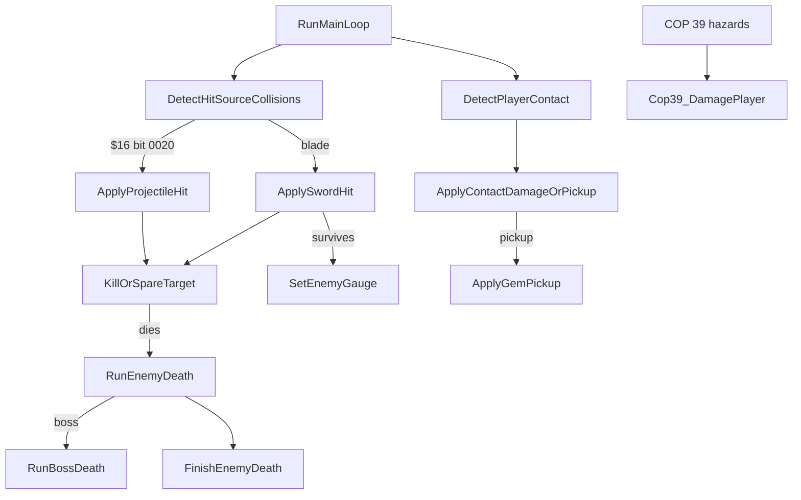

# Combat, Damage and Enemy Records — `engine_combat_hits.asm`, `WorldMetaPointers.asm` and the death scripts

*Part of the [Soul Blazer Code Documentation](README.md)*

> How a hit becomes damage: the sources and targets of the frame, the sword rules per weapon, the immunity classes, the spells and the Phoenix, the contact damage and what armor and bracelets change, the six hazards that bypass all of it, the 14-byte enemy record behind every number, the enemy gauge, and the death sequence with its Gem drop, EXP number and boss explosions.

**Source:**
[`engine_combat_hits.asm`](../../extracted/system/engine_combat_hits.asm) ·
[`WorldMetaPointers.asm`](../../extracted/system/WorldMetaPointers.asm) ·
[`engine_spawn_lairs_death_drops.asm`](../../extracted/system/engine_spawn_lairs_death_drops.asm) (`RunEnemyDeath` to `RunEnding`, the Gem pickups, `RunHazardPuff`) ·
[`engine_player_death_and_actor_helpers.asm`](../../extracted/system/engine_player_death_and_actor_helpers.asm) (`DestroyHazardsNearOrb`) ·
[`engine_actor_scheduler_and_sprites.asm`](../../extracted/system/engine_actor_scheduler_and_sprites.asm) (hit stun in `RunActorList`, the flash in `BuildActorSprites`) ·
[`player_spells_level_up.asm`](../../extracted/system/player_spells_level_up.asm) (the damage byte of each spell) ·
[`lib_hud.asm`](../../extracted/library/lib_hud.asm) (`UpdateHud`, `EnemyGaugeText`) ·
[`lib_player_helpers.asm`](../../extracted/library/lib_player_helpers.asm) (`AddExp`, `AddGems`) ·
[`lib_menus.asm`](../../extracted/library/lib_menus.asm) (`RecalcGearStats`, `GearStatTable`) ·
[`cop_items_stats_text.asm`](../../extracted/cop_handlers/cop_items_stats_text.asm) (`Cop39_DamagePlayer`)

---

## Overview

Every frame, after the actors have run, the main loop calls two routines in this order: `DetectHitSourceCollisions` (the hero's blade and his spells against everything else) and `DetectPlayerContact` (everything else against the hero). `CheckPlayerDeath` follows ([player.md](player.md)). Nothing in the engine moves an actor because it was hit: a hit changes the target's HP, its hit-stun counter `$26`, and, on a kill, its script. The numbers come from three places: the hero's own fields (`attack_current`, `defense_current`, `gear_power`, `level_power`), the 14-byte meta row of the monster (`WorldMetaPointers`, found through the actor's `$38`), and the flag words `$16` and `$1A` of the actor, which are the only way an enemy script can say "I cannot be hit", "only the Zantetsu Sword hurts me" or "I survive with 1 HP".

There are four ways to lose or deal HP, and they do not share code: the **sword** (`ApplySwordHit`), a **projectile** (`ApplyProjectileHit`: the seven spells, the Phoenix, the Lightning Pyramid), **contact** with a monster or an enemy shot (`ApplyContactDamageOrPickup`), and **fixed hazards** (`Cop39_DamagePlayer`, six scripts). A kill, from either of the first two, hands the monster to `RunEnemyDeath`.

The hero's blade is a separate actor (`RunWeaponLayer`, [player.md](player.md)): it is the hit source, not the hero, because the hero's own `$16` (`$1180`) contains `$0100`, which keeps an actor out of the source role. Code addresses are source-ROM addresses (LoROM: bank = file offset ÷ `$8000`); the rebuilt ROM places blocks elsewhere (`rebuilt/layout.json`). Game names (Gems, the eight swords and armors, the bracelets, the seven spells, the bosses) are the walkthrough's; the ROM names nothing, so every enemy name here is the walkthrough's name for a row matched by HP and EXP (`MetaGrassValley` and its six siblings carry the same note).

**Related:** [wram-memory-map.md](../wram-memory-map.md) · [cop/index.md](../cop/index.md) · [actor-system.md](actor-system.md) · [player.md](player.md) · [collision-and-physics.md](collision-and-physics.md) · [boot-nmi-main-loop.md](boot-nmi-main-loop.md)

---

## Memory Map

### Code

| Address | Name | Description |
|---------|------|-------------|
| `$00:8A34` | `DetectHitSourceCollisions` | Pairs each source with each target; calls the two hit routines. |
| `$00:8AF2` | `ApplySwordHit` | Weapon rules, immunity classes, damage, kill or stun. |
| `$00:8C67` | `ApplyProjectileHit` | `$30` damage byte or Phoenix formula; immunity; kill or stun. |
| `$00:8D55` | `TestSpriteOverlap` | Exact spritemap rectangle test behind the coarse box test. |
| `$00:8DF4` | `DetectPlayerContact` | The hero's hurt box against actors; pickups while stunned. |
| `$00:8E9D` | `ApplyContactDamageOrPickup` | Armor, bracelet and stun rules for damage taken; hands pickups on. |
| `$00:89BF` | `RunActorList` | Counts the hit-stun counter `$26` toward 0 and skips a frozen actor. |
| `$00:8761` | `BuildActorSprites` | Flashes (negative `$26`) or blinks (positive `$26`) a stunned actor. |
| `$00:AA10` | `RunEnemyDeath` | Death script of every enemy: puff, Gem drop, EXP number. |
| `$00:AB7E` / `$00:AB86` | `FinishEnemyDeath` / `NotifyLairOfDeath` | End of the sequence; a lair monster reports to its lair. |
| `$00:AB96` | `RunBossDeath` | Boss death: 32 explosions, `KillAllOtherActors`, the ending or the next scene. |
| `$00:ABFE` / `$00:AC63` / `$00:AC7D` | `RunBossExplosion` / `KillAllOtherActors` / `KillAllProjectiles` | One burst; the clean-up; the clean-up of shots after a magic change. |
| `$00:AEDA` / `$00:AEEA` / `$00:AEFA` | `RunSmallGemPickup` / `RunMediumGemPickup` / `RunLargeGemPickup` | The dropped Gem actors (1, 5, 10 Gems). |
| `$00:AEC0` / `$00:AF0A` | `RunFixedGemPickup` / `ApplyGemPickup` | A Gem that never expires; the pay-out on touch. |
| `$00:A9EC` | `RunHazardPuff` | The burst the Soul of Shield forces on a hazard. |
| `$00:B10F` | `DestroyHazardsNearOrb` | The Soul of Shield sweep. |
| `$00:DDCB` | `Cop39_DamagePlayer` | Fixed damage of the six hazard scripts. |
| `$00:D354` | `RunEnding` | The ending after the last boss (text and warp only; not documented here). |
| `$02:A659` | `UpdateHud` | Draws the enemy gauge for one second after a hit. |
| `$02:9EED` | `RecalcGearStats` | `gear_power` and `gear_defense` from the equipped weapon and armor. |
| `$04:F687` / `$04:F6A5` | `AddExp` / `AddGems` | BCD adds with caps (99,999,999 and 999,999). |

### Data

| Address | Name | Description |
|---------|------|-------------|
| `$01:8000` | `WorldMetaPointers` | Seven list pointers, then the seven lists (`MetaGrassValley` to `MetaWorldOfEvil`): 469 rows of 14 bytes. |
| `lib_menus.asm` | `GearStatTable` | Two rows of 17 bytes: weapon Strength and armor Defence bonus by item id. |
| `lib_menus.asm` | `WeaponMinLevelBcd` | Minimum level of each weapon (see [player.md](player.md)). |
| `engine_spawn_lairs_death_drops.asm` | `ExpDigitTiles` | Tile ids of the digits 0-9 of the EXP number. |
| `$02:C70C`-`$C788` | `EnemyGaugeText`, `EnemyGaugeClearText`, `HudRepeatCounts` | The gauge strings (with `HudFrameText`). |

### State

| Name | Address | Description |
|------|---------|-------------|
| `equipped_weapon` / `equipped_armor` / `equipped_magic` / `equipped_bracelet` | `$1B5E` / `$1B60` / `$1B62` / `$1B64` | Item ids; the last cell is the equipped item of the item list (Medical Herb, Magic Bell and the bracelets share it). |
| `gear_power` / `gear_defense` | `$1B70` / `$1B74` | Sums from `GearStatTable`. |
| `level_power` / `level_defense` | `$1B72` / `$1B76` | Grow with the level ([player.md](player.md)). |
| `attack_current` / `defense_current` | `$1B8C` / `$1B8E` | What the hit routines read; refreshed by `PublishPlayerAnim`. |
| `player_hp` | `$1B88` | Byte-sized subtraction, floor 0. |
| `boss_actor` | `$039A` | Slot of the active boss; exempts it from several rules. |
| `contact_lock` | `$042D` | Non-zero: `DetectPlayerContact` does nothing. Cleared by `InitSceneState`. |
| `enemy_gauge_timer` / `enemy_gauge_hp` / `enemy_gauge_max` | `$0330` / `$0336` / `$0338` | The gauge: set to `$80`, HP after the hit, HP of the meta row. |
| `hud_dirty_flags` | `$0332` | A kill sets `$0002` (EXP); damage taken and the Recovery Sword set `$0004` (HP); a pickup `$0010` (Gems). |
| actor `$16` / `$1A` / `$25` / `$26` / `$30` / `$38` | per actor | Flags; attribute flags; HP; hit-stun counter; projectile damage; pointer to the meta row. |

---

## The flags that decide who can hurt whom

The scheduler documents `$16` and `$1A` in general ([actor-system.md](actor-system.md)). The combat code reads them through four masks, and the masks settle the bits the older notes called "unexplained":

| Test | Mask on `$16` | Meaning |
|------|---------------|---------|
| Source in `DetectHitSourceCollisions` (`NextHitSource`) | needs `$0080`; none of `$0D00` | hit stun, dying and `$0100` are not sources |
| Target in `NextHitTarget` | none of `$EEC0` | not off screen, not a pickup, not hidden, not in hit stun, not dying, not a source, not `$0200`, not `$0040` |
| Candidate in `NextContactCandidate` | none of `$25C0` | not hidden, not dying, not `$0100`, not a source (`$0080`), not `$0040` |
| Projectile or sword | `$0020` set | `ApplyProjectileHit`, else `ApplySwordHit` |

So `$0100` means "inert": the actor is neither a source nor a contact hazard. `$0200` means "hurts, cannot be hit": it passes the contact mask but fails the target mask. `$0040` keeps an actor out of both target and contact scans. The combinations the scripts write are few:

| `$16` | Who | Behaviour |
|-------|-----|-----------|
| `$1180` | the hero (`WorldMetaPointers`, type `$00` of every list) | tile collision; inert as a source; the blade layer clears `$0100` |
| `$03A0` → `$02A0` | `RunFlameBall`, `RunLightArrow`, `RunMagicFlair` while forming → armed | `$0100` keeps the forming shot harmless; `$02A0` = projectile source that cannot be hit |
| `$02B0` | `RunRotatorBurst` (spawned by `RotatorFireBurst`) | as `$02A0`, also runs in sub-frames |
| `$0200` | enemy shots, shards and bursts (`ms_enemy_ice_crystal_shard_0FD0C4`, the landing of `se_obj_lava_bomb_0FBFC7`) | hurts on contact, cannot be hit |
| `$0301` | `se_obj_lava_bomb_0FBFC7` while it flies and falls | inert; no gauge; the Soul of Shield looks for exactly this value |
| `$0300` / `$0700` | a dying enemy (`RunEnemyDeath`, `RunHazardPuff`) / a dying boss (`RunBossDeath`) | inert; `$0400` adds "dying" for the boss |

`$1A` carries the immunity classes, set by enemy scripts with `LDA $001A,X` / `ORA` and never by meta rows. `RunEnemyDeath` clears `$1A` at its start (`STZ $001A, X`), so a dying enemy loses every class.

| `$1A` bit | Class | Hurt by | Set by (examples) |
|-----------|-------|---------|-------------------|
| `$0400` | metal | Zantetsu Sword only (other swords deflect) | `gv_enemy_metal_crawler_0FAEE5`, `ll_enemy_mini_race_car_0FD275`, `ll_enemy_mini_bulldozer_0FD345`, `ll_enemy_mini_helicopter_0FD402`, `gw_enemy_metal_scorpion_0FBABC`, `se_enemy_metal_ape_0FC3E8`, `se_enemy_hermit_crab_0FBC22` and four more crabs, `ll_boss_tin_doll_004659` |
| `$0800` | spirit | Spirit Sword only (others are silently ignored) | `mc_enemy_wraithe_0FE045`, `gw_enemy_spirit_ball_0FB5E3` |
| `$0200` | special | Soul Blade (and the Phoenix) only | `we_enemy_wall_tile_0FECD9`, `ms_enemy_snowball_0FCA35`, `gw_enemy_floor_spears_0FB59C`, `mc_obj_wall_spear_0FDE48`, `we_boss_deathtoll_mage_004D8B`, `we_boss_deathtoll_demon_005043` |
| `$0100` | survives a lethal hit with 1 HP | n/a | `ms_enemy_ice_crystal_0FD058`, `se_enemy_ghost_ship_torch_0041A0`, `we_boss_deathtoll_demon_fire_pillar_005101`, the Floating Skull parts in `se_boss_floating_skull.asm` |
| `$0040` | frozen while stunned | set by `ApplySwordHit` itself | see "Sword" |
| `$1000` | respawn | no code sets it | `RespawnOrKillActor`, OQ-I044-6 |

---

## The sword

### Who is hit

`DetectHitSourceCollisions` runs only in the main loop (`RunReturnLoop` has no hit tests) and not while the hero is dying (`$16` bit `$0400`). It takes each actor of the draw list that passes the source mask, loads its box (`LoadHitSourceBox`: the actor's position plus its extent fields `$0A` top, `$0E` bottom, `$08` left and `$0C` right), and walks the draw list again for targets (`NextHitTarget`) with the same box test against the target's extents. `TestSpriteOverlap` then compares the two spritemaps rectangle by rectangle (8 or 16 pixels by each entry's size bit, flips from `$1C`), so a hit lands where the pictures touch, not where the boxes do. A source keeps scanning after a hit, so one swing can hit several monsters in one frame. The player sees the blade connect with whatever it touches, one monster after another, and nothing through hidden, off-screen or already-stunned targets.

`ApplySwordHit` ignores the hit when the hero's animation `$1E` is `$24` or more. Those are the armed walk poses ([player.md](player.md), OQ-I048-4): the sword drawn but neither swung nor thrust. A thrust (L or R) and a swing (B) both count; only the swing adds `level_power` (`PublishPlayerAnim` sets `attack_current`), which is why the walkthrough calls the thrust "primarily useful for boss battles and to also use swords above your power level".

### What each weapon does

All sword rules sit in one routine, so a weapon differs only by its id. A target with `$16` bit `$0002` deflects everything (`DeflectHit`, sound `$4C`). Otherwise:

| Id | Weapon | Strength | ROM rule | Where |
|----|--------|----------|----------|-------|
| 1 | Sword of Life | +1 | none | n/a |
| 2 | Psycho Sword | +2 | a target with any class in `$0E00` (not the boss) is frozen for 180 frames: `$26` = `$00B4`, `$1A` bit `$0040`, `$16` bit `$0800`; the hit then goes on through the class check | `ApplySwordHit` |
| 3 | Critical Sword | +3 | when `frame_counter` and `$0F` = 0 the hit kills outright (not the boss) | `ApplySwordDamage` |
| 4 | Lucky Blade | +4 | doubles both Gem thresholds | `RunEnemyDeath` |
| 5 | Zantetsu Sword | +6 | the only sword that hurts `$0400` | `CheckImmunityClass` |
| 6 | Spirit Sword | +8 | the only sword that hurts `$0800` | `CheckImmunityClass` |
| 7 | Recovery Sword | +10 | +1 HP per kill (not above the maximum), HUD bit `$0004` | `KillTarget` |
| 8 | Soul Blade | +12 | skips every class test | `ApplySwordHit` |

`GearStatTable` holds the Strength column (1, 2, 3, 4, 6, 8, 10, 12 by weapon id) and, at `+$11`, the Defence column of the armors (the same numbers by armor id); `RecalcGearStats` adds the equipped weapon's row and the equipped armor's row into `gear_power` and `gear_defense`. It runs only when the equipment menu chooses a weapon or an armor, which is why the numbers can lag behind the equipment cells in a state loaded another way.

`CheckImmunityClass` tests spirit, then metal, then special. Metal with the wrong sword deflects (the player hears the clang and nothing else happens); spirit and special return without a sound, so the swing seems to pass through the monster.

### Damage, stun and kill

`ApplySwordDamage`: damage = max(1, `attack_current` minus the meta defence (row byte `+1`)), doubled with the Power Bracelet (`$35`) or the Super Bracelet (`$37`) *after* the subtraction. It is subtracted from the actor's `$25`. If HP does not stay above 0 the hit goes to `KillOrSpareTarget`. Otherwise:

- The target is stunned: `$26` = `$FFF8` and `$16` bit `$0800`. `RunActorList` counts it toward 0 (up when negative, down when positive), clears the bit at 0, and `BuildActorSprites` flashes palette 7 on alternate frames. About 8 frames of stun also mean the same monster cannot be hit again meanwhile, because `$0800` is in the target mask.
- While the hero swings (animations `$20`-`$23`) the target also gets `$1A` bit `$0040`: `RunActorList` skips its script and its motion for the stun, so it freezes for those frames. Any other hit (thrust, spell) and every hit on the boss clears the bit, so the monster keeps acting through the stun. Nothing moves the monster backwards: no routine writes `$00`-`$06` of a victim (OQ-I047-6).
- Sound `$42` plays, and `SetEnemyGauge` fills the gauge (see "The enemy gauge") unless `$16` bit `$0001`.

`KillOrSpareTarget`: with `$1A` bit `$0100` the monster keeps 1 HP and takes the stun path above; otherwise `KillTarget` makes the actor its own death: script `RunEnemyDeath` (bank and address in `$36` and `$18`), HP 0, wait 0, `$16` bit `$0400`. It then adds the row's EXP word (`+3`) with `AddExp`, sets HUD bit `$0002`, applies the Recovery Sword and plays sound `$43`. The player sees the monster burst, the EXP number float up and, a moment later, a Gem.

A worked example from the walkthrough: at level 24 with the Soul Blade the hero's Strength is about 13 + 12 = 25 (OQ-I048-1 for the exact base). A Wall Tile (`we_enemy_wall_tile_0FECD9`) has defence 1 and 10 HP: a swing deals 24, or 48 with the Power Bracelet, and kills it in one hit for 4,000 EXP. The same swing on the final form of Deathtoll (`we_boss_deathtoll_demon_005043`, defence `$FF`) deals 1, or 2 with the bracelet.

---

## Spells and the Phoenix

### Why spells have their own routine

A spell is a projectile actor with `$16` bit `$0020` that carries its damage with it. `ApplyProjectileHit` therefore reads the byte `$30` of the *source* instead of the hero's attack, which is why a Flame Ball hurts the same at level 1 and level 50. The values are written by the spell scripts themselves:

| Spell | Actor | `$30` | Flags |
|-------|-------|-------|-------|
| Flame Ball | `RunFlameBall` | 5 | `$03A0` then `$02A0` |
| Light Arrow | `RunLightArrowUp`, `RunLightArrowDown`, `RunLightArrowLeft`, `RunLightArrowRight` | 10 each | `$02A0` |
| Magic Flair | `RunMagicFlair` | 20 at every charge level (OQ-I032-5) | `$03A0` then `$02A0` |
| Rotator | `RunRotatorBurst` | 5 per burst | `$02B0` |
| Spark Bomb | `RunSparkBomb` | 30 | `$02A0` |
| Flame Pillar | `RunFlamePillar` | 6 | `$02A0` |
| Tornado | `RunTornado` | 15 | `$02A0` |
| Lightning Pyramid | `se_obj_pyramid_lightning_flash_0FBF88` | `$FF` | `$02A0` |
| Phoenix | the swing's shot ([player.md](player.md)) | `gear_power` + `level_power` minus defence | n/a |

### The rules

The order in `ApplyProjectileHit` is the rule: a target with `$0002` deflects (`DeflectProjectile`); then `$30` = `$FF` goes straight to damage, so the Lightning Pyramid kills metal monsters too (the walkthrough: "even if they are metal enemies"); then, with `equipped_magic` = `$18` (Phoenix), `ApplyPhoenixDamage` takes over for *every* target, bosses and all three immunity classes included; only after that does the boss (`boss_actor`) deflect everything, `$0A00` (spirit, special) ignore the hit silently, and `$0400` (metal) deflect. So the seven spells never hurt a boss, a metal monster, a spirit or a special enemy; the Phoenix hurts all of them, and that is how the walkthrough's Phoenix kills Wall Tiles (4,000 EXP each) and wears Deathtoll down.

`ApplyProjectileDamage` subtracts `$30` from `$25`; `ApplyPhoenixDamage` uses max(1, `gear_power` + `level_power` minus defence). Neither is doubled by a bracelet. A lethal hit goes to `KillOrSpareProjectileTarget` (the same kill as `KillTarget` without the Recovery Sword, with `$1A` bit `$0100` sparing 1 HP); a surviving hit goes to `StunProjectileTarget` (`$26` = `$FFF8`, `$1A` bit `$0040` cleared, so a spell never freezes) and `SetEnemyGaugeProjectile`.

---

## Contact: damage taken

### When the hero is hurt

`DetectPlayerContact` builds the hero's hurt box from his position (x + 5 to x + 12, y − 12 to y − 4), then scans the draw list for the first actor that passes the contact mask and whose own box (x to x + width `$10`, y − height `$12` to y) overlaps. It does nothing while `contact_lock` is non-zero (boss deaths and scene changes raise it) or while the hero is dying. While the hero is in hit stun (`$16` bit `$0800`) only actors with `$4000` (pickups) are tested (`ScanContactPickups`): he is invulnerable but can still collect Gems. The scan stops at the first damage (`ApplyContactDamageOrPickup` returns carry clear) and continues after a pickup (carry set), so one frame deals at most one hit.

### What the hit does

`ApplyContactDamageOrPickup` hands a pickup to `ApplyGemPickup`. Otherwise, with the monster's row (the actor's `$38`):

1. **Light Armor** (`equipped_armor` = `$0E`): when attack + attack ÷ 2 is below `defense_current` the hit is blocked (sound `$0C`) and nothing else happens. No stun is set, so the check repeats next frame (OQ-I049-4).
2. Damage = attack − 1 − `defense_current`, floor 0; halved with the Shield Bracelet (`$36`) or the Super Bracelet; at least 1.
3. `player_hp` drops (floor 0), HUD bit `$0004`.
4. Stun: `$26` = `$FFE0`, or `$FFC0` with the **Mystic Armor** (`$0D`), `$16` bit `$0800`, sound `$04`. The hero flashes and cannot be hurt for 32 or 64 steps of the counter.

Because `$38` is copied when an actor spawns another (`InitSpawnedActor` copies the first `$3C` bytes of the spawner), an enemy's fireball, spear or burst hurts with the *spawner's* attack: the lava bomb of `se_obj_lava_bomb_0FBFC7` uses the Durean vent's 7, and the shards of `ms_enemy_ice_crystal_shard_0FD0C4` use the crystal's 13. Only `InitActorFromPlacement` and `SpawnLairActor` write `$38`.

### Armor and bracelets

| Item | Id | Effect in the ROM | Walkthrough |
|------|----|-------------------|-------------|
| Mystic Armor | `$0D` | stun −64 instead of −32 | "Increases invulnerability period" |
| Light Armor | `$0E` | blocks when attack × 1.5 < defence | "Weaker monsters won't ever hurt you" |
| Power Bracelet | `$35` | sword damage × 2 | "Doubles offensive power and damage dealt" (OQ-I049-2) |
| Shield Bracelet | `$36` | contact damage ÷ 2 | "Doubles your defense, halving damage taken" |
| Super Bracelet | `$37` | both | "Adds two points to both Strength and Defense" (OQ-I005-1) |

The other armors act only through `GearStatTable` and through the hazard scripts below.

---

## Hazards that bypass contact

`Cop39_DamagePlayer` takes a byte operand and subtracts it from `player_hp` (floor 0), sets HUD bit `$0004`, `$26` = `$FFE0`, sound `$04` and `$16` bit `$0800` of the hero: the hero flinches, but it tests no armor, no bracelet and no Light Armor. The reason is that the floor, the water and the volcano are scenery, not monsters. Six scripts call it; five of them test the item that protects against the hazard before they call it:

| Hazard | Script | Damage | Protected by |
|--------|--------|--------|--------------|
| Hot coals of Durean | `se_obj_durean_hot_coals_0FA5BF` | 4 per check | nothing (flag `$0503` removes the coals) |
| Seabed of St. Elles, no air | `code_0FA697` (of `se_effect_underwater_breath_0FA64B`) | 1 every 64 frames | Bubble Armor |
| Castle dungeon spikes | `mc_obj_floor_spikes_026F30` | 3 | Elemental Mail (`$0F`) |
| Laboratory dungeon fire | `ll_obj_fire_pit_023F17` | 4 | Ice Armor (`$0A`) |
| Fire Shrine bridges (Lostside) | `gw_effect_fire_bridge_heat_01E98D` | 1 per hit while red | Ice Armor |
| Dazzling Space | `we_obj_dazzling_space_hazard_01EECA` | 1 every 8 frames | Soul Armor (`$10`) or flag `$0A01` (the Phoenix called) |

Where a script tests the metatile under the hero it uses `IsPlayerOnMetatile`, which answers "no" while the hero is stunned, so a floor hits again only after the stun.

### The Soul of Shield and the lava bombs

`DestroyHazardsNearOrb` is spawned with the Soul of Shield and runs every frame: every actor whose `$16` is *exactly* `$0301` within ±`$30` pixels of `soul_orb_actor` gets the script `RunHazardPuff` and bursts. The only actors with that value are the lava bombs: `se_obj_lava_bomb_0FBFC7` flies off screen with `$0301`, reappears at a random spot near the hero, high above the screen, falls with the same value, and only at the landing sets `$0200` for the burst animation. A bomb is therefore harmless in the air (`$0100` keeps it out of the contact scan) and hurts only on the burst; the orb removes it before it lands. The walkthrough says the Soul of Shield protects against the magma bombs, and this is the mechanism.

---

## The enemy record

### What is in a row

Every actor placed in a scene, every lair monster and the hero is an instance of a *meta type*, a 14-byte row. A type number means something different in each world, so each of the seven worlds has its own list; the actor's `$38` holds the address of its row.

| Offset | Size | Field | Used by |
|--------|------|-------|---------|
| +0 | 1 | attack | `ApplyContactDamageOrPickup` |
| +1 | 1 | defence | `ApplySwordDamage`, `ApplyPhoenixDamage` |
| +2 | 1 | HP (binary) | spawn (`$25`), `SetEnemyGauge` |
| +3 | 2 | EXP (BCD) | `KillTarget`, `KillOrSpareProjectileTarget`, `RunEnemyDeath` |
| +5 | 1 | first animation | spawn |
| +6 | 2 | flags, become `$16` (`$8000` added at spawn) | all masks above |
| +8 | 3 | animation table | spawn |
| +B | 3 | script | spawn |

| World | List label | Rows |
|-------|------------|------|
| 0 Grass Valley | `MetaGrassValley` | 95 |
| 1 GreenWood | `MetaGreenwood` | 81 |
| 2 St. Elles | `MetaStElles` | 87 |
| 3 Mountain of Souls | `MetaMountainOfSouls` | 68 |
| 4 Leo's Laboratory | `MetaLeosLab` | 55 |
| 5 Magridd's Castle | `MetaMagriddsCastle` | 62 |
| 6 World of Evil | `MetaWorldOfEvil` | 21 |

Row 0 of each list is the hero (attack 1, defence 2, HP 3, flags `$1180`); the same seven copies are never read for his stats, which live in the `$1B..` fields. Rows of NPCs and objects have no HP or EXP and often attack 0. The flags are only the *starting* `$16`: the Skeleton Soldier row of the castle (`$10`, attack 19, defence 11, HP 23, EXP 750) starts with `$1200`, "cannot be hit", and the Ice Crystal (`$35` of Mountain of Souls: attack 13, defence 0, HP 24, flags `$0001`) has no gauge. The Purple Bull (`$0A` of the World of Evil: HP 45, EXP 2,700, flags `$1000`) and the Wall Tile (`$0C`: attack 29, defence 1, HP 10, EXP 4,000) show how far the numbers run in the last world.

### Bosses

The bosses are rows like the rest, with their script doing the phases. `boss_actor` is stored by the boss scripts (OQ-I005-15). The rows that matter for combat: Tin Doll (`MetaLeosLab` `$1E`: attack 22, defence 15, HP 89, EXP 800, script `ll_boss_tin_doll_004659`, which sets the metal class); Deathtoll in two rows, the mage (`MetaWorldOfEvil` `$09`: attack 26, defence 21, HP 99, EXP 0, flags `$0200`, special class) and the demon (`$11`: attack 28, defence `$FF`, HP 100, flags `$0201`: cannot be hit and no gauge). A boss clears `$0200` for its vulnerable phases and sets it for invulnerable ones (the Tin Doll's flower attack, Poseidon): the script, not the row, decides when the hero can hurt it. With defence 255 the only damage that reaches Deathtoll's final form is the floor of 1 per hit (2 with a bracelet on a sword hit), which is why the walkthrough calls the fight long.

### The enemy gauge

A hit on a monster without `$16` bit `$0001` stores the monster's HP in `enemy_gauge_hp`, the row's HP in `enemy_gauge_max` and `$80` in `enemy_gauge_timer` (`SetEnemyGauge`, `SetEnemyGaugeProjectile`). `UpdateHud` draws `EnemyGaugeText` once on the next frame (the label and a bar through the text code `[04:336,338]`), counts the timer down by 2 per frame (about a second) and draws `EnemyGaugeClearText` at 0. Locations `$0F`-`$12` have no HUD, so no gauge. The player sees a short bar under the HUD each time he hits something. Deathtoll's final form has `$0001`, which fits the walkthrough: "He does have 100 HP - although you need an emulator ... to view it".

---

## Death, drops and EXP

### `RunEnemyDeath`

`KillTarget` and `KillOrSpareProjectileTarget` put this script into the dying actor, so it runs the next frame with the actor in its own slot. The boss goes to `RunBossDeath`. Everyone else becomes a puff (`$16` = `$0300`, `$1A` = 0, animation 3, centred on the old body), drops a Gem and shows the EXP it paid, and then ends.

The drop is chosen by the world and the weapon. With w = `world_index` (world 6 counts as 25), t1 = 2w + 1 and t2 = 4w + 4 (both doubled by the Lucky Blade) and a random number below 100 (`COP 35`): below t1 the 10-Gem pickup (`RunLargeGemPickup`), below t2 the 5-Gem pickup (`RunMediumGemPickup`), otherwise the 1-Gem pickup (`RunSmallGemPickup`). The pickup is spawned with flags `$4000` and every kill drops one:

| World | 10 Gems | 5 Gems | 1 Gem | with Lucky Blade (10 / 5 / 1) |
|-------|---------|--------|-------|-------------------------------|
| 0 Grass Valley | 1% | 3% | 96% | 2 / 6 / 92 |
| 1 GreenWood | 3% | 5% | 92% | 6 / 10 / 84 |
| 2 St. Elles | 5% | 7% | 88% | 10 / 14 / 76 |
| 3 Mountain of Souls | 7% | 9% | 84% | 14 / 18 / 68 |
| 4 Leo's Laboratory | 9% | 11% | 80% | 18 / 22 / 60 |
| 5 Magridd's Castle | 11% | 13% | 76% | 22 / 26 / 52 |
| 6 World of Evil | 51% | 49% | 0% | 100 / 0 / 0 |

This is the walkthrough's "Earn more Gems than usual" (the Lucky Blade) and the reason the last world pays in big Gems. The pickups play a short animation, blink and vanish if left; `RunFixedGemPickup` (a fixed reward in GreenWood) never expires. `ApplyGemPickup` reads the pickup's *current animation id* to size the pay-out (`$04`/`$09` = 1, `$05`/`$0A` = 5, `$06`/`$0B` = 10, anything else 10), adds it with `AddGems` (cap 999,999), sets HUD bit `$0010`, plays sound `$4D`, hides the pickup and ends it.

The EXP number is written into the actor's sprite map: the row's BCD word picks one to four digit sprites (`$1000` or more four, `$0100` three, `$0010` two, else one), `WriteHighNibbleDigit` and `WriteLowNibbleDigit` store the tiles from `ExpDigitTiles`, and the x position shifts by +5, +3, +1 or −1 to keep it centred. The sprite-map layout behind `$7EF000` (64 per-slot lists and 42-byte frames) is decoded in [sprites-oam-animation.md](sprites-oam-animation.md) (answering OQ-I049-6); what keeps the map in WRAM is OQ-I050-2. After `$10` frames `FinishEnemyDeath` runs: a lair monster (`$32` ≠ 0) reports through `NotifyLairOfDeath` (the lair's count `$2E`, see [actor-system.md](actor-system.md)); any other goes to `RespawnOrKillActor`, which kills it. Since `RunEnemyDeath` has just zeroed `$1A`, the `$1000` respawn branch cannot be taken for an ordinary enemy even if a script had set it (OQ-I049-7).

### Bosses

`RunBossDeath` sets `$16` = `$0700` (inert, dying), stops the boss, raises `contact_lock` so the hero cannot be hurt, stores the boss's box in `boss_box_x`, `boss_box_y`, `boss_box_w` and `boss_box_h`, and spawns 32 `RunBossExplosion` actors three frames apart, each at a random point inside the box (about half play sound `$85`). The player sees the boss come apart in a shower of bursts. Then `KillAllOtherActors` removes every actor that is not hidden, dying, a source, excluded, or running in sub-frames (mask `$24D0`), so shots and remaining monsters vanish at once. At `location_id` `$7D` (Deathtoll) the script jumps by an RTS trick into `RunEnding`; in every other room it starts the music handshake (`COP 31`) and ends through `FinishEnemyDeath`. `KillAllProjectiles` is unrelated: the equipment menu calls it when the equipped magic changes.

### EXP and Gems

`AddExp` adds a BCD word into `player_exp` with a cap of 99,999,999 and `AddGems` a BCD amount into the Gems with a cap of 999,999; both are covered with the pending queues in [player.md](player.md). The kill paths of `engine_combat_hits.asm` (`KillTarget`, `KillOrSpareProjectileTarget`) call `AddExp` at once, so the HUD shows the new EXP as soon as the blow lands.

---

## Walkthrough cross-check

| Walkthrough | ROM reading | Result |
|-------------|-------------|--------|
| `items.md`: Zantetsu Sword "hurts metal monsters", Spirit Sword "hurts spirit monsters", Soul Blade "hurts special enemies and Deathtoll" | `CheckImmunityClass`, the Soul Blade skip; the Deathtoll rows carry `$0200` | Agrees. |
| `items.md`: Lucky Blade "earn more Gems than usual" | `RunEnemyDeath` doubles both thresholds | Agrees. |
| `items.md`: Critical Sword "higher critical-hit rate" | kill on `frame_counter` and `$0F` = 0 | **DISCREPANCY** (OQ-I005-2). |
| `items.md`: Psycho Sword effect N/A | freeze of classes `$0E00` for 180 frames | **DISCREPANCY** (OQ-I005-3). |
| `items.md`: Recovery Sword "heal some HP in battles" | +1 HP per sword kill | **DISCREPANCY** (OQ-I005-4). |
| `items.md`: Super Bracelet "adds two points to both Strength and Defense" | damage × 2 dealt and ÷ 2 taken | **DISCREPANCY** (OQ-I005-1). |
| `items.md`: Power Bracelet "doubles offensive power"; `level-up.md`: Strength "50 with the Power Bracelet" | sword damage doubled after the defence is subtracted; spells not doubled | **DISCREPANCY** (OQ-I049-2). |
| `items.md`: Shield Bracelet "doubles your defense, halving damage taken" | contact damage halved after the defence is subtracted | Agrees (halving); "doubles defence" is not literal (OQ-I049-2). |
| `items.md`: Light Armor "weaker monsters won't ever hurt you"; Mystic Armor "increases invulnerability period" | block when attack × 1.5 < defence; stun −64 | Agrees. |
| `items.md`: Ice, Bubble, Elemental, Soul armors | the five hazards of the table above | Agrees; the Ice Armor also stops the Laboratory fire (chapter 6: "equip the Ice Armor to deal with the painful fire"). |
| `enemy-bestiary.md`: Wall Tile 10 HP, 4,000 EXP, "need Soul Blade"; chapter 8: "or the Phoenix spell" | HP 10, EXP `$4000`, class `$0200`; `ApplyPhoenixDamage` runs before every class test | Agrees. |
| `enemy-bestiary.md` and chapters: Lightning Pyramid kills "even if they are metal enemies" | `$30` = `$FF` skips every test | Agrees. |
| Chapter 8: Deathtoll has 100 HP, "you need an emulator to view it"; each Phoenix "1 ~ 2 points" | final form HP 100, no gauge (`$0001`); Phoenix damage is 1 against defence `$FF` | Agrees for HP and gauge; "1 ~ 2" is OQ-I049-3. |
| `04-st-elles.md`: the Soul of Shield "protects you from the magma on Durean", "if you have the Soul of Shield, you should be fine" against the lava bombs | `DestroyHazardsNearOrb` bursts the `$0301` bombs before they land | Agrees. |
| `enemy-bestiary.md`: Monster Blocks 4 HP, 2 EXP | HP 4, EXP `$0003` (`MetaGrassValley` `$2E`) | **DISCREPANCY** (OQ-I049-1). |
| `enemy-bestiary.md`: Tin Doll "Metal: No" | `ll_boss_tin_doll_004659` sets `$0400` | **DISCREPANCY** (OQ-I038-2). |
| `enemy-bestiary.md`: Ice Crystal "? HP, 0 EXP" | HP 24, EXP `$4000`; the crystal `$0100` and its script ends it with `COP 86` | **DISCREPANCY**, explained (OQ-I033-3, OQ-I049-5). |
| `enemy-bestiary.md`: Floating Skull 70 HP, Poseidon 70, Tin Doll 80, Demon Falcon 90; Purple Bull 23; Toy Calvary 29 | rows: 69, 79, 89, 99; 45; 24 | **DISCREPANCY** (OQ-I033-1, -2, -4). |

Every other enemy of worlds 0-5 that the bestiary lists matches in HP and EXP (the earlier notes of the seven lists did the matching).

---

## Open questions

The questions this document could not settle are in `plans/extracted-audit/questions/I049_questions.md`: OQ-I049-1 (Monster Blocks EXP), OQ-I049-2 (what the bracelets double), OQ-I049-3 (the Phoenix against Deathtoll), OQ-I049-4 (the Light Armor block repeating every frame), OQ-I049-5 (EXP words that are never paid), OQ-I049-6 (the EXP popup layout), OQ-I049-7 (the unreachable respawn branch), OQ-I049-8 (enemy shots with the spawner's attack), OQ-I049-9 (the `$16` bits `$0008` and `$0040` outside combat). Earlier questions this document relies on: OQ-I005-1 to OQ-I005-4 (sword and bracelet rules), OQ-I005-14 (the `$16` bits, answered here for `$0100` and `$0200`), OQ-I005-15 (`boss_actor`), OQ-I005-18 (the spell `$30` bytes, answered by the table above), OQ-I033-1 to OQ-I033-4 (rows against the bestiary), OQ-I038-2, OQ-I044-6, OQ-I047-6 (nothing is knocked back), OQ-I048-1 and OQ-I048-4.

---

## See Also

- [player.md](player.md): `PublishPlayerAnim` (`attack_current`, `defense_current`), the Phoenix shot and spell costs, `CheckPlayerDeath`, `WatchForLevelUp`, the pending EXP queue.
- [actor-system.md](actor-system.md): the actor fields, the scheduler, lairs and `RespawnOrKillActor`.
- [data-tables.md](data-tables.md): the six boss lair records next to the bestiary, and the meta types that no placement or lair reaches.
- [collision-and-physics.md](collision-and-physics.md): the tile collision that runs beside the hit tests.
- [boot-nmi-main-loop.md](boot-nmi-main-loop.md): `RunMainLoop` and the order of the work phase.
- [cop/index.md](../cop/index.md): `COP 35`, `COP 39`, `COP 84`-`COP 86`, `COP B0`.
- [wram-memory-map.md](../wram-memory-map.md): the player and gauge variables.
- [walkthrough/items.md](../walkthrough/items.md), [walkthrough/enemy-bestiary.md](../walkthrough/enemy-bestiary.md): the game-text source of truth for equipment and enemies.
