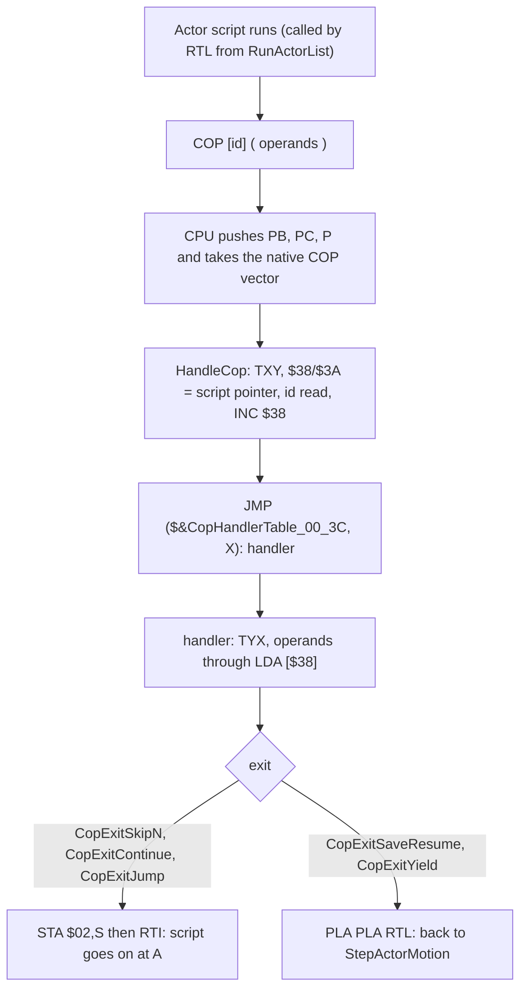
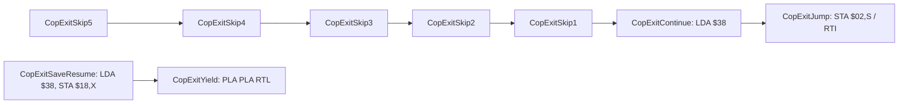

# COP Dispatch — From a COP Instruction to a Handler and Back

*Part of the [Soul Blazer Code Documentation](README.md)*

> How one `COP [id] ( operands )` inside an actor script becomes a call to one of 108 handlers, how a handler reads its operands, and which of seven exits sends the script on, skips operands, jumps, waits or yields; plus the shared helpers behind the handlers and the sibling `BRK #n` sound request.

**Source:**
[`cop_dispatch.asm`](../../extracted/system/cop_dispatch.asm) (`HandleCop`, `HandleBrk`, the three command tables) ·
[`cop_core.asm`](../../extracted/system/cop_core.asm) (the exit chain, the shared helpers, `CopB2_SpawnBeforeRelative`) ·
[`cop_script_flow_flags.asm`](../../extracted/cop_handlers/cop_script_flow_flags.asm) ·
[`cop_items_stats_text.asm`](../../extracted/cop_handlers/cop_items_stats_text.asm) ·
[`cop_conditions.asm`](../../extracted/cop_handlers/cop_conditions.asm) ·
[`cop_actor_fields_animation.asm`](../../extracted/cop_handlers/cop_actor_fields_animation.asm) ·
[`cop_tiles_spawn_kill.asm`](../../extracted/cop_handlers/cop_tiles_spawn_kill.asm) ·
[`copdef.json`](../../us/copdef.json) (operand schema) ·
[`gv_village_actors_019475.asm`](../../extracted/grass_valley/grass_valley_village/gv_village_actors_019475.asm) (the worked example)

---

## Overview

Every actor in a scene (an NPC, a monster, a door, a puff of smoke) is driven by a **script**: ordinary 65816 machine code in which the game's own commands are written as `COP [id] ( operands )`. The scheduler calls the script once when the actor's wait counter has run out ([actor-system.md](actor-system.md), "The script contract"); the script runs until it hits a `COP` that yields or an `RTL`. A `COP` is a software interrupt: `HandleCop` takes it, reads the id byte that follows the opcode, and jumps through a table to the handler. The handler reads its operands from the script bytes behind the id, does its work, and either lets the script go on after the last operand byte or hands control back to the scheduler.

This document explains that mechanism: the dispatcher, the operand conventions, the exit chain, the waiting idioms, the position conventions the tests share, and the helpers. The **list of the 108 commands** with their operands and use counts is the hub [cop/index.md](../cop/index.md); it is not repeated here.



The mechanism in numbers (`extracted/` after I045):

| What | Count |
|------|-------|
| `COP` command sites in all extracted code | 11,025 (489 in the engine files `system/` and `library/`, 10,536 in scene and shared actor files) |
| Handlers | 108 (ids `00`-`3C` minus four undefined, `80`-`B2`), 91 of them used |
| `BRK #n` sound requests | 289 |

The 108 handlers sit in six files, one per family:

| File | Handlers | Command sites | Subject |
|------|---------:|--------------:|---------|
| [`cop_script_flow_flags`](../../extracted/cop_handlers/cop_script_flow_flags.asm) | 19 | 2,076 | loops, yields, waits on event flags, switches, scene change, random numbers, music loading |
| [`cop_items_stats_text`](../../extracted/cop_handlers/cop_items_stats_text.asm) | 14 | 840 | text boxes, choice menus, items, Gems, EXP, HP |
| [`cop_conditions`](../../extracted/cop_handlers/cop_conditions.asm) | 15 | 639 | jumps on the position of actors and of the player, on-screen waits |
| [`cop_actor_fields_animation`](../../extracted/cop_handlers/cop_actor_fields_animation.asm) | 39 | 5,964 | position, animation, flips, draw order, palette, player visibility |
| [`cop_tiles_spawn_kill`](../../extracted/cop_handlers/cop_tiles_spawn_kill.asm) | 20 | 1,392 | tile map blocking and probes, spawning, killing |
| [`cop_core`](../../extracted/system/cop_core.asm) | 1 (`CopB2_SpawnBeforeRelative`) | 114 | the handler that sits in front of the exit chain |

More than half of all command sites (5,964 of 11,025) are the animation family; `Cop80_SetAnimation` plus `Cop82_WaitAnimationDone` alone are 3,237 sites.

Code addresses are source-ROM addresses (LoROM: bank = file offset ÷ `$8000`, address = `$8000` + the offset inside that bank); the rebuilt ROM places the blocks elsewhere (`rebuilt/layout.json`). WRAM addresses are the game's own.

**Related:** [cop/index.md](../cop/index.md) · [actor-system.md](actor-system.md) · [boot-nmi-main-loop.md](boot-nmi-main-loop.md) · [wram-memory-map.md](../wram-memory-map.md)

---

## Memory Map

All of it is in bank `$00`.

| Address | Name | Description |
|---------|------|-------------|
| `$00:D5FC` | `HandleBrk` | Native `BRK` vector: the sound request. |
| `$00:D61E` | `HandleCop` | Native `COP` vector: builds the script pointer and jumps to the handler. |
| `$00:D638` | `CopHandlerTable_00_3C` | 61 handler words for ids `00`-`3C`, indexed `id × 2`. |
| `$00:D6B2` | `CopFillerTable_3D_7F` | 67 filler words for ids `3D`-`7F` (no handlers; they keep the next table at `+$100`). |
| `$00:D738` | `CopHandlerTable_80_B2` | 51 handler words for ids `80`-`B2`. |
| `$00:D849` | `CopFlagJumpTail` | Shared test of `Cop07_JumpIfFlagEquals` and `Cop08_JumpIfFlagNotEquals`. |
| `$00:D8C0` | `CopActorBoxTest` | Shared box test of `Cop0C_JumpIfActorInBox` and `Cop2E_JumpIfActorInBoxWord`. |
| `$00:DBD0` | `CopTileTestTail` | Shared tile probe of `Cop21`-`Cop24` and `Cop28`. |
| `$00:E473` | `CopB2_SpawnBeforeRelative` | The last handler; the exit chain follows it in the ROM. |
| `$00:E4B5` | `CopExitSkip5` | Start of the exit chain (`CopExitSkip4` .. `CopExitSkip1` follow it). |
| `$00:E4BF` | `CopExitContinue` | Continue at `$38`. |
| `$00:E4C1` | `CopExitJump` | `STA $02,S` and `RTI`: the script continues at A. |
| `$00:E4C4` | `CopExitSaveResume` | Save `$38` as the resume pointer, then yield. |
| `$00:E4C9` | `CopExitYield` | `PLA PLA RTL`: back to the scheduler. |
| `$00:E4CC` | `WriteEventFlag` | Sets or clears one event flag. |
| `$00:E4F8` | `TestEventFlag` | Tests one event flag (carry = set). |
| `$00:E51E` | `LookupInventoryEntry` | Reads one inventory entry. |
| `$00:E537` | `BlockActorFootprint` | Marks the tiles under an actor solid. |
| `$00:E5A7` | `ClearActorFootprint` | Releases them. |
| `$00:E617` | `SlotNumberToActor` | Slot number 0-63 to the slot address. |
| `$00:E628` | `TileToPixel` | Tile number × 16. |
| `$00:E62D` | `RegisterSwitchOwner` | Records which actor owns a switch. |
| `$00:E63A` | `SpawnActorAfter` | Allocates, links and clones a new actor on the `$3C` side. |
| `$00:E662` | `SpawnActorBefore` | The same on the `$3E` side. |
| `$00:E68A` | `PopFreeSlot` | Takes a slot from the free stack. |
| `$00:E6A3` | `InitSpawnedActor` | Turns the new slot into a copy of the spawner. |

---

## From COP to handler

### HandleCop: the script pointer

*When:* at every `COP` of every script (11,025 sites). *Sees:* nothing by itself. *Why a routine:* the 65816 `COP` opcode is two bytes, the opcode and a signature byte that the CPU ignores, so the signature carries the command id for free and the interrupt entry gives the script one entry point from which a table can route every id.

The CPU pushes the program bank, the return address and the status register. `HandleCop` reads them off the stack (`$01,S` P, `$02,S` PC, `$04,S` PB):

```
TXY                  ; Y = actor slot (X is the slot at the COP site)
LDA $04,S : STA $3A  ; $3A = bank of the script
LDA $02,S : DEC : STA $38   ; PC - 1 = the signature byte = the command id
LDA [$38] : INC $38  ; read the id; $38 now points at the first operand byte
AND #$00FF : ASL : TAX
JMP ($&CopHandlerTable_00_3C,X)
```

The pushed PC is the COP address plus 2, so `DEC` lands on the id byte. From then on direct page `$38`/`$3A` is the **script pointer**: every handler reads operands with `LDA [$38]` and advances `$38` by hand. `HandleCop` changes neither the data bank (`DBR`) nor the direct page register. Both come from the boot code: `BootGame` sets D = 0 and DBR = `$01` ([boot-nmi-main-loop.md](boot-nmi-main-loop.md)), and `RunActors` saves and restores DBR without setting it, so a script reaches its `COP` with D = 0 (the handlers address `$38`, `$00`, `$16` directly) and DBR = `$01` (bank `$01` maps WRAM at `$0000`-`$1FFF`, which the handlers' `$0016,X` reads rely on), unless it changed them. `Cop01_ShowText` and `PrintTextString` switch DBR for the duration of one call. The 65816 sets `PB` to 0 when it takes the vector, which matters in the next section.

### The command tables

*When:* in the `JMP` of every dispatch. *Sees:* nothing. *Why:* three word tables instead of one so that the id numbering can leave a gap: ids `00`-`3C`, then 67 filler words (`CopFillerTable_3D_7F`, which hold `#$0000`, `#$FFFF` and one `#$0020` at index `$26`, id `$63`), then ids `80`-`B2`. The filler keeps `CopHandlerTable_80_B2` exactly `$100` bytes after `CopHandlerTable_00_3C`, so `id × 2` indexes the pair as one table. Ids `0E`, `0F`, `2C` and `2D` inside the first table are `#$0000`; no script uses them, nor any id from `3D` to `7F` or above `B2`.

The jump `JMP ($&CopHandlerTable_00_3C, X)` is the absolute indexed indirect form: the CPU reads the pointer from the **program bank** (Bruce Clark, [65C816 opcodes](https://6502.org/tutorials/65c816opcodes.html), JMP). Taking the COP vector forces `PB = 0`, and the target is a 16-bit address in the same bank, so the tables and all 108 handlers must be, and are, in bank `$00`. Scripts can be in any bank; the handlers are not.

### What a script author can rely on

Rules that follow from the code, in the order they bite:

1. **X must be the actor slot at every `COP`.** `HandleCop` starts with `TXY` and every handler starts with `TYX`; a script that uses X as a counter between two commands acts on the wrong actor ([`cop_core`](../../extracted/system/cop_core.asm), "Conventions of every handler"). The scheduler enters the script with X = the slot ([actor-system.md](actor-system.md)).
2. **A and Y are scratch across a command; X is the slot again on exit** (the exit chain does not change X).
3. **`$38`-`$3A` are clobbered by every `COP`**, so a script cannot keep its own data there.
4. **A jump stays in the bank of the script** (`CopExitJump` writes only the PC word, see below), which is why all jump targets are `&Code` (2 bytes) and never `@Code`.
5. **The processor flags come back as the script had them**: `HandleCop` changes only M (`SEP #$20`, `REP #$20`, so every handler starts with a 16-bit accumulator) and the closing `RTI` restores the pushed P.

---

## Handler contract and operands

### Reading operands

*When:* in the first instructions of every handler. *Sees:* nothing. *Why:* operands are inline bytes behind the id, with no length field; the handler is the only thing that knows how many there are, and `copdef.json` repeats that number so the extractor knows where the next instruction starts.

| `copdef` part | Bytes | How the handler reads it | Example label |
|---------------|------:|--------------------------|---------------|
| `Byte` | 1 | `LDA [$38]` (16-bit), `INC $38`, `AND #$00FF`: the next script byte is read and masked off | `Cop03_LoopStart` |
| `Word` | 2 | `LDA [$38]`, `INC $38` twice | `Cop09_SetOrClearFlag` |
| `&Code` | 2 | a `Word` that becomes the new `$38` | `Cop06_Jump` |
| `@Code` | 3 | a `Word` for `$18` and a masked `Byte` for `$36` | `Cop85_SpawnActorBefore` |
| `&ASCIIString` | 2 | a pointer in the script's own bank; `Cop01_ShowText` pushes `DBR`, sets it to `$3A` and calls `ShowDialogueText` | `Cop01_ShowText` |
| `&ASCIIString$2` | 2 | a pointer into **bank `$02`**: the `$2` is the bank hint of the copdef reader (`gaia-core` `cop.ts`: `$` plus hex digits after a part name), and `PrintTextString` forces `DBR = $02` | `Cop1A_ChoiceMenu` |

The `$2` explains the `Cross bank call detected ... 'COP ChoiceYesNoText'` lines of `npm run rebuild`: the writer warns for every `&` reference of a `COP` whose target is in another bank, and all 27 `COP [1A]` sites point at `shared_choice_prompt_texts` in bank `$02` by design.

Four handlers read a byte with an **8-bit** accumulator (`Cop1A_ChoiceMenu`, `CopA8_SetAnimationTable`, `CopA9_SetDynamicTileSource` and the unused `Cop29_JumpIfTileIdDiffers`). With M = 8 an `INC $38` increments only the low byte, so they follow it with `BNE` and `INC $39` to carry into the high byte. The 16-bit `INC $38` of the other handlers carries by itself. The bank `$3A` is never changed, so a script cannot run across a bank border.

Some commands pick a target from a list of `&Code` words instead of reading one: `Cop9A`, `Cop9B`, `Cop9C` and `CopA5_JumpByFlipState` set Y to 0, 2, 4 or 6 and read `LDA [$38], Y` (labels `Cop9APick`, `Cop9BPick`, `CopA5Pick`), so a three-way branch always jumps.

### The exit chain

*When:* at the end of every handler, entered by `BRL`. *Sees:* the script going on, a wait, or the actor going idle. *Why:* the handlers differ in how many operand bytes are left unread when they finish; instead of each one adding that up, they enter a chain of `INC $38` that skips exactly that many bytes.



Each `CopExitSkipN` is one `INC $38` that falls into the next; `CopExitContinue` loads `$38` into A, and `CopExitJump` stores A over the PC word of the COP frame and returns with `RTI`. A jump command therefore loads the target word into A and branches straight to `CopExitJump`.

| Exit | What it does to the stack | Meaning for the script |
|------|---------------------------|------------------------|
| `CopExitJump` (reached from the skips and from `CopExitContinue`) | `STA $02,S` replaces **only the PC word**; the bank byte at `$04,S` stays; `RTI` restores P, PC and PB | the script continues at A, in its own bank, with its own processor flags |
| `CopExitSaveResume` | `STA $18,X` first | resume pointer = `$38`, then yield |
| `CopExitYield` | two 16-bit `PLA` drop the 4-byte frame (P, PC, PB); `RTL` returns to the address the scheduler pushed (`StepActorMotion - 1`) | the actor yields; the scheduler calls it again at `$18,X`/`$36,X` once the wait counter `$14` has run out (a plain yield leaves `$14` at 0, so the next frame) |

The skip chain is how a failed test leaves: a jump command whose condition is false leaves through the `CopExitSkipN` that matches the bytes it did not read.

| Exit | Bytes still unread | Used by |
|------|-------------------:|---------|
| `CopExitSkip5` | 5 | `Cop30_SpawnIfEnteredViaRecord` when `return_active` is 0 (word and `@Code`) |
| `CopExitSkip4` | 4 | `Cop07_JumpIfFlagEquals`, `Cop08_JumpIfFlagNotEquals` (flag word and `&Code`) |
| `CopExitSkip3` | 3 | `Cop0D_JumpIfActorAtTile` when the x differs; `Cop30` when the record differs |
| `CopExitSkip2` | 2 | every conditional jump with one `&Code` left; `Cop05_WaitWhileFlagEquals` (its flag word) |
| `CopExitSkip1` | 1 | `CopAD_WaitUntilOnScreen` (its delay byte) |
| `CopExitContinue` | 0 | everything that has read all its operands: field writes, spawns, the animation starters |

`Cop8D_JumpIfOnScreen` and `Cop8E_JumpIfOffScreen` do not skip their `&Code` word on the not-taken path, so the script would run the target address as code. No script uses them (OQ-I001-1).

---

## Waiting and yielding

### The resume pointer: who writes it

*When:* whenever a script pauses. *Sees:* an NPC standing still, an animation playing out, an enemy idling off screen. *Why:* a yield returns to the scheduler with no memory of where the script was; the only memory is the actor's resume pointer `$18` (word) and `$36` (bank), so every pausing command must make sure it points where the script should go on.

| Command | Writes | Then |
|---------|--------|------|
| `Cop91_SetEntryHere` | `$18` = after itself, **`$36` = `$3A`** | continues (the only handler that writes the bank byte of the running actor) |
| `Cop03_LoopStart`, `Cop80`, `Cop81`, `Cop9D`, `Cop92`, `Cop93` | `$18` = after itself | continue (`Cop92`/`Cop93` yield) |
| `Cop05_WaitWhileFlagEquals`, `CopAD_WaitUntilOnScreen` | `$18` = **their own COP instruction** (`$38` rewound by 2 over the id and the opcode: labels `Cop05Wait`, `CopADWait`) | yield, so the test repeats |
| `Cop04_LoopNext` (label `Cop04LoopAgain`) | `$18` = the loop start in `$2C` | yields |
| `Cop1B_DelayThenGoto`, `Cop27_YieldThenGoto` | `$18` = target, `$14` = delay or 0 | yield |
| `Cop12_SetActorResume` | `$18` of **another** actor | continues |
| `Cop84_SpawnActorAfter`, `Cop85_SpawnActorBefore`, `CopAB`, `CopAC`, `CopAF`-`CopB2`, `Cop31`, `Cop32` (and `Cop30` through `Cop85`) | `$18` and `$36` of the **new** actor | continue |
| `Cop00_Yield`, `Cop82`, `Cop83`, `Cop94`, `Cop95`, `Cop9E` | nothing | yield with the pointer an earlier command left |

Only `Cop91` and the spawn commands ever write a bank byte, so the bank of a script is fixed at spawn (or by the `Cop91` of the placement script) and every later `&Code` is read in it.

### Wait pairs

*When:* wherever a script plays an animation (1,623 `COP [82]` sites). *Sees:* a character walking, a monster blinking, a puff expanding, with the script advancing when the animation ends. *Why:* `Cop82_WaitAnimationDone`, `Cop83_WaitAnimationRepeat` and `Cop9E_WaitAnimationDoneOrJumpIfBlocked` do not save a resume pointer themselves; the command **before** them did, and it pointed at the wait command.

The pairs are not a convention that might be broken: `rg` over `extracted/` finds every one of the 1,614 `COP [80]` followed immediately by `COP [82]`, all 522 `COP [81]` by `COP [83]`, all 51 `COP [9D]` by `COP [9E]` and all 21 `COP [92]` by `COP [94]`. `Cop91_SetEntryHere` also saves the address behind itself, so it is the other legal starter: seven `COP [82]` sites (four with a label between) and all seven of the `COP [83]` sites that do not follow a `COP [81]` come right after a `COP [91]`. Two `COP [82]` sites follow neither (OQ-I045-2).

Each run of the wait calls `SetActorAnimFrame` once. Carry clear means a step was loaded and its duration is in `$14`: the wait yields (`Cop82Yield`, `Cop83Yield`) and the scheduler re-enters it that many frames plus one later. Carry set means the animation ended and the script goes on. `Cop83` loops back into `SetActorAnimFrame` (`Cop83Step`) and decrements the repeat count `$2A` before it tests it, so a count of 0 would run 65,536 times; no script uses a `COP [81]` count below 2.

**Patch hazard:** because `Cop80`, `Cop81` and `Cop9D` save the address behind themselves, any command inserted between a starter and its wait would be re-run at every step of the animation.

### Delays, loops and flag waits

*When:* timers, repeated actions, scripted cutscenes. *Sees:* a pause of N frames, a repeated action, an NPC that stands until something has happened. *Why:* the script language has one idiom per wait kind, each storing what the scheduler needs.

- `Cop1B_DelayThenGoto` stores target and delay `$14`; the script runs delay + 1 frames later. `Cop27_YieldThenGoto` is the same with delay 0.
- `Cop03_LoopStart` and `Cop04_LoopNext` keep the loop start in `$2C` and the counter in `$2E`: one loop per actor, no nesting.
- `Cop05_WaitWhileFlagEquals` tests an event flag every frame (label `Cop05SenseSet` for the sense bit) and rewinds to itself while the flag has the awaited value.
- `CopAD_WaitUntilOnScreen` is the first command of many enemy scripts: an actor that is off screen but inside the map (`CopADTestMapX`, `CopADTestMapY`) rewinds to itself, sets `$14` to its delay byte (label `CopADWait`) and yields, so it tests again delay + 1 frames later; a monster is idle until the camera reaches it. Off screen and outside the map, or on screen, it skips the byte (`CopExitSkip1`).

---

## Where an actor is: the position conventions

### Position and box

*When:* in every command that compares positions. *Sees:* an NPC that reacts when the hero steps near, a monster that turns at a wall. *Why:* the commands share one convention, and it is easy to get wrong by a tile: an actor's `$00` is its x (left) and `$02` its **y bottom edge**, in pixels. A tile operand is multiplied by 16 (`TileToPixel`), so an actor standing on tile row n has y = (n + 1) × 16. `Cop0D_JumpIfActorAtTile` adds the 1 itself (comment on `INC` before `TileToPixel`: "an actor's y is its bottom edge"), while `Cop11_MoveActorToTile` does not: it sets y = tile row × 16, and its note records that placement records add 16 (OQ-I025-8).

`CopActorBoxTest` (shared by `Cop0C_JumpIfActorInBox`, margin in tiles, and `Cop2E_JumpIfActorInBoxWord`, margin in pixels) tests whether the other actor's position lies inside the caller's box widened by a margin m: x in [x - m, x + m + width - 16] and y in [y - m - height + 16, y + m] (width `$10`, height `$12` of the caller). The x test is `CopActorBoxTest`, the y test starts at `CopBoxTestY` and a hit leaves through `CopBoxInside`. Lair proximity scripts use `Cop0C`.

### Three-way branches

`Cop9A_JumpByPlayerDeltaX` and `Cop9B_JumpByPlayerDeltaY` take a threshold T and three targets (left / within / right, above / within / below). With d = player − actor, d = 0 or |d| within the band picks the middle target. The left (above) test uses `EOR #$FFFF` without the `INC` that completes a negation, which gives |d| − 1: the player is **left of the actor when |d| > T** but **right when d ≥ T**, so the band is one pixel wider on the right side (labels `Cop9ARight`, `Cop9APick`; the same shape in `Cop9BBelow`, `Cop9BPick`). `Cop9C_JumpByPlayerAxis` compares |dx| with |dy| and picks the first target when |dy| < |dx|. The usual follow-up of a three-way branch is a facing or animation command (`Cop8F_FacePlayerX`, `Cop80_SetAnimation`).

### Tile probes

*When:* in monster scripts that must turn before a wall and in scripts that open or close tiles. *Sees:* a monster that turns back, a door that blocks the way. *Why:* actors do not collide with each other for movement; solid ones mark the tile map (`tile_type_map`, one byte per 16 × 16 tile) and everything else asks the map.

| Command | Pixel sampled | Tests |
|---------|---------------|-------|
| `Cop28_JumpIfTileHere` | (x, y − 16) | whole byte non-zero |
| `Cop21_JumpIfTileAbove` | (x, y − 16 − height) | whole byte |
| `Cop22_JumpIfTileBelow` | (x, y) | whole byte |
| `Cop23_JumpIfTileLeft` | (x − 16, y − 16) | whole byte |
| `Cop24_JumpIfTileRight` | (x + width, y − 16) | whole byte |
| `CopAE_JumpIfTileTypeNonZero` | (x + dx, y + dy − 16) | the type nibble only, so an actor's `$F0` mark alone does not count |

The first five share `CopTileTestTail`, which turns the pixel into an index (`lib_map_index_helpers.PixelToMapIndex`) and keeps the low byte. `Cop2A_BlockTileAt` ORs `$F0` into one tile at an offset and `Cop2B_UnblockTileAt` zeroes the whole low byte, **including the type nibble**, not only the mark.

---

## Shared helpers

*When:* called by `JSR` from the handlers. *Sees:* the effects of the commands. *Why:* these are the pieces that more than one handler needs, and they sit in `cop_core` next to the exit chain.

### Event flags and switches

`TestEventFlag` and `WriteEventFlag` work on a **flag word**: bits 0-7 the bit number, bits 8-14 the byte index into `event_flags` (`$1A5E`), bit 15 a command-specific sense bit that `TestEventFlag` ignores (`BitMaskTable` supplies the masks). `Cop05`, `Cop07` and `Cop08` compare the flag with the sense bit; `Cop09_SetOrClearFlag` writes it. Switches are a second bit array at `$1ADE` indexed by the lair record: `Cop14_JumpIfSwitchSet` and `Cop3B_JumpIfSwitchSetElseHold` test it and call `RegisterSwitchOwner`, which records the calling actor in `switch_owner_table` (`$7F0483`; zeroed only on a return trip, its one reader is `FacePlayerTowardReturnTarget`); `HoldActorUntilReleased` sets the bits. The bit space, the writers and readers of every array, and the lifetime of the flags are in [flags-switches-and-inventory-bytes.md](flags-switches-and-inventory-bytes.md).

### Inventory

`LookupInventoryEntry` reads entry n (1-based) at `inventory + n - 1`: bit 7 = equipped, bits 0-6 = value, zero when not owned (carry set). `Cop0A_GiveItemIfNotOwned`, `Cop0B_RemoveItem`, `Cop18_JumpIfItemMissing` and `Cop19_JumpUnlessItemEquipped` all start with it.

### Footprints

`BlockActorFootprint` and `ClearActorFootprint` (called by `Cop15_BlockOwnTiles` and `Cop16_UnblockOwnTiles`; `Cop11_MoveActorToTile` also calls the second, for the other actor, after it has stored the new position, OQ-I025-8) write `$F0` into, or zero, every `tile_type_map` byte under the actor's box. A box with width + height below `$21` (`#$0021`) is the single tile at (x, y − 16). A bigger box takes the branch labelled `BlockFootprintMultiTile` / `ClearFootprintMultiTile`: width / 16 columns by height / 16 rows, one row per pass, stepping east with `StepMapIndexEast`.

### Slot numbers and tile pixels

`SlotNumberToActor` turns a slot number 0-63 into `$0800 + number × $40`, so a script can name another actor with one byte (`Cop0C`, `Cop0D`, `Cop11`, `Cop12`, `Cop13`, `Cop2E`); slot 0 is the hero. `TileToPixel` is four `ASL`.

### Spawning

`SpawnActorAfter`, `SpawnActorBefore`, `PopFreeSlot` and `InitSpawnedActor` allocate, link and clone a new actor; their rules (which side of the caller, what a full pool does) are in [actor-system.md](actor-system.md), "Script spawns: COP 84, 85 and their variants" and "When the pool is full". The spawn handlers do not test the carry of `PopFreeSlot`; with an empty pool the new actor lands in the scratch slot `$06AA`.

---

## COP outside a script

Most of the 489 `COP` sites of the engine files are engine actors written as scripts (the hero in `player_core`, the spells in `player_spells_level_up`, the lair actors in `engine_spawn_lairs_death_drops`). Three sites are different: `KillAllOtherActors` and `KillAllProjectiles` walk the actor list and issue `COP [86]` with X set to each victim, and `ApplyGemPickup` ends with `COP [86]` (X = the pickup actor) before its own `RTL`. The `COP [86]` of a script is followed by `RTL` at 280 of its 283 sites; these three are the others, because the caller must go on: `KillAllOtherActors` reads the next link from `$3E,X` after the kill, which still works because the freed slot keeps its links ([actor-system.md](actor-system.md), "Cop86_KillSelf and the bulk kills").

---

## HandleBrk: the sound request

*When:* every `BRK #n`, 289 sites in `extracted/` (sword swings, spawns, pickups, deaths, scripts). *Sees:* nothing itself; the sound driver plays the request one or two frames later. *Why:* a two-byte instruction is the cheapest way for scripts and engine code to ask for a sound, and `BRK` needs no register setup.

`HandleBrk` is the sibling of `HandleCop`. It saves A (`PHA`), reads the signature byte through a long pointer in `$3B`-`$3D` (after `PHA` the frame is A, P, PC, PB, so PC is at `$04,S` and the bank at `$06,S`) and writes it into the sound word: bit 6 of n clear stores n in `sound_request` (`$0398`) and goes to `BrkReturn`, bit 6 set stores n and `$BF` in `$0399` (label `BrkStoreHighByte`). It touches `$3B`-`$3D` only, never `$38`-`$3A`, so a `BRK` in the middle of a script or a handler (`Cop39_DamagePlayer` issues `BRK #$04`) does not disturb the script pointer. The previous value of the byte is overwritten, so two requests in one frame lose the first. The NMI sends the word on even frames and zero on odd frames (`engine_vblank_nmi`, section SOUND). The low byte goes to `APUIO2` and asks the SPC for a sound on voice 7, the high byte to `APUIO3` for voice 8; bit 7 of the low byte plays it on both voices and bits 0-5 are the sound id, 1-`$26` ([spc-interface.md](spc-interface.md), static reading; OQ-I024-1 is answered there).

---

## Worked example: the painting in the house on the hill

*When:* in Grass Valley, in the house at the top of the hill. *Sees:* a painting that shows a strange face; with Leo's Brush equipped the hero is pulled into it. *Why it makes a good example:* its script uses a switch, a spawn, a flag, an item test, a text box and a scene change.

The script is `gv_obj_leos_painting_019475` (meta type `$17`) and its labels in [`gv_village_actors_019475.asm`](../../extracted/grass_valley/grass_valley_village/gv_village_actors_019475.asm):

| Label | Script line | What happens |
|-------|-------------|--------------|
| `gv_obj_leos_painting_019475` | `COP [14] ( #$001A, &code_01947C )` then `RTL` | `Cop14_JumpIfSwitchSet`: registers the actor as owner of switch `$1A`, jumps when it is set, otherwise skips and the `RTL` yields; the resume pointer is unchanged, so the test repeats every frame |
| `code_01947C` | `COP [30] ( #$001A, &code_019505, #03 )`, `COP [AC] ( @code_0194BE, ... #$2000 )` | `Cop30_SpawnIfEnteredViaRecord` spawns `code_019505` (shows the screaming text, then `Cop86_KillSelf`) only when the visit began at lair record `$1A`; `CopAC_SpawnBeforeAbsolute` spawns the hidden helper `code_0194BE` with flags `$2000` |
| `code_01947C` | `COP [14] ( #$0009, &code_0194B5 )`, `COP [17] ( &code_0194FB )` | switch `$09` (the Chief's switch: the file's roster ties it to the Metal Mantis lair) set: jump to the "after" state; otherwise `Cop17_SetOwnParam` stores the talk text handler in `$30` |
| `loc_019498` | `COP [80] ( #03 )`, `COP [82]`, `COP [87]`, `COP [81] ( #05, #02 )`, `COP [83]`, then the same with animation 4, `BRL loc_019498` | the animation loop: animation 3 and its wait pair, a flip, animation 5 twice (`Cop81` with `Cop83`), and round again; `BRL` is plain machine code inside a script |
| `code_0194B5` | `COP [17]`, `COP [15]`, `COP [91]`, `RTL` | the "after" state: new talk text, solid tiles (`Cop15_BlockOwnTiles`), then `Cop91` and `RTL` park the actor for the rest of the scene |
| `code_0194BE` | `COP [20] ( &code_0194C9 )`, `COP [0D] ( #00, #30, #04, &code_0194CE )` | helper: while the hero is between tiles (`Cop20_JumpIfPlayerOffGrid`) it goes to `code_0194C9`, which clears flag `$0006` with `Cop09_SetOrClearFlag` and ends with `RTL`; otherwise `Cop0D_JumpIfActorAtTile` asks whether slot 0 (the hero) stands on tile (`$30`, `$04`) in front of the painting |
| `code_0194CE` | `COP [19] ( #1D, &code_0194E1 )`, `COP [01]`, `COP [10] ( #$0103, ... )`, `RTL` | `Cop19_JumpUnlessItemEquipped`: item `$1D` (Leo's Brush) not equipped jumps to `code_0194E1` (the "sad face" texts); equipped shows the text and `Cop10_SetNextScene` changes to area 3, scene 1 |

---

## Walkthrough cross-check

| Game term or fact | Walkthrough | ROM (label) | Result |
|-------------------|-------------|-------------|--------|
| Enter the painting with Leo's Brush | `02-grass-valley.md`: "equip Leo's Brush, then approach the painting" | `code_0194CE`: `Cop19_JumpUnlessItemEquipped` with item `$1D`, then `Cop10_SetNextScene` | Consistent |
| Switch under a cleared lair | `02-grass-valley.md`: "go onto the northwestern switch that was once underneath the monster lair" | `Cop14_JumpIfSwitchSet`, switch = lair record index | Consistent |
| Magic Bell: no Gems for magic | `items.md`: "Prevents magic from using Gems" | `Cop26_PayGemsOrJump`: `equipped_bracelet` = `$40` makes the cost 0 | Consistent |
| Magic Armor halves Gem use | `items.md`: "Halves Gem consumption when using spells"; `magic.md`: 4 Gems, 2 with Magic Armor | `Cop26_PayGemsOrJump`: `equipped_armor` = `$0C` halves the cost, at least 1 | Consistent |
| Medical Herb, Strange Bottle | `items.md` (Strange Bottle: "keep all of your Gems if your HP hits zero") | `Cop19`/`Cop0B` on ids `$38`/`$39` in `CheckPlayerDeath` | Consistent as far as the item ids; the Gem effect is not part of this document |
| Painting name | headings `Grass Valley - Leo's Painting`, `Leo's Painting - Part 1` | ROM banner text `LocationName07` (and 08, 09, 0B in `lib_banner_texts`) reads "Leo s Paintings" (plural, no apostrophe glyph) | DISCREPANCY (OQ-I045-1) |

---

## Open questions

The questions this document could not settle are in `plans/extracted-audit/questions/I045_questions.md`: OQ-I045-1 (the name "Leo's Painting" against the ROM's "Leo s Paintings", a DISCREPANCY), OQ-I045-2 (two `COP [82]` sites that follow no resume-saving command) and OQ-I045-3 (D and DBR at `HandleCop`, read from the boot code, not measured). Earlier questions this document relies on: OQ-I001-1 (`Cop8D`/`Cop8E`), OQ-I024-1 (the sound bytes), OQ-I025-4 (the 17 handlers without uses), OQ-I025-8 (`Cop11` clears the footprint at the new position).

---

## See Also

- [cop/index.md](../cop/index.md): the list of all 108 commands with operands, use counts and one-line behaviour; the dispatch snippet and the actor field table.
- [actor-system.md](actor-system.md): the scheduler that calls the script, the script contract (yield and resume), and the spawn and kill rules behind `Cop84`, `Cop85` and `Cop86_KillSelf`.
- [boot-nmi-main-loop.md](boot-nmi-main-loop.md): the frame that runs the actors, and the NMI that sends the `BRK` sound word.
- [wram-memory-map.md](../wram-memory-map.md): the WRAM variables the handlers touch.
- [scene-area-warp-loading.md](scene-area-warp-loading.md): what `Cop10_SetNextScene` and `Cop3C_SetTransitionType` start, and the loader that follows.
- [walkthrough/README.md](../walkthrough/README.md): the game terms used here.
- [collision-and-physics.md](collision-and-physics.md): the tile commands (`Cop15`, `Cop16`, `Cop21`-`Cop24`, `Cop28`, `Cop2A`, `Cop2B`, `CopAE`), the position commands (`Cop9F`-`CopA1`, `Cop2F`) and what they do to `tile_type_map`.
- [sprites-oam-animation.md](sprites-oam-animation.md): what `SetActorAnimFrame` does with the id that `Cop80` stores, the animation tables, the flip, priority and table commands in detail.
- [flags-switches-and-inventory-bytes.md](flags-switches-and-inventory-bytes.md): the state that `Cop05`, `Cop07`, `Cop08`, `Cop09`, `Cop0A`, `Cop0B`, `Cop14`, `Cop18`, `Cop19` and `Cop3B` read and write: the shared bit space, who owns each flag, the inventory bytes, the progress items.
- [text-and-dialogue.md](text-and-dialogue.md): the text engine behind `Cop01` and `Cop1A`: the string format, `ShowDialogueText`, `PrintTextString`, `RunChoiceMenu` and `choice_result`.
- [spc-interface.md](spc-interface.md): the sound driver behind `BRK` (the ports, the sound word, the uploads) and the music changes of `Cop31_FadeAndLoadMusic` and `Cop32_StopAndLoadMusic`.
