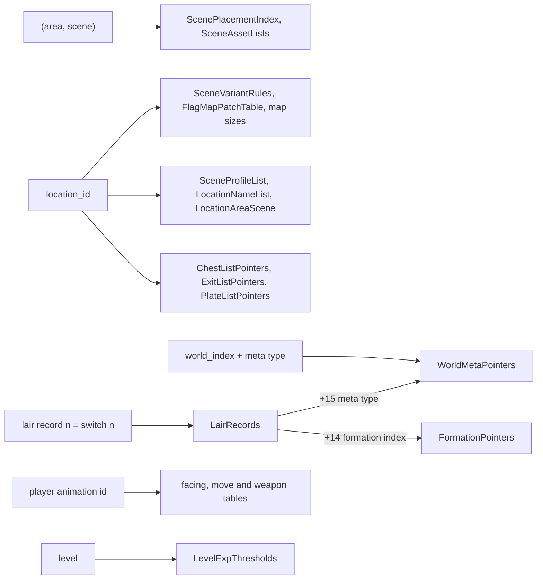
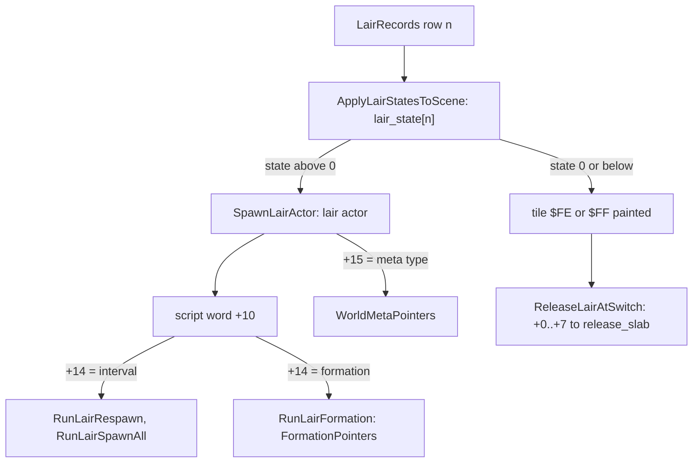

# Data Tables — the keyed tables of `data_*.asm`, `WorldMetaPointers.asm` and the libraries

*Part of the [Soul Blazer Code Documentation](README.md)*

> What the game stores as tables and how each one is found: the seven keys, the pointer-table and terminator conventions, the location tables and their 31 holes, the lair records and the formation lists that drive every monster lair, the meta lists, the sixteen engine tables, the animation banks, the row layouts and the data that nothing reads. The readers are described in the other spokes; this document compares the tables with each other.

**Source:**
[`WorldMetaPointers.asm`](../../extracted/system/WorldMetaPointers.asm) ·
[`data_lair_records.asm`](../../extracted/system/data_lair_records.asm) ·
[`data_lair_formations.asm`](../../extracted/system/data_lair_formations.asm) ·
[`data_engine_tables.asm`](../../extracted/system/data_engine_tables.asm) ·
[`data_scene_placements.asm`](../../extracted/system/data_scene_placements.asm) ·
[`data_chest_lists.asm`](../../extracted/system/data_chest_lists.asm) ·
[`data_exit_lists.asm`](../../extracted/system/data_exit_lists.asm) ·
[`data_plate_lists.asm`](../../extracted/system/data_plate_lists.asm) ·
[`data_scene_variant_rules.asm`](../../extracted/system/data_scene_variant_rules.asm) ·
[`data_scene_asset_lists.asm`](../../extracted/system/data_scene_asset_lists.asm) ·
[`lib_scene_profile_data.asm`](../../extracted/library/lib_scene_profile_data.asm) ·
[`lib_map_tile_patches.asm`](../../extracted/library/lib_map_tile_patches.asm) (`FlagMapPatchTable`, `MapPatchRectsAndMapSizes`) ·
[`lib_tile_triggers_and_lair_return.asm`](../../extracted/library/lib_tile_triggers_and_lair_return.asm) (`LocationAreaScene`, `NpcNameStrings`) ·
[`lib_banner_texts.asm`](../../extracted/library/lib_banner_texts.asm) (`LocationNameList`) ·
[`lib_unused_sine_wave_tables.asm`](../../extracted/library/lib_unused_sine_wave_tables.asm) ·
[`data_menu_palettes_and_groups.asm`](../../extracted/system/data_menu_palettes_and_groups.asm) ·
[`data_iris_and_icon_tiles.asm`](../../extracted/system/data_iris_and_icon_tiles.asm) ·
[`data_dictionary.asm`](../../extracted/system/data_dictionary.asm) ·
[`data_spc_driver.asm`](../../extracted/system/data_spc_driver.asm) ·
the six animation banks [`data_anim_player_unarmed.asm`](../../extracted/system/data_anim_player_unarmed.asm), [`data_anim_player.asm`](../../extracted/system/data_anim_player.asm), [`data_anim_weapon_overlay.asm`](../../extracted/system/data_anim_weapon_overlay.asm), [`data_anim_palette_cycles.asm`](../../extracted/system/data_anim_palette_cycles.asm), [`data_anim_effects.asm`](../../extracted/system/data_anim_effects.asm) and [`data_anim_magic.asm`](../../extracted/system/data_anim_magic.asm)

---

## Overview

Almost everything in Soul Blazer that differs from room to room, monster to monster or level to level is a table, and the code that reads it is shared. A scene is a row of `SceneAssetLists`, a list in `ScenePlacementIndex`, three lists keyed by `location_id`; a monster is a 14-byte row of `WorldMetaPointers`; a Monster Lair is a 32-byte row of `LairRecords`; the level-up is a row of `LevelExpThresholds`. The readers are in [scene-area-warp-loading.md](scene-area-warp-loading.md), [actor-system.md](actor-system.md), [combat-damage-and-enemy-records.md](combat-damage-and-enemy-records.md) and the other spokes; this document is the table-side view: what each table is keyed by, how it ends, what its rows hold, and what comparing the tables with each other shows.

Three conventions hold for almost every table here, and misreading one of them is the usual way to misread a table:

- **List offsets are relative to the table.** `chest_list_ofs`, `exit_list_ofs`, `plate_list_ofs` and `meta_table_offset` hold the pointer word minus the address of the table, and every reader adds the table label back (`TryOpenChest` reads `ChestListPointers, X` with X = `chest_list_ofs`; `InitExitListOffset` stores `ExitListPointers[location_id] - ExitListPointers`). A list therefore has to sit in the same bank as its pointer table, and each pointer table is followed directly by its lists.
- **Pointer words are 16 bits.** The tables of bank `$01` hold `&` words, so a table and the lists it points to stay together in one bank. Readers reach the data in both forms: the short `$&` form (`WatchForLevelUp`, `RunSoulOrbController`) and the long `$@` form (`TestBitInArray`, `DrawGaugeBar`, `BuildRotationMatrix`).
- **A table ends in one of four ways** (section "Keys, terminators and bank rules").

Code addresses are source-ROM addresses (LoROM: bank = file offset ÷ `$8000`); the rebuilt ROM places blocks elsewhere (`rebuilt/layout.json`). Counts below come from the extracted `.asm`.

**Related:** [wram-memory-map.md](../wram-memory-map.md) · [areas-and-scenes.md](../areas-and-scenes.md) · [flags-switches-and-inventory-bytes.md](flags-switches-and-inventory-bytes.md)

---

## Memory Map

### Data

Location-keyed (`location_id`, `$1C6A`):

| Label | Address | Key and index step | Ends at | Read by |
|-------|---------|--------------------|---------|---------|
| `ChestListPointers` | `$01:A9DE` | `location_id` × 2 | list: byte `$FF` (`ChestListEmpty` is a lone `$FF`) | `TryOpenChest`, `ShowOpenedChests` |
| `ExitListPointers` | `$01:AC96` | `location_id` × 2 | list: byte `$FF` | `CheckExitRegions`, `InitExitListOffset` |
| `PlateListPointers` | `$01:B69A` | `location_id` × 4 + `plate_variant` × 2 | list: byte `$FF` (`PlateListEmpty`) | `TriggerVariantPlate`, `InitPlateVariantAtEntry` |
| `SceneVariantRules` | `$01:F99A` | rows of 4 scanned in order | first byte ≥ `$80` | `LookupSceneVariant` |
| `SceneProfileList` | `$02:E8A1` | `location_id` × 2 | none (128 words) | `ApplySceneProfile` |
| `LocationNameList` | `$02:C7C2` | string number = `location_id` | none (128 words) | the `[TBL]` code of `LocationBannerText` |
| `LocationAreaScene` | `$02:F62C` | `location_id` × 2 | none (130 words) | `ReleaseLairAtSwitch` |
| `FlagMapPatchTable` | `$02:F28D` | rows of 9 scanned, location in byte 0 | byte `$FF` | `ApplyFlagMapPatches` |
| `MapPatchRectsAndMapSizes` | `$02:F504` | patch id × 8, then `location_id` × 2 + `$28` | none | `ApplyMapPatchRect`, `InitSceneState` |

Scene- and lair-keyed:

| Label | Address | Key and index step | Ends at | Read by |
|-------|---------|--------------------|---------|---------|
| `ScenePlacementIndex` | `$01:99B4` | `(area_current, scene_current)`, rows of 4 | first byte ≥ `$80` | `SpawnSceneActors` |
| `PlacementA00S01` … (97 lists) | after the index | row pointer of the index row | byte `$FF` | `SpawnPlacementList` |
| `SceneAssetLists` | `$05:8000` | `(area_current, scene_current)`, variable records | byte `$00` per record | `LoadSceneAssets` |
| `WorldMetaPointers` | `$01:8000` | `world_index` × 2, then type × 14 | none | `SpawnSceneActors`, `LoadMonsterFromMeta` |
| `LairRecords` | `$01:BA0D` | record n × 32 (n = switch n) | first byte `$FF` | `ApplyLairStatesToScene`, `SpawnLairActor`, `ReleaseLairAtSwitch` |
| `FormationPointers` | `$01:EE8E` | record +14 × 2 | none: the monster count ends a list | `RunLairFormation` |
| `NpcNameStrings` | `$02:D2E6` | record +9 × 2 | none (53 words) | the `[TBL:&NpcNameStrings,03C8]` text code |

The sixteen engine tables, all in `data_engine_tables.asm`, bank `$01`:

| Label | Address | Key | Read by |
|-------|---------|-----|---------|
| `WeaponIconPositions`, `ArmorIconPositions`, `MagicIconPositions` | `$01:F9F7`, `$FA07`, `$FA17` | slot 0-7 | `DrawEquipIconRows` |
| `ItemIconPositions` | `$01:FA27` | slot 0-39 | `DrawItemIconGrid` |
| `SwitchBitMasks` | `$01:FA77` | bit number and 7 | `TestBitInArray`, `SetBitInArray` |
| `PlayerFacingByAnim`, `PlayerMoveDirByAnim` | `$01:FA7F`, `$FAAB` | player animation id (44) | `GetPlayerFacing`, `GetMoveDirectionOfAnim` |
| `WeaponYOffsetByAnim` | `$01:FAD7` | animation id × 2 | `FinishPlayerMove` |
| `GaugeColorLadder` | `$01:FB2F` | units ÷ 10 (13 words) | `DrawGaugeBar` |
| `MusicPointerTable` | `$01:FB49` | track × 3 (21 long pointers) | `MusicLoadUpload` |
| `MagicGraphicsPointers`, `MagicPalettePointers` | `$01:FB88`, `$FBA0` | spell 0-7 | `LoadEquippedMagicGfx` |
| `LevelExpThresholds` | `$01:FBB8` | level × 4 | `WatchForLevelUp` |
| `SineTable` + `SineTableTail` | `$01:FC84`, `$FCC4` | angle 0-255 (cosine: + 64) | `RunSoulOrbController`, `BuildRotationMatrix` |
| `CircleHalfWidths` | `$01:FDC4` | row 0-127 | `BuildSoulOrbCircleWindow` |

Animation, graphics and sound data, each its own bank or block:

| Label | Address | Content | Read by |
|-------|---------|---------|---------|
| `PlayerUnarmedAnims` | `$0A:8000` | step lists, hero without a weapon | `ApplyPlayerWeaponPose` (`$24` = `$0A`) |
| `PlayerAnims` | `$0B:8000` | step lists, hero with a weapon; entry 0 of every meta list | `ApplyPlayerWeaponPose` |
| `WeaponOverlayAnims` | `$0C:8000` | step lists of the weapon actor | the weapon actor (`$24` = `$0C`) |
| `PaletteAnimLists` | `$0D:8000` | colour-cycle copy lists (6-byte steps) | `lib_animation` (COPs 92-95, 9D, 9E) |
| `EffectAnims` | `$0E:8000` | shared puffs and effects | `RunMonsterAppearPuff`, `RunEnemyDeath` |
| `MagicAnims` | `$0F:8000` | spell and Phoenix animations | the spell actors of `player_spells_level_up` |
| `IrisFrames`, `IconTileRecords` | `$09:8000`, `$09:8800` | 32 iris masks; 128 2 × 2 icon records | `PlayTransitionIn`; `DrawInventoryIcon` |
| `ItemPagePalette`, `MenuBgPalette`, `MenuTileGroupMap`, `MenuSpellPalettes` | `$09:F000`, `$F100`, `$F200`, `$F300` | menu palettes and the group map | `LoadItemPagePalette`, `LoadMenuPalette`, `ExpandMenuTileGroups`, `RestoreSceneBgGfxAndPalette` |
| `Dictionary` | `$10:8000` | 128 words of 12 bytes | `ReadTextByte`, `ReadDialogueByte` |
| `SpcDriverBlock` | `$06:8000` | SPC700 upload stream | `UploadSpcDriver` |

### State

| Variable | What it holds |
|----------|---------------|
| `location_id`, `world_index` | the key of the location tables; the key of the meta list (set by `ApplySceneProfile` from the profile's byte 11, bits 0-3) |
| `meta_table_offset` | the offset of the world's list in `WorldMetaPointers`; an actor's `$38` is this plus type × 14 |
| `chest_list_ofs`, `exit_list_ofs` | offsets of the current location's lists |
| `plate_lists_ofs`, `plate_list_ofs`, `plate_variant` | the offset of the location's pair of plate lists, of the active list, and which of the pair is active |
| `lair_state` | `$7F:0203`, 512 bytes, byte n = state of record n; starts as record +13 (`InitFixedState`) |
| `release_slab` … `release_rect_h` | the first 8 bytes of the record being released, copied by `MVN` to `$1C6D-$1C74` |
| `scene_variant` | the variant `LookupSceneVariant` found |

---

## Keys, terminators and bank rules

### Seven keys

**When:** every scene load and every frame that touches a tile list. **Sees:** nothing directly; the choice of key decides what a table can say. **Why:** a table can only describe what its key can tell apart.

| Key | Tables | Consequence |
|-----|--------|-------------|
| `(area, scene)` | `ScenePlacementIndex`, `SceneAssetLists` | one row per scene: 97 index rows and 98 asset records (the first record, area `$53` scene `$59`, is a dummy) |
| `location_id` | the nine location tables | 128 ids, 97 in use ([The 31 holes](#the-31-holes)) |
| `world_index` + type | `WorldMetaPointers` | the same type number is a different actor in each world |
| lair record n | `LairRecords`, `lair_state`, the switch arrays | 420 records; n is also switch number n |
| formation index | `FormationPointers` | 112 lists, indexed by record +14 |
| player animation id | the three `ByAnim` tables, the animation banks | 44 ids (`$00-$2B`); `$2C` and up are not valid |
| level | `LevelExpThresholds` | 51 rows, row = level × 4 |

### Terminators and counts

Four kinds occur, and each reader uses exactly one:

- **A byte `$FF` ends a list**: chest rows (`TryOpenChest`: `CMP #$FF` on byte 0), exit and plate rows, placement rows (`SpawnPlacementList`), the lair table (`LairRecords` byte 0) and `FlagMapPatchTable`.
- **A first byte of `$80` or more ends a scan**: `ScenePlacementIndex` and `SceneVariantRules`. The areas of the index are `$00-$15` and location ids are `$00-$7F`, so the high bit is free.
- **A count ends the walk**: `FormationPointers` lists have no terminator; `RunLairFormation` reads `$2E` rows (the record's monster count). A list shorter than the count would read into the next list.
- **No terminator at all**: the profile records, `WorldMetaPointers` rows (the type is bounded by the placement data, see [Meta lists](#meta-lists)), the `ByAnim` tables and the 128-word tables, whose key is always below the size.

### Pointer arithmetic

`PlateListPointers` is the only pointer table with a second index: two words per location, `plate_variant` picks one (`InitPlateVariantAtEntry` flips the bit and re-reads the word). `LocationAreaScene` has 130 words, two more than the 128 ids; both extra words are 0 and nothing indexes them by static reading. `MapPatchRectsAndMapSizes` is two tables under one label: five 8-byte patch rectangles read as id × 8 by `ApplyMapPatchRect`, then 32 rows of 8 bytes that are 128 pairs of map width and height read as `location_id` × 2 + `$28` by `InitSceneState`.

---

## The location tables

### The 31 holes

**When:** at every scene load. **Sees:** nothing; an id with no scene never loads. **Why:** the ids are assigned in blocks of `$14` per world, so the last ids of a block can stay unused and the tables keep their slots.

`SceneProfileList`, `ChestListPointers`, `ExitListPointers`, `PlateListPointers` (both words of a pair) and `LocationAreaScene` hold a zero word at exactly the same 31 ids: `$25-$27`, `$35-$3B`, `$48-$4F`, `$5D-$63`, `$74-$77` and `$7E-$7F`. The 97 other ids each have a profile record, and the world byte of every record equals `location_id` ÷ `$14` (`SceneProfile00` … `SceneProfile7D`). The holes are the unused tails of the world blocks:

| World | Ids | In use | Holes |
|-------|-----|--------|-------|
| 0 Grass Valley | `$00-$13` | 20 | none |
| 1 GreenWood | `$14-$27` | 17 (`$14-$24`) | `$25-$27` |
| 2 St. Elles | `$28-$3B` | 13 (`$28-$34`) | `$35-$3B` |
| 3 Mountain of Souls | `$3C-$4F` | 12 (`$3C-$47`) | `$48-$4F` |
| 4 Leo's Lab | `$50-$63` | 13 (`$50-$5C`) | `$5D-$63` |
| 5 Magridd's Castle | `$64-$77` | 16 (`$64-$73`) | `$74-$77` |
| 6 World of Evil | `$78-$8B` | 6 (`$78-$7D`) | `$7E-$7F` (the table ends at `$7F`) |

`LocationNameList` has no zero words: its unused ids point at a one-byte empty string. This explains why the 15 filler records of `LairRecords` can never be found: their location `$63` is a hole in every table that a scene load reads (OQ-I015-2).

### Chest, exit and plate lists

**When:** `InitSceneState` stores the offsets; the lists are read on a chest press, every frame (exits) and on a plate step. **Sees:** a chest that stays open, a door that leads on, a plate that rearranges the room. **Why:** doors, chests and plates are data on the map, so one routine serves every room (the readers are in [scene-area-warp-loading.md](scene-area-warp-loading.md)).

- 60 of the 128 words of `ChestListPointers` point at the shared `ChestListEmpty`: the 31 holes are zero, so 60 locations are real places without a chest. The id byte of a chest row is a bit number of the chest array at `$1A7E` (bit 7: the chest is also on BG2), so all chests of the game share one bit space (`ChestListLoc05` holds three chests).
- `ExitListPointers` gives `$56` and `$5A` the same list, `ExitListLoc56`. `$5A` is a dream room, so the pointer may be a slip of the original data (OQ-I033-5, DISCREPANCY). `ExitListUnreferenced`, an empty list after `ExitListLoc59`, has no reader.
- A plate pair holds the plates of variant 0 and variant 1 (`PlateListLoc01V0`, `PlateListLoc01V1`): stepping on an active plate applies the lair record named by the plate's word and flips the variant. A plate row's word is a record number, so plates and lairs share the switch numbering.

### Variant rules and map patches

`SceneVariantRules` has 23 rows `(location, switch word, variant)`. Its switch words name six boss lair records (`$09`, `$50`, `$B6`, `$103`, `$12F`, `$195`) and the variant is 0 for the six boss rooms, 1 for the dock `$71` and 2 for the rest (`LookupSceneVariant`). `FlagMapPatchTable` has 70 rows of 9 bytes (`unk13`: location, flag word, the destination rectangle, the staging position); the flag word holds the event-flag bit number directly ([flags-switches-and-inventory-bytes.md](flags-switches-and-inventory-bytes.md)). The five patch rectangles of `MapPatchRectsAndMapSizes` are the boss-room patches; ids 0 and 4 are identical (OQ-I024-3).

---

## Lair records and formations

No other spoke describes these two tables as data. The behaviour of the lair scripts is in [actor-system.md](actor-system.md) (§"Lair actors and their monsters"); the release scenes are in [scene-area-warp-loading.md](scene-area-warp-loading.md).

### LairRecords: one 32-byte row per lair and per switch

**When:** `ApplyLairStatesToScene` walks all 420 rows at every scene load; `SpawnLairActor` builds each live lair; `ReleaseLairAtSwitch` runs when the player steps on the green switch; NPC and plate scripts reach it through the record number. **Sees:** monsters that come out of a patch of map until all are dead, then a green switch that frees an NPC or opens a path. **Why:** all lairs share six scripts, so a lair is one row, and the same row says what the release does.

| Offset | Field | Used by |
|--------|-------|---------|
| `+0` | home location (where the released NPC lives); `$FF` ends the table | `ApplyLairStatesToScene`, `ReleaseLairAtSwitch` |
| `+1` | slab number (0-3) | `release_slab` |
| `+2`, `+3` | home tile x, y | release |
| `+4` … `+7` | release rectangle x, y, width, height (0 / 0 writes one type-1 tile) | `release_rect_x` … `release_rect_h` |
| `+8` | layer (non-zero: BG2 as well) | `PaintLairTile` |
| `+9` | NPC name index | `NpcNameStrings` |
| `+A` | world index of the lair location; the release ORs it into `lair_state` | `ReleaseLairAtSwitch` |
| `+B` | lair location | `ApplyLairStatesToScene` |
| `+C`, `+D` | lair tile x, y (the switch appears here) | `PaintLairTile` |
| `+E`, `+F` | staging rectangle x, y (both 0: the lair frees an NPC) | release |
| `+10` … `+12` | script, 3-byte `@Code` | `SpawnLairActor` |
| `+13` | monster count; also the initial `lair_state` | `InitFixedState`, `SpawnLairActor` |
| `+14` | spawn interval (`$14` = 3 × `$26` − 1) or formation index | `DelayBetweenSpawns`, `RunLairFormation` |
| `+15` | meta type | `LoadMonsterFromMeta` |
| `+16` | OAM attribute word (`$4000`, `$8000`, `$C000`: flips) | `SpawnLairMonster` |
| `+18`, `+1A`, `+1C` | zero in all 420 rows; no reader | OQ-I033-12 |
| `+1D` | `warp_dest_anim` of the return trip | `ReleaseLairAtSwitch` |
| `+1E` | gate switch (a bit of `$1ADE`; 0 = none) | `Cop3B_JumpIfSwitchSetElseHold`, `SetHeldLairTileType` |

The 420 rows are grouped by the world of their lair location, not sorted inside a world: world 0 is rows `$00-$34`, world 1 `$36-$76`, world 2 `$77-$C3`, world 3 `$C4-$103`, world 4 `$109-$155`, world 5 `$158-$195` and world 6 `$196-$1A3`. The gaps and the holes inside the ranges are the 15 filler rows (`$26`, `$27`, `$2D`, `$35`, `$104-$108`, `$12B`, `$12C`, `$146`, `$156`, `$157`, `$194`), identical copies for location `$63`.

Scripts by world (the survey of the 420 rows; the block note of `LairRecords` gives the totals 156 / 139 / 107 / 8 / 7 / 3):

| Script | W0 | W1 | W2 | W3 | W4 | W5 | W6 |
|--------|----|----|----|----|----|----|----|
| `RunLairRespawn` | 24 | 22 | 24 | 24 | 21 | 19 | 7 |
| `RunLairSpawnAll` | 17 | 28 | 33 | 23 | 26 | 11 | 1 |
| `RunLairFormation` | 8 | 13 | 17 | 9 | 26 | 29 | 5 |
| `RunLairProximity` | 0 | 0 | 3 | 2 | 0 | 2 | 1 |
| `RunLairSpawnAllFlipping` | 0 | 0 | 0 | 6 | 1 | 0 | 0 |
| no script | 1 | 2 | 0 | 0 | 0 | 0 | 0 |

Plus 15 `RunLairRespawn` fillers. The row counts per world agree with the ranges above (for example world 3: 24 + 23 + 9 + 2 + 6 = 64 = `$C4-$103`).

**+A is the world index.** In 403 of the 420 rows `+A` equals the world of the lair location; the 17 exceptions have `+A` = 0: the 15 fillers and the dream rows `$74` and `$75`. `ReleaseLairAtSwitch` stores `+A` or `$80` (path) or `+A` or `$C0` (NPC) into `lair_state`. Every reader found tests `lair_state` for sign (`ApplyLairStatesToScene`: `BMI`, `BEQ`), for bits 7 and 6 (`SetHeldLairTileType`) or for bit 6 (`Cop3B_JumpIfSwitchSetElseHold`, `HoldActorUntilReleased`, `PlayLairReleaseScene`); none tests the low bits, so the world number rides along unused (OQ-I057-1).

**Dream rooms.** Five rows have a monster count of 0: `$32` (Lisa's dream, location `$0E`), `$74` (Bird's, `$23`), `$75` (Stump's, `$24`), `$79` (a dolphin's, `$2D`) and `$E7` (a mushroom's, `$43`). The first three have no script (`$000000`); `$79` and `$E7` carry `RunLairRespawn` with interval 1, but a state of 0 paints the green switch and never spawns the lair actor (`ApplyLairStatesToScene`), so the script never runs (OQ-I057-3). The walkthrough describes exactly these switches: the Stump's dream has "the monster lair switch" with no monster, the dolphin's "the switch that was beneath him", the mushroom's "a switch to make a path to an island".

**The six boss rows** (all `RunLairFormation`, `+15` is the boss type of the lair location's world):

| Row | Home `+0` | Lair `+B` | Type | Count | Formation | ROM HP / EXP | Bestiary |
|-----|-----------|-----------|------|-------|-----------|--------------|----------|
| `$09` | `$04` | `$0C` | `$1F` | 1 | `$21` | 50 / 50 | Metal Mantis 50 HP, 50 EXP |
| `$50` | `$15` | `$22` | `$3D` | 3 | `$20` | 50 each / 30 each | Elemental Statues 50 HP each, 90 EXP total |
| `$B6` | `$29` | `$32` | `$41` | 1 | `$22` | 69 / 200 | Floating Skull 70 HP, 200 EXP |
| `$103` | `$3D` | `$44` | `$38` | 1 | `$23` | 79 / 400 | Poseidon 70 HP, 400 EXP |
| `$12F` | `$53` | `$59` | `$1E` | 1 | `$6C` | 89 / 800 | Tin Doll 80 HP, 800 EXP |
| `$195` | `$65` | `$72` | `$09` | 1 | `$6F` | 99 / 5,000 | Demon Falcon 90 HP, 5,000 EXP |

HP and EXP are the type's row in the world's meta list (`MetaGrassValley` … `MetaMagriddsCastle`; EXP is BCD). Four HP values differ from the bestiary (OQ-I033-1).

### FormationPointers: places the monsters of 107 lairs

**When:** `RunLairFormation`, once when the lair first runs. **Sees:** the whole group standing in a set pattern, some mirrored, the moment the lair opens. **Why:** the timed scripts cannot place monsters at fixed positions.

`FormationPointers` is 112 words indexed by record `+14`; each list is rows of three words (x, y in pixels, flip bits ORed into `$1C` after `AND #$3FFF`). `RunLairFormation` takes the row count from `$2E`, the live monster count, so a list needs at least that many rows. Static comparison of all 107 records that use it: the list has **exactly** as many rows as the record's `+13` count, in every record (the old notes said "at least"). The sum of the counts is 407 rows; the 112 lists hold 434 rows, so 27 rows belong to lists no record names.

Five lists are named by no record: `$06`, `$0B`, `$0E`, `$29` and `$2B` (10, 3, 6, 4 and 4 rows, 27 in all). The 107 used lists split by world as 8, 13, 17, 9, 26, 29 and 5 (the formation rows of the table above). `RunLairFormation` is the only reader and takes its index only from `+14`, so by static reading the five lists are dead data (OQ-I057-2). The lists keep their auto names (`unk9_00EF6E` …): the index in `FormationPointers` is the name the records use (OQ-I033-15).

---

## Meta lists

**When:** `SpawnSceneActors` picks the list once per scene load; every spawn of a placement row, a lair monster or a script reads one row. **Sees:** the same type number is a different creature in each world. **Why:** a type is one byte, so seven lists let seven worlds reuse the numbers.

`WorldMetaPointers` is seven words followed by the lists `MetaGrassValley`, `MetaGreenwood`, `MetaStElles`, `MetaMountainOfSouls`, `MetaLeosLab`, `MetaMagriddsCastle` and `MetaWorldOfEvil` (95, 81, 87, 68, 55, 62 and 21 rows of 14 bytes, 469 in all). The row layout is in [combat-damage-and-enemy-records.md](combat-damage-and-enemy-records.md) (§"The enemy record") and [actor-system.md](actor-system.md) (§"Scene load"). Entry 0 of every list is the hero, and the seven copies are identical (`PlayerAnims` as animation table, `InitPlayerActor` as script).

The animation field (`+8`..`+A`) of the 469 rows points at one of five places:

| Animation table | Rows |
|-----------------|------|
| the spritemap asset in WRAM (`$7E3800`) | 358 |
| `PaletteAnimLists` | 69 |
| none (`$000000`) | 31 |
| `PlayerAnims` | 7 (entry 0 of each world) |
| `EffectAnims` | 4 |

Which rows the game can reach: a type is reachable when a placement row (913 rows over the 97 lists) or a lair record names it. Static comparison:

| World | Rows | In placements | In lair records | Reached by either |
|-------|------|---------------|-----------------|-------------------|
| 0 | 95 | 84 | 10 | 94 |
| 1 | 81 | 67 | 10 | 77 |
| 2 | 87 | 73 | 10 | 83 |
| 3 | 68 | 59 | 9 | 68 |
| 4 | 55 | 45 | 10 | 55 |
| 5 | 62 | 54 | 8 | 62 |
| 6 | 21 | 19 | 2 | 21 |

Nine rows are reached by neither: world 0 type `$09`; world 1 types `$34`, `$36`, `$3B`, `$3E`; world 2 types `$14`, `$25`, `$27`, `$33`. Script spawns (`COP [84]`, `[85]`) could still reach them (OQ-I015-6). The highest type placed in each world equals the list size − 1, so every list is exactly as long as its highest placed type.

---

## Engine tables

The sixteen small tables of `data_engine_tables.asm`. Their readers and effects are in the spokes named in the right column; this section adds what the bytes show.

### Bit masks and the player's direction tables

`SwitchBitMasks` is `01 02 04 08 10 20 40 80`, the mask of bit n and 7 for every bit array (the arrays are in [flags-switches-and-inventory-bytes.md](flags-switches-and-inventory-bytes.md)). `PlayerFacingByAnim` and `PlayerMoveDirByAnim` have 44 bytes each with the values 0 up, 1 down, 2 right, 3 left. They agree for ids `$00-$04`, `$06`, `$08`, `$0A` and `$14-$2B` and differ for 12 ids (`$05`, `$07`, `$09`, `$0B-$13`), the sidestep and backstep poses, where the hero faces one way and slides another (`GetMoveDirectionOfAnim`, `SlideAroundCorner`). Ids `$14-$1F` hold 0 in both tables; what those animations are is OQ-I014-2 ([player.md](player.md) covers the animation ids). `WeaponYOffsetByAnim` is 44 words of 0 or 1 pixel, added to the weapon actor's y by `FinishPlayerMove`.

### Gauge colours and the EXP ladder

`GaugeColorLadder` has 13 words: five entries of dark blue (`$79E0`, units 0-49), then one colour per ten units from 50 to 90 (`$7AE0`, `$5FC0`, `$03D7`, `$03DE`, `$3FDE`) and white (`$7BDE`) for 100 and more. A value of 130 or more reads past the table (OQ-I010-5). `LevelExpThresholds` has 51 rows of two BCD words, the high word first: row 0 is unused, row n is the EXP needed for level n + 1, row 49 and row 50 are `99,999,999`. `WatchForLevelUp` ends at level 50, so row 50 is never read.

### Sine and circle

`SineTable` and `SineTableTail` are one 320-byte signed sine: 256 angles plus 64 for the cosine (`BuildRotationMatrix` reads the cosine from `SineTableTail` at the same index). The values follow 127 × sin(angle) within 1.9; none of six simple formulas reproduces them (rounding, truncating or flooring 127 × sin; rounding 127.5 × sin; truncating or rounding 128 × sin clipped at 127: 117 to 249 of 320 entries differ), and the negative half is not the exact negation of the positive one (12 of 128 entries match: the table rises 0, 3, 6, 9 … and falls 0, −4, −7, −10 …). The rising half is mirrored about the peak at angle 64 (`S[i]` = `S[128 − i]`, 127 of 127 entries). Readers: `RunSoulOrbController` (the orbit), `BuildRotationMatrix` and `BuildRotationMatrixAlt` (the Mode 7 rotation), the World of Evil jet script (`SineTable+10`), and the dead `FillSineWaveTables` of [`lib_unused_sine_wave_tables.asm`](../../extracted/library/lib_unused_sine_wave_tables.asm).

`CircleHalfWidths` is the half-width of a circle for each of 128 rows, largest value `$3F`; the reader is `BuildSoulOrbCircleWindow`, which builds the window tables of the four Soul effects (`RunSoulOfLightEffect` and its three siblings) with a circle of radius `$40` around the soul orb. The table is mirrored about row 64 (`C[i]` = `C[128 − i]` for 125 of 127 rows; rows 1 and 127 hold 4 and 0) and is not a perfect circle (the effect's radius is `$40`; the table peaks at `$3F` for eleven rows, 59-69). The old note called the reader unannotated and the shape "probably the iris"; the reading above settles both (OQ-I033-9).

---

## Animation banks

**When:** every frame, for every actor with an animation. **Sees:** the sprites of the hero, the weapon, the effects and the monsters. **Why:** one bank per kind of actor keeps each pointer list under 128 entries.

Two formats share the animation banks (the stepping code is in [sprites-oam-animation.md](sprites-oam-animation.md)):

| Format | Banks | Step | List ends | Counts (lists / steps / leaves) |
|--------|-------|------|-----------|--------------------------------|
| animation steps (`unk3`, `unk12`) | `$0A`, `$0B`, `$0C`, `$0E`, `$0F` | 8 bytes: duration, dx, dy, `&frame` | word `$FFFF` | `$0A` 26 / 116 / 64; `$0B` 44 / 184 / 100; `$0C` 44 / 120 / 42; `$0E` 17 / 83 / 28; `$0F` 54 / 264 / 124 |
| copy steps (`unk11`) | `$0D` | 6 bytes: hold, `&source`, destination colour, length − 1, delay | byte `$00` | 80 / 686 / 593 |

Bank `$0D` is `PaletteAnimLists`, not a VRAM copy list: the steps write BGR555 runs into the CGRAM shadow at `$7F0000`, and 53 steps with destination 0 and 3 bytes write the three COLDATA bytes of the fixed-colour fade (the earlier function maps called it a VRAM copy list; OQ-I033-6). A frame leaf has a 12-byte header and a sprite map. The meta lists reach the banks through the animation field (see [Meta lists](#meta-lists)); bank `$0E` and `$0F` also through `COP [A8]` operands (`#$8000, #0E`, `#$8000, #0F`).

---

## Row layouts

Every field width below was read from the consuming code. The `structs.json` column says where the declared type of `us/structs.json` disagrees.

| Struct | Rows | Layout | Declared |
|--------|------|--------|----------|
| `meta_entry` | 469 | attack, defence, HP (bytes), EXP (BCD word), animation id (byte), flags (word), animation table (3 bytes), script (3 bytes) | agrees |
| `unk1` | 97 | area, scene, `&unk2` list | agrees |
| `unk2` | 913 | x tile, y tile, flags (bit 7, 6: flip; bit 0: `$1C` bit 8), meta type | agrees |
| chest row | 67 | x, y (the player's tile; the chest is one tile up), id (bit 7: also BG2), item (`$00` empty, `$FF` Gems), Gems (BCD word); raw bytes in the extraction, no struct | none |
| `unk6` (exit) | 201 | x, y, width, height, area, scene, anim (bytes), `warp_dest_x`, `warp_dest_y` (words) | 11 bytes: the two words are declared as 4 bytes |
| `unk7` (plate) | 91 | x, y, record number (word) | agrees |
| `unk8` (lair) | 420 | table above | 16 bytes, `@Code`, 3 bytes, 5 words: `+14` is a byte and `+1D` is read as a byte |
| `unk9` (formation) | 434 | x, y, flip bits (words) | agrees |
| `unk10` (variant) | 23 | location (byte), switch bit (word), variant (byte) | agrees |
| `unk13` | 70 | location, flag word, six bytes | agrees |
| `unk14` | 37 | four bytes, two words; five patch rectangles, then 32 rows of map sizes | one struct for two tables |
| `unk17` | 128 | four words (top-left, top-right, bottom-left, bottom-right) | agrees |
| `unk3`, `unk12` | 420, 347 | duration, dx, dy, `&frame` (words) | six bytes and `&Binary` |
| `unk11` | 686 | hold, `&source`, destination, length − 1, delay | agrees |
| `unk4`, `unk15`, `unk16` | 7, 15, 54 | actor-owned tables: `cm_data_master_move_hub_positions_0076D3` (`unk4`); `ms_ice_markers_summit_021FA9` and `ms_ice_markers_laynole_021FED` (`unk15`); `gv_push_zones_underground_west_01B042` and the other push-zone lists, `mc_deck_push_zone_records_02702B` (`unk16`) | agrees |
| `unk5` | 0 | declared, never used | n/a |

The scene asset records (`asset<>`, `asset8`, `graphics`, `palette`, `tileset`, `tilemap`, `music`, `spritemap`, `meta4`) are in [scene-area-warp-loading.md](scene-area-warp-loading.md). Whether to retype `unk6`, `unk8`, `unk3` and `unk12` is OQ-I033-10; a retype changes the extracted text only when it is lossless and was not tried.

---

## Data nothing reads

Static reading finds these never-read data (none is a bug; they keep numbering or alignment):

| Data | Evidence |
|------|----------|
| the 15 filler rows of `LairRecords` | location `$63`, a hole in every table (OQ-I015-2) |
| formation lists `$06`, `$0B`, `$0E`, `$29`, `$2B` | named by no record (OQ-I057-2) |
| meta rows (9) | reached by no placement and no lair record (OQ-I015-6) |
| `LairRecords` `+18`, `+1A`, `+1C`; the low bits of `+A` | zero in every row; no reader of the low bits (OQ-I033-12, OQ-I057-1) |
| `ExitListUnreferenced` | an empty list after `ExitListLoc59` |
| `LocationAreaScene` words 128 and 129 | past the last id |
| `LevelExpThresholds` row 0 and row 50 | `WatchForLevelUp` reads rows 1-49 |
| `FillSineWaveTables` | no routine calls it, and `wave_request` has no other user (OQ-I013-12) |
| `RunLairRespawnFlipping` | no record uses it (OQ-I006-5) |

---

## Walkthrough cross-check

The walkthrough is the source of truth for game names and facts; the ROM text for spelling and behaviour.

| Walkthrough | ROM | Result |
|-------------|-----|--------|
| `level-up.md`: EXP table of levels 2-50 (100, 280, 580, 1,000, … 99,999,999) | `LevelExpThresholds` rows 1-49 | All 49 values agree. |
| `level-up.md`: Max HP bar of 50 units, "each color adds ten more HP" up to white at 100 | `GaugeColorLadder`: dark blue below 50, five colours for 50-99, white at 100 | Agrees. |
| `enemy-bestiary.md`: Metal Mantis 50 HP, 50 EXP; Elemental Statues 50 HP each, 90 EXP total | rows `$09` and `$50` of `LairRecords`; types `$1F` of `MetaGrassValley` and `$3D` of `MetaGreenwood` | Agrees (three statues at 30 EXP each). |
| `enemy-bestiary.md`: Floating Skull 70, Poseidon 70, Tin Doll 80, Demon Falcon 90 HP | `MetaGreenwood` `$41` = 69, `MetaMountainOfSouls` `$38` = 79, `MetaLeosLab` `$1E` = 89, `MetaMagriddsCastle` `$09` = 99 | DISCREPANCY, already OQ-I033-1; EXP agrees (200, 400, 800, 5,000). |
| `02-grass-valley.md`: "the switch beneath the lair will release the tool shop's owner"; the village Chief freed after the Metal Mantis | row `$09`: home location `$04` (the Chief's room), `RunLairFormation`, type `$1F` | Agrees. |
| `02-grass-valley.md`, `03-greenwood.md`, `04-st-elles.md`, `05-mountain-of-souls.md`: Lisa's, the bird's, the tree stump's, the dolphin's and the mushroom's dreams each hold a switch and no monster | rows `$32`, `$74`, `$75`, `$79`, `$E7` (count 0) | Agrees. |
| `Dictionary` entries `$06` "Deathtole" and `$0C` "Liesa" against the walkthrough's "Deathtoll" and "Lisa" | `Dictionary` strings | DISCREPANCY, already OQ-I010-2 and OQ-I033-7; the ROM spelling is quoted. |

---

## Open questions

The questions this document could not settle are in `plans/extracted-audit/questions/I057_questions.md`: OQ-I057-1 (the world number in `LairRecords` `+A` is stored and never read), OQ-I057-2 (five formation lists no record names), OQ-I057-3 (why the dolphin's and the mushroom's dream rows carry a script and the other three do not), OQ-I057-4 (what the two words past `$7F` of `LocationAreaScene` are) and OQ-I057-5 (whether `MapPatchRectsAndMapSizes` should be split into its two tables). All are GAP or decisions; none is a DISCREPANCY. Earlier questions this document relies on: OQ-I033-1 (the four boss HP values), OQ-I033-5 (`ExitListLoc56` shared by `$56` and `$5A`), OQ-I033-6 (bank `$0D`), OQ-I033-9 (settled by the reading above), OQ-I033-10 (retyping), OQ-I033-12 (the zero fields), OQ-I015-2 and OQ-I015-6 (fillers and unused meta rows), OQ-I010-2 and OQ-I033-7 (the dictionary spelling) and OQ-I010-5 (the gauge ladder overrun).

---

## See Also

- [scene-area-warp-loading.md](scene-area-warp-loading.md) — how the scene loader reads the location tables, the asset lists, the profile records and the exit regions.
- [actor-system.md](actor-system.md) — `SpawnSceneActors`, `SpawnPlacementList`, the lair scripts and the lair actors that read `LairRecords` and `FormationPointers`.
- [combat-damage-and-enemy-records.md](combat-damage-and-enemy-records.md) — the 14-byte enemy record and the boss numbers.
- [flags-switches-and-inventory-bytes.md](flags-switches-and-inventory-bytes.md) — the switch arrays that record numbers, chest ids and plate words index, and `FlagMapPatchTable`.
- [sprites-oam-animation.md](sprites-oam-animation.md) — the animation steppers that read the six banks.
- [player.md](player.md) — the player animation ids behind the `ByAnim` tables, `LevelExpThresholds` and `SineTable` in the soul orb.
- [menus-inventory-status-hud.md](menus-inventory-status-hud.md) — the icon position tables, `IconTileRecords` and the menu palettes.
- [text-and-dialogue.md](text-and-dialogue.md) — `Dictionary`, `LocationNameList` and `NpcNameStrings` in the text engine.
- [spc-interface.md](spc-interface.md) — `MusicPointerTable` and `SpcDriverBlock`.
- [vram-dma-hdma-palettes.md](vram-dma-hdma-palettes.md) — `IrisFrames`, `CircleHalfWidths` in the Soul window effects and `GaugeColorLadder` in the CGRAM buffer.
- [areas-and-scenes.md](../areas-and-scenes.md) — every `(area, scene)` pair and its `location_id`.
- [wram-memory-map.md](../wram-memory-map.md) — the WRAM variables named above.
- [walkthrough/README.md](../walkthrough/README.md) — the game-text source of truth.
