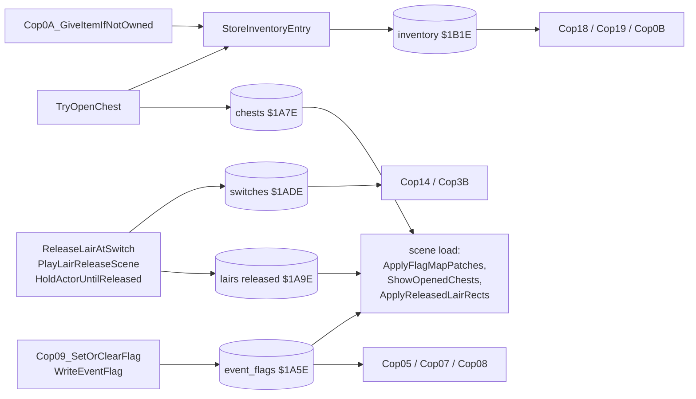

# Flags, Switches and Inventory Bytes — The Progress State of the Game

*Part of the [Soul Blazer Code Documentation](README.md)*

> Where the game remembers what the player has done: one 256-byte block of WRAM (`$1A5E-$1B5D`) holds the event flags, the opened chests, the released lairs, the switches and the inventory. This document is the atlas of that block: the shared bit space and its two ways of addressing, who writes and reads each array, how long each part lives, and what the progress items (Emblems, Stones, Red-Hot items, souls) do to it.

**Source:**
[`lib_bit_array.asm`](../../extracted/library/lib_bit_array.asm) (`SetBitInArray`, `ClearBitInArray`, `TestBitInArray`) ·
[`cop_core.asm`](../../extracted/system/cop_core.asm) (`WriteEventFlag`, `TestEventFlag`, `BitMaskTable`, `LookupInventoryEntry`, `RegisterSwitchOwner`) ·
[`cop_script_flow_flags.asm`](../../extracted/cop_handlers/cop_script_flow_flags.asm) (`Cop05`, `Cop07`, `Cop08`, `Cop09`, `Cop14`, `Cop3B`) ·
[`cop_items_stats_text.asm`](../../extracted/cop_handlers/cop_items_stats_text.asm) (`Cop0A`, `Cop0B`, `Cop18`, `Cop19`) ·
[`lib_inventory_store.asm`](../../extracted/library/lib_inventory_store.asm) (`StoreInventoryEntry`) ·
[`lib_boot_and_scene_init.asm`](../../extracted/library/lib_boot_and_scene_init.asm) (`InitFixedState`, `InitSceneState`, `ClearSwitchOwnersOnReturn`) ·
[`lib_scene_asset_loader.asm`](../../extracted/library/lib_scene_asset_loader.asm) (`InitHardwareAndClearWram`) ·
[`lib_map_tile_patches.asm`](../../extracted/library/lib_map_tile_patches.asm) (`ApplyFlagMapPatches`, `FlagMapPatchTable`, `ShowOpenedChests`, `ApplyReleasedLairRects`, `SetHeldLairTileType`, `LookupSceneVariant`) ·
[`lib_tile_triggers_and_lair_return.asm`](../../extracted/library/lib_tile_triggers_and_lair_return.asm) (`TryOpenChest`, `TriggerVariantPlate`, `ReleaseLairAtSwitch`, `PlayLairReleaseScene`) ·
[`engine_player_death_and_actor_helpers.asm`](../../extracted/system/engine_player_death_and_actor_helpers.asm) (`CheckPlayerDeath`, `HoldActorUntilReleased`) ·
[`data_chest_lists.asm`](../../extracted/system/data_chest_lists.asm) · [`data_lair_records.asm`](../../extracted/system/data_lair_records.asm) ·
[`player_core.asm`](../../extracted/system/player_core.asm) (`FacePlayerTowardReturnTarget`) ·
[`we_obj_master_shrine_event.asm`](../../extracted/world_of_evil/up_above/we_obj_master_shrine_event.asm) (the stones) ·
[`gw_woods_actors_01B98D.asm`](../../extracted/greenwood/woods_of_greenwood/gw_woods_actors_01B98D.asm) (the Magic Bell)

---

## Overview

The game keeps its progress in five bit or byte arrays that sit one behind the other in WRAM:

| Array | Address | Size | One bit or byte means |
|-------|---------|------|-----------------------|
| `event_flags` | `$1A5E` | 32 bytes | one story flag |
| chests opened | `$1A7E` | 32 bytes (16 used) | one chest was opened |
| lairs released | `$1A9E` | 64 bytes | one lair record was released |
| switches | `$1ADE` | 64 bytes | one lair record's switch was triggered |
| `inventory` | `$1B1E` | 64 bytes | one item entry (id in bits 0-6, equipped marker in bit 7) |

All four bit arrays are read and written with the same three routines, so a bit number is the same kind of number everywhere. The flags are addressed by script operands (`COP 05`, `07`, `08`, `09`); the chests, the lairs and the switches are addressed by tables (`ChestListPointers`, `LairRecords`) and by the switch operand of `COP 14` and `COP 3B`; the inventory is addressed by item id. Everything from `$1A5E` to `$1C57` is copied into a record slot by `SaveGameToSlot`, so the arrays survive a reset only when the player has talked to the Master ([save-and-load.md](save-and-load.md)).

This document covers the state itself. The COP commands as commands (operand formats, the exit chain) are in [cop-dispatch.md](cop-dispatch.md); the item lists, the equipment menu and the Item cell are in [menus-inventory-status-hud.md](menus-inventory-status-hud.md); the slot format that carries the arrays is in [save-and-load.md](save-and-load.md); lair spawning and sealing is in [actor-system.md](actor-system.md); the death items are told from the player's side in [player.md](player.md).

Code addresses are source-ROM addresses (LoROM: bank = file offset ÷ `$8000`, address = `$8000` + the offset inside that bank); the rebuilt ROM places the blocks elsewhere (`rebuilt/layout.json`). WRAM addresses are the game's own. Strings are quoted the way the extractor prints them: the apostrophe appears as a blank and the hyphen of `Red-Hot` as `+` (OQ-I027-3). Counts come from a search of `extracted/` (every COP operand is an immediate, and only the COP handlers call `TestEventFlag` and `WriteEventFlag`, so the survey is complete).

**Related:** [cop-dispatch.md](cop-dispatch.md) · [menus-inventory-status-hud.md](menus-inventory-status-hud.md) · [save-and-load.md](save-and-load.md) · [player.md](player.md) · [wram-memory-map.md](../wram-memory-map.md) · [cop/index.md](../cop/index.md)

---

## Memory Map

### Code

| Address | Routine | Role |
|---------|---------|------|
| `$04:F348` | `SetBitInArray` | Set bit A (`& $3FF`) of the array at Y |
| `$04:F374` | `ClearBitInArray` | Clear it; no caller (OQ-I013-12) |
| `$04:F3A2` | `TestBitInArray` | Carry = bit set |
| `$00:E4CC` | `WriteEventFlag` | Set or clear the flag of a flag word |
| `$00:E4F8` | `TestEventFlag` | Carry = flag set |
| `$00:D81D` / `D83E` / `D843` | `Cop05_WaitWhileFlagEquals` / `Cop07_JumpIfFlagEquals` / `Cop08_JumpIfFlagNotEquals` | Wait on, or branch on, a flag; `CopFlagJumpTail` (`$00:D849`) is the shared test |
| `$00:D867` | `Cop09_SetOrClearFlag` | Write a flag |
| `$00:D9CC` | `Cop14_JumpIfSwitchSet` | Register the actor as owner of switch n, jump when it is set |
| `$00:DE0D` | `Cop3B_JumpIfSwitchSetElseHold` | The same for held NPCs (second, release switch) |
| `$00:E51E` | `LookupInventoryEntry` | Read entry n |
| `$02:A0F9` | `StoreInventoryEntry` | Write entry n, keeping the equipped marker |
| `$00:D874` / `D888` | `Cop0A_GiveItemIfNotOwned` / `Cop0B_RemoveItem` | Give and take an item |
| `$00:DA0F` / `DA28` | `Cop18_JumpIfItemMissing` / `Cop19_JumpUnlessItemEquipped` | Test ownership, test the equipped marker |
| `$00:E62D` | `RegisterSwitchOwner` | `switch_owner_table[n] = actor` |
| `$02:8A29` | `TryOpenChest` | Open the chest above the player, set its bit |
| `$02:8C25` / `$02:8DBD` | `ReleaseLairAtSwitch` / `PlayLairReleaseScene` | Set the lair bits when a lair is released |
| `$00:B05F` | `HoldActorUntilReleased` | Wait for a release switch, then set the actor's own bits |
| `$00:B005` | `CheckPlayerDeath` | Uses and removes Medical Herb and Strange Bottle |
| `$04:F912` / `$04:F9B5` | `InitFixedState` / `InitSceneState` | Boot value of flag `$FF`; per-scene clear of flag byte 0 and the replay of the patches |
| `$02:95F1` | `ApplyFlagMapPatches` | Replay the permanent map changes |
| `$02:94E4` / `$02:92F5` | `ShowOpenedChests` / `ApplyReleasedLairRects` | Replay opened chests and released lairs |
| `$00:99A4` | `FacePlayerTowardReturnTarget` | The one reader of `switch_owner_table` |
| `$00:D354` | `RunEnding` | Sets flag `$1F02`, clears `souls_flags` |

### Data

| Address | Name | Contents |
|---------|------|----------|
| `$02:F28D` | `FlagMapPatchTable` | 70 rows of 9 bytes (location, bit-number word, destination rectangle, staging position), `$FF` terminator |
| `$01:A9DE` | `ChestListPointers` | 128 words by `location_id`, then the lists of 6-byte chest rows (67 chests) |
| `$01:BA0D` | `LairRecords` | 420 records of 32 bytes; the word at `+1E` is the release switch |
| `$01:B69A` | `PlateListPointers` | Plate rows; the word at `+2` is a lair record index |
| `$01:F99A` | `SceneVariantRules` | Rows of 4 bytes (location, switch word, variant) read by `LookupSceneVariant` |
| `$00:E516` | `BitMaskTable` | `01 02 04 08 10 20 40 80` for `TestEventFlag` |
| `$01:FA77` | `SwitchBitMasks` | The same masks for the bit-array routines |
| `$02:CF74` | `ItemNameList` | The 65 item names, index = item id |

### State

| Address | Name | Role |
|---------|------|------|
| `$1A5E` | `event_flags` | 32 bytes, bit numbers `$000-$0FF`; byte 0 is cleared at every scene load |
| `$1A7E` | (chests opened) | bit = chest id `& $7F`, bit numbers `$100-$17F` |
| `$1A9E` | (lairs released) | bit = lair record index, bit numbers `$200-$3FF` |
| `$1ADE` | (switches) | bit = lair record index; `event_flags` + `$80` |
| `$1B1E` | `inventory` | 64 bytes; entry n at `$1B1E + n - 1` |
| `$1B5E-$1B64` | `equipped_weapon`, `equipped_armor`, `equipped_magic`, `equipped_bracelet` | Word cells with the equipped id of each list; the fourth is the Item cell |
| `$1B82` | `souls_flags` | Recruited souls, one bit each |
| `$043B` | `heal_pending` | Hit points the next frames add; written by the Herb rules |
| `$7F:0203` | `lair_state` | `$200` lair state bytes, saved in front of the image |
| `$7F:0483` | `switch_owner_table` | 512 words: switch n to the actor that owns it |
| `$03FB` / `$0405` | `return_active` / `return_record` | The return trip and the lair record the hero came from |
| `$1C6A` | `location_id` | The key of `FlagMapPatchTable`, `ChestListPointers` and `SceneVariantRules` |

---

## The State

### One bit space, two ways to address it

*What:* `SetBitInArray`, `ClearBitInArray` and `TestBitInArray` take a bit number n in A and an array address in Y. The byte is `Y + ((n & $3F8) >> 3)` and the mask is `SwitchBitMasks[n & 7]`; the mask `$3FF` limits n to 1024 bits. The arrays follow each other, so one number can walk across them: the bit number of a lair released bit is `$200 + record`, of an event flag `byte × 8 + bit`.

| Bit numbers | Array | Base passed in Y | Bit means |
|-------------|-------|------------------|-----------|
| `$000-$0FF` | event flags | `$1A5E` | story flag |
| `$100-$17F` | chests opened (the 16 bytes `$1A8E-$1A9D` are never used) | `$1A7E` | chest id `& $7F` |
| `$200-$3FF` | lairs released | `$1A9E` | lair record index |
| own base | switches | `$1ADE` | lair record index (the same number as the released bit) |

*Two addressings of the same number:* a script flag is a **flag word** `v bbbbbbb nnnnnnnn`: bits 0-7 are the bit inside the byte, bits 8-14 the byte index into `event_flags`, bit 15 the sense `v` (`TestEventFlag` ignores it, `WriteEventFlag` uses it as the value). So flag `$1F02` is bit number `$FA`, `$1F04` is `$FC`, `$1F07` is `$FF`, and `$0A00` is `$50`. `FlagMapPatchTable` stores the bit number directly: `ApplyFlagMapPatches` passes `Y = $1A5E` and the row's word to `TestBitInArray`, so rows below `$100` test event flags and rows from `$200` test released-lair bits (the largest is `$03A2`, `$1A5E + $74 = $1AD2`). No row uses `$100-$1FF`.

*Why:* one test routine serves every array, and a save slot keeps one bit per object. The shared numbering is also why the same tables can mix flag rows and lair rows.

### Event flags

*What:* 256 bits in `$1A5E-$1A7D`. A script flag is tested by `Cop05_WaitWhileFlagEquals` (70 sites; waits while the flag equals the sense bit), `Cop07_JumpIfFlagEquals` (190) and `Cop08_JumpIfFlagNotEquals` (7, the same test with bit 15 inverted in `Cop08` before `CopFlagJumpTail`), and written by `Cop09_SetOrClearFlag` (213 sites). Together the 480 sites name **114 distinct flags** in bytes `$00-$0A` and `$19-$1F`; bytes `$0B-$18` are never named.

*Lifetime:* `InitSceneState` stores one zero byte into `event_flags` (`STZ $event_flags`, M = 8) at every scene load, so the eight flags `$0000-$0007` are **scene-local**. Scripts use them as scratch: the Billy show and its three actors share them (`gw_woods_actors_01D045`), and two boss scripts use the whole byte as a counter (`INC $event_flags` for the Deathtoll fire pillars in `we_deathtolls_shrine_actors`, for the water trail in `gw_boss_light_water_fire_statues`). Every other byte persists across scenes and is saved. `InitFixedState` writes the word `$0080` to `$1A7D` once at boot, which sets flag `$FF` (`$1F07`) and clears the first chest byte; nothing clears `$FF` again (no `COP 09` names it, `ClearBitInArray` has no caller, and the per-scene clear is byte 0), so the 13 `FlagMapPatchTable` rows that test it are permanent (this settles the static part of OQ-I011-13 and OQ-I031-5). `InitSceneState` also reads `$1A7D` bit 2 (flag `$FA`, `$1F02`): once the ending has run, the HUD is no longer marked dirty at scene start.

The flags in use, by byte (reads and writes are COP sites; "group" is the area folder of `extracted/` that contains the sites):

| Byte | Flags | Reads / writes | Group and meaning |
|------|-------|----------------|-------------------|
| `$00` | `$0000-$0007` | 96 / 92 | all seven areas; scene-local scratch and counters (lifetime above); 14 of the 114 flags are ever cleared, 7 of them here |
| `$01`-`$02` | `$0101-$0107`, `$0200-$0207` (12 named) | 15 / 13 | Grass Valley village and Underground Castle; `$0200` is the boy who accepts the pass (`code_01991A`) |
| `$03`-`$04` | `$0301-$0307`, `$0400-$0407` (15) | 24 / 15 | Grass Valley and the Woods of GreenWood (`$0303` the Soul of Light, `$0307` Monmo at her hole); `$0405-$0407` St. Elles |
| `$05`-`$07` | 24 flags | 35 / 24 | St. Elles, GreenWood, Leo's Laboratory, Magridd's Castle, the Mountain of Souls: NPC talks and passages |
| `$08`-`$0A` | 19 flags | 30 / 28 | Leo's Laboratory, Magridd's Castle, St. Elles, Grass Valley, GreenWood; `$0A00` and `$0A01` are the Phoenix flags (Mountain of Souls, read also in the World of Evil) |
| `$19` | `$1905-$1907` | 4 / 8 | set and cleared as locks of the bosses: `$1905` the water statue's trail, `$1906` / `$1907` the Deathtoll scepters' direction |
| `$1A` | `$1A00`, `$1A02`, `$1A04-$1A07` | 6 / 6 | **Emblem taken** (see Progress items) |
| `$1B` | `$1B00-$1B05`, `$1B07` | 21 / 7 | **stone given** `$1B00-$1B05`; `$1B07` Leo's town models: the effect has played (`ll_town_models_actors`) |
| `$1C`-`$1E` | `$1C00-$1C02`, `$1C05-$1C07`, `$1D00-$1D03`, `$1D05-$1D07`, `$1E00` (14) | 14 / 14 | **Fairy Gem rewards paid once** (EXP, an item or a magic) |
| `$1F` | `$1F01-$1F06`, `$FF` | 22 / 6 (+ boot) | `$1F01` Lisa's promise, `$1F02` the ending ran (11 readers: the epilogue branches), `$1F03` the Master's gate speech was said, `$1F04` / `$1F05` the hub step in Up Above and the World of Evil, `$1F06` the name was chosen |

*The five flags that are only written:* `$0502`, `$0601`, `$0706`, `$0907` and `$0A00` are set by one script each and tested by no COP command. They are the bit numbers `$2A`, `$31`, `$3E`, `$4F` and `$50` of `FlagMapPatchTable` rows, so they are read by `ApplyFlagMapPatches` at scene load (locations `$28`, `$2C`, `$3D`, `$7B` and `$16`). The "no reader found" of OQ-I037-4 (`$0706`, `$0A00`) and OQ-I035-6 (`$0907`) is answered: they are map flags, and the comments at their writers say so now.

*Why:* every actor that has to remember something has no memory of its own beyond the scene, so a flag is the only state two actors or two scenes share. A flag set in one scene is read in another only from byte 1 up.

### Chests

*What:* `ChestListPointers` has one word per `location_id`; a chest row is 6 bytes (x, y of the tile the player stands on, id, content, a BCD Gem amount). The id's low 7 bits are the bit in the chest array `$1A7E`; bit 7 says the chest tile is also edited on BG2. 36 lists hold **67 chests**: 21 give Gems, 3 are empty, 43 hold an item (13 Medical Herbs, 5 Strange Bottles, the rest are weapons, armors, magic and progress items).

*When:* `TryOpenChest` runs from `CheckPlayerTileTriggers` when the player faces up. The tile above must be `$FB` (closed), and the chest bit must be clear; it then sets the bit, turns the tile into `$FC` and pays the content: an item through `StoreInventoryEntry` (not through the `Cop0A` ownership check, so a second Herb from a chest is stored and takes the Herb rule below), Gems through `AddGems`. At every scene load `ShowOpenedChests` tests each row's bit and, for the opened chests, walks the chest's column from (x, y - 1) down in the BG1 map (and BG2 when id bit 7 is set), turning every `$FB` cell it meets into `$FC`.

*Why:* a chest is not an actor, it is a table row and one bit. Progress items in chests include the Dream Rod (location `$05`), Leo's brush (`$06`), the Mole's Ribbon (`$16`), the Big Pearl and Mermaid's Tears (`$29`), the Delicious Seeds (`$1C`), the Power Bracelet (`$34`), Red-Hot Ball (`$79`) and the Master's Emblems B (`$68`) and D (`$2B`). The four chests of `ChestListLoc2B` hold Emblem D, 80 Gems, a Medical Herb and nothing, exactly as `04-st-elles.md` lists them.

*Note:* 66 distinct ids serve the 67 rows. `ChestListLoc29` has two rows with id `$17` (tiles y `$39` and `$B9`) and both hold item `$21`, Mermaid's Tears. Because the redraw is a column walk, `ChestListLoc2B` has two columns with two chests each (x `$04`: ids `$19` and `$1B`; x `$0A`: ids `$1A` and `$1C`); whether the lower chest looks open once only the upper one was opened is OQ-I055-3.

### Lairs and switches

*What:* lair record n (of 420) has one bit in the released array `$1A9E` and one in the switch array `$1ADE`. The three routines that mark a release set both, always `$1A9E` first: `ReleaseLairAtSwitch` (the player steps on the green switch of a lair that opens a path), `PlayLairReleaseScene` (the release scene in the home location of a freed NPC, started by `RunLairReleaseOnReturn`) and `HoldActorUntilReleased` (a held NPC, once its own release switch is set, sets its own two bits). With 7 `SetBitInArray` sites in all (these 6 plus the chest bit), the two arrays are bit for bit equal; whether the game ever needs both is OQ-I055-1.

| Reader | Array | What the bit does |
|--------|-------|-------------------|
| `Cop14_JumpIfSwitchSet` (245 scripts) | `$1ADE` | The NPC or object wakes (`$16` bit `$2000` cleared, jump) when switch n is set; first it registers the actor with `RegisterSwitchOwner` |
| `Cop3B_JumpIfSwitchSetElseHold` (28 scripts) | `$1ADE` | The same for a captive; a non-zero word at `LairRecords+1E` is a second, release switch that must be set first |
| `HoldActorUntilReleased` | `$1ADE` | Polls the release switch of its record (`+1E`) every frame |
| `SetHeldLairTileType` | `$1ADE` | Marks the cell of a released lair whose NPC is still held (`lair_state` bits 7 and 6) as tile type 1, once its release switch (`+1E`, no test when 0) is set |
| `LookupSceneVariant` | `$1ADE` | Music variant of a location by a switch row of `SceneVariantRules` |
| `ApplyReleasedLairRects` | `$1A9E` | Redraws the rectangle a released lair opened |
| `InitPlateVariantAtEntry`, `TriggerVariantPlate` | `$1A9E` | A pressure plate works only after its lair (`PlateListPointers+2`) is released |
| `ApplyFlagMapPatches` | `$1A9E` | The 37 lair rows of `FlagMapPatchTable` |

The word at `+1E` of a record is non-zero in **27 of the 420 records**, and in none of them equals the record's own index: record `$168` waits for switch `$167`, record `$16` for switch `6`. These are captives whose release depends on the switch of another record (`Cop3B_JumpIfSwitchSetElseHold`, `HoldActorUntilReleased`); which records they are is OQ-I055-2. Switch `0` cannot be a release switch, because `0` means none.

`RegisterSwitchOwner` writes `switch_owner_table[n] = actor`. The table (`$7F:0483`, 512 words) has one reader: `FacePlayerTowardReturnTarget` waits until `switch_owner_table[return_record]` is not zero and turns the hero toward that actor after a return trip. It is zeroed only on a return trip (`ClearSwitchOwnersOnReturn`, not at every scene load), so a stale entry can never be read: the entry of the record the hero came from is rebuilt by the actor's own `Cop14` or `Cop3B`.

`lair_state` (`$7F:0203`) is the third place that remembers a release: `ApplyLairStatesToScene` treats a negative state as released and writes tile `$FF`. It is saved in front of the image (slot `+$000`), the bit arrays inside it.

### Permanent map changes

*What:* rooms are rebuilt from the ROM at every scene load, so every opened door and passage is replayed. `ApplyFlagMapPatches` walks `FlagMapPatchTable` (70 rows, `$FF` terminator); for each row of the current `location_id` whose bit number is set it copies a staging rectangle onto the visible map through `CopyMapRectFromStaging`. It is the last of the scene-load patches in `InitSceneState`, after `ApplyLairStatesToScene` and `ShowOpenedChests`.

*The rows by kind:* 33 rows test 12 event flags and 37 rows test 29 released-lair bits.

| Bit number | Flag word | Rows | Location (ROM name) | Set by |
|------------|-----------|------|---------------------|--------|
| `$000F` | `$0107` | 4 | `$01` Grass Valley highlands | Grass Valley |
| `$001F` / `$0020` / `$004F` | `$0307` / `$0400` / `$0907` | 1 each | `$16` A mole's hole | GreenWood: Monmo at her hole, the digger's story, `$0907` |
| `$002A` | `$0502` | 1 | `$28` St. Elles Shrine | St. Elles (`se_seabed_sanctuary_actors_0F8D58`) |
| `$0031` | `$0601` | 1 | `$2C` The Secret Cave | St. Elles |
| `$003E` | `$0706` | 3 | `$3D` Soul of Mountain House | the grandfather (OQ-I037-4) |
| `$0046` | `$0806` | 3 | `$65` Castle of King Magridd | Magridd's Castle |
| `$0050` | `$0A00` | 3 | `$7B` Dazzling Space | the King's call of the Phoenix (Mountain of Souls) |
| `$00FA` / `$00FC` | `$1F02` / `$1F04` | 1 each | `$0E` / `$0F` | the ending; the Master's stones scene |
| `$00FF` | `$1F07` | 13 | `$00`, `$0E`, `$13`, `$71`, `$72`, `$73` | boot (`InitFixedState`): always on |

The lair rows (bit numbers `$0200` to `$03A2`) open a room after a lair was cleared; five rows share bit `$027C` at location `$33`.

*Why:* the map is data, not state. The only things that have to survive are the bits, and this table is where each bit is turned back into tiles.

---

## The Inventory

### The table and its three writers of state

*What:* `inventory` (`$1B1E`) holds 64 entries; entry n is the byte at `$1B1E + n - 1` and n is the item id. Bits 0-6 hold the id when the item is owned (an owned entry holds its own number, so 0 means not owned), bit 7 is the marker of the item that is equipped in its list (weapons `$01-$08`, armors `$09-$10`, magic `$11-$18`, items `$19-$40`; the lists and the cells are in [menus-inventory-status-hud.md](menus-inventory-status-hud.md)). `LookupInventoryEntry` returns carry set when the value bits are zero and carry clear with the whole byte otherwise.

| Command | Sites | Effect | Notes |
|---------|-------|--------|-------|
| `Cop0A_GiveItemIfNotOwned` | 47 | `StoreInventoryEntry` only when the entry is empty | not used by chests |
| `Cop0B_RemoveItem` | 27 | value bits cleared; an equipped entry keeps `$80` and `equipped_bracelet` is zeroed | an empty entry is left alone |
| `Cop18_JumpIfItemMissing` | 55 | jump when the value bits are zero | |
| `Cop19_JumpUnlessItemEquipped` | 36 | jump unless the entry is owned **and** bit 7 is set | the NPC and floor tests |

`StoreInventoryEntry` stores ids below `$19` as the plain id, and ids from `$19` up as the id ORed with the old bit 7 (and copies the id to `equipped_bracelet` when that bit was set): a removed item that was equipped comes back equipped when it is given again. It then tests the **old** value: when it was the Medical Herb (`$38`), `heal_pending = player_max_hp - player_hp`. So a Herb picked up while one is already owned heals at once, which is the walkthrough's "if you already have one and get another, effect is immediate" (`items.md`); only chests can do it, because `Cop0A` skips owned items. `DebugApplyItem` calls `StoreInventoryEntry` but has no caller.

### Giving an item to someone

*What:* almost every hand-over tests `Cop19`, not `Cop18`: the item must be **equipped in the Item cell**, and the same script then removes it with `Cop0B`. The Harp String (`code_0245CB`), the pass (`code_01991A`), the Mole's Ribbon (`code_01D908`) and the Delicious Seeds (`code_01E024`) all do this, and the walkthrough says the same: "Equip the Platinum Card", "equip the Harp String", "Speak to him with the Dream Rod equipped", "Equip the (Actinidia) Leaves". Goat's Food (`$19`) is the exception: `Cop18` twice, `Cop19` never.

*When:* `CheckPlayerDeath` runs every frame. With `player_hp` and `heal_pending` both 0 it tests the equipped Medical Herb (`$38`: `heal_pending = player_max_hp`, `Cop0B`, the player lives), then `TryStrangeBottle` (`$39`: removed, the player dies and keeps the Gems), then `TryMagicBell` (`$40`: not removed, the player dies and keeps the Gems), else `ZeroGemsAndDie`. The Bell test is OQ-I006-1.

### Progress items

*What:* the entries from `$19` up are the key items. The table counts the script sites per id (`0A` give, `0B` remove, `18` missing test, `19` equipped test) and the chest rows that hold the item:

| Id | ROM name | `0A` | Chest location | `0B` | `18` | `19` | Notes |
|----|----------|------|----------------|------|------|------|-------|
| `$19` | Goat s Food | 1 | - | 1 | 2 | 0 | goat |
| `$1A` | Harp string | 1 | - | 1 | 0 | 1 | singer, `code_0245CB` |
| `$1B` | a pass | 1 | - | 1 | 1 | 1 | boy, flag `$0200` |
| `$1C` | Dream Rod | 0 | `$05` | 0 | 1 | 10 | equipped to speak to sleepers |
| `$1D` | Leo s brush | 0 | `$06` | 0 | 1 | 1 | painting |
| `$1E` | Leaves | 1 | - | 0 | 1 | 0 | rafts |
| `$1F` | Mole s Ribbon | 0 | `$16` | 1 | 1 | 1 | ghost, flag `$0403` |
| `$20` | the Big Pearl | 0 | `$29` | 1 | 0 | 1 | |
| `$21` | Mermaid s Tears | 0 | `$29` (2 rows) | 1 | 2 | 1 | "used up" in `se_st_elles_coast_actors` |
| `$22` | Mushroom Shoes | 1 | - | 0 | 1 | 2 | equipped on ice |
| `$23` | a mobile key | 1 | - | 0 | 0 | 1 | airship |
| `$24` | Thunder Ring | 1 | - | 0 | 3 | 1 | |
| `$25` | Delicious Seeds | 0 | `$1C` | 1 | 1 | 1 | squirrel, `code_01E024` |
| `$26` | Leaves | 1 | - | 0 | 1 | 2 | the second "Leaves": OQ-I012-12 |
| `$27` | a door key | 1 | - | 0 | 0 | 1 | |
| `$28` | Platinum Card | 1 | - | 0 | 1 | 1 | |
| `$29` | the VIP Card | 1 | - | 0 | 3 | 1 | |
| `$2A-$31` | Emblem A-H | 1 each except B, D | B `$68`, D `$2B` | 1 each | 1 each | 0 | the Magic Bell exchange |
| `$32-$34` | Red+Hot Mirror, Ball, Stick | Mirror, Stick | Ball `$79` | 1 each | 2 / 1 / 2 | 0 | the Phoenix call |
| `$35-$37` | Power, Shield, Super Bracelet | Shield, Super | Power `$34` | 0 | 0 / 1 / 1 | 0 | |
| `$38` | Medical Herb | 7 | 13 locations | 2 | 6 | 1 | |
| `$39` | Strange Bottle | 2 | 5 locations | 1 | 0 | 1 | |
| `$3A-$3F` | Brown, Green, Blue, Silver, Purple, Black Stone | 1 each | - | 1 each | Brown 2, others 0 | 0 | the stones |
| `$40` | Magic Bell | 1 | - | 0 | 1 | 1 | |

Items that are also flags:

- **The Master's Emblems.** Flag `$1A0n` is Emblem n (A = 0): `$1A00` (Grass Valley village), `$1A02` (the squirrel in GreenWood), `$1A04` (the snail of the Soul of Mountain House), `$1A05` (`ms_obj_master_emblem_f_021E8F`, a place on an island), `$1A06` (Leo's Laboratory), `$1A07` (Magridd's Castle). Emblems B and D have no flag: they are chests, and their chest bit is the memory. In GreenWood `code_01C0C4` jumps to `code_01C0CE` when the Bell is missing; that routine tests all eight (`Cop18` for `$2A-$31`), takes them with eight `Cop0B` and gives `$40` with `Cop0A`.
- **The six stones.** Flag `$1B0n` and item `$3A + n` come as a pair: the script that calls `COP [0A] ( #3B )` for the Green Stone (`code_01D51D`) sets `$1B01` on the next line. The Up Above walker and the path markers read `$1B00-$1B05` six times each (`COP 08` and `COP 07` in `gv_up_above_actors_and_name_entry`), so this settles OQ-I035-7 and the gates of OQ-I030-1: `$1B00` is only the first of six. `we_obj_master_shrine_stones_scene_01EC55` removes all six stones with six `Cop0B` and no test, then sets `$1F04`; `$1F05` follows from the Up Above hub step, and the gate speech (`we_obj_master_shrine_gate_open_speech_01ECB1`) is said once, guarded by `$1F03`.
- **The Red-Hot items.** The Mountain of Souls scripts take `$32`, `$33` and `$34` with three `Cop0B` for the Phoenix call (`ms_soul_of_mountain_house_actors_020000`); flag `$0A00` follows, `$0A01` is cleared in the World of Evil. Who calls the Phoenix is OQ-I037-1.

### Souls

*What:* `souls_flags` (`$1B82`) is a byte, not a bit-array entry: bit 0 Magician, 1 Light, 2 Shield, 3 Detection, 4 Reality. It is inside the saved image. Each soul's script sets it together with one event flag:

| Bit | Soul | Writer | Event flag |
|-----|------|--------|------------|
| `$01` | Magician | talk handler `code_01A7DC` in `gv_up_above_trial_room_and_lisa_turbo_actors`: `STA $souls_flags` with 1 (it also gives item `$11`) | `$0504` |
| `$02` | Light | the root in `gw_woods_actors_01D045`: `ORA #$02` | `$0303` |
| `$04` | Shield | `se_npc_angelfish_soul_of_shield_0F80A4`: `ORA #$04` | `$0701` |
| `$08` | Detection | `ll_npc_door_soul_of_detection_022E10`: `ORA #$08` | `$0603` |
| `$10` | Reality | `code_025203` in `mc_castle_actors`: `ORA #$10` | `$0604` |

*Readers:* `RunSoulOrb` stays hidden while `souls_flags` is 0; `RunSoulOfLightEffect`, `RunSoulOfRealityEffect`, `RunSoulOfDetectionEffect` and `RunSoulOfShieldEffect` poll their bit every frame and write the window effect once (the Shield effect also spawns `DestroyHazardsNearOrb`); `DrawRecruitedSouls` prints one line per set bit. `RunEnding` tests `souls_flags & $1F` for exactly 1 (only the Magician: singular text) and clears it, and `gv_front_end` clears it again before the closing scene. All five names and effects agree with `items.md` (Souls).

---

## Lifetime

| State | Boot | Scene load | Record and load | Death | Ending |
|-------|------|------------|-----------------|-------|--------|
| `event_flags` byte 0 | zero, then nothing | **zeroed** | saved with the image | unchanged | unchanged |
| `event_flags` bytes 1-31 | zero, `$FF` set | kept; map patches replay | saved | unchanged | `$1F02` set |
| chests, lairs, switches | zero | kept; replayed by `ShowOpenedChests`, `ApplyReleasedLairRects`, `ApplyLairStatesToScene` | saved | unchanged | unchanged |
| `inventory` | zero | kept | saved | a used Herb or Bottle is removed | unchanged |
| `souls_flags` | zero | kept | saved | unchanged | **cleared** |
| `switch_owner_table` | zero | zeroed only on a return trip | not saved | - | - |

`InitHardwareAndClearWram` clears `$7E:0000-$1EFF`, `$7E:2000-$FFFF` and the whole of bank `$7F` once at boot, and `InitFixedState` then sets flag `$FF`. A failed load is a new game that keeps whatever the boot left ([save-and-load.md](save-and-load.md)). A death never reloads a slot, so the arrays only go back to an older state through the file select. After the ending the Up Above scripts, the Seabed Sanctuary and the other epilogue branches read `$1F02` and nothing clears it.

---

## Walkthrough Cross-Check

| Claim | ROM | Result |
|-------|-----|--------|
| Eight Master's Emblems, exchanged for the Magic Bell (`sidequests.md`, `07-king-magridds-castle.md`) | `code_01C0CE` tests `$2A-$31`, removes them, gives `$40` | agrees |
| Where each Emblem is (A Grass Valley, B castle dungeon, C squirrel, D St. Elles chest, E snail, F island, G Leo's chest of drawers, H castle exterior) | flags `$1A00`, `$1A02`, `$1A04-$1A07`, chests `$68` and `$2B` | agrees |
| Four chests behind a lair: Emblem D, 80 Gems, nothing, Medical Herb (`04-st-elles.md`) | `ChestListLoc2B` | agrees |
| Six stones open the barrier of the World of Evil (`02-grass-valley.md`, `08-world-of-evil.md`) | `$1B00-$1B05`, the stones scene takes all six and sets `$1F04` | agrees (the removal of the stones is not in the walkthrough) |
| Equip the item before you hand it over (Platinum Card, Harp String, Leaves, Dream Rod, Mobile Key) | `Cop19` then `Cop0B` | agrees |
| Medical Herb: "if you already have one and get another, effect is immediate" (`items.md`) | `StoreInventoryEntry` tests the old value `$38` | agrees |
| Strange Bottle keeps the Gems on death; Magic Bell stops Gem use (`items.md`) | `TryStrangeBottle` keeps them; `TryMagicBell` also keeps them | OQ-I006-1 (the Bell is not mentioned for death) |
| Phoenix: the three Red-Hot items (`items.md`, chapter 5 and 8) | `Cop0B` of `$32-$34` at the King's call | OQ-I037-1 |
| Five souls and their places (`items.md` Souls) | five `souls_flags` writers | agrees |
| Item spellings (`Emblem A`, `Red+Hot`, two `Leaves`, `a pass`) | `ItemNameList` | OQ-I027-3, OQ-I004-6, OQ-I012-12; the document uses the walkthrough names |

No new DISCREPANCY was found.

---

## Open Questions

| ID | Tag | Topic |
|----|-----|-------|
| OQ-I055-1 | GAP | Are `$1A9E` and `$1ADE` ever different? |
| OQ-I055-2 | GAP | Which 27 records have a release switch at `+1E`, and does each chain as read? |
| OQ-I055-3 | GAP | The two rows with chest id `$17` in `ChestListLoc29`; the column walk of `ShowOpenedChests` over the paired chests of `ChestListLoc2B` |
| OQ-I055-4 | GAP | Do any flags above `$0A` and below `$19` or the bits `$1A01`, `$1A03`, `$1B06` have a use? |
| OQ-I055-5 | GAP | Is `$1F07` set in every game, and is the image tail `$1B9B-$1C57` (OQ-I054-2) part of the progress state? |
| OQ-I055-6 | GAP | What does `$1B07` (Leo's town models) record? |

Answered statically here and left open in their own rows: OQ-I011-13, OQ-I031-5 (flag `$FF`), OQ-I035-7 (`$1B01`), OQ-I037-4 (`$0706`, `$0A00`), the reader of `switch_owner_table` (`RegisterSwitchOwner`'s note). The question rows are in `plans/extracted-audit/questions/I055_questions.md`.

---

## See Also

- [cop-dispatch.md](cop-dispatch.md) — the COP commands that carry these operands, the exit chain, `Cop3B`'s place among the commands
- [menus-inventory-status-hud.md](menus-inventory-status-hud.md) — the four item lists, the equipment menu, the Item cell, the HUD
- [save-and-load.md](save-and-load.md) — the slot that carries the arrays, the new-game case
- [player.md](player.md) — the death items, `FacePlayerTowardReturnTarget`
- [scene-area-warp-loading.md](scene-area-warp-loading.md) — `InitSceneState`, the return trip
- [data-tables.md](data-tables.md) — the tables whose rows carry switch, chest and record numbers (`LairRecords`, the chest, plate and variant lists)
- [wram-memory-map.md](../wram-memory-map.md) — the WRAM table for the cells above
- [cop/index.md](../cop/index.md) — operand formats
- [walkthrough/items.md](../walkthrough/items.md) and [walkthrough/sidequests.md](../walkthrough/sidequests.md) — the game's own names for the items
