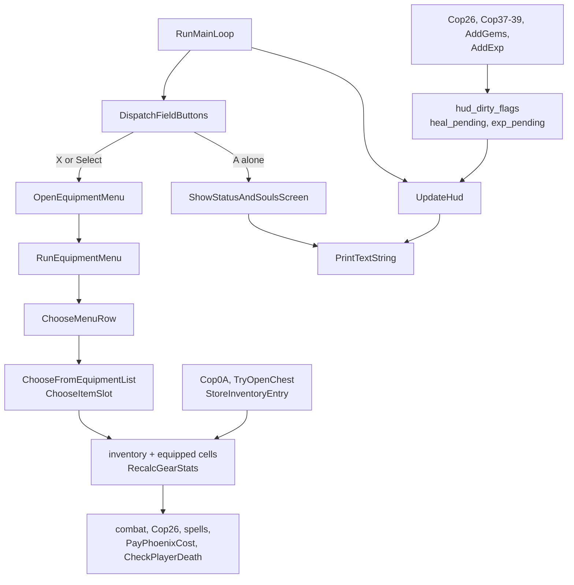

# Menus, Inventory, Status and HUD — What the Player Wears, Reads and Spends

*Part of the [Soul Blazer Code Documentation](README.md)*

> The player's belongings and the screens that show them: the 64-byte inventory table and the four equipped cells that the rest of the engine reads, the X-button equipment and item menu (rows, lists, icons, descriptions, the video state it swaps and restores), the A-button status and souls screen, the commands and routines that give, remove and pay for things (items, Gems, EXP, HP), and the HUD with its dirty mask and the enemy gauge.

**Source:**
[`lib_menus.asm`](../../extracted/library/lib_menus.asm) (field buttons, status and souls screen, equipment and item menu, icons, `RecalcGearStats`, menu text, `ItemNameList`, the item descriptions, `GearStatTable`) ·
[`lib_choice_menus.asm`](../../extracted/library/lib_choice_menus.asm) (`ChooseMenuRow`, `ChooseMenuRowAtTable`) ·
[`lib_menu_screen_setup.asm`](../../extracted/library/lib_menu_screen_setup.asm) (menu graphics and palettes, restore, `LoadEquippedMagicGfx`) ·
[`lib_inventory_store.asm`](../../extracted/library/lib_inventory_store.asm) (`StoreInventoryEntry`) ·
[`lib_hud.asm`](../../extracted/library/lib_hud.asm) (`UpdateHud`, the HUD strings, the enemy gauge) ·
[`lib_player_helpers.asm`](../../extracted/library/lib_player_helpers.asm) (`DrainPendingHeal`, `DrainPendingExp`, `AddExp`, `AddGems`, `SubtractGems`) ·
[`cop_items_stats_text.asm`](../../extracted/cop_handlers/cop_items_stats_text.asm) (the item, Gem, EXP and HP commands) ·
[`cop_core.asm`](../../extracted/system/cop_core.asm) (`LookupInventoryEntry`) ·
[`data_engine_tables.asm`](../../extracted/system/data_engine_tables.asm) (icon positions, spell graphics and palette pointers) ·
[`data_iris_and_icon_tiles.asm`](../../extracted/system/data_iris_and_icon_tiles.asm) (`IconTileRecords`) ·
[`data_menu_palettes_and_groups.asm`](../../extracted/system/data_menu_palettes_and_groups.asm) (menu palettes, `MenuTileGroupMap`) ·
[`engine_player_death_and_actor_helpers.asm`](../../extracted/system/engine_player_death_and_actor_helpers.asm) (`CheckPlayerDeath`) ·
[`engine_combat_hits.asm`](../../extracted/system/engine_combat_hits.asm) · [`player_core.asm`](../../extracted/system/player_core.asm) (`PayPhoenixCost`, `PublishPlayerAnim`) · [`data_chest_lists.asm`](../../extracted/system/data_chest_lists.asm) (readers and sources of the inventory)

---

## Overview

Everything the player owns is one table, `inventory` (`$1B1E`, 64 bytes, one byte per item id). Four word cells (`equipped_weapon`, `equipped_armor`, `equipped_magic`, `equipped_bracelet`) say what is worn; the combat, spell, Gem and death code read the cells, and the menu is the only code that sets them from the player's choices (the item commands only copy or clear `equipped_bracelet`). Everything else on these screens is text: the menu, the status page and the HUD are BG3 tiles printed with `PrintTextString` ([text-and-dialogue.md](text-and-dialogue.md)), plus one BG2 page that holds the item icons.

Three screens read this state:

- **The equipment and item menu** (X or Select): a full-screen mode change. `OpenEquipmentMenu` blanks the screen, swaps the scene's character data, palette, scroll and layer registers for its own, runs the choosers, and puts the field back in a fixed order.
- **The status and souls screen** (A with no direction held): a BG3-only overlay with no graphics swap that freezes the frame clock while it is open.
- **The HUD** (always): `UpdateHud` redraws only the parts that `hud_dirty_flags` marks, drains the queued heal and EXP, and draws the enemy gauge for about a second after a hit.

This document covers the state, the three screens and the routines that change the state. The text renderer and the string format are in [text-and-dialogue.md](text-and-dialogue.md); the BG3 and icon page upload, the DMA and the palette buffer are in [vram-dma-hdma-palettes.md](vram-dma-hdma-palettes.md); the pause banner (Start) and the frame order of `RunMainLoop` are in [boot-nmi-main-loop.md](boot-nmi-main-loop.md); the level-up watcher that sets `hud_dirty_flags` bit 3 is in [player.md](player.md); the damage formula that reads the equipped cells is in [combat-damage-and-enemy-records.md](combat-damage-and-enemy-records.md). The file select (`ChooseMenuRowAtTable`, `SetupMenuBg2Screen`) is in [save-and-load.md](save-and-load.md) and is only listed here.

Code addresses are source-ROM addresses (LoROM: bank = file offset ÷ `$8000`, address = `$8000` + the offset inside that bank); the rebuilt ROM places the blocks elsewhere (`rebuilt/layout.json`). WRAM addresses are the game's own. Strings are quoted the way the extractor prints them: the apostrophe appears as a blank and the period as `-` (OQ-I008-15).

**Related:** [text-and-dialogue.md](text-and-dialogue.md) · [boot-nmi-main-loop.md](boot-nmi-main-loop.md) · [player.md](player.md) · [combat-damage-and-enemy-records.md](combat-damage-and-enemy-records.md) · [wram-memory-map.md](../wram-memory-map.md) · [cop/index.md](../cop/index.md)

---

## Memory Map

### Code

| Address | Routine | Role |
|---------|---------|------|
| `$02:98FC` | `DispatchFieldButtons` | Per frame: X or Select opens the menu, B talks, A alone shows the status screen |
| `$02:9919` | `ShowStatusAndSoulsScreen` | Status page, then the souls page |
| `$02:99A8` | `WaitFrameKeepClock` | One frame with `frame_counter` held |
| `$02:99B7` | `DrawRecruitedSouls` | One line per bit of `souls_flags` |
| `$02:9B97` | `OpenEquipmentMenu` | Swap in the menu video state, run the menu, restore the field |
| `$02:9C7B` | `RunEquipmentMenu` | The row loop; stores the chosen ids |
| `$02:9D44` | `ExitEquipmentMenu` | `SEC` / `RTS`: the single return path of the row loop |
| `$02:9D46` | `RedrawEquipmentPage` | Equipment page back after the item page |
| `$02:9D76` | `DrawItemPage` | The item page (frame, palette, 40 icons) |
| `$02:9DA3` | `ChooseFromEquipmentList` | Marker through an 8-slot list (weapons, armors, magic) |
| `$02:9E44` | `CancelEquipChoice` | Dead cancel path (OQ-I009-14) |
| `$02:9E57` | `MoveSelectionRight` | First of four move routines; `MoveSelectionMarker` at `$02:9E91` |
| `$02:9EAB` | `BackupSlotList` | List copy to `$7F:0403`; `RestoreSlotList` at `$02:9EBD` (dead callers) |
| `$02:9ECF` | `BlinkSelectionMarker` | Marker bit shown 24 of 32 frames |
| `$02:9EED` | `RecalcGearStats` | `gear_power`, `gear_defense` from the two cells |
| `$02:9F18` | `DrawEquipIconRows` | The 24 icons of the equipment page |
| `$02:9F67` | `DrawInventoryIcon` | One 2 × 2 icon plus the selection frame |
| `$02:9FD3` | `DrawItemIconGrid` | The 40 item icons |
| `$02:9FF2` | `ChooseItemSlot` | Marker through the 40-slot grid |
| `$02:A086` | `CancelItemChoice` | Dead cancel path |
| `$02:A0F9` | `StoreInventoryEntry` | Writes an item into the table |
| `$02:A138` | `ChooseMenuRow` | Row cursor of the equipment menu; swaps the page |
| `$02:A1E8` | `ChooseMenuRowAtTable` | Same loop for the file select |
| `$02:A32B` | `SetupMenuBg2Screen` | BG2 menu screen of the file select |
| `$02:A350` | `ClearBg3Page` | Fill the page with `$2000`; `ClearBg3UpperHalf` at `$02:A370` |
| `$02:A390` | `ExpandMenuTileGroups` | `MenuTileGroupMap` to the BG2 page |
| `$02:A3EA` | `SaveCgramBuffer` | CGRAM buffer to `$7E:6000`; `RestoreCgramBuffer` at `$02:A400` |
| `$02:A416` | `LoadMenuBg2Graphics` | `graphics_04B000` to VRAM `$2000` |
| `$02:A43D` | `LoadMenuPalette` | `MenuBgPalette` to `cgram_buffer`; `LoadItemPagePalette` at `$02:A450` |
| `$02:A463` | `RestoreSceneBgGfxAndPalette` | The field's character data and palettes 11-15 back |
| `$02:A49C` | `LoadEquippedMagicGfx` | Graphics and palette of the equipped spell |
| `$02:A659` | `UpdateHud` | Enemy gauge, heal and EXP drains, dirty-mask redraw |
| `$00:B005` | `CheckPlayerDeath` | Herb, Bottle and Bell at zero HP |
| `$00:D874` | `Cop0A_GiveItemIfNotOwned` | Script command: give an item |
| `$00:D888` | `Cop0B_RemoveItem` | Script command: remove an item |
| `$00:DA0F` | `Cop18_JumpIfItemMissing` | Script command: ownership test |
| `$00:DA28` | `Cop19_JumpUnlessItemEquipped` | Script command: equipped test |
| `$00:DB79` | `Cop26_PayGemsOrJump` | Script command: pay Gems or jump |
| `$00:DDB0` | `Cop37_HealPlayerToFull` | Queue a full heal |
| `$00:DDBE` | `Cop38_QueueExp` | Queue EXP |
| `$00:DDCB` | `Cop39_DamagePlayer` | Hazard damage |
| `$00:E51E` | `LookupInventoryEntry` | Shared read of one entry |
| `$04:F5ED` | `DrainPendingHeal` | One HP per 4 frames from `heal_pending` |
| `$04:F614` | `DrainPendingExp` | One digit step per 8 frames from `exp_pending` |
| `$04:F687` | `AddExp` | BCD add with cap; `AddGems` at `$04:F6A5`, `SubtractGems` at `$04:F6C9` |

`Cop25_AddGems` (`$00:DB65`) and `Cop36_AddExp` (`$00:DD94`) have no uses (OQ-I025-4).

### Data

| Address | Name | Contents |
|---------|------|----------|
| `$02:C571` | `StatusScreenText` | The status page string |
| `$02:C624` | `SoulsScreenTitleText` | Souls page title; `SoulOfMagicianText` at `$02:C636`, then four more 21-byte lines |
| `$02:C69F` | `EquipMenuFrameText` | Tabs, description window, four equipped lines; `ItemMenuFrameText` at `$02:C701` |
| `$02:C70C` | `HudRepeatCounts` | `$19`, `$20`; then `HudFrameText` (`$02:C70E`), `HudExpText`, `HudHpGaugeText`, `HudLevelText`, `HudGemsText`, `EnemyGaugeClearText` (`$02:C766`), `EnemyGaugeText` (`$02:C76F`) |
| `$02:CF74` | `ItemNameList` | 65 names, index = item id (0 = "not equipped") |
| `$02:D53E` | `WeaponDescHeaderText` | Description headers; `ArmorDescHeaderText` at `$02:D558`, `PlainDescHeaderText` at `$02:D56B` |
| `$02:D572` | `DescriptionTextList` | 65 description pointers, index = item id |
| `$02:E12C` | `NameIndexCells` | Word cells k + 1 that `[TBL]` reads as an index |
| `$02:E1AC` | `GearStatTable` | Two rows of 17 bytes: strength by weapon id, defence by armor id |
| `$02:E1CE` | `WeaponMinLevelBcd` | Eight BCD minimum levels |
| `$01:F9F7` | `WeaponIconPositions` | 8 BG offsets; `ArmorIconPositions` `$01:FA07`, `MagicIconPositions` `$01:FA17`, `ItemIconPositions` `$01:FA27` (40) |
| `$01:FB88` | `MagicGraphicsPointers` | 8 long pointers; `MagicPalettePointers` at `$01:FBA0` |
| `$09:8800` | `IconTileRecords` | 128 records of 4 tile words |
| `$09:F000` | `ItemPagePalette` | 256 bytes; `MenuBgPalette` `$09:F100`, `MenuTileGroupMap` `$09:F200`, `MenuSpellPalettes` `$09:F300` |
| `$01:A9DE` | `ChestListPointers` | Per-location chest lists; the contents byte is an item id |

### State

| Address | Name | Role |
|---------|------|------|
| `$1B1E` | `inventory` | 64 bytes; slot = id − 1; bits 0-6 id, bit 7 marker |
| `$1B5E` / `$1B60` / `$1B62` / `$1B64` | `equipped_weapon`, `equipped_armor`, `equipped_magic`, `equipped_bracelet` | Word cells; high bytes never written |
| `$1B66` / `$1B68` | `gems_low`, `gems_high` | Six BCD digits |
| `$1B6A` | `player_level_bcd` | Level, BCD |
| `$1B6C` / `$1B6E` | `hp_bcd`, `max_hp_bcd` | Status-screen scratch |
| `$1B70` / `$1B72` | `gear_power`, `level_power` | Strength parts |
| `$1B74` / `$1B76` | `gear_defense`, `level_defense` | Defence parts |
| `$1B78` / `$1B7C` | `player_exp`, `player_exp_next` | 8-digit BCD; EXP now and the EXP total of the next level |
| `$1B82` | `souls_flags` | Bits 0-4: Magician, Light, Shield, Detection, Reality |
| `$1B88` / `$1B8A` | `player_hp`, `player_max_hp` | Bytes |
| `$1B8C` / `$1B8E` | `attack_current`, `defense_current` | What the damage code reads |
| `$0330` / `$0332` | `enemy_gauge_timer`, `hud_dirty_flags` | HUD control |
| `$0336` / `$0338` | `enemy_gauge_hp`, `enemy_gauge_max` | The gauge words |
| `$03B8` | `vram_upload_flags` | Bit 0 BG3 page, bit 1 icon page |
| `$03C0`-`$03C3` | `tm_shadow`, `cgadsub_shadow`, `bg2sc_shadow`, `w12sel_shadow` | The scene's video settings |
| `$03C4` / `$03C6` | `menu_count`, `menu_blink` | List size; blink counter |
| `$042F` / `$0435` | `menu_item_page`, `menu_magic_on_open` | Page flag; magic at open |
| `$043B` / `$043D` | `heal_pending`, `exp_pending` | Queues paid out by `UpdateHud` |
| `$045A`-`$0460` | `menu_saved_bg1_x` … `menu_saved_bg2_y` | Scroll words saved while the menu is open |
| `$7F:7000` / `$7F:7800` | `bg3_tilemap_buffer`, the icon page | BG3 text page; BG2 icon page (VRAM `$5C00`) |
| `$7F:0403` | (no mnemonic) | Backup of the list being chosen |
| `$7E:6000` | (no mnemonic) | CGRAM backup while a menu is open |

---

## The Inventory Table

### One table, four lists

`inventory` is indexed by item id minus 1, and an owned slot holds its own id in bits 0-6 (0 = not owned). The four lists of the menu are ranges of it:

| List | Ids | Base | Slots |
|------|-----|------|-------|
| Weapons | `$01`-`$08` | `$1B1E` | 8 |
| Armors | `$09`-`$10` | `$1B26` | 8 |
| Magic | `$11`-`$18` | `$1B2E` | 8 |
| Items | `$19`-`$40` | `$1B36` | 40 (4 rows of 10) |

The ids are those of `ItemNameList` (`ItemName01` Sword of Life … `ItemName18` Phoenix, `ItemName19` Goat s Food … `ItemName40` Magic Bell). The items from `$19` up are not only things the player carries: the Master's Emblems (`$2A`-`$31`), the Red-Hot pieces, the Stones and the story cards are entries too, which is why scripts ask for them with `Cop18_JumpIfItemMissing`. A walkthrough grid position (row *r*, column *c*) is slot (*r* − 1) × 10 + *c* − 1 of the item list, so id `$19` + (*r* − 1) × 10 + (*c* − 1).

Bit 7 of a slot byte is a marker with two meanings. Outside a menu it means *equipped*: each list has at most one marked slot. During a choice the chooser moves the marker with the cursor (`MoveSelectionMarker`) and `BlinkSelectionMarker` clears and sets it every frame, so while the menu is open the marker is the cursor; on a confirm it stays on the chosen slot. `DrawInventoryIcon` draws a selection frame around every slot whose bit 7 is set, which is why one routine serves both the equipped frame and the cursor.

### The equipped cells and who reads them

The marker records the choice inside the table, and the id is also stored in a word cell, because every reader wants the id, not a slot scan. The cells are words whose high byte is never written, and the text codes read them as words (`[TBL:&ItemNameList,1B5E]` in `StatusScreenText`). `equipped_bracelet` is the fourth *Item* row, so it holds any item from the grid, not just a bracelet: the Medical Herb, Strange Bottle and Magic Bell are worn through it (OQ-I024-7 asks whether to rename it).

| Cell | Read by | For |
|------|---------|-----|
| `equipped_weapon` | `RecalcGearStats` | `gear_power`, `gear_defense` |
| | `FilterPlayerInput` | 0 = no swing; a minimum level above `player_level_bcd` clears B |
| | `ApplyPlayerWeaponPose` | 0 = the unarmed pose |
| | `engine_combat_hits` | Psycho (2), Critical (3), Zantetsu (5), Spirit (6), Recovery (7) and Soul Blade (8) effects |
| | `engine_spawn_lairs_death_drops` | Lucky Blade (4) doubles the Gem drop thresholds |
| | `PayPhoenixCost` | weapon 8 |
| `equipped_armor` | `RecalcGearStats` | `gear_defense` |
| | `Cop26_PayGemsOrJump` | Magic Armor (`$0C`) halves the Gem cost |
| | `engine_combat_hits` | Light Armor (`$0E`) blocks weak hits, Mystic Armor (`$0D`) lengthens the stun |
| | `PayPhoenixCost` | armor `$10` |
| `equipped_magic` | `DispatchSpellCast`, `LoadEquippedMagicGfx` | which spell and its graphics |
| | `PayPhoenixCost`, `engine_combat_hits` | magic `$18` (Phoenix) |
| `equipped_bracelet` | `Cop26_PayGemsOrJump` | Magic Bell (`$40`): cost 0 |
| | `engine_combat_hits` | `$35`/`$37` double damage dealt, `$36`/`$37` halve damage taken |

Items that scripts test (the Ice Armor, the Dream Rod, the Herb, the Bottle) go through `Cop19_JumpUnlessItemEquipped`, which reads bit 7 of the *table* slot and does not look at the cells. `CheckPlayerDeath` tests `$38`, `$39` and `$40` that way, in that order, and it is the only reader that removes the item afterwards (`Cop0B_RemoveItem`).

### Giving and removing items

**`StoreInventoryEntry`** is the only writer the item scripts and the chests use. For an id below `$19` (a weapon, armor or spell) it stores the id and clears bit 7. For an id from `$19` up it stores the id **or** the old bit 7, and when that bit was set it copies the id to `equipped_bracelet`: an upgrade or a re-found item keeps the slot equipped. Then, if the *old* value of the slot (bit 7 masked) was `$38`, it sets `heal_pending` to `player_max_hp` − `player_hp`: this is the Medical Herb's "the effect is immediate" (walkthrough `items.md`: "if you already have one and get another, effect is immediate").

The branch is reachable. `Cop0A_GiveItemIfNotOwned` calls the store only for an empty slot (`LookupInventoryEntry` carry set), so a Herb from an NPC never heals, but `TryOpenChest` calls `StoreInventoryEntry` directly with the chest's content byte and no ownership test. `ChestListLoc05`, `ChestListLoc08`, `ChestListLoc1B`, `ChestListLoc1D`, `ChestListLoc2B`, `ChestListLoc2E`, `ChestListLoc2F`, `ChestListLoc3F`, `ChestListLoc5B`, `ChestListLoc5C`, `ChestListLoc67`, `ChestListLoc6F` and `ChestListLoc79` each hold a row whose content byte is `$38` (13 of the 67 chest rows), so opening a second Herb chest while one is owned heals at once. This answers the reachability half of OQ-I026-7 (the premise "a chest cannot open twice" ignored that different chests hold the same item); the heal itself was not run (OQ-I053-3).

**`Cop0B_RemoveItem`** clears the value bits of a slot. When bit 7 was set the slot keeps `$80` and `equipped_bracelet` is cleared; an empty slot is left alone. So after `CheckPlayerDeath` has used the Herb, the slot is an empty marked slot, the item menu's cursor starts on it (`ChooseItemSlot` starts on the first slot with bit 7), and a Herb found later is stored with that bit ORed back in and is worn again without a visit to the menu (derived, OQ-I053-4).

**`LookupInventoryEntry`** is the shared read: carry set and A = the id when the value bits are zero, otherwise carry clear and A = the whole byte, so the callers can test bit 7 with the sign flag. `Cop18_JumpIfItemMissing` (55 scripts) jumps on carry set; `Cop19_JumpUnlessItemEquipped` (36 scripts) jumps unless the slot is owned and bit 7 is set.

---

## The Equipment Menu

### Opening and closing: the video state it owns

*When:* `DispatchFieldButtons` sees `joy_pressed+1` bit `$20` (the NMI copies X into the Select bit). *Sees:* the screen fades to a full-screen menu with the tabs Weapon, Armor and Magic. *Why:* the field and the menu share VRAM, palettes and scroll registers, so `OpenEquipmentMenu` saves what it overwrites and puts it back itself.

On the way in it clears the HDMA enable (`$42`), forces blank, sets the icon page address (`BG2SC` = `$5C`, VRAM `$5C00`), the character base (`BG12NBA` = `$20`, BG2 characters at `$2000`), the main screen to BG2 and BG3 (`TM` = 6), and turns colour math and windows off. It saves the four scroll words to `menu_saved_bg1_x` … `menu_saved_bg2_y` and zeroes the live ones, stores `equipped_magic` in `menu_magic_on_open`, copies the CGRAM buffer to `$7E:6000` (`SaveCgramBuffer`), and loads the menu's graphics, palette and tile groups (`LoadMenuBg2Graphics`, `LoadMenuPalette`, `ExpandMenuTileGroups`).

On the way out (the tail of `OpenEquipmentMenu`, after `RunEquipmentMenu` returns through `ExitEquipmentMenu`) it consumes the B and Y latch bits so the closing press does not act in the field, restores the scroll words and the four video shadows, and runs three restores in this order:

1. `RestoreSceneBgGfxAndPalette`: the 8 KB copy of the scene's character data at `$7F:C000` to VRAM `$2000`, and `MenuSpellPalettes` to `cgram_buffer` + `$160` (palettes 11-15).
2. `RestoreCgramBuffer`: overwrites the whole buffer from `$7E:6000`, including the colours step 1 just wrote.
3. `LoadEquippedMagicGfx`: the spell's palette last, so the backup does not erase it.

The order matters twice. Step 2 would undo step 1's palette work and step 3 undoes step 2's, so the spell palette must come last. And the spell's graphics go to VRAM word `$2600`, which lies inside the 4096-word block `$2000`-`$2FFF` that `LoadMenuBg2Graphics` overwrites (8192 bytes from `$2000`); the menu therefore destroys the spell graphics, and `LoadEquippedMagicGfx` runs unconditionally on exit, not only when the magic changed. If it did change (`equipped_magic` ≠ `menu_magic_on_open`), `KillAllProjectiles` removes the old spell's actors and `spell_active_count` and `$0434` are cleared (OQ-I009-11). The rest of the exit is `ApplyPlayerWeaponPose` (the weapon may have changed), `ClearBg3Page`, `hud_dirty_flags` = `$1F` (the whole HUD is redrawn), one sub-frame, and `INIDISP` = `$0F`. Both `LoadEquippedMagicGfx` and `RestoreSceneBgGfxAndPalette` also run at a scene change (`lib_boot_and_scene_init`, when the reload flag is set).

`MagicGraphicsPointers` and `MagicPalettePointers` are both eight 3-byte pointers. `LoadEquippedMagicGfx` indexes both with 3 × (`equipped_magic` − `$11`): it DMAs `$800` bytes of `graphics_07B000` from the graphics pointer (some spells share graphics: offsets 0, 0, `$800`, `$1000`, `$1000`, `$1800`, `$1800`, `$800`), and copies 32 bytes of `palette_07D000` + `$20` × *n* with `MVN`, reading only the low word of the palette pointer because the source bank is fixed to `$0F`.

### Rows and pages

`RunEquipmentMenu` prints `EquipMenuFrameText`: the tabs Weapon, Armor and Magic (BG3 row 2, columns 4, 12, 20), the description window (row 16) and four equipped lines at rows 18, 20, 22 and 24 that read `Wep.:`, `Arm.:`, `Mag.:` and `Item:` followed by the name from `ItemNameList` (the walkthrough: "navigate the cursors to 'Wep.'"). It uploads the BG3 page, then the icon page, then the BG3 page again, one frame each, and loops on `ChooseMenuRow`.

`ChooseMenuRow` is the row cursor: a one-glyph arrow (tile `$2B`) moves between four rows `$80` apart in the buffer (cells `$48A`, `$50A`, `$58A`, `$60A`). Up and Down move it, B confirms (carry clear, A = the row), Y leaves (carry set). Entering row 3 calls `DrawItemPage` (`ItemMenuFrameText` with the single tab "Item", `LoadItemPagePalette`, the 40 icons) and sets `menu_item_page`; leaving it calls `RedrawEquipmentPage` (`ClearBg3UpperHalf`, `EquipMenuFrameText`, `LoadMenuPalette`, the 24 icons). The cursor blink and the steps use `BlinkChoiceCursor` and `BRK #$07` ([text-and-dialogue.md](text-and-dialogue.md), OQ-I009-12).

Rows 0-2 call `ChooseFromEquipmentList` with the list base in Y (`$1B1E`, `$1B26`, `$1B2E`) and A = 8; row 3 calls `ChooseItemSlot` with `$1B36` and A = `$28`. The returned id goes into the cell (`equipped_weapon`, `equipped_armor`, `equipped_magic`, `equipped_bracelet`), `RecalcGearStats` runs after a weapon or armor choice, `EquipMenuFrameText` is reprinted from its `[::]` marker (the window and the four lines only), and the loop continues on the same row. B opens a list and B again confirms inside it, which is the walkthrough's "Press the B Button twice to equip"; Y exits.

### Choosing from a list

Both choosers copy the list to `$7F:0403` (`BackupSlotList`), start the cursor on the first slot with bit 7 set (or mark slot 0 when none is), draw the icons, print the header and the description, and wait until every button is up. A direction moves the marker, Y or B confirms with `BRK #$18` and returns the id with carry clear. There is **no live cancel**: `CancelEquipChoice` and `CancelItemChoice` have no callers (OQ-I009-14), B and Y both confirm, and choosing an empty slot returns 0, which the caller stores in the cell. `ItemName00` is "not equipped", so that is how the player unequips.

| List | Layout | Right / Left | Down / Up |
|------|--------|--------------|-----------|
| Weapons, armors, magic | two columns of four, column-major | +4 / −4 | +1 / −1 |
| Items | four rows of ten, row-major | +1 / −1 | +10 / −10 |

A step past an end leaves the cursor where it is, except that Down from the last slot of a column goes to the top of the next column. `BlinkSelectionMarker` makes the frame visible 24 of every 32 frames (`menu_blink` and `$1F` below `$18`).

### Icons

*Sees:* every owned item as a 2 × 2 picture, and a four-tile frame around the equipped or chosen one. *Why:* the frame lives on BG3 (the text layer) and the icon on BG2, so the cursor can blink without redrawing the picture.

`DrawInventoryIcon` takes the slot word and a BG offset from one of the position tables (`WeaponIconPositions`, `ArmorIconPositions`, `MagicIconPositions`, `ItemIconPositions`). With bit 7 set it writes the frame tile `$2A` in four BG3 cells with palette 3 and the three flips; without it, four zero cells. Then it copies the four words of `IconTileRecords` at id × 8 to the BG2 page at `$7F:7800` (an empty slot is record 0). `DrawEquipIconRows` redraws all 24 equipment icons and `DrawItemIconGrid` all 40 item icons on every blink frame, because that is simpler than tracking one icon.

### Descriptions and gear numbers

Under the cursor the menu prints the item's name and text. `ChooseFromEquipmentList` picks a header by id (`WeaponDescHeaderText` for ids 1-8: the level and Strength lines; `ArmorDescHeaderText` for 9-`$10`: Defence; `PlainDescHeaderText` above) and then the string `DescriptionTextList[id]`. Every record starts `[CUR:48A][TBL:&ItemNameList,&NameIndexCells+2×(id−1)]`; `NameIndexCells` exists only because `[TBL]` reads its index from memory. Weapons then print the minimum swing level from `WeaponMinLevelBcd` and a bar of `GearStatTable` tiles; armors a defence bar; magic and items start the text at `$50A`. Fourteen stub records (ids `$2B`-`$31`, `$33`, `$34` and `$3B`-`$3F`: the Master's Emblems B-H, the Red-Hot Ball and Stick, five of the six Stones) print their own name and `[JMP]` into the carrying record (`DescMastersEmblemA`, `DescRedHotMirror`, `DescBrownStone`). The magic Gem costs (4, 8, 8, 1, 8, 20, 8, 2) are literal digits in the text (OQ-I009-10); the amounts that are really paid are the operands of `Cop26_PayGemsOrJump`.

`GearStatTable` has two rows of 17 bytes indexed by item id: row 0 is the strength of weapons 1-8 (1, 2, 3, 4, 6, 8, 10, 12), row 1 (+`$11`) the defence of armors 9-`$10` (the same numbers); everything else is 0. `RecalcGearStats` sums the weapon and armor entries into `gear_power` and `gear_defense`. The two parts the player sees on the status page are those and the level parts: `PublishPlayerAnim` sets `attack_current` = `gear_power` + `level_power` for the four swing animations and `defense_current` = `gear_defense` + `level_defense`. `WeaponMinLevelBcd` (1, 5, 11, 15, 16, 19, 22, 24) is compared with `player_level_bcd` by `FilterPlayerInput` (`player_core`), not by the menu: the menu lets the player equip a weapon that is too heavy and the input filter clears B for it until the level is reached (L and R thrusts need no level).

---

## The Status and Souls Screen

*When:* `DispatchFieldButtons` runs `ShowStatusAndSoulsScreen` when A is newly pressed and no direction is held (the test is `BIT #$0F` on the high byte, then bit 7 of `joy_pressed`). *Sees:* a window with the player name, HP / maximum HP, "Next level :", Strength and Defence bars and the four equipped items; after another button, the souls page. *Why:* it shows HP, strength and defence without opening the menu. The screen is not in the walkthrough (OQ-I009-5).

The status page converts HP and maximum HP to BCD (`hp_bcd` at `$1B6C`, `max_hp_bcd` at `$1B6E`, `ByteToPackedBcd`) because the string prints them with `[06:3,…]`. It saves `level_power` and `level_defense`, clamps each to 12 for the print, prints `StatusScreenText`, and restores them (OQ-I009-6: the clamp is a display rule, the stats keep growing). The two bars per stat are `[0B:26,1B72]` over `[0B:26,1B70]` for Strength (level part on the upper row, gear part below) and `[0B:27,1B76]` over `[0B:27,1B74]` for Defence. The number after "Next level :" is `player_exp_next`, eight BCD digits. It is the threshold that `WatchForLevelUp` loads from `LevelExpThresholds` and compares with `player_exp` (the EXP total at which the next level is reached), so the screen shows that total and not a remainder: `player_exp` is never reduced by a level-up. The walkthrough's `level-up.md` calls the stat "the amount to reach the next level", and its table lists both the current EXP and the increase to the next level (OQ-I053-6). The existing notes of `ShowStatusAndSoulsScreen` and the `lib_menus` block say "the EXP still needed"; they are corrected in the same step.

The souls page waits for A to be released, then for A, B, Y or a direction (`BIT #$CF80`: Start and Select or X do not count), and prints `SoulsScreenTitleText` and `DrawRecruitedSouls`. That routine walks `souls_flags` from bit 0 and prints the 21-byte line of each set bit, stepping Y by `$15` from `SoulOfMagicianText`: bit 0 Magician, 1 Light, 2 Shield, 3 Detection, 4 Reality (the walkthrough's five souls). After the next press it consumes the latch bits of B, Y, A and X, clears `joy_pressed`, clears BG3, sets `hud_dirty_flags` = `$1F`, and calls `UpdateHud` once.

`WaitFrameKeepClock` is the wait used five times in the screen: `WaitVBlank`, then `DEX` / `STX` on `frame_counter` to undo the NMI's increment. The frame counter drives animations, so the field's animation clock stands still while the screen is open; nothing else is frozen because nothing else runs (`RunMainLoop` is not executing).

---

## Gems, EXP and HP

### Gems

Gems are six BCD digits in `gems_low` (`$1B66`) and the low byte of `gems_high` (`$1B68`). `AddGems` adds a BCD amount (pickups, chest Gems) and caps both words at 999,999 (OQ-I013-8: the walkthrough gives no cap); `SubtractGems` returns carry set and takes nothing when the player is short. Scripts never subtract directly: every spell and the Phoenix shot go through `Cop26_PayGemsOrJump` (8 uses), which changes the price by what is worn: `equipped_bracelet` = `$40` (Magic Bell) makes it 0, `equipped_armor` = `$0C` (Magic Armor) halves it with a minimum of 1 (walkthrough: "Prevents magic from using Gems", "Halves Gem consumption"). On success it sets `hud_dirty_flags` bit 4 and continues; when short it jumps, and the caller casts nothing.

### EXP and HP queues

`Cop38_QueueExp` (13 uses: rewards other than kills) stores the amount in `exp_pending`; `Cop37_HealPlayerToFull` (12 uses) stores `player_max_hp` − `player_hp` in `heal_pending`; `StoreInventoryEntry` stores the same for the Herb, and `CheckPlayerDeath` stores `player_max_hp`. `UpdateHud` pays them out: `DrainPendingHeal` adds 1 HP every fourth frame (`frame_counter` and 3 = 0) with `BRK #$48` and drops the rest when HP reaches the maximum; `DrainPendingExp` every eighth frame takes one unit of the lowest non-zero digit of `exp_pending` (ones, then tens, hundreds, thousands) and calls `AddExp`, so a pending `$0132` pays 1, 1, 10, 10, 10, 100. That is why the HP bar fills a point at a time and the EXP counter climbs in steps (the walkthrough does not describe either). Kills do not use the queue: both kill paths call `AddExp` at once. `AddExp` caps at 99,999,999 (walkthrough `level-up.md` agrees). `Cop39_DamagePlayer` (6 uses: hazards) subtracts from `player_hp` with a floor of 0, sets `hud_dirty_flags` bit 2, hit-stuns the hero and plays `BRK #$04`; death is decided by `CheckPlayerDeath` on the next frame.

`CheckPlayerDeath` runs every frame and only acts when `player_hp` and `heal_pending` are both 0: a worn Herb refills (`heal_pending` = `player_max_hp`, `Cop0B_RemoveItem`), a worn Bottle is used up and the hero dies with his Gems, a worn Bell stays and the hero dies with his Gems (OQ-I006-1), and with nothing worn `gems_low` and `gems_high` are zeroed. Because all three need the *table* marker, and only one item can sit in `equipped_bracelet`, wearing a bracelet means not wearing the Herb (OQ-I006-2).

---

## The HUD

### UpdateHud

*When:* once per frame at the end of the work phase (five call sites in `engine_boot_main_loop`) and once from `ShowStatusAndSoulsScreen`. *Sees:* the LEV, EXP and GEM numbers and the HP gauge at the top of the screen, and below them the enemy gauge for about a second after a hit. *Why:* all HUD text goes through one routine and a dirty mask, so only what changed is redrawn.

In locations `$0F`-`$12` it returns at once (`location_id` − `$0F` below 4) with `hud_dirty_flags` cleared; that also skips the two drains, so in location `$0F`, which runs the full main loop, a queued heal or EXP waits until the player leaves (OQ-I027-2). Otherwise it draws the enemy gauge, runs `DrainPendingHeal` and `DrainPendingExp`, shifts `hud_dirty_flags` out bit by bit, prints one string per set bit and clears the byte:

| Bit | String | What it draws |
|-----|--------|---------------|
| 0 | `HudFrameText` | Backing tiles, the labels LEV, EXP, GEM and a fixed six-tile label |
| 1 | `HudExpText` | Eight BCD digits from `player_exp` |
| 2 | `HudHpGaugeText` | The gauge from `player_hp` and `player_max_hp` (`DrawGaugeBar`) |
| 3 | `HudLevelText` | Two digits from `player_level_bcd` |
| 4 | `HudGemsText` | Six digits from `gems_low` |

Who sets them: the menus and the scene start store `$1F` (everything), hits set bits 1 and 2 (the kill EXP and the lost HP), `Cop26_PayGemsOrJump` and pickups set bit 4, and the level-up watcher stores `$1F` (`WatchForLevelUp`, [player.md](player.md)), which is how the level digits (bit 3) change.

### Layout

The HUD strings use the single-row glyph mode (`[09]`), so each label and number is one tile row. BG3 offsets are `$40` bytes per row and 2 bytes per tile:

| String | Offset | Row, column | Content |
|--------|--------|-------------|---------|
| `HudFrameText` | `$42` / `$4A` | 1, 1 / 1, 5 | `LEV` and the level (`HudLevelText`) |
| | `$50` / `$58` | 1, 8 / 1, 12 | `EXP` and the EXP (`HudExpText`) |
| | `$6A` / `$72` | 1, 21 / 1, 25 | `GEM` and the Gems (`HudGemsText`): the top-right counter of the walkthrough |
| | `$C0` / `$CC` | 3, 0 / 3, 6 | six-tile label (entry 0 of `TextListPointers`) and the HP gauge (`HudHpGaugeText`) over 32 blanks |
| | `$700` | 28, 0 | 25 tiles `$1A` (OQ-I009-16) |
| `EnemyGaugeText` | `$140` / `$14C` | 5, 0 / 5, 6 | six-tile label (entry 1) and the bar from `enemy_gauge_hp` and `enemy_gauge_max` over 32 blanks |

`HudRepeatCounts` holds the two counts the `[0B:t,&c]` codes read (`$19` = 25 tiles, `$20` = 32 tiles). Row 28 is the first row below a 224-line picture at BG3 scroll 0, so the `$700` row is probably not visible (derived, OQ-I009-16). The HUD rows 1-5 fall inside the first 48 scanlines, which is the region `Bg3ScrollHdmaTable` adjusts line by line (derived, OQ-I042-1, OQ-I053-5).

### The enemy gauge

`SetEnemyGauge` and `SetEnemyGaugeProjectile` (`engine_combat_hits`) store the target's life in `enemy_gauge_hp` and `enemy_gauge_max` and set `enemy_gauge_timer` to `$80`. The next `UpdateHud` draws `EnemyGaugeText` only for exactly `$80` (the value minus 1 stays positive; every other negative value is idle), then the timer counts down by 2 per frame (`$7E` … `$00`: 63 frames, about one second). At 0 `EnemyGaugeClearText` blanks the 25 tiles at `$140` and the timer becomes `$FE`, the idle value (OQ-I009-15). A new hit during the countdown stores `$80` again, so the gauge shows the monster hit last and lasts a second from the last hit.

---

## Walkthrough Cross-Check

| Walkthrough | ROM evidence | Status |
|-------------|--------------|--------|
| "Press the X Button to open the menu … 'Wep.' … B twice to equip … Y to exit" (`01-in-the-beginning.md`) | `DispatchFieldButtons` (bit `$20`), `EquipMenuFrameText` (`Wep-:`, the period printed as `-`), `ChooseMenuRow` (B opens, Y leaves), `ChooseFromEquipmentList` (B or Y confirms) | agrees |
| Item grid positions (`items.md`: Goat's Food row 1 column 1 … Magic Bell row 4 column 10) | slot = (row − 1) × 10 + column − 1; spot checks: Medical Herb row 4 column 2 = `$38`, Strange Bottle `$39`, Super Bracelet row 4 column 1 = `$37`, Power Bracelet row 3 column 9 = `$35`, Shield Bracelet `$36`, Master's Emblem A row 2 column 8 = `$2A`, Mole's Ribbon row 1 column 7 = `$1F`, Magic Bell `$40` | agrees |
| Weapon table: minimum levels 1, 5, 11, 15, 16, 19, 22, 24; Strength +1, +2, +3, +4, +6, +8, +10, +12 | `WeaponMinLevelBcd`, `GearStatTable` row 0 | agrees |
| Armor table: Defense +1, +2, +3, +4, +6, +8, +10, +12 (Iron … Soul Armor) | `GearStatTable` row 1; ids `$09`-`$10` in `ItemNameList` order | agrees |
| Spells: Flame Ball … Phoenix and their Gem costs | `ItemName11`-`ItemName18`; `DescFlameBall` … `DescPhoenix` digits 4, 8, 8, 1, 8, 20, 8, 2 | agrees |
| Magic Bell prevents magic from using Gems; Magic Armor halves it | `Cop26_PayGemsOrJump` (`equipped_bracelet` = `$40`, `equipped_armor` = `$0C`) | agrees |
| Medical Herb heals fully at zero HP; a second one heals at once | `CheckPlayerDeath`; `StoreInventoryEntry` old-value test, reachable through 13 chest rows | agrees; the walkthrough does not say the Herb must be worn (OQ-I006-2) |
| Strange Bottle keeps the Gems | `CheckPlayerDeath` (`TryStrangeBottle`); the Bell also keeps them | OQ-I006-1, carried |
| Power Bracelet doubles damage, Shield Bracelet halves damage taken | `engine_combat_hits` (`$35` and `$37` double, `$36` and `$37` halve) | agrees |
| Super Bracelet "adds two points to both Strength and Defense" | the code gives both bracelet effects; the description says "strength by 2" | OQ-I005-1, OQ-I009-4, carried |
| Psycho Sword: "N/A" (`items.md`) | ROM text "Invincible monsters temporarily paralyzed"; `03-greenwood.md` says the sword halts the Spirit Balls | DISCREPANCY inside the walkthrough, OQ-I053-1 |
| Recovery Sword: "Heal some HP in battles" | ROM text "HP will be filled when monster is defeated"; the code adds 1 HP per kill | DISCREPANCY (text against code), OQ-I053-2 |
| Critical Sword: "Higher critical-hit rate"; ROM text "Defeats monsters at once" | the code kills on 1 hit in 16 | OQ-I005-2, carried |
| VIP Card opens the Right Tower | description: "wherever you wish within the Magridd Castle" | OQ-I009-1, carried |
| Strength caps at 13, defense at 12 | the status page clamps both at 12 | OQ-I009-6, OQ-I004-10, carried |
| "Defense" | `StatusScreenText` and the description headers print "Defence" | OQ-I048-5, carried |
| Item spellings (Soul Blade, Master's Emblem, Actinidia Leaves, Red-Hot …) | `ItemNameList` strings | OQ-I027-3, carried |
| Gems in the top-right counter; HP bar of fifty units | `HudGemsText` at row 1, column 25; `HudHpGaugeText` (`DrawGaugeBar`) | agrees |
| Start shows the number of Monster Lairs | `HandlePauseBanner` ([boot-nmi-main-loop.md](boot-nmi-main-loop.md)) | agrees, not repeated |

---

## Open Questions

New in this iteration (see `plans/extracted-audit/questions/I053_questions.md`):

- **OQ-I053-1** (DISCREPANCY): the Psycho Sword is "N/A" in `items.md`, yet `03-greenwood.md` and the ROM description both say it halts monsters.
- **OQ-I053-2** (DISCREPANCY): the Recovery Sword text says HP is "filled" per kill; the code adds 1 HP.
- **OQ-I053-3** (GAP): a second Medical Herb from a chest heals at once (static reading; not run).
- **OQ-I053-4** (GAP): a used Herb or Bottle leaves a marked empty slot, so the next one found is worn automatically.
- **OQ-I053-5** (GAP): whether the HUD rows fall inside the BG3 scroll HDMA region.
- **OQ-I053-6** (GAP): the "Next level :" number is the next level's EXP total, not a remainder (static reading; the notes said "still needed").

Carried, still open: OQ-I009-1, OQ-I009-2 (truncated Bottle text), OQ-I009-3, OQ-I009-4, OQ-I009-5, OQ-I009-6, OQ-I009-10, OQ-I009-11, OQ-I009-12, OQ-I009-14, OQ-I009-15, OQ-I009-16, OQ-I027-1 (`ClearBg3Page` sets its upload bit with DBR `$7F`), OQ-I027-2, OQ-I027-3, OQ-I024-7 (`equipped_bracelet` name), OQ-I006-1, OQ-I006-2, OQ-I005-1, OQ-I005-2, OQ-I005-4, OQ-I013-5 (`BRK #$48`), OQ-I013-8 (Gem cap), OQ-I025-4 (unused `Cop25_AddGems`, `Cop36_AddExp`), OQ-I026-7 (reachability answered above; the heal is OQ-I053-3), OQ-I042-1, OQ-I048-5.

---

## See Also

- [text-and-dialogue.md](text-and-dialogue.md): `PrintTextString`, the control codes every string here uses (`[CUR]`, `[TBL]`, `[06]`, `[0B]`, `[04]`), `RunChoiceMenu`, `BlinkChoiceCursor`, `DrawGaugeBar`.
- [vram-dma-hdma-palettes.md](vram-dma-hdma-palettes.md): the upload of the BG3 and icon pages, the CGRAM buffer, the DMA `LoadEquippedMagicGfx` uses.
- [boot-nmi-main-loop.md](boot-nmi-main-loop.md): the call sites of `DispatchFieldButtons` and `UpdateHud`, `RunSubFrame`, the pause banner.
- [player.md](player.md): the level-up watcher (`hud_dirty_flags` bit 3), `ApplyPlayerWeaponPose`, the hero's swing and the minimum-level check.
- [combat-damage-and-enemy-records.md](combat-damage-and-enemy-records.md): `attack_current` and `defense_current` in the damage formula, the bracelet and armor effects, `SetEnemyGauge`.
- [cop-dispatch.md](cop-dispatch.md): how the item, Gem and HP commands reach their handlers.
- [flags-switches-and-inventory-bytes.md](flags-switches-and-inventory-bytes.md): the inventory byte as state (who gives, takes and tests each item, the Herb rule of `StoreInventoryEntry`, the progress items, the souls).
- [actor-system.md](actor-system.md): the actor scheduler that stands still while `DispatchFieldButtons` waits inside a screen.
- [wram-memory-map.md](../wram-memory-map.md): section 7f (menu, status and HUD state) and the player-state sections.
- [cop/index.md](../cop/index.md): the command catalogue.
- [walkthrough/items.md](../walkthrough/items.md), [walkthrough/magic.md](../walkthrough/magic.md), [walkthrough/level-up.md](../walkthrough/level-up.md): the game terms.
- [save-and-load.md](save-and-load.md): the file select that uses `ChooseMenuRowAtTable` and `SetupMenuBg2Screen`, and the four record slots.
- [spc-interface.md](spc-interface.md): the sound driver behind `BRK` and the `$F2` / `$01` writes of the Start pause.
