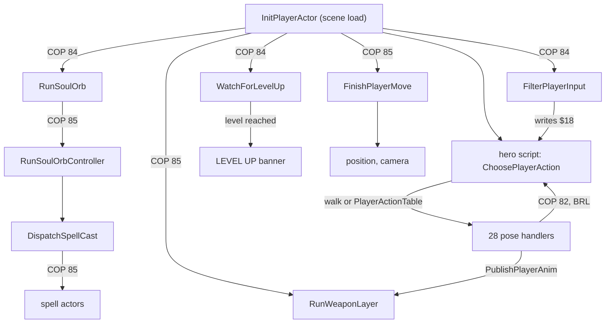

# The Hero — `player_core.asm`, `player_spells_level_up.asm` and `lib_player_helpers.asm`

*Part of the [Soul Blazer Code Documentation](README.md)*

> How the hero is built and driven: one actor with five helper actors, the one-step-per-animation script, the input filter that cuts into it, the 44-row action table and its 28 pose handlers, the swings and the Phoenix shot, the Gem pull, the death sequence, the blade layer, the soul orb, the seven spells with their cast lock, the level-up watcher, and the bank-04 helpers that other subsystems call.

**Source:**
[`player_core.asm`](../../extracted/system/player_core.asm) ·
[`player_spells_level_up.asm`](../../extracted/system/player_spells_level_up.asm) ·
[`lib_player_helpers.asm`](../../extracted/library/lib_player_helpers.asm) ·
[`engine_player_death_and_actor_helpers.asm`](../../extracted/system/engine_player_death_and_actor_helpers.asm) (`CheckPlayerDeath`, `MarkPlayerDead`) ·
[`data_engine_tables.asm`](../../extracted/system/data_engine_tables.asm) (`PlayerFacingByAnim`, `PlayerMoveDirByAnim`, `LevelExpThresholds`, `SineTable`, `SineTableTail`, `WeaponMinLevelBcd`) ·
[`data_anim_player.asm`](../../extracted/system/data_anim_player.asm) ·
[`data_anim_player_unarmed.asm`](../../extracted/system/data_anim_player_unarmed.asm) ·
[`data_anim_weapon_overlay.asm`](../../extracted/system/data_anim_weapon_overlay.asm) ·
[`cop_items_stats_text.asm`](../../extracted/cop_handlers/cop_items_stats_text.asm) (`Cop26_PayGemsOrJump`, `Cop37_HealPlayerToFull`)

---

## Overview

The hero is one actor per scene. The seven worlds each start their meta table (`WorldMetaPointers`) with the same record: animation 0, `$16` = `$1180`, animation table `PlayerAnims`, script `InitPlayerActor`. `$1180` is tile collision (`$1000`), "not a hit source" (`$0100`) and `$0080`; the first bit is why the hero is stopped by walls (see [collision-and-physics.md](collision-and-physics.md)), the second is why the hero's own body never hits anything. `InitPlayerActor` then clones five helpers from the hero. Each helper starts as a copy of the hero, so it has his position, flags and animation fields until its own script changes them.

The reason for six actors is the frame order. The scheduler runs actors in list order, and the hero needs a filter that runs *before* him (buttons the weapon rule strips), a motion finisher that runs *after* him (position, camera, blade placement), a blade with its own sprite set, an orb that moves independently of him, and a level watcher that has nothing to do with his pose. The run order is `WatchForLevelUp`, `RunSoulOrb`, `RunSoulOrbController`, `FilterPlayerInput`, the hero, `RunWeaponLayer`, `FinishPlayerMove` (derived in [actor-system.md](actor-system.md), "The hero is the worked example").

The hero's own script is a loop: `ChoosePlayerAction` picks a pose handler from the keys held, the handler publishes an animation and waits for it (`COP 82`), and falls back to `ChoosePlayerAction`. Because the wait lasts a whole animation step, `FilterPlayerInput` cuts in from outside when a key is released or B is pressed.

Direction codes are the game's own: 0 up, 1 down, 2 right, 3 left, for the facing (`PlayerFacingByAnim`) and for the direction of movement (`PlayerMoveDirByAnim`). The hero has 44 animation ids (`$00`-`$2B`); the idle poses `$00`-`$03` face down, up, left and right (`ApplyPlayerWeaponPose` gets them as `PlayerFacingByAnim xor 1`). The walkthrough never names the hero (you choose a name; chapter 1), so this document says "the hero".

Code addresses are source-ROM addresses (LoROM: bank = file offset ÷ `$8000`); the rebuilt ROM places blocks elsewhere (`rebuilt/layout.json`). The walkthrough is the source of truth for game names (Gems, Soul Blade, Medical Herb, Magic Bell, the seven spells); the ROM text is used for exact spelling.

**Related:** [wram-memory-map.md](../wram-memory-map.md) · [cop/index.md](../cop/index.md) · [actor-system.md](actor-system.md) · [collision-and-physics.md](collision-and-physics.md) · [boot-nmi-main-loop.md](boot-nmi-main-loop.md) · [cop-dispatch.md](cop-dispatch.md)

---

## Memory Map

### Code

| Address | Name | Description |
|---------|------|-------------|
| `$00:9512` | `FilterPlayerInput` | Strips B and Y, pulls Gems, gates B by weapon level, cuts a step short. |
| `$00:95E0` | `FinishPlayerMove` | Push zone or corner slide, even-pixel snap, published position, blade, camera ([collision-and-physics.md](collision-and-physics.md)). |
| `$00:969C` / `$00:9733` | `ScanPushZones` / `SlideAroundCorner` | Documented in the collision document. |
| `$00:9892` | `GetMoveDirectionOfAnim` | `PlayerMoveDirByAnim[$1E]`, carry set from `$2C`. |
| `$00:98A1` / `$00:98EB` | `PullGemsToPlayer` / `PullGemTowardPlayer` | Gem pull for the standing, armed hero. |
| `$00:99A4` | `FacePlayerTowardReturnTarget` | The hero's script on a return trip. |
| `$00:9A28` | `InitPlayerActor` | Spawn script: registers the hero, clones the helpers. |
| `$00:9A65` | `ChoosePlayerAction` | The action loop. |
| `$00:9B2B` | `PlayerActionTable` | 44 rows × 6 handler words. |
| `$00:9D3B` | `StartIdleUp` | First of the 28 pose handlers (`StartWalkDown` `$00:9DD1`, `StartBackstepDown` `$00:9E2B`, `SwingUp` `$00:9EFB`). |
| `$00:9ED3` | `PlayPlayerDeath` | Death animation and scene change. |
| `$00:9F7B` / `$00:9F9D` | `PayPhoenixCost` / `PublishPlayerAnim` | Phoenix gear check and 2 Gems; shows an animation to the blade, refreshes attack and defense. |
| `$00:9FCF` | `RunWeaponLayer` | Blade layer actor. |
| `$00:9FE0` / `$00:A026` | `RunSoulOrb` / `RunSoulOrbController` | Orb actor; its steering point. |
| `$00:A10A` / `$00:A163` | `DispatchSpellCast` / `TickOrbitPhase` | Spell gate; orbit advance. |
| `$00:A1D5` | `RunFlameBall` | Flame Ball cast actor. |
| `$00:A246` | `RunLightArrow` | Light Arrow parent (`RunLightArrowUp/Down/Left/Right` follow). |
| `$00:A2F1` / `$00:A3B1` | `RunMagicFlair` / `TrackOrbWhileCharging` | Magic Flair charge actor. |
| `$00:A3DD` / `$00:A401` | `RunRotator` / `RunRotatorBurst` | Rotator and its burst. |
| `$00:A439` / `$00:A457` | `RunSparkBombSpawner` / `RunSparkBomb` | Spark Bomb. |
| `$00:A49D` / `$00:A4BB` | `RunFlamePillarSpawner` / `RunFlamePillar` | Flame Pillar. |
| `$00:A4F8` / `$00:A666` | `RunTornado` / `RunTornadoBody` | Tornado (`TornadoVanish` `$00:A654`). |
| `$00:A678` / `$00:A6D0` | `PhoenixProjectileUp` / `InitPhoenixProjectile` | The four Phoenix shot scripts and their shared start. |
| `$00:A6E7` | `EndSpellActor` | Ends a spell actor and consumes the Y press. |
| `$00:AF56` | `WatchForLevelUp` | Level-up watcher. |
| `$00:B005` | `CheckPlayerDeath` | Death items or death; `ZeroGemsAndDie` `$00:B03C`, `MarkPlayerDead` `$00:B042`. |
| `$04:F3D4` / `$04:F3EB` | `GetPlayerFacing` / `FlipActorX` | Facing code of the hero; toggles the X flip of an actor. |
| `$04:F3F9` | `ApplyPlayerWeaponPose` | Armed or unarmed animation set after a scene load or the equipment menu. |
| `$04:F5ED` / `$04:F614` | `DrainPendingHeal` / `DrainPendingExp` | Pay out queued HP and EXP. |
| `$04:F6A5` / `$04:F6C9` | `AddGems` / `SubtractGems` | Gem counter; `AddExp` follows `DrainPendingExp`. |

### Data

| Address | Name | Description |
|---------|------|-------------|
| `$00:8000` | `WorldMetaPointers` | Seven world tables; entry 0 of each is the hero. |
| `$00:9588` | `AnimKeepKeyMask` | 44 words: the d-pad bit that keeps each animation going. |
| `$00:FA7F` / `$00:FAAB` | `PlayerFacingByAnim` / `PlayerMoveDirByAnim` | 44 bytes each. |
| `$00:FBB8` | `LevelExpThresholds` | 51 rows × 2 BCD words. |
| `$00:FC84` / `$00:FCC4` | `SineTable` / `SineTableTail` | One 320-byte sine (orb orbit). |
| `$02:E1CE` | `WeaponMinLevelBcd` | Minimum level of each weapon (`GearStatTable` at `$02:E1AC`). |
| `$0A:8000` | `PlayerUnarmedAnims` | 26 animation lists (`$00`-`$19`), 64 frame leaves. |
| `$0B:8000` | `PlayerAnims` | 44 lists, 100 frame leaves (the armed set). |
| `$0C:8000` | `WeaponOverlayAnims` | 44 lists, 42 frame leaves (41 of them 8 × 8) with the blade's own extents. |

### State

| Address | Name | Description |
|---------|------|-------------|
| `$039C` / `$039E` / `$03A0` | `player_actor` / `player_weapon_actor` / `soul_orb_actor` | Slots of the three visible parts. |
| `$0464` | `player_hidden_count` | Non-zero: `FilterPlayerInput` clears `joy_pressed`. |
| `$0322` / `$0326` / `$032A` | `joy_pressed` / `joy_block_mask` / `joy_release_latch` | Buttons ([boot-nmi-main-loop.md](boot-nmi-main-loop.md)). |
| `$03FB` / `$0405` / `$0380` | `return_active` / `return_record` / `warp_dest_anim` | Return trip. |
| `$0439` / `$03A6` | `no_combat_scene` / `subframe_active` | Scene rules the spell gate and the filter read. |
| `$0431` / `$0433` | `soul_orbit_phase` / `spell_active_count` | Orbit phase; the cast lock. |
| `$043B` / `$043D` / `$043F` | `heal_pending` / `exp_pending` / `player_died` | Queued HP and EXP; death counter. |
| `$1B5E`-`$1B64` | `equipped_weapon`, `equipped_armor`, `equipped_magic`, `equipped_bracelet` | Equipped ids (the Magic Bell is `$40` in the last). |
| `$1B66` / `$1B68` | `gems_low` / `gems_high` | Gems, six BCD digits. |
| `$1B6A` / `$1B86` | `player_level_bcd` / `player_level` | Level, BCD and binary. |
| `$1B70`-`$1B76` | `gear_power`, `level_power`, `gear_defense`, `level_defense` | Stat parts. |
| `$1B78` / `$1B7C` | `player_exp` / `player_exp_next` | EXP and the next threshold, eight BCD digits each. |
| `$1B82` | `souls_flags` | Bits 1 Magician, 2 Light, 4 Shield, 8 Detection, `$10` Reality. |
| `$1B88` / `$1B8A` | `player_hp` / `player_max_hp` | HP. |
| `$1B8C` / `$1B8E` | `attack_current` / `defense_current` | Values the hit code reads, set by `PublishPlayerAnim`. |

---

## The hero as six actors

### Spawn

`InitPlayerActor` runs once per scene load, as the script of the hero's meta record. It stores its slot in `player_actor`, selects the sprite tile source `$7F:3000` (`CopA9_SetDynamicTileSource`) and spawns `WatchForLevelUp` (`Cop84_SpawnActorAfter`). With `return_active` set it stops there and becomes `FacePlayerTowardReturnTarget`: no orb, filter, blade or camera follow. Otherwise it spawns `RunSoulOrb` and rewrites the orb's `$16` to (`$16` and `$CF7F`) or `$0310`: no tile collision, not hidden, not the player bit, but not a hit source (`$0100`), not a hit target (`$0200`) and running in sub-frames (`$0010`); the slot goes to `soul_orb_actor`. It then spawns `FilterPlayerInput`, `FinishPlayerMove` and `RunWeaponLayer` (`Cop85_SpawnActorBefore`; the last slot goes to `player_weapon_actor`) and sets its own re-entry address with `COP 91` to `ChoosePlayerAction`.

The player sees the hero appear with the orb and the blade; the reason for the split is the frame order above. Every scene load builds the whole set again, so none of it survives a scene change.

### One script step per animation step

A script resumes when its countdown `$14` underflows. `Cop82_WaitAnimationDone` steps the animation and the actor yields for the step duration plus one frame, while `StepActorMotion` applies the step velocity (`$04`, `$06`) every frame ([actor-system.md](actor-system.md)). So the hero's script runs once per animation step, not once per frame. A walk is six steps of duration 3 (four frames each, so 24 frames per cycle by that rule; OQ-I048-3), and every step of every walk handler has a velocity of 2 pixels per frame on one axis (`unk3_0585BC`, `unk3_0585F8`, `unk3_058634` and the others in `PlayerAnims`). The idle animations `$00`-`$03` are a single step of duration 0, so a standing hero decides again every frame.

What the player sees is that a walk keeps going until the animation ends, no matter how briefly a key was tapped. The engine avoids that by letting `FilterPlayerInput` write `ChoosePlayerAction` into the hero's resume pointer `$18` from outside (below). The first step of every walk is 2 px per frame in all four directions (OQ-I032-15; the data shows it for all six steps).

---

## Reading the controller

### `FilterPlayerInput`

Runs every frame, just before the hero. It decides which buttons the hero's script gets to see and whether the current animation must stop now. In order:

1. `player_hidden_count` non-zero (incremented by `Cop34_HidePlayerActors`, cleared by `Cop33_ShowPlayerActors` in cutscenes): `joy_pressed` is cleared.
2. No weapon (`equipped_weapon` = 0) or `no_combat_scene`: B and Y are cleared (`#$C000`; `FilterNoWeapon`). This is why the hero cannot swing or cast in towns.
3. Armed: `PullGemsToPlayer` runs, then `WeaponMinLevelBcd[(equipped_weapon − 1) × 2]` is compared with `player_level_bcd`; a level that is too low clears B (`#$8000`). L and R are never touched, so the thrust needs no level.
4. Animations `$14`-`$23` are never interrupted (the swings `$20`-`$23` and the death `$1C` among them; `FilterReturn`).
5. B pressed in any other animation: `FilterLeaveAnimation` writes `ChoosePlayerAction` into `$18`, so a swing can start in the middle of a walk.
6. A dying hero (`$16` bit `$0400`): `$18` = `ChoosePlayerAction` and `COP 91`, so the filter idles for good (`FilterPlayerDying`).
7. Otherwise `AnimKeepKeyMask[$1E]` is tested against `joy_pressed`; zero means the key of the animation was released, and the animation is left (`FilterLeaveAnimation`).

Why a separate actor: the filter must run before the hero reads the buttons and has to reach into the hero's resume pointer, which is not possible from his own script. Spells are not filtered, because `RunSoulOrbController` runs before the filter and sees the raw buttons (Y works without a weapon).

### `AnimKeepKeyMask`

44 words, indexed by animation id × 2, giving the d-pad bit that keeps that animation going: Down `$0400`, Up `$0800`, Left `$0200`, Right `$0100`. The idle poses `$00`-`$03` and the walk and sidestep poses name the key of their direction of *travel*, which for the backsteps and sidesteps differs from the facing; `$24`-`$2B` (the carried-sword poses) are Right, Right, Left, Left, Down, Down, Up, Up. Words `$14`-`$23` are `$0000` and never read.

---

## Choosing an action

### `ChoosePlayerAction`

The player script comes back here after every animation (all 28 pose handlers end with `BRL ChoosePlayerAction`), when the filter forces it, and once from `InitPlayerActor`. The hero walks, turns, sidesteps, thrusts or swings according to the keys held. The reason it is one routine is that the whole behaviour is a table plus two shortcuts for plain walking:

- A dying hero (`$16` bit `$0400`) goes to `PlayPlayerDeath`.
- **Unarmed** (`no_combat_scene` or no weapon): L or R held (`#$0030`) takes the table; otherwise the first held key of Right, Left, Down, Up starts its walk handler directly (`BRL StartWalkRight`, `StartWalkLeft`, `StartWalkDown`, `StartWalkUp`); no key takes the table (idle).
- **Armed**: B, L or R held (`#$8030`) takes the table; otherwise the same direct walk, and no key again takes the table.
- **Table path** (`ChooseUnarmedTable`, `ChooseArmedTable`): row = animation × 12 bytes, slot 0 = B (armed only; the unarmed path skips it), 1 = Right, 2 = Left, 3 = Down, 4 = Up, 5 = no key. The handler address is entered by `DEC`, `PHA`, `RTS`.

The **carry** on entry to a handler selects between the two animation ids of a paired handler. Clear = pose family `$00`-`$13` (unarmed, or armed with L or R held: the thrust, the blade stays out). Set = armed without L or R, pose family `$24`-`$2B` (the sword carried). The direct walks get their carry from the key test itself: the unarmed test falls through with carry clear, the armed test with carry set. The unarmed table path always clears carry. So one armed hero uses two sets of poses: with L or R he thrusts and sidesteps, without them he walks with the sword carried, and by `ApplySwordHit` a hit counts only while the hero's animation is below `$24` (OQ-I048-4).

### `PlayerActionTable`

The table has 44 rows (one per animation) of 6 `&` handler words, `$00:9B2B`. Every row depends only on the **facing** of the animation (`PlayerFacingByAnim`), except the twelve rows `$14`-`$1F`, which are all `StartIdleUp`. So the table says: keep the facing, choose the pose of the pressed key. The resulting animation per facing (x or y = carry clear or set):

| Facing | Rows | B | Right | Left | Down | Up | none |
|--------|------|---|-------|------|------|----|------|
| down | `$00 $04 $05 $0C $0D $20 $28 $29` | `$20` | `$0C` | `$0D` | `$04` / `$28` | `$05` | `$00` / `$29` |
| up | `$01 $06 $07 $0E $0F $21 $2A $2B` | `$21` | `$0F` | `$0E` | `$07` | `$06` / `$2A` | `$01` / `$2B` |
| left | `$02 $08 $09 $10 $11 $22 $26 $27` | `$22` | `$09` | `$08` / `$26` | `$10` | `$11` | `$02` / `$27` |
| right | `$03 $0A $0B $12 $13 $23 $24 $25` | `$23` | `$0A` / `$25` | `$0B` | `$13` | `$12` | `$03` / `$24` |

Hold L or R and the hero keeps his facing while he moves in another direction: that is the crab-walk of the walkthrough ("press and hold the L or R Button to basically move sideways", chapter 2, `02-grass-valley.md`). Without L or R a direction key turns him that way.

### The 28 pose handlers

Each handler is the same four steps: `PublishPlayerAnim` with its animation id, `COP 80` (`Cop80_SetAnimation`) with the same id, `COP 82` (`Cop82_WaitAnimationDone`), `BRL ChoosePlayerAction`. They exist as separate routines so that the 44 × 6 table holds only addresses and no animation ids, and the carry picks between the two ids of a pair. The first (`StartIdleUp`) carries the family note.

| Group | Handlers | Animations (carry clear / set) |
|-------|----------|--------------------------------|
| Idle | `StartIdleUp`, `StartIdleDown`, `StartIdleLeft`, `StartIdleRight` | `$01` / `$2B`, `$00` / `$29`, `$02` / `$27`, `$03` / `$24` |
| Walk | `StartWalkUp`, `StartWalkDown`, `StartWalkLeft`, `StartWalkRight` | `$06` / `$2A`, `$04` / `$28`, `$08` / `$26`, `$0A` / `$25` |
| Backstep (facing locked, no armed variant) | `StartBackstepDown`, `StartBackstepUp`, `StartBackstepLeft`, `StartBackstepRight` | `$05`, `$07`, `$09`, `$0B` |
| Sidestep (names: facing, then direction of travel) | `StartSidestepLeftUp`, `…RightUp`, `…LeftDown`, `…RightDown`, `…UpLeft`, `…DownLeft`, `…UpRight`, `…DownRight` | `$11`, `$12`, `$10`, `$13`, `$0E`, `$0D`, `$0F`, `$0C` |
| Swing | `SwingUp`, `SwingDown`, `SwingLeft`, `SwingRight` | `$21`, `$20`, `$22`, `$23` |

A backstep keeps the facing it is named for and moves the other way: `StartBackstepDown` (`$05`) faces down (`PlayerFacingByAnim` 1) and moves up (`PlayerMoveDirByAnim` 0, step velocity dy = −2). The sidesteps move on the other axis. `PublishPlayerAnim` also sets the numbers the hit code reads: for animations `$20`-`$23` `attack_current` = `gear_power` + `level_power`, otherwise `gear_power`; `defense_current` = `gear_defense` + `level_defense`; the blade actor (the hero's `$3E` link) gets `$1E` = the id, `$20` = 0 and `$14` = 0, so the blade restarts its animation with every pose.

### Animation ids no handler plays

The 44 animation lists in `PlayerAnims` are `$00`-`$13` (idle, walk, backstep, sidestep), `$14`-`$1F`, `$20`-`$23` (swings: steps of duration 3, 1 and 8 with no velocity) and `$24`-`$2B` (the carried-sword poses). In `$14`-`$1F` the data shows: `$14`-`$17` are the four idle leaves held for 60 frames (one step of duration `$3B`); `$18`-`$1B` are three-step slides of 8, 5 and 3 pixels per frame in one direction (`unk3_0583C8` up, `unk3_0583E2` down, `unk3_0583FC` right, `unk3_058416` left); `$1C`-`$1F` are four-leaf animations of eight steps of duration 7, one of `$0F` and a last of `$5F` (`$1C` is the death animation). No routine in `player_core` plays `$14`-`$1B` or `$1D`-`$1F`, though the filter protects them and no hit routine writes the hero's `$1E` (`engine_combat_hits.asm`); what plays them is OQ-I048-2 (extends OQ-I032-2).

---

## The sword

### Swings and the Phoenix shot

`SwingUp`, `SwingDown`, `SwingLeft` and `SwingRight` run when B is pressed with a weapon equipped (slot 0 of the table). Each does `BRK #$01` (the swing sound), `PayPhoenixCost`, and when that succeeds `COP 84` of `PhoenixProjectileUp/Down/Left/Right`; then it clears the B release-latch bit (`TRB $joy_release_latch`, `#$8000`: a held B swings once) and runs the pose `$21`, `$20`, `$22` or `$23`. The swing animations have three steps of duration 3, 1 and 8 and no velocity, so the hero stands still for about 15 frames (derived; OQ-I048-3) and the filter does not cut the swing short.

`PayPhoenixCost` needs `equipped_weapon` = `$08`, `equipped_armor` = `$10` and `equipped_magic` = `$18` (the walkthrough: Soul Blade, Soul Armor and the Phoenix, `08-world-of-evil.md`), then `Cop26_PayGemsOrJump` takes 2 Gems or jumps to `PhoenixCostFailed` (carry set). The shot is a clone of the hero: `InitPhoenixProjectile` sets `$16` = `$02A0` and `$30` = `$14` (OQ-I006-26), `CopA3`, `CopA2(#30)` and the animation table `$0F` (`MagicAnims`, `CopA8`). The four scripts differ by the animation and the flip: up and down shift 16 pixels (`CopA0_AddY`) and use animations `$30` then `$31` × 8 (down adds `COP 98`, flip Y); left and right shift 16 pixels up and use `$2E` then `$2F` × 8 (right adds `COP 96`, flip X). `ApplyProjectileHit` damages with `gear_power` + `level_power` − defence when `equipped_magic` = `$18` (`engine_combat_hits.asm`; damage is a separate spoke).

### The blade layer

`RunWeaponLayer` is spawned once; it runs every frame right after the hero. It is a clone of the hero with `$16` and `$CEFF` (visible, no tile collision, and the "not a hit source" bit `$0100` cleared) and its animation bank `$24` incremented (`$0B` becomes `$0C`), so it plays `WeaponOverlayAnims` while the body plays `PlayerAnims`. `COP 91` then `COP 82` step whatever `PublishPlayerAnim` writes into its `$1E`, `$20` and `$14`. `FinishPlayerMove` puts it on the hero every frame, using `WeaponYOffsetByAnim`.

The sword is its own actor for two reasons: its sprite set is separate (42 frame leaves, 41 of them 8 × 8 pixels, `data_anim_weapon_overlay.asm`), and the hit test needs a source. `DetectHitSourceCollisions` takes only actors with `$16` bit `$0080` and none of `$0D00`; the hero has `$0100` set and the blade has it cleared, so the blade is the hit source and its box is the extents of its own current frame (static reading of `DetectHitSourceCollisions`, `RunWeaponLayer`). Without a weapon, or in a no-combat scene, `ApplyPlayerWeaponPose` hides it (`$2000`).

---

## Motion, Gems and the return trip

### Finishing the move

`FinishPlayerMove` runs after the hero and after `RunWeaponLayer` (spawned with `COP 85`), sets the hero's `$16` bit `$0010` (so he also runs in sub-frames) and does the player-side work of the frame: a push zone or the corner slide, the even-pixel snap when no d-pad bit of `joy_block_mask` is set, the published `player_x`, `player_y`, `player_tile_x` and `player_tile_y`, the blade's place and `AimCameraAtPlayer`. Its mechanics (`ScanPushZones`, `SlideAroundCorner`, the push-zone records, the quadrant masks) are in [collision-and-physics.md](collision-and-physics.md); nothing is repeated here. The hero's hurt box is not his frame: `DetectPlayerContact` uses a fixed box from x + 5 to x + 12 and y − 12 to y − 4. The frame size of the hero (header words `$10` and `$12` of the leaf) is 16 × 16 in all 164 leaves of `PlayerUnarmedAnims` and `PlayerAnims`, which answers OQ-I047-3 statically.

### The Gem pull

`PullGemsToPlayer` is called by the filter for an armed hero and acts only while his animation is `$00`-`$03`: standing still, which for an armed hero means L or R held. It scans the actor list for pickups with `$16` bit `$4000` (and not `$8000`) whose animation is `$04`, `$05` or `$06`, the three Gem sizes. `PullGemTowardPlayer` moves a Gem that lies in the 17-pixel-wide lane in front of the hero, on the side he faces, 3 pixels per frame (animation `$04`), 2 (`$05`) or 1 (`$06`) toward him, by entering an `INC` or `DEC` chain at different labels (`PullGemUpStep2`, `PullGemUpStep1` and their siblings for the other directions). The player sees Gems slide to the sword. An earlier reading called this a "sword push-back scan"; it touches no enemy (OQ-I032-1; DISCREPANCY with the earlier notes).

### The return trip

`FacePlayerTowardReturnTarget` is the hero's script when `return_active` is set. It waits while `warp_dest_anim` is non-zero or `switch_owner_table[return_record]` is 0 (`$7F0483`; what `warp_dest_anim` holds in a return trip is OQ-I032-10), then compares the hero's position with the position of the switch owner. The larger axis difference picks the idle animation: `$00` down, `$01` up, `$02` left or `$03` right; a tie goes vertical. It sets `$1E`, `$20` = 0, calls `SetActorAnimFrame`, zeroes `$14` and parks the script with `COP 91`. So the hero comes back from a lair facing the NPC he released, with no input filter, orb or blade (the lair side is in [scene-area-warp-loading.md](scene-area-warp-loading.md)).

---

## Dying

### `CheckPlayerDeath`

Runs every frame from `RunMainLoop`, after the hit and contact tests, and only while `$16` bit `$0400` is clear and `player_hp` and `heal_pending` are both 0. Three inventory ids are tested in order with `Cop19_JumpUnlessItemEquipped` (bit 7 of an entry = equipped):

| Item | Id | Effect |
|------|----|--------|
| Medical Herb | `$38` | `heal_pending` = `player_max_hp`, the entry removed (`Cop0B_RemoveItem`): the hero lives. |
| Strange Bottle | `$39` (`TryStrangeBottle`) | Entry removed; the hero dies but keeps his Gems. |
| Magic Bell | `$40` (`TryMagicBell`) | Entry kept; the hero dies and keeps his Gems (OQ-I006-1). |
| none | | `ZeroGemsAndDie`: `gems_low` and `gems_high` = 0, then death. |

`MarkPlayerDead` clears `$16` bit `$0800`, sets `$0400`, writes `joy_block_mask` = `$2080` (Select/X and A) and increments `player_died`. The ids match the walkthrough's inventory grid (Medical Herb row 4 column 2, Strange Bottle row 4 column 3, Magic Bell row 4 column 10; `items.md`). The reason it is one routine after all damage is that the items must be checked once per frame, after every damage source.

### `PlayPlayerDeath`

The hero's script reaches it through `ChoosePlayerAction` (the filter forces that). It sets the data bank `$24` to `$0B` for the hero and `$0C` for the blade (the unarmed bank `$0A` has no death animation: `PlayerUnarmedAnims` has 26 lists), `BRK #$84`, publishes animation `$1C`, runs `COP 80` and `COP 82`, sets `scene_next` = `world_index` + 1 (OQ-I006-22: whether that is the world's shrine), `COP 91` and returns. The death animation is eight steps of duration 7, one of `$0F` and a last of `$5F`, so about 176 frames by the yield rule (derived, OQ-I048-3). The player sees the hero's death animation and then the scene changes.

---

## The soul orb and the spells

### `RunSoulOrb` and `RunSoulOrbController`

`RunSoulOrb` hides itself (`$16` bit `$2000`) while `return_active` is set or `souls_flags` is 0. When a soul exists it shows the orb, spawns `RunSoulOrbController` (`COP 85`), selects `EffectAnims` (`COP A8`, table `$0E:8000`) and loops animation 8 × `$10` forever. A soul received after the scene started restarts the orb at map position (0, 0) (OQ-I032-4). The walkthrough says the Soul of Magician "also ends up being the little orb of light surrounding you" (`items.md`).

`RunSoulOrbController` runs every frame, also in sub-frames, right after the orb, and moves an invisible steering point: it calls `DispatchSpellCast` first (carry set: skip the rest this frame); the d-pad moves the point 2 px per axis per frame whether or not the hero can move; a pull toward the hero adds 1 px, or 2 px at a distance of `$50` or more to the right or below, `$60` to the left and `$40` above. The orb actor (the `$3C` link) gets the point plus (sine ÷ 4, cosine ÷ 4) from `SineTable` and `SineTableTail` at index (`soul_orbit_phase` × 2) and `$FF`: a circle of radius 31 pixels, 128 phases per turn. The player can park the orb in front of an enemy; the spells start where the orb is. `DestroyHazardsNearOrb` (the Soul of Shield sweep) is in `engine_player_death_and_actor_helpers.asm` and is outside this document.

### `DispatchSpellCast`

Called by the controller every frame. It refuses, in order, with a jump to `TickOrbitPhase` (the orbit still advances): `no_combat_scene`, `subframe_active`, no `equipped_magic`, an empty free actor stack (`$4A`). With `spell_active_count` non-zero it blocks every new cast: the Flame Ball and the Light Arrow return carry set (the orb freezes), the Rotator adds an extra orbit tick (`RotatorBoostPhase`). Otherwise Y (`joy_pressed` and `$4000`) with `equipped_magic` − `$11` picks the arm. Each arm pays with `Cop26_PayGemsOrJump` (the Magic Bell, `$1B64` = `$40`, makes the cost 0; Magic Armor, `$1B60` = `$0C`, halves it to at least 1; then `SubtractGems`), increments `spell_active_count` and spawns the cast actor.

| `equipped_magic` | Spell | Gems | Cast actor | `$30` |
|------------------|-------|------|------------|-------|
| `$11` | Flame Ball | 4 | `RunFlameBall` | 5 |
| `$12` | Light Arrow | 8 | `RunLightArrow` (four arrows: `RunLightArrowUp/Down/Left/Right`) | `$0A` each |
| `$13` | Magic Flair | 8 | `RunMagicFlair` | `$14` |
| `$14` | Rotator | 1 per burst | `RunRotator` | 5 |
| `$15` | Spark Bomb | 8 | `RunSparkBombSpawner` (four bombs) | `$1E` each |
| `$16` | Flame Pillar | 20 (BCD `$20`) | `RunFlamePillarSpawner` (four pillars) | 6 |
| `$17` | Tornado | 8 | `RunTornado` | `$0F` |
| `$18` | Phoenix | 2 | cast by the swing, not here (`PayPhoenixCost`) | `$14` |

`$30` is the projectile damage byte `ApplyProjectileHit` reads. Every cast actor copies the orb's position at its first run and plays an animation of bank `$0F` (`CopA8`, `#$8000`, `#0F` = `MagicAnims`); the movement is in the velocity words of the animation steps, not in the scripts. The `$16` values show the stage: `$03A0` = harmless while it forms, `$02A0` = armed, `$2020` = the hidden projectile of a spawner, `$02B0` = a Rotator burst; `$0010` is added where the actor must run in sub-frames.

### The seven spells

The Flame Ball flies the way the hero faces (`PlayerFacingByAnim`; the opposite directions flip with `COP 96` and `COP 98`). `RunLightArrow` spawns four arrows, one per direction. `RunMagicFlair` is charged by holding Y: `TrackOrbWhileCharging` keeps it on the orb, and the release picks a tap or one of three levels (animations `$0D`/`$10`, `$0E`/`$11`, `$0E`/`$12`, `$0E`/`$13`). `RunRotator` releases `RunRotatorBurst` actors (animations `$14`-`$17`) every 5 frames while Y is held, paying 1 Gem each (`RepeatRotatorBurst`). `RunSparkBombSpawner` and `RunFlamePillarSpawner` drop four `RunSparkBomb` or `RunFlamePillar` actors with `RepeatSparkBombSpawn` and `RepeatFlamePillarSpawn`, about 18 frames apart. `RunTornado` spawns `RunTornadoBody` (`COP 92` and `COP 94` on table `$0D`, animation `$42`), a countdown of 60 in `$2E` and a four-state heading graph; `TornadoVanish` ends it. The first heading and every restart come from `LDA #$0302` then `AND #$0003`, which is always 2: down-left (OQ-I032-6). The flame pillar's duration against the walkthrough is OQ-I032-13, the body sprite of the Tornado is OQ-I032-12.

### The cast lock

`spell_active_count` counts the live spell actors and is tested first by the gate, so no spell at all can be cast while one lives (OQ-I032-7). `EndSpellActor` is the exit of the Light Arrow, Magic Flair and Rotator actors: it clears bit `$4000` of `joy_release_latch` (a held Y fires only once), zeroes `spell_active_count` and ends the actor (`COP 86`). The Flame Ball clears the count at launch. The Spark Bomb, Flame Pillar and Tornado parents zero the count and let their children `INC` and `DEC` it; the last child to end consumes the Y press. The reason: Y is a held button and the gem cost is per cast, so the latch has to be consumed exactly once.

---

## Levelling

### `WatchForLevelUp`

Runs every frame as a helper actor and ends itself at level 50 (`StopLevelUpWatcher`). It reads the next threshold from `LevelExpThresholds[player_level × 4]` (two big-endian BCD words; the first is the high word and goes to `player_exp_next+2`) and subtracts it from `player_exp` as a 32-bit value (BCD digits compare like binary). Reached:

- `player_max_hp` and `player_hp` each + 2, capped at 100 (`$64`); `COP 37` queues the refill (`heal_pending` = max HP − HP).
- `player_level` + 1 and `player_level_bcd` + 1 in decimal mode; the low bit of the new BCD level decides: odd = `level_defense` + 1, even = `level_power` + 1.
- `hud_dirty_flags` |= `$1F`, the next threshold is loaded, `BRK #$97` (the fanfare, from the call site).
- `COP 03(#3)`, then three times: print `LevelUpText` (`PrintTextString`), wait 21 frames (`COP 1B`, `ClearLevelUpText`), print `LevelUpClearText`, wait 11 (`RepeatLevelUpBlink`, `COP 04`), then `BRL WatchForLevelUp`.

The player sees HP and level rise, the banner blink three times near the top and the HP bar refill. A large EXP gain gives several levels in a row, because the watcher checks again at once. `level_power` and `level_defense` have no cap in the ROM; `ShowStatusAndSoulsScreen` clamps only the displayed level parts to 12 (OQ-I032-8, DISCREPANCY: the walkthrough caps the unequipped values at 13 and 12). `LevelExpThresholds` has 51 rows (row 0 unused; rows 49 and 50 are `$9999`, `$9999`), and every one of the walkthrough's 49 thresholds matches. The new-game values are set by `InitFixedState` (`player_hp` = `player_max_hp` = 8, `player_level` = `player_level_bcd` = 1); it does not set `level_power` or `level_defense`, while the walkthrough shows strength 1 and defense 0 at level 1 (OQ-I048-1).

### Weapon level and stats

The minimum levels in `WeaponMinLevelBcd` are 01, 05, 11, 15, 16, 19, 22 and 24 (BCD words), as in the walkthrough's weapon table; they gate B only (`FilterPlayerInput`). `gear_power` and `gear_defense` come from `GearStatTable` through `RecalcGearStats` (`lib_menus.asm`); the damage rules are a separate spoke.

### Pending heal and EXP (bank 04)

`heal_pending` and `exp_pending` are queues filled by `Cop37_HealPlayerToFull` and `Cop38_QueueExp`, and `UpdateHud` pays them out once per frame (not in locations `$0F`-`$12`) so the HUD animates. `DrainPendingHeal` moves one point every 4th frame (`frame_counter` and 3 = 0, `BRK #$48`) and drops the rest when HP is at the maximum. `DrainPendingExp` takes one unit of the lowest non-zero BCD digit every 8th frame and calls `AddExp`, which caps `player_exp` at 99,999,999; `AddGems` caps the Gems at 999,999 and `SubtractGems` returns carry set, taking nothing, when the price is too high. The player sees the HP bar and the EXP counter climb in steps with a sound. The two kill paths in `engine_combat_hits.asm` (`KillTarget` and `KillOrSpareProjectileTarget`) call `AddExp` at once ([combat-damage-and-enemy-records.md](combat-damage-and-enemy-records.md)).

---

## Helpers other subsystems call

### `ApplyPlayerWeaponPose`

Runs at the end of `InitSceneState` and after the equipment menu closes (the tail of `OpenEquipmentMenu`), so the right pose is on screen before the hero's own script has run. It does nothing in locations `$0F`-`$12`. Unarmed (`no_combat_scene` or no weapon): the hero's `$24` = `$0A`, `$1E` = `PlayerFacingByAnim` xor 1 (the idle pose of the facing), `$20` = 0, `SetActorAnimFrame`, and the blade gets `$2000` (hidden). Armed: `$24` = `$0B`, `$20` = 0, `SetActorAnimFrame`, the blade is shown; `$1E` is kept. What bank `$0A` shows besides a sword-less hero is OQ-I031-3.

### `GetPlayerFacing` and `FlipActorX`

`GetPlayerFacing` returns `PlayerFacingByAnim[$1E]` for the talk probe (`RunTalkInteraction`) and `TryOpenChest`, with carry set from animation `$2C` (no facing, so no talk and no chest). `FlipActorX` toggles `$1C` bit `$4000`; `ChooseFacingAnim` uses it to mirror an NPC's side view.

---

## Walkthrough cross-check

| Walkthrough | ROM reading | Result |
|-------------|-------------|--------|
| 02 Grass Valley: "press and hold the L or R Button to basically move sideways" | L or R held takes the table, which keeps the facing (`ChoosePlayerAction`, `PlayerActionTable`) | Agrees. |
| `items.md`: weapon levels | `WeaponMinLevelBcd` 01, 05, 11, 15, 16, 19, 22, 24; the gate clears B, never L or R | Agrees (thrusts need no level). |
| `level-up.md`: level cap 50; max HP + 2 per level (8 at level 1, 100 at level 47); EXP max 99,999,999 | `WatchForLevelUp` (`$32`, `+2`, cap `$64`), `AddExp` | Agrees. |
| `level-up.md`: EXP rows 100, 280, 18 = 83,000, 19 = 115,000 | `LevelExpThresholds` rows 1, 2, 18, 19 | Agrees (all 49 rows). |
| `level-up.md`: strength at even levels, defense at odd | low bit of the new BCD level | Agrees. |
| `level-up.md`: unequipped Strength maxes at 13, Defense at 12 | no cap on `level_power`, `level_defense`; the status screen clamps the display to 12 | **DISCREPANCY** (OQ-I032-8). |
| `magic.md`: Gem costs 4, 8, 8, 1 per burst, 8, 20, 8; Magic Bell zero cost; Magic Armor halves | table above, `Cop26_PayGemsOrJump` | Agrees. |
| `magic.md`: Spark Bomb at sixty-degree intervals, the fourth 180° from the first | four bombs about 18 frames apart, about 51° each | **DISCREPANCY** (OQ-I032-3). |
| `magic.md`: one Tornado at a time | `spell_active_count` lock for all spells | Agrees, wider than stated (OQ-I032-7). |
| `08-world-of-evil.md`: Phoenix needs the Soul Blade and Soul Armor, 2 Gems; `level-up.md`: Level 24 for the Soul Blade | `PayPhoenixCost` (`$08`, `$10`, `$18`, 2 Gems); `WeaponMinLevelBcd` 24 | Agrees. |
| `items.md`: Medical Herb heals fully at zero; Strange Bottle keeps the Gems | `CheckPlayerDeath` | Agrees; the Magic Bell also keeps them, which the walkthrough does not say (OQ-I006-1). |
| `items.md`: Soul of Magician "also ends up being the little orb of light" | `RunSoulOrb` shows the orb for any `souls_flags` bit | Agrees (any soul, not only the Magician's; OQ-I032-4 for the restart). |
| Status screen "Defense" | ROM prints "Defence" (`StatusScreenText`) | Spelling differs; prose uses the walkthrough (OQ-I048-5). |

---

## Open questions

The questions this document could not settle are in `plans/extracted-audit/questions/I048_questions.md`: OQ-I048-1 (the starting `level_power` and `level_defense`), OQ-I048-2 (what plays animations `$14`-`$1B` and `$1D`-`$1F`), OQ-I048-3 (the walk, swing and death timings derived from the step durations), OQ-I048-4 (whether the carried sword hurts), OQ-I048-5 (the spelling "Defence"). Earlier questions this document relies on: OQ-I032-1 to OQ-I032-15 (the player batch), OQ-I006-1, OQ-I006-22, OQ-I006-26, OQ-I031-3, OQ-I047-3 (answered statically here for the hero's frames) and OQ-I005-1 to OQ-I005-3 (combat).

---

## See Also

- [actor-system.md](actor-system.md): the actor fields, the list order and the script contract (`$18`, `$14`, `COP 91`) the hero's script builds on.
- [collision-and-physics.md](collision-and-physics.md): `FinishPlayerMove`, `ScanPushZones`, `SlideAroundCorner` and the tile map the hero walks on.
- [boot-nmi-main-loop.md](boot-nmi-main-loop.md): `RunMainLoop`, the joypad words and `joy_release_latch`.
- [cop-dispatch.md](cop-dispatch.md): how the `COP` calls of the pose handlers become handler calls.
- [cop/index.md](../cop/index.md): the full command list (`COP 80`-`COP 86`, `COP A8`).
- [wram-memory-map.md](../wram-memory-map.md): the player variables.
- [walkthrough/README.md](../walkthrough/README.md): the game-text source of truth.
- [combat-damage-and-enemy-records.md](combat-damage-and-enemy-records.md): what `attack_current` and `defense_current` do (`ApplySwordHit`, `ApplyProjectileHit`, `ApplyContactDamageOrPickup`), `GearStatTable`, the damage byte of each spell, the enemy record and the death sequence.
- [sprites-oam-animation.md](sprites-oam-animation.md): the animation banks `$0A`-`$0C` and `$0F` in the format of their lists, steps and frames, the hero's three streamed 16 × 16 pieces and the sword's static tiles.
- [text-and-dialogue.md](text-and-dialogue.md): `LevelUpText` and the menu renderer behind it, and the sub-frame rule that lets the hero run while a dialogue types.
- [menus-inventory-status-hud.md](menus-inventory-status-hud.md): the equipment menu and the equipped cells the hero's swing and damage read, the status screen, `hud_dirty_flags` and the HUD.
