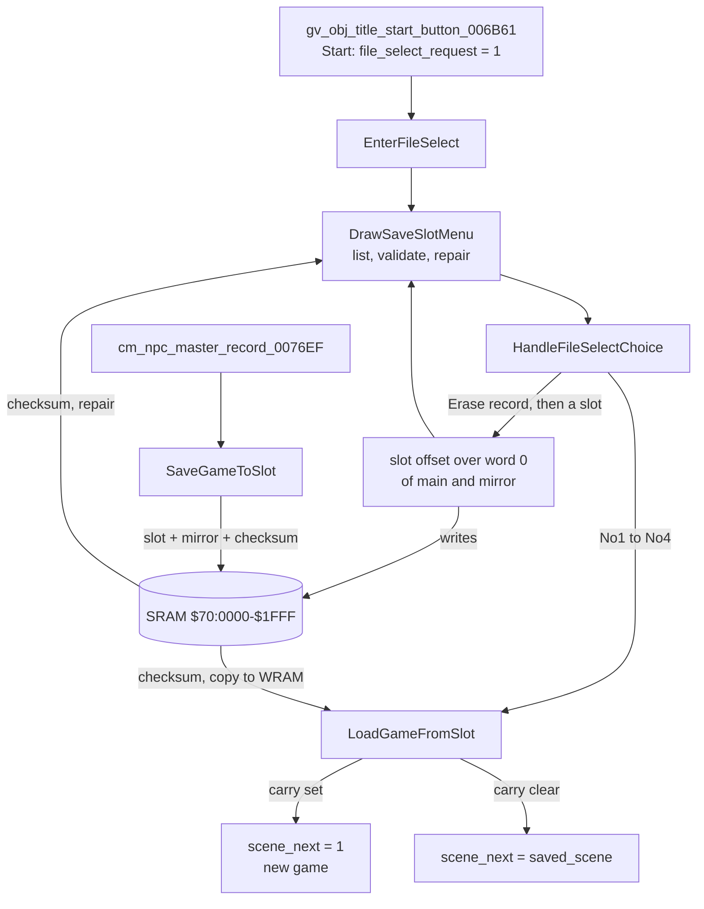

# Save and Load — The Record Slots, Their Checksum and the File Select

*Part of the [Soul Blazer Code Documentation](README.md)*

> How the game is written to the cartridge and read back: the four record slots in SRAM with their checksum and backup mirror, the Master's Record command that writes a slot, the file select that lists, repairs, erases and loads the slots, and what an empty slot means (a new game).

**Source:**
[`lib_save_system.asm`](../../extracted/library/lib_save_system.asm) (`SaveGameToSlot`, `LoadGameFromSlot`, `ComputeSlotChecksum`) ·
[`engine_title_file_select.asm`](../../extracted/system/engine_title_file_select.asm) (`EnterFileSelect`, `HandleFileSelectChoice`, `DrawSaveSlotMenu`; the Mode 7 half of the file is in [vram-dma-hdma-palettes.md](vram-dma-hdma-palettes.md)) ·
[`shared_actor_helpers_bank0.asm`](../../extracted/actor_shared/shared_actor_helpers_bank0.asm) (the Master: `cm_npc_master_*`) ·
[`shared_choice_prompt_texts.asm`](../../extracted/actor_shared/shared_choice_prompt_texts.asm) (`ChoiceYesNoText`, `ChoiceRecordQuitText`, `ChoiceRecordMoveQuitText`) ·
[`gv_front_end.asm`](../../extracted/grass_valley/front_end/gv_front_end.asm) (`gv_obj_title_start_button_006B61`, the hand-over in `gv_obj_title_and_prologue_0066FC`) ·
[`gv_title_texts.asm`](../../extracted/grass_valley/front_end/gv_title_texts.asm) (`SaveSlotMenuText`, `SaveSlotLineTemplates`) ·
[`lib_choice_menus.asm`](../../extracted/library/lib_choice_menus.asm) (`ChooseMenuRowAtTable`, `TitleMenuCursorOffsets`) ·
[`lib_menu_screen_setup.asm`](../../extracted/library/lib_menu_screen_setup.asm) (`SetupMenuBg2Screen`) ·
[`lib_boot_and_scene_init.asm`](../../extracted/library/lib_boot_and_scene_init.asm) (`InitFixedState`, `InitSceneState`) ·
[`lib_name_entry_and_staff_roll.asm`](../../extracted/library/lib_name_entry_and_staff_roll.asm) (`RunNameEntryScreen`, the name that is saved) ·
[`player_core.asm`](../../extracted/system/player_core.asm) (`PlayPlayerDeath`)

---

## Overview

The cartridge has 8 KB of battery RAM, which the CPU sees at `$70:0000-$1FFF` (`us/config.json` has `chipset` 2 and `ramSize` 3, the SNES header codes for ROM + RAM + battery and 1 KB << 3). The game keeps **four record slots** in it. Each slot is a `$400`-byte block that holds the cave and lair counters (`lair_state`), a `$1FA`-byte image of the player's progress (`$1A5E-$1C57`) and two checksum words; the same block is kept a second time `$1000` bytes higher as a backup mirror.

Only two places touch the SRAM, and each has a single caller:

- **Writing** is the Master's **Record** command in every shrine of Up Above (`cm_npc_master_record_0076EF` calls `SaveGameToSlot`). No other routine writes a slot: not a scene change, not a death, not a level-up.
- **Reading** is the **file select** after the title's Start (`HandleFileSelectChoice` calls `LoadGameFromSlot`). The same routine and `DrawSaveSlotMenu` also validate, repair and erase slots.

No other file of `extracted/` has an absolute `$70:xxxx` operand or an `MVN` with the bank `$70` (a search of the extracted source). So the saved game is exactly what `SaveGameToSlot` copied the last time the player answered Yes to the Master, and a death or a reset loses everything since then (the hero comes back to the shrine with the live state; see [What is not saved](#what-is-not-saved)).

This document covers the slot format, the two routines that write and read it, the file select screen and the new-game case. The shrine scenes and the warp that follows a load are in [scene-area-warp-loading.md](scene-area-warp-loading.md); the text renderer and the choice windows (`Cop1A_ChoiceMenu`, `RunChoiceMenu`) are in [text-and-dialogue.md](text-and-dialogue.md); the Mode 7 title and the palette buffer are in [vram-dma-hdma-palettes.md](vram-dma-hdma-palettes.md); the death and the items that soften it are in [player.md](player.md); the row cursor shared with the equipment menu is in [menus-inventory-status-hud.md](menus-inventory-status-hud.md).

Code addresses are source-ROM addresses (LoROM: bank = file offset ÷ `$8000`, address = `$8000` + the offset inside that bank); the rebuilt ROM places the blocks elsewhere (`rebuilt/layout.json`). WRAM addresses are the game's own. Strings are quoted the way the extractor prints them: the apostrophe appears as a blank and the period as `-` (OQ-I008-15).

**Related:** [scene-area-warp-loading.md](scene-area-warp-loading.md) · [text-and-dialogue.md](text-and-dialogue.md) · [menus-inventory-status-hud.md](menus-inventory-status-hud.md) · [player.md](player.md) · [wram-memory-map.md](../wram-memory-map.md) · [cop/index.md](../cop/index.md)

---

## Memory Map

### Code

| Address | Routine | Role |
|---------|---------|------|
| `$00:EB61` | `gv_obj_title_start_button_006B61` | Start on the title: reload the title scene as the file select |
| `$00:ECC1` | `EnterFileSelect` | Set up the BG2 screen, draw the menu, wait one frame |
| `$00:ECD0` | `HandleFileSelectChoice` | Cursor, erase prompt, load, warp to the shrine |
| `$00:ED4E` | `DrawSaveSlotMenu` | Print the window, check and repair the four slots, print one line per valid slot |
| `$04:F0E4` | `SaveGameToSlot` | Write the live state into slot `save_slot` |
| `$04:F132` | `LoadGameFromSlot` | Validate a slot and copy it into the live state; `LoadSlotChecksumMismatch` at `$04:F169` |
| `$04:F16E` | `ComputeSlotChecksum` | Sum and xor words of a slot; loop `SlotChecksumLoop` at `$04:F186` |
| `$00:F66C` | `cm_npc_master_shrine_menu_00766C` | The Master of a shrine: heal, poll the hero's tile; `cm_npc_master_shrine_poll_00766E` at `$00:F66E` |
| `$00:F67F` | `cm_npc_master_greeting_00767F` | Greeting and the Record / Quit menu; `cm_npc_master_greeting_with_move_00769C` at `$00:F69C` |
| `$00:F6EF` | `cm_npc_master_record_0076EF` | Record: confirm, save, continue question, `Rest well` ending |
| `$00:F754` | `cm_npc_master_farewell_007754` | Farewell; `cm_npc_master_arrival_007765` at `$00:F765` handles tile (7, 6) |
| `$02:A1E8` | `ChooseMenuRowAtTable` | Row cursor of the file select and the erase prompt |
| `$02:A32B` | `SetupMenuBg2Screen` | The BG2 menu screen behind the file select |
| `$04:F912` | `InitFixedState` | The new-game values (called once from `BootGame`) |

### Data

| Address | Name | Contents |
|---------|------|----------|
| `$02:C3B0` | `SaveSlotMenuText` | Window, `Please choose a record`, heads Name / Lev / Area, `No1:` to `No4:`, `Erase record` |
| `$02:C40D` | `SaveSlotLineTemplates` | Four 20-byte strings, one per slot line (name, level, area) |
| `$02:A277` | `TitleMenuCursorOffsets` | Five BG3 cursor offsets: `$02CA`, `$038A`, `$044A`, `$050A`, `$05CA` |
| `$02:CF02` | `ChoiceYesNoText` | `Yes / No` window of the Record questions |
| `$02:CF23` | `ChoiceRecordMoveQuitText` | `Record / Move / Quit` (3 entries); `ChoiceRecordQuitText` at `$02:CF43` (2 entries) |
| `$00:F7B0` | `asciistring_0077B0` | The Master's strings: greeting `$F7B0`/`$F7C1`, record question `$F7D4`, `Finished recording` `$F7FA`, `Rest well` `$F825`, farewell `$F848`, comfort `$F86A`, stone hint `$F8BB`, common tail `$FA52` |

### State

| Address | Name | Role |
|---------|------|------|
| `$70:slot×$400` | slot (main) | Slots 0-3 at `$70:0000`, `$0400`, `$0800`, `$0C00` |
| `$70:slot×$400+$1000` | slot (mirror) | Backup copies at `$70:1000`, `$1400`, `$1800`, `$1C00` |
| `$70:1FFE` | last slot | The slot written last (0-3); `HandleFileSelectChoice` puts the cursor on it |
| `$03A4` | `save_slot` | The slot in use (0-3); set by `HandleFileSelectChoice`, read by the three save routines |
| `$03BA` | `world_index` | 0 Grass Valley … 6 World of Evil; `SaveGameToSlot` reads it as a word |
| `$1B90` | `saved_scene` | `world_index + 1`; inside the saved image; becomes `scene_next` on load |
| `$0445` | `file_select_request` | 1 from the title's Start until a slot is chosen; the title actor branches to `EnterFileSelect` on it |
| `$0447-$044F` | (name field) | The nine bytes of a slot's name that `DrawSaveSlotMenu` fills for `[02:3]` |
| `$0450` / `$0452` | (level / area cells) | Words copied from `$1B6A` and `$1B90` of the slot for `[06:2,0450]` and `[06:1,0452]` |
| `$0454` | `reload_menu_gfx` | One-shot: the next scene restores the field graphics the file select replaced |
| `$7F:0006` | `cgram_buffer`+6 | Colour 3 of palette 0: `$7FFF` normally, `$03FF` while the erase prompt runs |
| `$7F:0203` | `lair_state` | The `$200` lair counters; the first part of every slot |

### The slot (offset inside the `$400` block)

| Offset | Size | Contents |
|--------|------|----------|
| `+$000` | `$200` | `lair_state` (from `$7F:0203`): monster count of every lair, `$80`/`$C0` bits when released |
| `+$200` | `$1FA` | The progress image `$1A5E-$1C57` (table below) |
| `+$3FA` | 2 | Sum word of the checksum |
| `+$3FC` | 2 | Xor word of the checksum |
| `+$3FE` | 2 | Not written by any routine; the mirror copy ends at `+$3FD` |

The image offsets are `address − $1A5E + $200`:

| WRAM | Slot offset | Name | Notes |
|------|-------------|------|-------|
| `$1A5E` | `+$200` | `event_flags` | Flag words, byte index in the high 7 bits; the chest, released-lair and switch arrays `$1A7E`, `$1A9E`, `$1ADE` lie inside the image |
| `$1B1E` | `+$2C0` | `inventory` | 64 bytes, one per item id |
| `$1B5E-$1B64` | `+$300` | `equipped_weapon` … `equipped_bracelet` | The four worn cells |
| `$1B66` / `$1B68` | `+$308` | `gems_low` / `gems_high` | BCD Gems |
| `$1B6A` | `+$30C` | `player_level_bcd` | Printed as `Lev` in the file select |
| `$1B78-$1B7E` | `+$31A` | `player_exp`, `player_exp_next` | BCD EXP and the next threshold |
| `$1B80` / `$1B82` | `+$322` | `lair_count_bcd` / `souls_flags` | Lair counter digits and the recruited souls |
| `$1B86-$1B8E` | `+$328` | `player_level`, `player_hp`, `player_max_hp`, `attack_current`, `defense_current` | The live HP and stats at the time of Record |
| `$1B90` | `+$332` | `saved_scene` | Stored by `SaveGameToSlot` just before the copy |
| `$1B92-$1B9A` | `+$334` | (player name) | Eight characters and the terminator |
| `$1B9B-$1C57` | `+$33D` | (no name) | Not read by any operand of `extracted/` (OQ-I054-2) |

---

## The slot format

### What a slot holds

**When:** every Record writes the whole slot and every file select reads it.
**Sees:** nothing directly; the file select line shows the name, the level and the area digit of the slot.
**Why:** the game's progress is not one structure in WRAM but two ranges: `lair_state` (the lair counters, `$7F:0203`, `$200` bytes) and the image `$1A5E-$1C57` (flags, inventory, equipment, Gems, level, EXP, HP, souls, scene, name). `SaveGameToSlot` and `LoadGameFromSlot` copy exactly these two ranges (`MVN #$70,#$7F` and `MVN #$70,#$01` in `SaveGameToSlot`, the reverse pair in `LoadGameFromSlot`), so every other cell of WRAM is not part of a record: it comes from the boot and from the scene that the load starts.

Two cells are worth a note. `saved_scene` (`$1B90`) is a word that `SaveGameToSlot` sets to `world_index + 1` before the copy (`INC` then `STA $saved_scene`), so the image carries the number of the shrine scene of the current world (scenes 1-7 of area 0). Its high byte is the byte after `world_index` (OQ-I046-1). The name (`$1B92`) is filled by `RunNameEntryScreen` from the Master's speech at the start of a new game (the walkthrough: "you will then get to pick a name for yourself"; `Cop3A_EnterPlayerName`), so the first Record already has a name to show.

### `ComputeSlotChecksum`

**When:** `SaveGameToSlot`, `LoadGameFromSlot` and two sites in `DrawSaveSlotMenu` (once per slot, and again after a repair).
**Sees:** nothing; a slot whose stored words differ from the computed ones is not listed.
**Why:** a slot that was never written, or whose write was interrupted by a reset, must not load. The empty SRAM does not give words that match a computation seeded with `$3652`.
Both words start at `$3652` (`LDA #$3652`, `STA $16`, `STA $18`). The loop `SlotChecksumLoop` runs `$1FD` words (`LDA #$01FD`, counter `$0C`): the sum word adds each word (16-bit wrap), the xor word xors it. The `$1FD` words are the first `$3FA` bytes, so the two stored words are not part of the sum. A slot is valid when the word at `+$3FA` equals dp `$16` and the word at `+$3FC` equals dp `$18`.

The routine uses dp `$0C`, `$16` and `$18` as scratch. The main loop runs with D = 0 (`BootGame`, `RunMainLoop`), so these are global scratch cells and not the actor fields (`$0016,X` and the like), and the Master's script can call the save routines without harming its own fields.

### The backup mirror and the write order

**When:** inside `SaveGameToSlot` (after the checksum) and `DrawSaveSlotMenu` (every time the file select opens).
**Sees:** nothing; it is why a slot survives a reset during a save.
**Why:** a write is several `MVN` copies; a reset in the middle leaves the main block half old and half new. `SaveGameToSlot` writes the main block first, then the checksum words, then copies `$3FE` bytes (`LDA #$03FD`, `MVN #$70,#$70`) from the main block to `+$1000`. After a reset during the first part the mirror still holds the previous complete record; after a reset during the mirror copy the main block is already complete. `DrawSaveSlotMenu` decides which copy wins: a valid main block is copied over the mirror, an invalid one is replaced by the mirror and tested again, and a slot that is invalid in both is not listed. The repair is permanent: the menu writes to the SRAM whenever it runs.

`LoadGameFromSlot` tests only the main copy (the file select has repaired it a moment before); the mirror plays no part in it.

---

## Writing: the Master's Record

### `cm_npc_master_record_0076EF`

**When:** the hero stands on tile (7, 4) of a shrine scene (`cm_npc_master_shrine_poll_00766E`, `COP 0D` on slot 0) and chooses **Record** in the greeting menu.
**Sees:** the voice `I will record all you have accomplished- Is this okay?` (`asciistring_0077D4`) with Yes / No. No or cancel is the farewell. On Yes a sound plays (`BRK #$66`), the hero cannot move for 61 frames (`joy_block_mask |= $7FC0`, `COP 03 #3D`), then `Finished recording- Do you wish to continue?` (`asciistring_0077FA`). Yes ends in the farewell and the game goes on; No shows `Rest well, there is still much to be done-` (`asciistring_007825`), blocks the pad for good, plays the appear puff (`cm_fx_master_hero_puff_007798`), hides the hero (`COP 34`), fades the music and ends the script.
**Why:** the save point is a conversation, not a menu key, so it can only happen in a shrine, where the hero was also healed on arrival (`COP 37` at `cm_npc_master_shrine_menu_00766C`; the walkthrough: "go there to heal and save if wanted"). The second question lets the player stop playing at once; nothing after `Rest well` gives the pad back, so the session ends there (OQ-I041-1, carried).

The script also saves `X` around the call (`PHX`, `JSL SaveGameToSlot`, `PLX`), because every COP command after it needs X = the actor's slot. The slot is whatever `save_slot` holds, and the only writer of `save_slot` is `HandleFileSelectChoice`: **Record always writes the file that was chosen at the title**, including the empty file of a new game. There is no way to move a game to another slot.

### `SaveGameToSlot`

**When:** once per confirmed Record; the only caller is `cm_npc_master_record_0076EF`.
**Sees:** nothing is drawn; the 61-frame wait of the script covers it.
**Why:** one routine owns the format, the checksum and the mirror.
The order: `saved_scene` = `world_index + 1`; `$70:1FFE` = `save_slot`; slot offset = `save_slot × $400` (`XBA`, `ASL`, `ASL`); `lair_state` to `+$000`; the image to `+$200`; `ComputeSlotChecksum`; the sum and xor words to `+$3FA` and `+$3FC`; the mirror. `X`, `DBR` and `P` are restored.

### The rest of the Master's script

The same actor offers two more things that matter for a save: **Move** (added to the menu once flag `$1B00` is set, the Brown Stone handed over in Grass Valley: `cm_npc_master_greeting_with_move_00769C`) sets `scene_next` to the Up Above hub (scene 9) and positions the hero from `cm_data_master_move_hub_positions_0076D3`; and tile (7, 6), the arrival tile, shows the comfort text after a death (`player_died`, `cm_npc_master_death_comfort_007773`) or, once, the stone hint (`cm_npc_master_stone_hint_00777B`, flag `$0602`). Neither touches the SRAM. The walkthrough's "save your adventure, as well as move on later in the game" (`01-in-the-beginning.md`) and "move east" (`05-mountain-of-souls.md`) are the Record and Move commands.

---

## Reading: the file select

### From the title to the menu

**When:** the player presses Start on the title.
**Sees:** the title picture is replaced by the file select window.
**Why:** there is no separate title loop; the file select is the title scene run a second time (see [boot-nmi-main-loop.md](boot-nmi-main-loop.md)). `gv_obj_title_start_button_006B61` tests `joy_pressed` for Start (`$1000`), starts a scene change to the title scene A00S0A (`COP 10`), sets `scene_variant` and `file_select_request` to 1 and ends itself. The reloaded title actor (`gv_obj_title_and_prologue_0066FC`) blocks Start and Select (`joy_block_mask |= $3000`), sees `file_select_request` and branches (`BRL`) to `EnterFileSelect` instead of playing the title.

`EnterFileSelect` calls `SetupMenuBg2Screen` (the BG2 menu picture), `DrawSaveSlotMenu`, and then `COP 1B` continues in `HandleFileSelectChoice` one frame later.

### `DrawSaveSlotMenu`

**When:** `EnterFileSelect`, and again after every pass through the erase prompt.
**Sees:** a 22 × 22 window headed `Please choose a record`, the column heads `Name`, `Lev` and `Area`, the labels `No1:` to `No4:` and `Erase record` (`SaveSlotMenuText`). On the line of every valid slot, the saved name, the level and one digit for the area. An empty or damaged slot shows only its label.
**Why:** the player picks a slot by what is in it, so the screen must read the slots; it also has to be the place that repairs them, because it is the first code to run after a power-on.
For each of the four slots (`save_slot` counts 0-3, `X` steps `$400`, `Y` steps `$14` through `SaveSlotLineTemplates`) it computes the checksum, repairs from the mirror if needed (see above), and for a valid slot copies three fields from the slot into the cells that the line template prints:

- the name: five word loads from the slot's copy of `$1B92` (name bytes 0, 2, 4, 6 and 7) go to `$0447`, `$0449`, `$044B`, `$044D` and `$044E`; the last word overlaps the one before it by one byte, so the field is nine bytes (`$0447-$044F`): eight letters and the terminator of a full name (`[02:3]` prints it up to the terminator);
- the level: the word at `$1B6A` into `$0450`, printed as two BCD digits (`[06:2,0450]`, `Lev`);
- the area: the word at `$1B90` (`saved_scene`) into `$0452`, printed as **one** BCD digit (`[06:1,0452]`): the low nibble of `world_index + 1`, so 1-7, the number of the world in the walkthrough's order (Grass Valley 1 … World of Evil 7).

If no slot is valid the routine stores 0 in `$70:1FFE`; at the end `save_slot` is 0.

### `HandleFileSelectChoice`

**When:** one frame after `EnterFileSelect`, and again after every pass of the erase prompt or a cancelled choice.
**Sees:** a blinking arrow beside the five rows, starting on the last used slot; B chooses, Y cancels, Up and Down move without wrapping (`ChooseMenuRowAtTable`: BRK `$18` on B, BRK `$07` on Y and on every step).
**Why:** one routine holds the choose, erase and load paths so that the menu can be redrawn between them.
The start row is `$70:1FFE` (anything above 3 becomes 0); the count is 5 and the row offsets are `TitleMenuCursorOffsets` (`$C0` apart, three text rows). A cancel (carry set) asks again from row 0. Answer 0-3 is a slot; answer 4 is **Erase record**.

### Erase record

**When:** the fifth row of the file select is chosen.
**Sees:** a colour change (`$7F:0006`, colour 3 of palette 0 in the CGRAM buffer, goes from white `$7FFF` to yellow `$03FF`; probably the menu text colour, OQ-I054-1) and the arrow asks for one of the four slots; B erases at once, Y cancels. The menu is then redrawn and the erased slot is gone from the list (static reading).
**Why:** the label is the ROM's own (`Erase record`, row 4 of `TitleMenuCursorOffsets`), which settles the earlier guess of OQ-I024-5. The erase does not clear the slot: it stores the slot offset (`save_slot × $400`, the value left in A) over the first word of the main block and of the mirror (`STA $700000,X`, `STA $701000,X`). That word is part of `lair_state`, so both checksums now fail and the slot is no longer listed; the rest of the data stays in the SRAM until a Record overwrites it. There is no second confirmation. A slot whose first word already equals the written value would survive (OQ-I054-1).

### Loading, and the empty slot

**When:** a slot row (0-3) is chosen.
**Sees:** the file select closes and the game starts in the shrine of the saved world, with the hero on the arrival tile (7, 6) (`warp_dest` x `$70`, y `$60`, the tile of the hero row of `PlacementA00S01`); with an empty slot the game starts the way the walkthrough describes ("Opt for an empty file to begin": the Master speaks first, then the name entry).
**Why:** the loader needs the slot first, then the scene.
`HandleFileSelectChoice` stores the choice in `save_slot` and calls `LoadGameFromSlot`, which computes the checksum and compares it with the stored words **before** copying anything, so a damaged slot never overwrites the running state. The result is in the carry:

| Carry | Meaning | `scene_next` |
|-------|---------|--------------|
| clear | valid slot: `lair_state` and the image are replaced | the word `saved_scene` (the shrine of the saved world) |
| set | no valid save: nothing is changed | `1`: scene 1 of area 0, the first shrine |

Both cases then set `warp_dest_anim` = 1, `warp_dest_x` = `$70`, `warp_dest_y` = `$60`, clear `file_select_request`, increment `reload_menu_gfx` and end with `COP 91`; the main loop's scene change does the rest ([scene-area-warp-loading.md](scene-area-warp-loading.md)). `reload_menu_gfx` makes `InitSceneState` call `RestoreSceneBgGfxAndPalette` and `LoadEquippedMagicGfx`, so the field graphics and the equipped spell come back after the file select's own BG2 graphics.

An empty slot is "no valid save", and a new game keeps whatever the boot left in WRAM: `InitFixedState` is called once, from `BootGame`, and gives the starting values (event flag `$FF` set, HP and max HP 8, level 1, `text_delay` 3, the initial `lair_state` of every lair from `LairRecords` byte `+$13`). A slot that exists but is damaged beyond repair behaves exactly like an empty one, and a slot erased with **Erase record** too. After the first Record the empty file becomes slot `save_slot`.

---

## What is not saved

**When:** a death, a game over, a scene change, a reset.
**Sees:** after a death the hero reappears on tile (7, 6) of the shrine of his world and the Master speaks the comfort text (`cm_npc_master_death_comfort_007773`); after a reset the title and the file select.
**Why:** the record is a snapshot, not a continuous save.
`PlayPlayerDeath` plays the death animation and sets `scene_next` = `world_index + 1`; it never calls the save or load routines, and `LoadGameFromSlot` has exactly one caller (`HandleFileSelectChoice`), so a death continues with the live state of that moment (minus the Gems that `ZeroGemsAndDie` clears, see [player.md](player.md)). To go back to the last Record the player resets and loads the slot. The walkthrough's remark that "save-spamming" saves the Gems that are lost when dying (`07-king-magridds-castle.md`) fits: `gems_low` and `gems_high` are inside the image.

Not in any slot: the position inside a scene (a load always starts on the shrine's arrival tile), the actors of the scene and every WRAM cell outside the two copied ranges. A loaded game still finds the world as it left it, because the chest, released-lair and switch arrays and `lair_state` are inside the slot.

---

## Walkthrough Cross-Check

| Walkthrough | ROM evidence | Status |
|-------------|--------------|--------|
| "press the Start Button to reach the file selection menu" (`01-in-the-beginning.md`) | `gv_obj_title_start_button_006B61` (Start `$1000`, `file_select_request`), `EnterFileSelect` | agrees |
| "Opt for an empty file to begin" | carry set from `LoadGameFromSlot` gives `scene_next` = 1, the first shrine, with `InitFixedState` values kept | agrees (this settles the "inferred" of OQ-I024-5; runtime check in OQ-I054-1) |
| "begin by speaking with 'the Master' … then you get to pick a name" | scene 1 is the Master's shrine of Grass Valley; `Cop3A_EnterPlayerName` stores the name at `$1B92`, which the slot copies | agrees, not repeated ([scene-area-warp-loading.md](scene-area-warp-loading.md)) |
| "When you come here, your health is fully restored … The northern square will allow you to save your adventure, as well as move on later in the game" (`01-in-the-beginning.md`) | `COP 37` heals on arrival (`cm_npc_master_shrine_menu_00766C`); Record and Move are offered on tile (7, 4), Move only once flag `$1B00` is set ("later in the game") | agrees; that tile (7, 4) is the northern square is OQ-I041-4, carried |
| "go there to heal and save if wanted" (`06-dr-leos-lab.md`) | the same heal and Record | agrees |
| "move east (actually southeast)" from the Master's Shrine (`05-mountain-of-souls.md`) | the Move entry of `ChoiceRecordMoveQuitText` and the hub positions `cm_data_master_move_hub_positions_0076D3` | agrees, not repeated |
| "save-spamming to save Gems that are lost when dying" (`07-king-magridds-castle.md`) | Gems are inside the image; death never reloads a slot | agrees |
| Terms: the walkthrough says "save point" and "file selection menu" | the ROM says `Record`, `record` and `No1`-`No4` (`SaveSlotMenuText`, `ChoiceRecordQuitText`) | naming difference only |
| Number of files | the walkthrough does not say; the ROM has four | not stated |

---

## Open Questions

New in this iteration (see `plans/extracted-audit/questions/I054_questions.md`):

- **OQ-I054-1** (GAP): what the erase looks like at runtime: the yellow text, the vanished slot, and the case in which the written word equals the slot's first word (slot 0 with both first lair counters 0).
- **OQ-I054-2** (GAP): what lives in the saved image tail `$1B9B-$1C57` (`$BD` bytes), which no operand of `extracted/` names.

Answered statically here: OQ-I024-5 (the fifth row is `Erase record`; a failed load is a new game) and OQ-I011-12 (the area column is one BCD digit, the world number). Carried: OQ-I046-1 (the byte after `world_index`), OQ-I041-4 (tile (7, 4) as the northern square), OQ-I041-1 (the pad stays blocked after `Rest well`), OQ-I041-6 (the sound and track ids), OQ-I010-13 (the name terminator at `$1B9A`).

---

## See Also

- [scene-area-warp-loading.md](scene-area-warp-loading.md): `scene_next`, `warp_dest_*` and the arrival that follows a load, the shrine scenes A00S01-A00S07, `PlayPlayerDeath`'s scene change.
- [text-and-dialogue.md](text-and-dialogue.md): `PrintTextString`, the `[02:n]` and `[06:n,addr]` codes of the slot lines, `Cop1A_ChoiceMenu`, `RunNameEntryScreen`.
- [menus-inventory-status-hud.md](menus-inventory-status-hud.md): `ChooseMenuRow`, the sibling of `ChooseMenuRowAtTable`; the inventory and equipped cells that the image stores.
- [flags-switches-and-inventory-bytes.md](flags-switches-and-inventory-bytes.md): what the arrays inside the image mean (event flags, chests, lairs, switches, inventory), which part is scene-local, and what a load restores.
- [player.md](player.md): `CheckPlayerDeath`, `ZeroGemsAndDie`, `PlayPlayerDeath`.
- [boot-nmi-main-loop.md](boot-nmi-main-loop.md): `BootGame` (D = 0, the one call of `InitFixedState`), the title as a scene.
- [vram-dma-hdma-palettes.md](vram-dma-hdma-palettes.md): the Mode 7 title half of `engine_title_file_select`, the CGRAM buffer that holds `$7F:0006`.
- [wram-memory-map.md](../wram-memory-map.md): `save_slot`, `saved_scene`, `lair_state`, the player-state cells of the image.
- [cop/index.md](../cop/index.md): `COP 1A` (choice window), `COP 1B` (continue after n frames), `COP 91`.
- [walkthrough/01-in-the-beginning.md](../walkthrough/01-in-the-beginning.md), [walkthrough/06-dr-leos-lab.md](../walkthrough/06-dr-leos-lab.md): the game terms.
