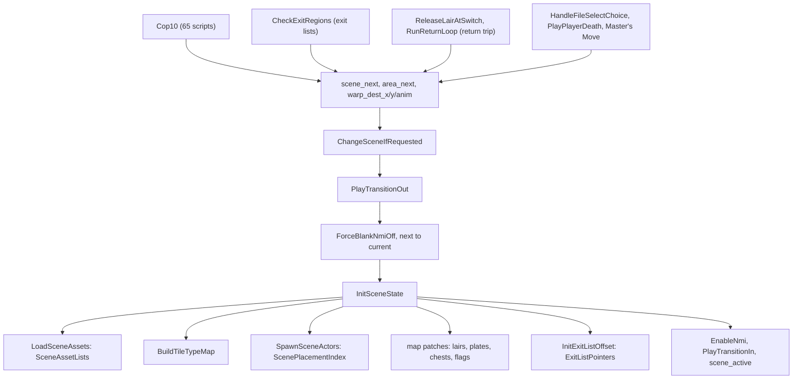
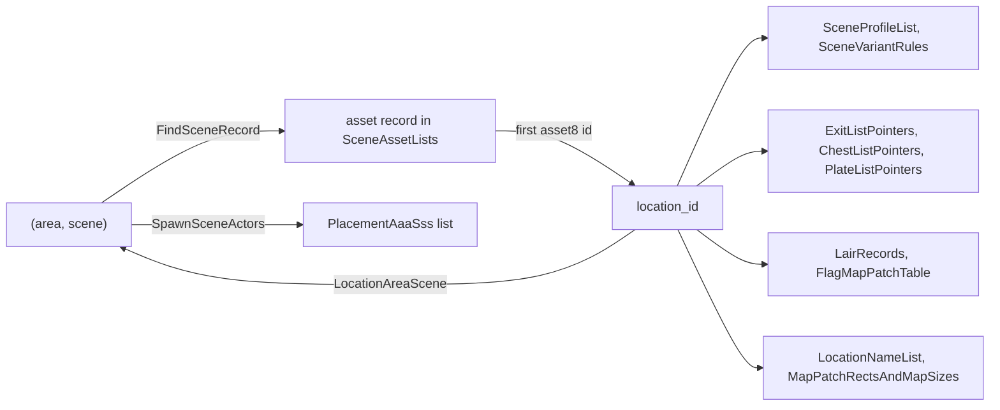

# Scene, Area and Warp Loading — `lib_scene_asset_loader.asm`, `lib_boot_and_scene_init.asm` and the scene tables

*Part of the [Soul Blazer Code Documentation](README.md)*

> How a request for another room becomes a loaded room: who writes `scene_next`, what `ChangeSceneIfRequested` does with it, how the asset list fills VRAM, palettes and maps, which tables populate and patch the scene, and how exit regions, `Cop10` and the return trip choose the next scene and the arrival point.

**Source:**
[`lib_scene_asset_loader.asm`](../../extracted/library/lib_scene_asset_loader.asm) ·
[`lib_boot_and_scene_init.asm`](../../extracted/library/lib_boot_and_scene_init.asm) ·
[`data_scene_asset_lists.asm`](../../extracted/system/data_scene_asset_lists.asm) ·
[`lib_scene_profile_data.asm`](../../extracted/library/lib_scene_profile_data.asm) ·
[`data_scene_variant_rules.asm`](../../extracted/system/data_scene_variant_rules.asm) ·
[`data_scene_placements.asm`](../../extracted/system/data_scene_placements.asm) ·
[`data_exit_lists.asm`](../../extracted/system/data_exit_lists.asm) ·
[`data_chest_lists.asm`](../../extracted/system/data_chest_lists.asm) ·
[`data_plate_lists.asm`](../../extracted/system/data_plate_lists.asm) ·
[`lib_map_tile_patches.asm`](../../extracted/library/lib_map_tile_patches.asm) ·
[`lib_tile_triggers_and_lair_return.asm`](../../extracted/library/lib_tile_triggers_and_lair_return.asm) ·
[`engine_spawn_lairs_death_drops.asm`](../../extracted/system/engine_spawn_lairs_death_drops.asm) (`SpawnSceneActors`) ·
[`cop_script_flow_flags.asm`](../../extracted/cop_handlers/cop_script_flow_flags.asm) (`Cop10_SetNextScene`, `Cop3C_SetTransitionType`) ·
[`cop_tiles_spawn_kill.asm`](../../extracted/cop_handlers/cop_tiles_spawn_kill.asm) (`Cop30_SpawnIfEnteredViaRecord`)

---

## Overview

A scene change is a value, not a call. Anything that wants another room writes a word to `scene_next` (and the arrival point to `warp_dest_x`, `warp_dest_y` and `warp_dest_anim`); the main loop notices on its next pass, and `ChangeSceneIfRequested` does the rest with the screen blanked: it plays the out transition, copies next to current, and runs `InitSceneState`, which reads the asset list, builds the tile type map, spawns the actors, replays the saved world state onto the map and places the player. The loop itself is described in [boot-nmi-main-loop.md](boot-nmi-main-loop.md); the actors that `SpawnSceneActors` creates are described in [actor-system.md](actor-system.md). This document covers everything between the request and the first frame of the new room.

Two keys run through all of it. The **asset list** and the **placement index** are keyed by `(area, scene)`, the pair the scene change carries. Everything else is keyed by `location_id` (`$1C6A`): the scene profile, the exit, chest and plate lists, the lair records, the variant rules, the map sizes and the location name. `location_id` is not stored in a table next to the scene; it is the id of the first `asset8` command of the scene's asset record, and `ApplySceneProfile` writes it while the record is loaded. `LocationAreaScene` is the reverse bridge (location to area and scene) that the lair return trip needs.

Three word encodings meet here, and mixing them up is the easiest way to misread a warp: the `Cop10` operand and `LocationAreaScene` hold `#$SSAA` (area in the low byte, scene in the high byte), `scene_next` holds `#$AASS` (scene in the low byte at `$0318`, area in the high byte at `$0319`), and an exit row stores area and scene as two separate bytes. `Cop10_SetNextScene` converts with an `XBA`; `ReleaseLairAtSwitch` copies the two bytes of `LocationAreaScene` one at a time.

Code addresses are source-ROM addresses (LoROM: bank = file offset ÷ `$8000`); the rebuilt ROM places blocks elsewhere (`rebuilt/layout.json`). `?BANK` in the extracted files and the keys of the notes files use the bank of the file offset, which can differ from the SNES bank printed here for blocks that start after `$8000` of a 64 KiB half. WRAM addresses are the game's own.

**Related:** [wram-memory-map.md](../wram-memory-map.md) · [areas-and-scenes.md](../areas-and-scenes.md) · [cop/index.md](../cop/index.md) · [cop-dispatch.md](cop-dispatch.md)

---

## Memory Map

### Code

| Address | Name | Description |
|---------|------|-------------|
| `$04:F781` | `ChangeSceneIfRequested` | Scene change when the low byte of `scene_next` is non-zero. |
| `$04:F7D5` | `PlayTransitionOut` | Out effect chosen by `transition_type`. |
| `$04:F827` | `PlayTransitionIn` | In effect chosen by `transition_type`. |
| `$04:F87C` | `RunIrisTransition` | Iris out and in (`IrisFrames`, VRAM word `$4000`). |
| `$04:F723` | `BuildTileTypeMap` | Rebuilds the tile type map from the loaded map (`FillTileTypeMap` at `$04:F73D`). |
| `$04:F9B5` | `InitSceneState` | Rebuild order of a scene: assets, tile types, actors, patches, player, HUD. |
| `$02:B3A6` | `LoadSceneAssets` | Walks the asset record of the scene command by command. |
| `$02:B3FF` | `FindSceneRecord` | Finds the record of `(area_current, scene_current)`. |
| `$02:B43F` | `LoadSceneGraphics` | Command `$80`: tile graphics to VRAM. |
| `$02:B532` | `LoadScenePalette` | Command `$40`: colours to the CGRAM buffer. |
| `$02:B571` | `LoadMetatileDefs` | Command `$20`: metatile definitions (`CopyDefsToLayer`). |
| `$02:B62B` | `LoadSceneTilemap` | Command `$10`: map to BG1, BG2 or Mode 7 (`LoadMapLayer`, `LoadMode7Map`). |
| `$02:B759` | `ApplySceneProfile` | Command `$08`: profile, jump or label. |
| `$02:B89E` | `LoadSceneMusic` | Command `$02`: music for the current variant (`UploadSceneMusic`). |
| `$02:B8FB` | `LoadSceneSpritemap` | Command `$01`: sprite maps to WRAM. |
| `$02:B731` | `ReadAssetPointer` | 3-byte file offset to a long pointer in dp`$29`-`$2B`. |
| `$02:B94A` | `FindAssetLabel` | Position behind a label of the asset list. |
| `$02:B983` | `CheckAssetCache` | Compares a pointer with its cache cell. |
| `$02:B272` | `DecompressQuintetLz` | Quintet LZ expander. |
| `$00:92DE` | `SpawnSceneActors` | Finds the placement list of the scene and spawns it (`SpawnPlacementList` at `$00:9314`). |
| `$02:957E` | `ApplyLairStatesToScene` | Replays lair states on the map (`ApplyFlagMapPatches` at `$02:95F1`, `LookupSceneVariant` at `$02:9662`). |
| `$02:92F5` | `ApplyReleasedLairRects` | Reopens the rooms of released lairs (`SetHeldLairTileType`, `InitPlateVariantAtEntry`, `InitExitListOffset`, `ShowOpenedChests` follow). |
| `$02:89D6` | `CheckPlayerTileTriggers` | Per frame: exits, chests, switches, plates. |
| `$02:8AF2` | `CheckExitRegions` | Exit region test of the current location. |
| `$02:8C25` | `ReleaseLairAtSwitch` | Lair reward: opens a path or starts the return trip. |
| `$00:D946` | `Cop10_SetNextScene` | `COP [10]`: scene request from a script. |
| `$00:DE6C` | `Cop3C_SetTransitionType` | `COP [3C]`: sets `transition_type`. |
| `$00:80DD` | `WaitReturnDone` | Finishes the return trip and warps to the return point. |
| `$00:ECD0` | `HandleFileSelectChoice` | Continue: `scene_next` from the save. |
| `$00:9ED3` | `PlayPlayerDeath` | Death: `scene_next` = world shrine. |

### Data

| Address | Name | Description |
|---------|------|-------------|
| `$05:8000` | `SceneAssetLists` | Asset records, 98 (a dummy first record and 97 scenes); `movable`. |
| `$01:99B4` | `ScenePlacementIndex` | 97 index rows `(area, scene, &list)` and the 97 `PlacementAaaSss` lists. |
| `$01:A9DE` | `ChestListPointers` | 128 words by `location_id`, then the chest lists. |
| `$01:AC96` | `ExitListPointers` | 128 words by `location_id`, then the exit lists. |
| `$01:B69A` | `PlateListPointers` | 256 words (`location_id` × 2 + variant), then the plate lists. |
| `$01:BA0D` | `LairRecords` | 32-byte lair records: location, rectangles, home location, switch. |
| `$01:F99A` | `SceneVariantRules` | 23 rows `(location, switch, variant)`. |
| `$02:C7C2` | `LocationNameList` | Banner text per `location_id`. |
| `$02:E8A1` | `SceneProfileList` | 128 words and the 97 profile records. |
| `$02:F28D` | `FlagMapPatchTable` | 70 rows of event-flag map patches. |
| `$02:F504` | `MapPatchRectsAndMapSizes` | Five patch rectangles and 128 map sizes in pages (at `+$28`). |
| `$02:F62C` | `LocationAreaScene` | 130 words, `#$SSAA`, by `location_id`. |
| `$09:8000` | `IrisFrames` | Iris mask tile data for the transition. |

### State

| Address | Name | Role in this document |
|---------|------|-----------------------|
| `$0314` / `$0316` | `area_current`, `scene_current` | The scene being run; keys of `FindSceneRecord` and `SpawnSceneActors`. |
| `$0318` / `$0319` | `scene_next`, `area_next` | The request; non-zero low byte starts the change. |
| `$1C6A` | `location_id` | Key of every per-location table; set by `ApplySceneProfile`. |
| `$03BA` | `world_index` | 0-6, from profile byte 11; selects the meta list and the shrine after death. |
| `$037C` / `$037E` / `$0380` | `warp_dest_x`, `warp_dest_y`, `warp_dest_anim` | Arrival point; consumed and cleared by `SpawnPlacementList`. |
| `$03E3` | `transition_type` | Effect of the change; cleared after the in transition. |
| `$031E` | `scene_variant` | Music record selector; cleared after the load. |
| `$03B4` | `asset_skip_mask` | One-shot mask of commands to skip; cleared after the load. |
| `$0407`-`$0424` | `asset_cache_*` | Ten 3-byte cache cells. |
| `$03FB`-`$0403` | `return_active`, `return_area`, `return_scene`, `return_x`, `return_y` | Return trip state. |

---

## Requesting a scene change

### Who writes `scene_next`

**When** something other than the loader decides that the player is elsewhere; **what** is stored is the destination and the arrival point; **why** a value instead of a call: the request can come from a script in the middle of a frame, and only the main loop is in a state where the screen may be blanked.

| Writer | Destination | Arrival | Notes |
|--------|-------------|---------|-------|
| `Cop10_SetNextScene` | operand word `#$SSAA` | operand anim, x, y | 65 sites: doors, stairs and the end of cutscenes. Always followed by `RTL`. |
| `CheckExitRegions` | row bytes `+4` area, `+5` scene | row anim, x, y | Per frame, for the current location only. |
| `ReleaseLairAtSwitch` (`StartLairReturnTrip`) | `LocationAreaScene[home]` | home tile of the record, anim from record `+1D` | Also saves `return_*`; see [Return trip](#return-trip). |
| `WaitReturnDone` | `return_area`, `return_scene` | `return_x`, `return_y` | Writes `transition_type = $80`. |
| `HandleFileSelectChoice` | the word `saved_scene` (`$1B90`, stored by `SaveGameToSlot` as `world_index + 1`), or `1` when `LoadGameFromSlot` returns carry set (no valid save: a new game, [save-and-load.md](save-and-load.md)) | anim 1, x `$70`, y `$60` | Same tile as the hero row of `PlacementA00S01` (7, 6). |
| `PlayPlayerDeath` | `world_index + 1` read as a word | none (`warp_dest_*` are normally 0, so the placement position is used) | Like `SaveGameToSlot`, it reads the word at `world_index`, so the area is the byte after it (`$03BB`); see [Open questions](#open-questions). |
| `cm_npc_master_move_to_hub_0076B2` | `$0009` | none | Master's Move: area 0, scene 9, the hub. |
| `BootGame` | `$000C` | none | The first scene after reset (area 0, scene `$0C`). |

`ChangeSceneIfRequested` is the only reader that clears `scene_next` (`STZ`). A request is therefore a one-slot mailbox: a second writer in the same frame overwrites the first.

### Scene identity: area, scene and `location_id`

**When** the scene change is processed; **what** it resolves: `FindSceneRecord` matches `(area_current, scene_current)` against the records of `SceneAssetLists`, and the first `asset8` command of the matching record carries the profile id, which `ApplySceneProfile` stores in `location_id`. All 97 records have a profile first (the first asset8 id equals the location of the scene in every record), and the four key sets are the same 97 scenes: the asset records, `ScenePlacementIndex`, the nonzero words of `ExitListPointers` and the non-empty words of `LocationAreaScene` (static check over the extracted tables). The other 31 `location_id` values (`25`-`27`, `35`-`3B`, `48`-`4F`, `5D`-`63`, `74`-`77`, `7E`, `7F`) hold `$0000` in every pointer table.

The shrine rooms show the pattern: `LocationAreaScene` gives area 0, scene `world_index + 1` for locations `00`, `14`, `28`, `3C`, `50`, `64` and `78`, which is why `PlayPlayerDeath` and the saved scene reach the world's shrine with `world_index + 1`. `docs/areas-and-scenes.md` lists every pair.

---

## Running a scene change

### `ChangeSceneIfRequested`

**When** `RunMainLoop` calls it every frame (and `BootGame` once); it acts only when the low byte of `scene_next` is non-zero, so scene 0 can never be requested. **What**, in order: with `scene_active` set it loads `iris_frame = $1E`, `iris_step = $FF` and calls `PlayTransitionOut`; it then clears `scene_active` and dp`$42`, calls `ForceBlankNmiOff`, copies `scene_next` and `area_next` to `scene_current` and `area_current`, clears `scene_next`, and runs `InitSceneState`, one `RunSubFrameLoader` and `EnableNmi`; finally it sets `iris_frame = 0`, `iris_step = 1`, calls `PlayTransitionIn`, sets `scene_active`, clears `transition_type` and `scene_loading`, and runs one more `RunSubFrameLoader`. At boot `scene_active` is 0, so the first load has no out transition. **Why** the order: everything between `ForceBlankNmiOff` and `EnableNmi` writes VRAM and CGRAM buffers directly, so no vblank check is needed anywhere in the loader.

### Transitions and the iris

**When** every scene change, before the blank and after the load; **what** the effect is depends on `transition_type`, which `Cop3C_SetTransitionType` sets from scripts and which stays set until the in transition has finished, so one value drives both halves. The values in use are few: `0` (the default: fade out, fade in), `4` (23 scripts, always just before a `Cop10`: mosaic out, mosaic in) and `$80` (return trips: iris out and iris in). Out: 0-1 fade, 2-3 instant, 4-5 mosaic, 6-7 instant, 8-`$7F` fade, `$80` and above iris. In: 0 fade, 1 instant, 2 fade, 3 instant, 4 mosaic, 5 instant, 6 mosaic, 7 instant, 8-`$7F` fade, `$80` and above iris. A fade is `INIDISP` brightness `$0F` to 0 (out) or 0 to `$0F` (in) with one sub-frame per step; a mosaic uses two sub-frames per step with `MOSAIC = ((brightness xor $0F) << 4) | 3`.

`RunIrisTransition` out starts with `scene_loading` incremented, `ClearBg3Buffer` and `vram_upload_flags` bit 0, then runs frames `$1E` down to 0 (31 steps) and in runs 0 to `$1F` (32 steps). Each step is two `RunSubFrameLoader` calls and one 16-byte row of `IrisFrames` written to VRAM word `$4000` (the offset is `((2 × type + frame bit 4) << 8) | ((frame & $0F) << 4)`, where the type's bit 7 drops out). **Why** a data table: the iris is drawn by rewriting one mask tile per step, so the shape of each frame is data in `IrisFrames`.

### `InitSceneState`

**When** inside the blank, once per scene change. **What** it does, in order (`InitSceneState`, block note and code):

1. Zeroes the per-scene variables: `player_x`, `player_y`, the scroll deltas, `joy_pressed`, `joy_block_mask`, `boss_fight_active`, `player_hidden_count`, `joy_override`; sets the weapon, soul orb and boss actor references to none; clears event flag byte 0 (flags `$00`-`$07` are scene-local), `contact_lock`, `no_combat_scene`, the PPU shadows and the colour buffer.
2. `LoadSceneAssets`; then, when `reload_menu_gfx` is set, clears it and calls `RestoreSceneBgGfxAndPalette` and `LoadEquippedMagicGfx`.
3. `BuildTileTypeMap`; then the map size in pages from `MapPatchRectsAndMapSizes+$28` by `location_id`.
4. `InitActorPool` and `SpawnSceneActors`.
5. The seven patches in this order: `SetHeldLairTileType`, `ApplyReleasedLairRects`, `ApplyLairStatesToScene`, `InitPlateVariantAtEntry`, `InitExitListOffset`, `ShowOpenedChests`, `ApplyFlagMapPatches`.
6. `ClearBg3Buffer`, `ClearSwitchOwnersOnReturn`, two `RunActors` passes, `ApplyPlayerWeaponPose`, `RedrawBackgroundsAtEntry` (skipped for location `$10`, the Mode 7 scene).
7. Clears `scene_variant` and `asset_skip_mask` (the two one-shot requests), seeds `rng_state+1` from `frame_counter`, sets `joy_release_latch` and `frame_counter` to `$FFFF`, resets the window registers and `ResetSortBuckets`, and marks the HUD dirty unless event flag `$FA` is set.

**Why** this order: the actors need the tile types and the map size, the patches need the actors (lair actors are created by `ApplyLairStatesToScene`), and the player has to be placed before the two `RunActors` passes that settle the first frame.

---

## The asset list

### Record and command format

**When** `LoadSceneAssets` runs; **what** it reads is a record per scene in `SceneAssetLists`: area, scene, a run of commands, `00`. A command byte has exactly one bit set; `LoadSceneAssets` tries the bits from `$80` down to `$01` (a `BIT` ladder), calls the handler, and stops on a `00` byte.

| Byte | Command | Operands | Handler | Skip bit |
|------|---------|----------|---------|----------|
| `$80` | graphics | 6: start, end (units of `$200` bytes, bit 7 = raw), VRAM page (word address `b2 << 8`), pointer | `LoadSceneGraphics` | 3 |
| `$40` | palette | 6: first colour, end colour, destination colour, pointer | `LoadScenePalette` | 2 |
| `$20` | tileset | 7: start, end (units of 64 bytes), destination offset, layer mask (1 BG1, 2 BG2), pointer | `LoadMetatileDefs` | 1 |
| `$10` | tilemap | 4: type (1 BG1, 2 BG2, 0 Mode 7), pointer | `LoadSceneTilemap` | 0 |
| `$08` | asset8 | 1: profile id, jump or label | `ApplySceneProfile` | never |
| `$04` | meta4 | 3, ignored | `SkipMeta4Command` | no record uses it |
| `$02` | music | 5: start command, variant, pointer | `LoadSceneMusic` | 5 |
| `$01` | spritemap | 6: slot (0 = `$7E:3800`, else `$7E:F000`), two ignored bytes, pointer | `LoadSceneSpritemap` | 4 |

The list holds 107 graphics, 109 palette, 62 tileset, 135 tilemap, 65 music and 47 spritemap commands. The first record is a dummy (area `$53`, scene `$59`) with no commands, and the list has no end sentinel (OQ-I011-3): a request for a pair that is not in the list would walk past the end.

### Shared segments: `FindSceneRecord` and `FindAssetLabel`

**When** a record starts and when an `asset8` operand is `$80` or higher; **what**: `FindSceneRecord` walks the records from the top, skipping each command by its operand size (6, 6, 7, 4, 1, 3, 5 and 6 bytes in the order of the table above), and stops at the first record whose scene and area match. An `asset8` id below `$80` is a profile; `$80`-`$BF` is a jump (`JumpToAssetLabel` turns it into the label `id | $40` and calls `FindAssetLabel`); `$C0`-`$FF` is a label (nothing to do, the walker simply continues). `FindAssetLabel` scans the whole list from the first record for the `asset8` command whose operand equals the label, and the walk continues behind it in the other record, up to that record's `00`. **Why**: scenes of one world share graphics, palettes and tile definitions; the 65 jumps go to 37 labels. The label `$DE`, in the record of area `$12`, scene 1, is defined and never targeted (no jump `$9E` exists).

The record walkers ignore `asset_skip_mask`. A jump never returns: the walk ends at the `00` of the other record, and in the shipped list all 65 jumps are the last command of their record.

### Pointers, cache and `asset_skip_mask`

**When** every loading command; **what**: each pointer in a record is a 3-byte linear **file offset**, which `ReadAssetPointer` converts to a LoROM long pointer in dp`$29`-`$2B` (`bank = offset >> 15`, `address = $8000 + (offset & $7FFF)`). `CheckAssetCache` then compares the pointer with one of ten 3-byte cache cells at `$0407`-`$0424` and says "load" only when it differs: graphics are cached by VRAM page (`$00`, `$10`, `$20`, `$30`), tilesets and tilemaps per layer, plus one cell each for the spritemap and the music. Palettes have no cache because loading one is a copy into the CGRAM buffer. A graphics page other than those four, and a tileset or tilemap type other than 1 or 2, zero the cells of their kind and always load. **Why**: a scene change that keeps the same assets in the same slots (the rooms of one town) costs no decompression and no DMA.

`asset_skip_mask` (`$03B4`) is a one-shot request: a cutscene script, or `ReleaseLairAtSwitch` for the return trip, writes `$0020` just before the scene change so that the music is not reloaded, even when the warp goes to another world (15 writer sites in 10 files; the Phoenix scene of the Soul of Mountain House goes to the World of Evil this way). `InitSceneState` clears it after the load.

### The loaders

| Command | What it does | Where it puts it |
|---------|--------------|------------------|
| Graphics (`LoadSceneGraphics`) | Expands the stream to `$7E:6000` and writes words `[b0 × $200, b1 × $200)` to `VMDATAL`; raw (b0 bit 7) copies straight from the ROM. `b2 = $FF` (the Mode 7 scene only) writes `VMDATAH` only, `$4000` bytes. | VRAM word `b2 << 8` |
| Palette (`LoadScenePalette`) | Copies colours `[b0, b1)` of the source. | `cgram_buffer + b2 × 2`, uploaded by the NMI |
| Tileset (`LoadMetatileDefs`, `CopyDefsToLayer`) | Expands to `$7E:6000`, copies bytes `[b0 × 64, b1 × 64)` word by word, byte-swapped; eight bytes per metatile, 256 ids, `$800` bytes per layer. All 62 are `b0 = 00`, `b1 = 20`. | `$7E:2000` (BG1) and/or `$7E:2800` (BG2) |
| Tilemap (`LoadSceneTilemap`, `LoadMapLayer`, `LoadMode7Map`) | The stream header is width and height in 256-pixel pages; the length is width × height × 256 bytes (one byte per metatile), replaced by the stream's length word when compressed. Types 1 and 2 store the sizes in `map_width_px` and `map_height_px` and expand to the layer page; type 0 expands `$4000` bytes to `$7E:C000` and writes `VMDATAL` with `VMAIN = 0`. | `map_base_bg1` (`$8000`), `map_base_bg2` (`$C000`) |
| Spritemap (`LoadSceneSpritemap`) | Expands unless the pointer equals `asset_cache_spritemap`. | `$7E:3800` or `$7E:F000` |

All loaders advance `Y` past their operands even when skipped, so a skip never shifts the walk. The loader never sets dp`$2E`, the bank byte of the copy destination of a raw tileset or map; no shipped asset is raw (OQ-I011-1).

### Music: `LoadSceneMusic` and `UploadSceneMusic`

**When** a music command is reached and bit 5 of `asset_skip_mask` is clear; **what**: it stores `bgm_start_cmd` and `bgm_record_variant`, and calls `UploadSceneMusic` only when `scene_variant` equals the record's variant byte and the pointer differs from `asset_cache_music`. A scene lists one music command per variant (for example the record of area 3 scene 1 has three, variants 0, 1 and 2), so the variant picks which song plays. The upload is `APUIO0 = $F0` and wait for the SPC to answer 0, 2 frames, `APUIO0 = $FF` (the boot handshake handler), 2 frames, `UploadSpcStream`, 3 frames, then `APUIO0 = bgm_start_cmd`. **Why** the cache and the skip mask: sending a song through the SPC IPL takes several frames and silences the previous one.

### Quintet LZ

**When** every compressed stream: `DecompressQuintetLz` is the Quintet LZ expander of `corpus/gaia-core/quintet-lz.md`. **What**: a 256-byte ring pre-filled with `$20` (the ring is the page `$7E:0100`-`$01FF`, which every decompression overwrites, OQ-I011-8), first write position `$EF`, one flag bit per token (1 = literal byte, 0 = back reference of an 8-bit ring position and a 4-bit length, count = length + 2), bits read MSB first with the one-hot mask dp`$1E` (`ReadLzByte` reads 8 bits at any phase). It does not read the 2-byte length word in front of every stream; each caller reads it into dp`$23`. The source cursor is the 16-bit dp`$29` with the bank in dp`$2B`, so by static reading a compressed stream cannot cross a bank border (OQ-I046-3).

---

## Scene profile and variant

### `ApplySceneProfile`

**When** the first command of every record; **what**: for an id below `$80`, `ApplyProfileRecord` stores `location_id`, reads the profile address from `SceneProfileList` (the word minus the list's own address, indexed with long addressing) and writes `TM`, `TMW`, `TS`, `TSW`, `CGWSEL`, `CGADSUB`, `BGMODE`, `BG1SC`, `BG2SC`, the shadows, the BG tile attributes, the view height, the four parallax ratio words and `world_index`. Byte 11 of the record carries `world_index` in bits 0-3, `no_combat_scene` in bit 5 and the music variant in bits 6 and 7 (each adds 1). The first id of each world (`00`, `14`, `28`, `3C`, `50`, `64`, `78`, the shrine rooms) has byte 4 = `$E4` and byte 5 = `$0F`. The sample record `SceneProfile00` is `#17008000E40F091111111120`: main screen `$17`, `BGMODE $09`, ratios `$11` (same speed) and byte 11 = `$20` (world 0, no combat). **Why** a table: the settings that differ per scene are 12 bytes, so one routine writes them for 97 scenes. The records are read once per load, so the list and the records can move together.

### `LookupSceneVariant`

**When** `ApplySceneProfile`, when `scene_variant` is still 0 (no actor asked for a variant); **what**: it walks `SceneVariantRules` (4-byte rows: `location_id`, word switch number, variant; a first byte of `$80` or more ends the table) for a row of this location whose bit is set in the switch array at `$1ADE`, and stores its variant. When a variant was already requested, or a row matched, bits 6 and 7 of profile byte 11 are ignored (`ProfileKeepVariant`); otherwise `ProfileAddVariantBits` adds them. So the priority is: actor request, switch row, profile bits. The switch numbers are lair record indices; the six values `$0009`, `$0050`, `$00B6`, `$0103`, `$012F` and `$0195` are the boss lairs of worlds 0-5. **Why**: the boss room tune and the tune of the rest of the world depend on a lair switch, not on the room, so they are rows keyed by location and switch. Static reading only: the rows change the music of a world after its boss lair is released (OQ-I011-5).

---

## Population and map patches

### Placement tables

**When** `SpawnSceneActors`, once per scene; **what**: `ScenePlacementIndex` rows are `unk1 < #area, #scene, &PlacementAaaSss >`; the first row that matches `(area_current, scene_current)` hands its list to `SpawnPlacementList` (a first byte of `$80` or more ends the scan). A list row is `x, y, flags, meta type`; position is `x × 16, y × 16 + 16`. There are 97 lists with 913 rows (93 hero rows and 820 other actors; the longest list is `PlacementA06S01` with 33 rows). The first row of 93 lists is the hero (meta type 0); the four lists without a hero are `PlacementA00S09` (the hub), `PlacementA00S0A`, `PlacementA00S0B` and `PlacementA00S0C`. **Why**: the lair monsters are not here: they come from `LairRecords`, so the enemies of a scene are the placement list plus the lairs of its location. The meta types, the actor linking and the player placement are described in [actor-system.md](actor-system.md); the arrival point is in [Arrival](#arrival).

### Scene-load patches

**When** `InitSceneState`, after the actors exist; **what**: the map is rebuilt from the ROM at every scene change, so every permanent change of the game is replayed from saved bit arrays and event flags.

| Routine | Replays | From |
|---------|---------|------|
| `SetHeldLairTileType` | Tile type 1 on the cells of lairs whose NPC is held (state bits 7 and 6, switch bit set) | `lair_state`, `LairRecords`, `$1ADE` |
| `ApplyReleasedLairRects` | The rooms a released lair opened (copy from the staging place of the map or from slab 3) | `LairRecords`, `$1A9E` |
| `ApplyLairStatesToScene` | Lair actors for lairs with monsters left, tile `$FE` (state 0, the green switch) or `$FF` (state below 0); counts `lairs_left` | `lair_state` |
| `InitPlateVariantAtEntry` | `plate_variant` and `plate_list_ofs` of the pressure plates | `PlateListPointers` |
| `InitExitListOffset` | `exit_list_ofs` = `ExitListPointers[location_id]` minus the table base | `ExitListPointers` |
| `ShowOpenedChests` | Open-chest tiles for chests already opened | `ChestListPointers`, `$1A7E` |
| `ApplyFlagMapPatches` | Permanent map changes of the story (opened doors and passages): 9-byte rows, rectangle copied from the staging place when the event flag is set | `FlagMapPatchTable` (70 rows), event flags at `$1A5E` |

Only three locations have plates (01, 29 and 65; two lists each, by variant). 60 of the 97 chest lists are the shared `ChestListEmpty`. `BuildTileTypeMap` fills the tile type map before these patches run, which is why `SetHeldLairTileType` has to write its type 1 cells afterwards.

---

## Warps

### Exit regions

**When** every frame, from `CheckPlayerTileTriggers`; **what**: `CheckExitRegions` walks the 11-byte rows of the current location's exit list (`+0` x, `+1` y, `+2` width, `+3` height in tiles, `+4` area, `+5` scene, `+6` arrival animation, `+7` word arrival x, `+9` word arrival y; `$FF` ends the list). `TestExitRow` tests the player's tile inside the rectangle (unsigned: tile minus origin must be below the size), `AdvanceExitRow` steps to the next row (`+$0B`), and `TestExitPixels` repeats the test in pixels against the rectangle shrunk by 15 pixels: `player_x - x × 16` must be below `width × 16 - 15`, and `player_y - (y × 16 + 16)` below `height × 16 - 15`. A 1 × 1 region therefore fires only when the player stands exactly on its grid point, and a 2-wide region over a span of 17 pixels. On a match the destination is stored in `area_next`, `scene_next`, `warp_dest_anim`, `warp_dest_x` and `warp_dest_y` and carry is set; `NoExitHit` returns with carry clear. **Why**: doors, room edges, ladders and portals are data, not scripts: 78 of the 97 lists have rows (201 in all), 18 are a single `$FF` byte (the dream rooms, the five intro scenes `0F`-`13`, the deck `72` and the Deathtoll battle `7D`: places the player leaves by script), and `ExitListUnreferenced` is empty and unused. Locations `56` and `5A` share `ExitListLoc56` (OQ-I033-5).

No row has a condition: a region is live whenever the player is inside it. What keeps a portal out of reach before its lair is cleared is the map, which the patches above open, not the exit list.

### Arrival

**When** `SpawnPlacementList` meets the hero row; **what**: when `warp_dest_x` or `warp_dest_y` is non-zero the player's actor is placed at `warp_dest_x` and `warp_dest_y + 16` (the same +16 as the placement position), the animation is `warp_dest_anim` (`SetActorAnimFrame`), `player_tile_x` and `player_tile_y` are `warp_dest >> 4`, and the three `warp_dest_*` words are cleared. When both are 0 the placement row decides. `player_x`, `player_y` and `player_actor` are published afterwards. **Why** the +16: the origin of every position is the actor's bottom edge, so a tile row `y` is at pixel `y × 16 + 16`; this is the same offset that `TestExitPixels` adds to an exit row.

By convention the arrival tile is one step inside the partner exit region of the destination room, never in it, so the arrival does not trigger a warp back (see [the worked example](#worked-example-the-grass-valley-shrine)).

### `Cop10` and `Cop3C`

**When** 65 scripts end a cutscene, open a door or drag the hero into a painting; **what**: `Cop10_SetNextScene` reads a word `#$SSAA`, a byte (the arrival animation) and two words (x and y), `XBA`s the first into `scene_next` and stores the other three in `warp_dest_*`; it ends in `CopExitContinue` and the script's `RTL` follows. `Cop3C_SetTransitionType` stores one byte in `transition_type` and runs before the `Cop10` (23 scripts, all with type 4). For example, `COP [10] ( #$0103, #01, #$0078, #$03E0 )` in the Leo's Brush painting script sends the hero to area 3, scene 1 (location `07`, "Leo s Paintings") at tile (7, 62), one tile above the exit row at the bottom of that room. **Why**: a script needs only the destination pair; everything else (assets, actors, exits) is looked up from it. See [cop-dispatch.md](cop-dispatch.md) for the COP mechanics.

### Return trip

**When** the player steps on the green switch of a lair that frees an NPC whose home is in another scene; **what**: `ReleaseLairAtSwitch` finds the lair record by `(location_id, tile)` and turns the switch tile into `$FF`; a record with a staging rectangle (`ReleaseLairPathCase`) opens a path in place with a map sweep, and a record without one (`ReleaseLairNpcCase`) frees an NPC: `lair_state = +A or $C0`, and when the record's home location is the current one the home tile gets type 1. For a home elsewhere, `StartLairReturnTrip` saves the return point (`area_current`, `scene_current`, `player_x`, `player_y - 16` into `return_*`), sets `warp_dest_anim` from record `+1D` and `warp_dest_x/y` from the home tile (`+2`, `+3` times 16), looks up `area_next` and `scene_next` in `LocationAreaScene[record +0]`, sets `transition_type = $80` and `asset_skip_mask = $20`, stores the record index in `return_record` and increments `return_active`. The main loop then switches to `RunReturnLoop`, `WaitReturnDone` waits for the flag, heals, waits `$78` frames and copies `return_area`, `return_scene`, `return_x` and `return_y` into the next-scene variables with `transition_type = $80` again. In the home scene `Cop30_SpawnIfEnteredViaRecord` reads `return_record`, and `RunLairReleaseOnReturn` waits for the player to stand on the type 1 tile, where `PlayLairReleaseScene` shows the "released" message. **Why** the iris: a trip to the NPC's room and back is not a door, so it gets its own effect. `LocationAreaScene` exists for this path: a lair record names its home by location id, and only this table says in which scene that is.

---

## Bank layout

**When** it matters: every time a table is read or moved. **What**: the engine runs with DBR = `$01` and the scene tables fall into three groups.

| Group | Tables | How they are read |
|-------|--------|-------------------|
| Bank `$01`, short `$&` | `ScenePlacementIndex` and the placement lists (`dp$2B = $01`), `ExitListPointers`, `ChestListPointers`, `PlateListPointers`, `LairRecords`, `SceneVariantRules` | 16-bit addresses from code in banks `$00` and `$02` (`LDA $&data_exit_lists.ExitListPointers, X`), so `exit_list_ofs` is an offset from the table base (`InitExitListOffset` subtracts it) and every access adds `ExitListPointers` again. |
| Bank `$02`, long `$@` | `SceneProfileList`, `LocationAreaScene`, `FlagMapPatchTable`, `MapPatchRectsAndMapSizes` | Long addresses, because DBR is `$01` while the code reads a bank `$02` table; `ApplyProfileRecord` also subtracts the list base from the pointer word to index with long addressing. |
| Anywhere, long pointer | `SceneAssetLists` (`$05:8000`) and every asset | The list is `movable`: dp`$2F`-`$31` is set once by `InitHardwareAndClearWram` (after the WRAM clear, since the direct page is inside it). Asset pointers are 3-byte file offsets, not addresses, so assets can move without changing the list's format. |

Because the asset pointers are file offsets and the cursor of `DecompressQuintetLz` is a 16-bit address, a compressed asset has to start and end inside one bank. Two pieces of code pin the layout: `FindSceneRecord` ends with a `BRA GraphicsCacheHit` and `FindAssetLabel` with a branch that is never taken, so a rebuild must keep them at the same relative distance and `InitHardwareAndClearWram` cannot move away from `FindAssetLabel` on its own (OQ-I011-10).

---

## Worked example: the Grass Valley Shrine

The shrine of world 0 is area 0, scene 1, location `00` (`LocationName00`, "Grass Valley Shrine"); its asset record opens with `asset8 < #00 >` (the profile of location `00`) and, after a palette, marks the label `#DA`, the shared segment that six other records reach with the jump `#9A`. `PlacementA00S01` puts the hero at tile (7, 6) when `warp_dest` is 0 and `ExitListLoc00` holds three rows:

| Row | Region (x, y, w × h) | Destination | Arrival | Walkthrough |
|-----|----------------------|-------------|---------|-------------|
| `;00` | (5, 6, 1 × 1) west of the hero | area 0, scene 8 (`LocationName0D`, "Trial room") | anim 1, ($40, $90) = tile (4, 9) | "walking left onto the blue portal" (01) |
| `;01` | (7, 8, 1 × 1) south | area 1, scene 1 (Grass Valley highlands) | anim 0, ($0140, $0270) = tile (20, 39) | "the blue tile to the south" (01) |
| `;02` | (9, 6, 1 × 1) east | area 3, scene 5 (`LocationName0B`, "Leo s Paintings") | anim 3, ($30, $02D0) | "exit off to the east" (06, Leo's Painting) |

Standing on (5, 6) at exactly pixel (80, 112): `CheckExitRegions` passes `TestExitRow` (tile (5, 6) minus (5, 6) is 0, below 1) and `TestExitPixels` (both pixel differences 0, below 1), stores area 0, scene 8, anim 1 and (`$40`, `$90`), and returns carry set. The next pass of `RunMainLoop` calls `ChangeSceneIfRequested`: fade out (`transition_type` is 0), blank, copy to current, `InitSceneState`. `FindSceneRecord` finds `asset_list < #00, #08 >`, whose first command `asset8 < #0D >` sets `location_id = $0D` (`SceneProfile0D`, `world_index` 0). The record then loads one graphics block, one tileset (`b3 = 3`: both layers), a palette, the tilemap `type 1`, a second graphics block and palette, a spritemap and one music record. `InitExitListOffset` takes `ExitListLoc0D`, a single row (4, 10, 1 × 1) to area 0, scene 1, anim 3, ($60, $60): back to the shrine at tile (6, 6), one tile east of the west region it left through. The player arrives at tile (4, 9), directly above the Trial room's own exit row: the pairs are built so that neither arrival lies in a region.

The same pairing holds for the south exit: `ExitListLoc01` row `;00` (20, 38) leads to the shrine at ($70, $70), tile (7, 7), directly above the region (7, 8) that led out. And `Cop10` into the first painting arrives at ($78, $3E0), tile (7, 62), while `ExitListLoc07` row `;01` (7, 63, 2 × 1) is the way back to the village at ($0300, $0050).

---

## Walkthrough cross-check

The walkthrough is the source of truth for game names and facts; the ROM text for spelling and behaviour.

| Walkthrough | ROM | Result |
|-------------|-----|--------|
| 01: begin in "Up Above", walk left onto the blue portal to the Trial Room | `ExitListLoc00` row `;00`, region west of the hero row, to area 0 scene 8 "Trial room" | Agrees. |
| 01: an empty file begins "Up Above" with the Master; after the Trial Room you are back "wherever it is that you started" | `HandleFileSelectChoice` stores `scene_next = 1` when `LoadGameFromSlot` returns carry set, with arrival ($70, $60), the hero tile of `PlacementA00S01`; `ExitListLoc0D` leads back to area 0, scene 1 | Agrees; carry set is "no valid save", which is what an empty file is ([save-and-load.md](save-and-load.md); runtime check OQ-I024-5). |
| 01: leave the Trial Room by the blue square, then use "the blue tile to the south" to enter the main game | `ExitListLoc0D` has one row, to the shrine; `ExitListLoc00` row `;01` is south and leads to the highlands | Agrees; the direction of the Trial room's own exit is not checked (the walkthrough says southwest, the row is at (4, 10)). |
| 01: the Master's place has four squares: save, boss, town, midpoint | `ExitListLoc00` holds three rows (Trial room, highlands, Leo's Paintings), `ExitListLoc14` three (Woods, Lostside, Light Shrine) | Not comparable by static reading: OQ-I046-4. |
| 06: "From the Master's Shrine in Grass Valley, exit off to the east" (Leo's Painting) | `ExitListLoc00` row `;02` to area 3 scene 5 "Leo s Paintings" | Agrees. |
| 06: GreenWood, "exit the shrine to the west" to reach the Fire Shrine | `ExitListLoc14` row `;01` (5, 6) to area 5 scene 1 "Lostside, a marsh" | Agrees (the route to the Fire Shrine starts in the marsh). |
| 07 and 08: Light Shrine, "exit via the portal to the east" of the GreenWood Master's Shrine | `ExitListLoc14` row `;02` (9, 6) to area 5 scene 9 "Light Shrine" | Agrees. |
| Master's Shrine (walkthrough name for the hub room of each world) | Seven rooms named "Grass Valley Shrine", "GreenWood Shrine", "St- Elles Shrine", "The Soul s Sanctuary", "The Laboratory Shrine", "Magridd Castle Shrine", "The Evil World Shrine" (locations `00`, `14`, `28`, `3C`, `50`, `64`, `78`) | Naming difference only (crosswalk class C), no DISCREPANCY. |

---

## Open questions

The questions this document could not settle are in `plans/extracted-audit/questions/I046_questions.md`: OQ-I046-1 (the byte after `world_index`, which `PlayPlayerDeath` and `SaveGameToSlot` read as the area of the shrine scene), OQ-I046-2 (the music of the hub after the Master's Shrine event, which fades the music out and then sets `asset_skip_mask`), OQ-I046-3 (compressed assets inside one bank), OQ-I046-4 (the walkthrough's four squares of the Master's place against the three exit rows of a shrine list) and OQ-I046-5 (which scenes the four hero-less placement lists belong to). All are GAP; none is a DISCREPANCY, and the game terms of the document agree with the walkthrough chapters 01, 06, 07 and 08. Earlier questions this document relies on: OQ-I024-5 (carry set from `LoadGameFromSlot`), OQ-I011-1, OQ-I011-3, OQ-I011-5, OQ-I011-8 and OQ-I011-10 (the loader and the variant rows), OQ-I033-5 (`ExitListLoc56` shared by locations `56` and `5A`) and OQ-I044-5 (the hero-less lists).

---

## See Also

- [boot-nmi-main-loop.md](boot-nmi-main-loop.md) — `RunMainLoop`, `RunReturnLoop`, `RunSubFrameLoader`, `ForceBlankNmiOff` and the frame structure around a scene change.
- [actor-system.md](actor-system.md) — meta lists, actor linking and placement spawning.
- [data-tables.md](data-tables.md) — the tables side by side: keys, terminators, the 31 id holes, the row layouts and the lair records.
- [cop-dispatch.md](cop-dispatch.md) — the COP mechanics behind `Cop10` and `Cop3C`; [cop/index.md](../cop/index.md) for the command list.
- [collision-and-physics.md](collision-and-physics.md) — what `BuildTileTypeMap` builds, how the type byte is read, and how the map patches change it.
- [areas-and-scenes.md](../areas-and-scenes.md) — every `(area, scene)` pair and its `location_id`.
- [wram-memory-map.md](../wram-memory-map.md) — the WRAM variables used here.
- [vram-dma-hdma-palettes.md](vram-dma-hdma-palettes.md) — where the `graphics`, `palette` and `tilemap` commands land in VRAM and the CGRAM buffer, what `ApplySceneProfile` and `InitSceneState` write to the PPU, and the iris.
- [text-and-dialogue.md](text-and-dialogue.md) — how `LocationNameList` is printed by the pause banner (`[TBL:&LocationNameList,1C6A]`).
- [walkthrough/README.md](../walkthrough/README.md) — the game-text source of truth.
