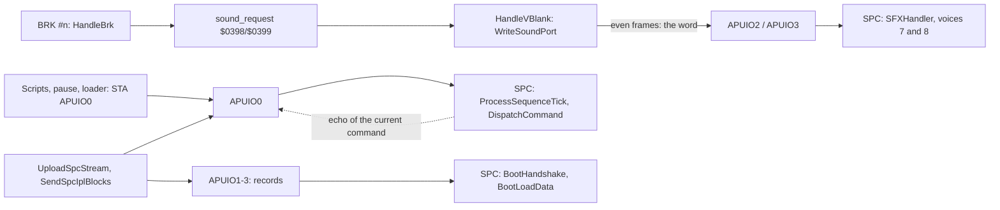
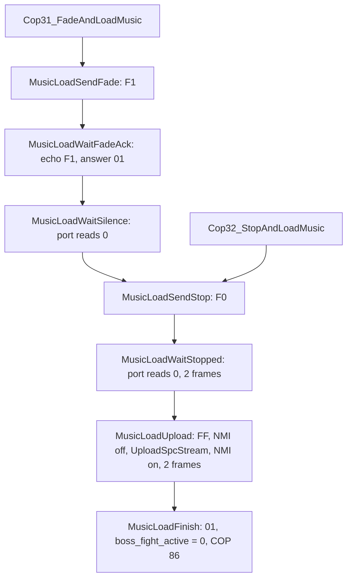

# SPC Interface — `engine_spc_ipl_upload.asm`

*Part of the [Soul Blazer Code Documentation](README.md)*

> How the CPU talks to the sound chip: the four ports, the uploads of the engine, the driver and every song, the song and sound-effect requests, and what the SPC does with each value.

**Source:**
[`engine_spc_ipl_upload.asm`](../../extracted/system/engine_spc_ipl_upload.asm) ·
[`data_spc_driver.asm`](../../extracted/system/data_spc_driver.asm) ·
[`engine_vblank_nmi.asm`](../../extracted/system/engine_vblank_nmi.asm) (`HandleVBlank`, `WriteSoundPort`) ·
[`cop_dispatch.asm`](../../extracted/system/cop_dispatch.asm) (`HandleBrk`) ·
[`engine_spawn_lairs_death_drops.asm`](../../extracted/system/engine_spawn_lairs_death_drops.asm) (the music-load chain) ·
[`cop_script_flow_flags.asm`](../../extracted/cop_handlers/cop_script_flow_flags.asm) (`Cop31_FadeAndLoadMusic`, `Cop32_StopAndLoadMusic`) ·
[`lib_scene_asset_loader.asm`](../../extracted/library/lib_scene_asset_loader.asm) (`LoadSceneMusic`, `UploadSceneMusic`) ·
[`data_engine_tables.asm`](../../extracted/system/data_engine_tables.asm) (`MusicPointerTable`) ·
[`data_scene_asset_lists.asm`](../../extracted/system/data_scene_asset_lists.asm) (the `music` records) ·
[`lib_main_loop_helpers.asm`](../../extracted/library/lib_main_loop_helpers.asm) (`HandlePauseBanner`) ·
[`gw_woods_actors_01B98D.asm`](../../extracted/greenwood/woods_of_greenwood/gw_woods_actors_01B98D.asm) (the restaurant dog) ·
[`mc_castle_actors.asm`](../../extracted/magridds_castle/castle_of_magridd/mc_castle_actors.asm) (the singer)

---

## Overview

The sound chip is a second computer: an SPC700 with its own 64 KB of RAM (ARAM) and the DSP that makes the sound. The CPU sees only four byte-wide ports, `APUIO0`-`APUIO3` (`$2140`-`$2143`), which the SPC reads and writes as its `$F4`-`$F7`. Soul Blazer uses them for three jobs. **Uploads**: the engine (once, through the SPC's boot ROM), the driver block (once) and a song (at every music change) are sent as records. **Commands on `APUIO0`**: a song number or a value from `$F0` up (stop, fade, pause, boot handshake). **Sound requests on `APUIO2`/`APUIO3`**: every `BRK #n` ends as one pulse there, sent by the NMI. The SPC answers on `APUIO0` by echoing the command it has accepted; the wait loops of the CPU depend on that echo.

The SPC-side labels (`ProcessSequenceTick`, `DispatchCommand`, `PlaySong`, `HandleFadeIn`, `StopAllChannels`, `SetEchoBit6`, `HandleBootHandshake`, `BootHandshake`, `BootLoadData`, `SFXHandler`, `SFXInitChannel`, `ReadPortData`, `InitSampleEndPtr`) are the ones of [audio/spc-disassembly.md](../audio/spc-disassembly.md); they are not in `extracted/` because the engine is data (`SpcEngineBlock`). Everything the document says about the SPC side is read from that listing; nothing was run.

A song change is a small protocol with the game running between the steps:

Scene music takes a shorter road (`UploadSceneMusic`: `$F0`, `$FF`, upload, start command) because the scene loader already owns the frame; the scene side of it is in [scene-area-warp-loading.md](scene-area-warp-loading.md) (§"Music: `LoadSceneMusic` and `UploadSceneMusic`") and only the SPC side is described here.

Code addresses below are source-ROM addresses (LoROM: bank = file offset ÷ `$8000`, address = `$8000` + the offset inside that bank); the rebuilt ROM places the blocks elsewhere (`rebuilt/layout.json`). WRAM addresses are the game's own. ARAM addresses are written `ARAM $xxxx`.

**Related:** [audio/spc-engine.md](../audio/spc-engine.md) · [audio/spc-disassembly.md](../audio/spc-disassembly.md) · [boot-nmi-main-loop.md](boot-nmi-main-loop.md) · [cop-dispatch.md](cop-dispatch.md) · [wram-memory-map.md](../wram-memory-map.md)

---

## Memory Map

### Code

| Address | Name | Description |
|---------|------|-------------|
| `$1F:EEA6` | `RunSineWaveMover` | Not SPC code: a sine-moving actor that shares the file (OQ-I042-5). |
| `$1F:EFBC` | `UploadSpcDriver` | Boot: sends `SpcEngineBlock`, then `SpcDriverBlock`; leaves the next ARAM sample address in `$0320`. |
| `$1F:EFF5` | `UploadSpcStream` | Sends a block list in two phases: the records, then the samples named by index. |
| `$1F:F0E6` | `SendSpcIplBlocks` | The record protocol: `$BBAA` / `$CC` handshake, counter, one record after another. |
| `$1F:F14E` | `SpcEngineBlock` | The SPC700 program as an IPL stream: 2895 bytes, 2887 of them code for `ARAM $0400`. |
| `$06:8000` | `SpcDriverBlock` | The driver block: five records and 13 sample indices, 1807 bytes. |
| `$00:8342` | `HandleVBlank` | The NMI; ends with the sound word. |
| `$00:83BC` | `WriteSoundPort` | Writes the sound word (even frames) or 0 (odd frames) to `APUIO2`. |
| `$00:D5FC` | `HandleBrk` | The `BRK` vector: fills `sound_request` or `$0399`. |
| `$00:DCF0` | `Cop31_FadeAndLoadMusic` | `COP 31`: spawns the music-load actor at `MusicLoadSendFade`. |
| `$00:DD10` | `Cop32_StopAndLoadMusic` | `COP 32`: spawns it at `MusicLoadSendStop`. |
| `$00:AC9B` | `MusicLoadSendFade` | Step 1: `APUIO0` = `$F1`. |
| `$00:ACA8` | `MusicLoadWaitFadeAck` | Waits for the echo `$F1`, answers `$01`. |
| `$00:ACC1` | `MusicLoadWaitSilence` | Waits until `APUIO0` reads 0. |
| `$00:ACCB` | `MusicLoadSendStop` | `APUIO0` = `$F0`. |
| `$00:ACD8` | `MusicLoadWaitStopped` | Waits until `APUIO0` reads 0, then 2 frames. |
| `$00:ACE8` | `MusicLoadUpload` | `APUIO0` = `$FF`, track pointer, NMI off, `UploadSpcStream`, NMI on. |
| `$00:AD31` | `MusicLoadFinish` | `APUIO0` = `$01`, clears `boss_fight_active`, ends the actor. |
| `$00:AB96` | `RunBossDeath` | Plays track `$02` through `COP 31` when the boss was not the last one. |
| `$00:D354` | `RunEnding` | Plays track `$00` through `COP 31`. |
| `$02:B89E` | `LoadSceneMusic` | Scene music command: stores the start command and the variant. |
| `$02:B8C6` | `CheckMusicCache` | Compares the pointer with `asset_cache_music`. |
| `$02:B8CF` | `UploadSceneMusic` | `$F0`, wait, `$FF`, upload, start command. |
| `$02:B983` | `CheckAssetCache` | Equal pointer: carry clear, nothing to load. |
| `$02:B1C9` | `WaitVblankFrames` | Waits A frames (the loader's clock for the SPC handshake). |
| `$04:F572` | `HandlePauseBanner` | Start pause: `APUIO0` = `$F2`, later `$01`. |
| `$00:E6C6` | `gv_obj_boot_loader_0066C6` | The boot actor; its next step calls `UploadSpcDriver`. |

### Data

| Address | Name | Description |
|---------|------|-------------|
| `$01:FB49` | `MusicPointerTable` | 21 long pointers (3 bytes) to the songs; the index is the track number. |
| `$05:8000` | `SceneAssetLists` | Holds the 65 `music < start, variant, %file >` records. |
| `$07:8000` | the sample table | 33 samples, `extracted/sfx/sfx00.sfx`-`sfx20.sfx` (`sfxLocation` 229376, `sfxCount` 33 in `us/config.json`). |
| `*.bgm` | 21 songs | One file per `MusicPointerTable` entry (`music_0F6D31.bgm` ...); the format is in the section "The songs". |
| `$04:C5B3` | `mc_npc_singer_theater_play_0245B3` | The only script that starts track `$12`. |
| `$03:B98D` | `gw_npc_dog_restaurant_01B98D` | The restaurant dog (writes 0 and 1 to `APUIO0`). |

### State

| Address | Name | Role in this document |
|---------|------|-----------------------|
| `$2140`-`$2143` | `APUIO0`-`APUIO3` | The four ports. |
| `$0312` | `frame_counter` | Bit 0 chooses sound word or 0 in the NMI. |
| `$031A` / `$031C` / `$031E` | `bgm_start_cmd`, `bgm_record_variant`, `scene_variant` | Start command (always 1), variant of the record, variant of the scene. |
| `$0320` | (unnamed) | Next ARAM address for a sample: `$3000` before the driver, `$7353` after it; songs start there. |
| `$0398` / `$0399` | `sound_request` | Low and high byte of the sound word. |
| `$03A2` | `pause_latch` | Start-pause state. |
| `$03B4` | `asset_skip_mask` | Bit 5 keeps the running music through a scene change. |
| `$0422`-`$0424` | `asset_cache_music` | Pointer of the song that was requested last. |
| `$0458` | `boss_fight_active` | Cleared by `MusicLoadFinish`. |
| dp`$29`-`$2B` | block pointer | The block list that `UploadSpcStream` sends. |
| dp`$00`-`$0E`, dp`$2C`-`$2E` | upload work cells | Clobbered by `UploadSpcStream`; dp`$2E` ends as `$7E`. |
| actor `$30` | track number | Of the actor spawned by `Cop31`/`Cop32`; cleared by `MusicLoadUpload`. |

### ARAM as the CPU fills it

| ARAM | Content | Source |
|------|---------|--------|
| `$0400`-`$0F46` | The engine (2887 bytes). | `SpcEngineBlock`, once. |
| `$0FFD`-`$0FFE` | End of the loaded samples (the SPC clears memory from there up, `InitSampleEndPtr`). | Last record of every song. |
| `$0FFF` | Instrument base offset, `$0D`. | `SpcDriverBlock`, once. |
| `$1000`-... | Song sequence data; its first word is `$1002`. | The song. |
| `$2400`-`$2A4F` | Sound effect table (39 words) and the sequences of the 38 sounds. | `SpcDriverBlock`, once. |
| `$2C00`-`$2C33` | Sample directory entries 0-12. | `SpcDriverBlock`, once. |
| `$2C34`-... | Sample directory entries 13 and up: the song's samples. | The song. |
| `$2E00`-`$2E4D` | Instrument definitions 0-12 (6 bytes each). | `SpcDriverBlock`, once. |
| `$2E4E`-... | Instrument definitions 13 and up: the song's instruments. | The song. |
| `$2F00`-`$2F17` | The 24-byte duration/velocity table. | Driver and every song (the same bytes). |
| `$3000`-`$7352` | The 13 samples of the driver. | `SpcDriverBlock` (sample list), once. |
| `$7353`-... | The song's samples (the highest end is `$C7C5`, track `$12`). | The song (sample list). |

---

## The ports

### What each port carries

*When:* every transfer and every command. *Sees:* the table below. *Why:* four bytes are all the hardware offers, so the same ports serve a record transfer, a command and a sound request, and the game keeps them apart by time (never two at once) and by NMI state.

| Port | CPU writes | SPC writes | Used for |
|------|------------|------------|----------|
| `APUIO0` | A song number, a command from `$F0` up, or the running counter of a transfer | The SPC's current command (`$04`), every time it reads the port (`ReadPortData`); the transfer echo | The command channel; the `$BBAA` handshake |
| `APUIO1` | In a transfer: the data byte, and in a record header 1 (data follows) or 0 (end) | `$BB` of the handshake | Transfers only |
| `APUIO2` | In a transfer: the destination word; otherwise the low byte of the sound word | nothing | SFX channel 7 (`$F6`) |
| `APUIO3` | In a transfer: the high byte of the destination; otherwise the high byte of the sound word | nothing | SFX channel 8 (`$F7`) |

`UploadSpcStream` uses `APUIO2`/`APUIO3` for destination words, and `WriteSoundPort` writes the sound word to the same ports on every even frame. A transfer is therefore only safe with the NMI off or the word empty: the scene loader runs with the screen blanked and the NMI off, and `MusicLoadUpload` calls `DisableNmi` itself before `UploadSpcStream`. The CPU never writes `APUIO1`-`APUIO3` for any other reason: in `extracted/` they appear only in `WriteSoundPort`, `SendSpcIplBlocks` and `UploadSpcStream`.

---

## The command channel (`APUIO0`)

### Song numbers and commands

*When:* the SPC reads `APUIO0` on every sequence tick (`ReadPortData` stores it in its `$00`; `ProcessSequenceTick` looks at it first). *Sees:* below. *Why:* one byte, two kinds of value: below `$F0` it is a song number, from `$F0` up a command.

| Value | SPC handler | Effect | Sent by |
|-------|-------------|--------|---------|
| `$F0` | `StopAllChannels` | Key-off of every voice, the volume bytes `$E5` and `$E7` set to 0, bits 5 and 6 of SPC byte `$48` set, current command `$04` = 0. | `MusicLoadSendStop`, `UploadSceneMusic` |
| `$F1` | `HandleFadeIn` | Starts a fade-out: fade flag `$30` = `$FF`, counter `$31` = `$7F`, current command `$04` = `$F1`. Each tick `$31` counts down and scales the volume of every voice; at 0 the SPC sets `$04` = 0 and runs `StopAllChannels`. | `MusicLoadSendFade` |
| `$F2` | `SetEchoBit6` | Sets bit 6 of `$48` (mute by static reading, OQ-I056-3); while the port keeps `$F2` the sequence does not advance. | `HandlePauseBanner` |
| `$FF` | `HandleBootHandshake` | Enters the SPC's own copy of the record receiver (`BootHandshake`, `BootLoadData`); returns with last song `$08` and current command `$04` both 0. | `UploadSpcStream` (once per call, between the two phases), `MusicLoadUpload`, `UploadSceneMusic`, `UploadSpcDriver` (the last three before the call) |
| `0` | `PlaySong` with 0 | Key-off of the music voices; `$04` = 0, so the sequence stands still. | `gw_npc_dog_restaurant_01B98D` |
| `1` | `PlaySong` with 1, or resume | Different from the last song number `$08`: starts song 1 from its first phrase. Equal: nothing restarts and bit 6 of `$48` is cleared, which resumes a pause. | `MusicLoadFinish`, `UploadSceneMusic` (`bgm_start_cmd`), `HandlePauseBanner`, the dog |

Only 0 and 1 are ever written as song numbers: `bgm_start_cmd` is always 1 in the shipped list (`LoadSceneMusic`), and every song is stored as song 1 at `ARAM $1000` (the phrase list pointer for track 1 is read from `ARAM $0FFE + 2`, the word at `$1000`; all 21 songs start with `$1002` there). The 21 "tracks" of `MusicPointerTable` are different files uploaded into the same slot, not 21 song numbers inside the SPC.

### The echo and why a command is answered

*When:* every time a script waits on `APUIO0`. *Sees:* the SPC copies its current command `$04` to its output port before it reads the CPU's value, so the CPU reads the last accepted command: 1 while a song plays, `$F1` after the fade command, 0 after a stop or at the end of a fade. *Why:* the loops `MusicLoadWaitFadeAck`, `MusicLoadWaitSilence`, `MusicLoadWaitStopped` and the first loop of `UploadSceneMusic` use that echo as an acknowledgement: no step has a timeout, so a command that never arrives would hang the actor for ever.

A value of `$F0` or more is dispatched again on every tick while the port still holds it (`ProcessSequenceTick` jumps to `DispatchCommand` before it advances anything). That is why `MusicLoadWaitFadeAck` writes `$01` as soon as it sees the echo: with `$F1` left in the port, `HandleFadeIn` would reload the counter `$31` on every tick and the fade would never reach 0. `$F0` can stay in the port, because stopping twice does no harm, and the pause keeps `$F2` there on purpose, which is also what freezes the sequence.

The fade lasts `$7F` counts of the sequence tick, so its length in frames depends on the song's tempo (OQ-I056-5).

---

## The sound request (`BRK` to `APUIO2` and `APUIO3`)

### From `BRK #n` to the port

*When:* every `BRK #n`, 289 sites in `extracted/`. *Sees:* the sound plays one or two frames later. *Why:* a two-byte instruction asks for a sound without setting up a register.

`HandleBrk` reads the signature byte n and stores it in the sound word: bit 6 of n clear stores n in `sound_request` (`$0398`, the low byte), bit 6 set stores `n and $BF` in `$0399` (the high byte, label `BrkStoreHighByte`). `HandleVBlank` ends with `WriteSoundPort`: on even frames (`frame_counter` bit 0 clear) it writes the 16-bit word `sound_request` to `APUIO2` (which fills `APUIO3` too) and clears it, on odd frames it writes 0. A second `BRK` in the same frame to the same byte overwrites the first.

| Part of n | Meaning (SPC side, `SFXHandler`) |
|-----------|----------------------------------|
| bit 6 | 0: low byte, `APUIO2`, SFX voice 7; 1: high byte, `APUIO3`, SFX voice 8 |
| bit 7 | Only in the low byte: play on both voices (stereo, `SFXHandler` sets the stereo flag `$35`) |
| bits 0-5 | Sound id 1-`$26`: `SFXInitChannel` reads the sequence pointer at `ARAM $2400 + 2 × id` |

The 289 sites use 57 distinct operands; every one has `n and $3F` in 1-`$26`, the 38 sounds of the table at `ARAM $2400`. 89 sites use the low byte, 200 the high byte (for example `BRK #$5D` of the arc jets is id `$1D` on voice 8, `BRK #$5E` is id `$1E`), and 46 set bit 7 (for example `BRK #$83` as a lair opens, in `engine_spawn_lairs_death_drops`). A plain request on a voice is ignored while a stereo sound holds both (`SFXHandler` tests `$35`); a stereo request is always taken.

### Why the zero on odd frames

*Sees:* the SPC does not remember the last value of `$F6`/`$F7`: `SFXHandler` starts a sound whenever the port is non-zero. *Why:* the word is therefore a pulse, not an event. The NMI keeps the port non-zero for one frame and then writes 0, which is what lets the same id be requested again (this answers the static half of OQ-I043-1). `SFXHandler` runs on the SFX tempo accumulator of the main loop, which by the arithmetic of `audio/spc-engine.md` (timer 0 at 500 Hz, accumulator step `$40`) is about twice per frame, so one pulse may start the sound once or twice (OQ-I056-1).

---

## Uploads

### The record protocol (`SendSpcIplBlocks`)

*When:* `UploadSpcDriver` (the engine block), and the first step of each of the two phases of `UploadSpcStream`. *Sees:* nothing on the screen; the CPU spends frames in it. *Why:* it is the protocol of the SPC700's boot ROM, which the engine also copies, so one routine feeds both.

1. Wait until `APUIO0`/`APUIO1` read `$BBAA` (the SPC writes `$AA` to port 0 and `$BB` to port 1), then answer `$CC` in `APUIO0`.
2. For every record: read the length word and the destination word of the list; write the destination to `APUIO2`/`APUIO3`; write 1 to `APUIO1` when the length is not 0, else 0; write the counter to `APUIO0` and wait for the SPC to echo it.
3. Send the bytes one at a time: one 16-bit store puts the counter in `APUIO0` and the byte in `APUIO1`; the SPC echoes the counter. After the last byte the counter is advanced by 3 (never 0) for the next header.
4. A record of length 0 ends the transfer: the boot ROM jumps to the destination of that record, the engine's copy just returns and ignores it.

The only transfer that really talks to the boot ROM is the first one (`SpcEngineBlock`, record length `$0B47`, destination `ARAM $0400`, closing record with start address `$0400`). Every later transfer talks to the engine itself: the CPU writes `$FF` to `APUIO0`, the engine's `DispatchCommand` calls `HandleBootHandshake`, and `BootHandshake` writes `$BBAA` and waits for `$CC` like the ROM does. The engine needs its own copy because the SPC cannot be reset from the CPU and its boot ROM is hidden once the engine has set `CONTROL` (`audio/spc-engine.md`, initialization: `$30`, then `$01`).

### One block list, two phases (`UploadSpcStream`)

*When:* once for the driver and once for every song. *Sees:* the block list in dp`$29`-`$2B` (the song or `SpcDriverBlock`). *Why:* the records carry only what is specific to a song (sequence, instruments, directory entries); the samples are shared and live in one table in the ROM, so the song names them by index instead of carrying them.

- **Phase 1.** `SendSpcIplBlocks` sends the records of the list up to the record of length 0. The CPU has already written `$FF` (the caller does it before the call).
- **The closing record.** Its destination word is read a second time as data: the low byte is the number of samples, the high byte is the index of the first sample, and one more index byte follows for each further sample. (`UploadSpcStream` backs up two bytes after phase 1 with `DEY` twice.) The sample count and indices therefore sit in the place of the start address that the boot ROM never sees in these lists.
- **Phase 2.** Two frames later the CPU writes `$FF` again and runs the handshake again. For each index it walks the sample table from `$07:8000` (records of a length word and the bytes of one sample), sends that sample to the next free ARAM address (the first address comes from `$0320`, each next one is the previous plus the previous length) and ends with a record of length 0. dp`$2E` is `$7E` afterwards, which the scene loader's tileset copy depends on (OQ-I011-1).

So a song upload is two handshakes, which is also why `$FF` is written twice per song: once by the caller and once inside `UploadSpcStream`.

### The driver block

*When:* once, `UploadSpcDriver` (called from the code after `gv_obj_boot_loader_0066C6`, one frame into the boot scene). *Sees:* after it the SPC can play music and sound effects. *Why:* the engine alone has no instruments, no sound effects and no samples.

`UploadSpcDriver` sends `SpcEngineBlock` through the boot ROM, waits two vblanks, writes `$FF`, then sends `SpcDriverBlock` with `UploadSpcStream` and `$0320` = `$3000`. Afterwards it stores `dp$02 + dp$08` (the end of the last sample) in `$0320`. The block has five records:

| ARAM | Bytes | Content |
|------|-------|---------|
| `$2E00` | 78 | 13 instrument definitions of 6 bytes (slots 0-12) |
| `$2F00` | 24 | the duration/velocity table |
| `$2400` | 1616 | the sound effect table: 39 words (word 0 is a dummy that points at itself, ids 1-38 point at the sequences behind the table), then the sequences |
| `$2C00` | 52 | 13 sample directory entries of 4 bytes (start, loop) |
| `$0FFF` | 1 | `$0D`: the instrument base offset |

The closing record carries 13 sample indices: `$00`, `$01`, `$02`, `$03`, `$04`, `$05`, `$0C`, `$06`, `$0B`, `$1C`, `$0D`, `$07`, `$1D`. The directory follows from the sizes: sample 0 is 2817 bytes, `$3000 + 2817 = $3B01`, and the second entry is `$3B01`; the last sample ends at `$7353`. The 13 driver samples are permanent; a song's own instruments and samples come after them (instrument slot `13 + n`, directory entry `13 + n`, samples from `$7353`).

### The songs

*When:* every music change. *Sees:* `MusicPointerTable[track]` points at one `.bgm` file. *Why:* the SPC has room for one song; the file is that song's difference from the driver.

All 21 files have the same shape (decoded and checked against the sample sizes: each file is covered to its last byte, and each directory entry and each end pointer follows from `$7353` plus the sizes of its samples):

| ARAM | Bytes | Content |
|------|-------|---------|
| `$2E4E` | 6 per instrument | the song's instruments, slots 13 and up (`$2E00 + 13 × 6`) |
| `$2F00` | 24 | the same table in all 21 songs and in the driver |
| `$1000` | 53-5044 | the sequence data (phrase list, patterns, channels); the first word is `$1002` |
| `$2C34` | 4 per sample | directory entries 13 and up |
| `$0FFD` | 2 | the end of the song's samples |

The closing record then names 1-11 samples, all of them among the ids `$08`-`$20` (`music_0F6D31` and `music_0C6897` have one, `music_0C94E8` has eleven). The sample table holds 33 samples (`sfx00`-`sfx20`, 36 to 5652 bytes); all sizes are multiples of 9, the size of one BRR block, which suggests the format.

### The two senders

| | `MusicLoadUpload` (script) | `UploadSceneMusic` (loader) |
|--|----------------------------|------------------------------|
| Before | `$F1` and `$F0` with their waits, or `$F0` only | `$F0`, wait for the echo 0 |
| `$FF` | written first | after 2 frames |
| Frames | 1 before, NMI off, upload, 1 after, NMI on, 2 more | 2 before the upload, 3 after |
| End | `MusicLoadFinish` writes `$01` | writes `bgm_start_cmd` (1) |
| Cache | writes `asset_cache_music` itself | `CheckMusicCache` writes it before the call |
| Why the NMI is safe | `DisableNmi` | the loader runs blanked with the NMI off |

`UploadSceneMusic` has no fade: a scene change already hides the cut. The upload does not use the SPC reset, so the engine and the driver stay where they are for the whole session.

---

## Music changes by script

### `COP 31` and `COP 32`

*When:* nine `COP 31` and five `COP 32` sites. *Sees:* the music fades out (`COP 31`) or stops (`COP 32`), a short silence, then the new track. The game keeps running between the steps; only the upload itself stalls it. *Why:* a song cannot be started with one write, so a helper actor does the multi-frame protocol and ends itself.

`Cop31_FadeAndLoadMusic` reads the track byte, spawns an actor before the caller (`SpawnActorBefore`) with `$30` = track and the script at `MusicLoadSendFade`; `Cop32_StopAndLoadMusic` does the same with `MusicLoadSendStop`. A full actor pool silently loses the request. The steps, each separated by `COP 27` (next frame) or `COP 1B` (a frame count):

1. `MusicLoadSendFade` writes `$F1`.
2. `MusicLoadWaitFadeAck` waits for the echo `$F1` and writes `$01`.
3. `MusicLoadWaitSilence` waits until the port reads 0 (the fade has ended).
4. `MusicLoadSendStop` writes `$F0`.
5. `MusicLoadWaitStopped` waits until the port reads 0, then `COP 1B` for 2 frames.
6. `MusicLoadUpload` writes `$FF`, copies `MusicPointerTable[$30]` into dp`$29`-`$2B` and `asset_cache_music`, waits one vblank, calls `DisableNmi`, `UploadSpcStream`, waits one vblank, `EnableNmi`; `COP 1B` for 2 frames.
7. `MusicLoadFinish` writes `$01` (the SPC left the transfer with last song 0, so 1 starts the new song), clears `boss_fight_active` and ends the actor with `COP 86`.

`boss_fight_active` is cleared here because a boss track change marks the end of the fight; the boss scripts increment it when the fight starts (the note of `MusicLoadFinish`). `RunBossDeath` plays track `$02` this way when the boss was not the last one; `RunEnding` plays track `$00`.

### The tracks

The track number is the index into `MusicPointerTable`. "Scene records" counts the `music` records of `SceneAssetLists` that name the file and the variants they belong to.

| Track | File | Bytes | Scene records (variants) | Started by a script |
|-------|------|-------|--------------------------|---------------------|
| `$00` | `music_0F6D31` | 113 | 3 (0, 1, 3) | `COP 31`: `gv_front_end`, village, Soul of the Mountain house, `RunEnding`, `we_obj_master_shrine_event`; `COP 32`: airship dock |
| `$01` | `music_0D6E9C` | 1870 | 7 (0) | |
| `$02` | `music_0CBCAF` | 2493 | 6 (2) | `COP 31`: `RunBossDeath`; `COP 32`: village |
| `$03` | `music_052CC8` | 4615 | 1 (0) | |
| `$04` | `music_0CC66C` | 2493 | 2 (0) | |
| `$05` | `music_0D2D18` | 2238 | 1 (0) | |
| `$06` | `music_0D46E4` | 2146 | 4 (0) | |
| `$07` | `music_0D574E` | 2042 | 2 (0) | |
| `$08` | `music_08703D` | 3954 | 1 (0) | |
| `$09` | `music_0A6F8A` | 4039 | 3 (0) | |
| `$0A` | `music_0BB3E4` | 3905 | 1 (0) | |
| `$0B` | `music_0C73F8` | 2792 | 3 (0) | |
| `$0C` | `music_0BEFCA` | 3751 | 1 (0) | |
| `$0D` | `music_0B52E8` | 5170 | 6 (2) | `COP 32`: airship dock, Death Toll's Shrine |
| `$0E` | `music_0C0000` | 3751 | 1 (0) | |
| `$0F` | `music_02F66C` | 2421 | 1 (0) | |
| `$10` | `music_0BD265` | 3771 | 1 (0): the title scene | |
| `$11` | `music_0AEC48` | 5001 | 3 (1, 4) | `COP 32`: the trial room above |
| `$12` | `music_0C94E8` | 2589 | 1 (0): area 0 scene `$0B` | `COP 31`: the singer (`mc_npc_singer_theater_play_0245B3`) |
| `$13` | `music_0DB13D` | 1743 | 16 (1), among them the title scene | `COP 31`: `shared_actor_helpers_bank0`, airship dock |
| `$14` | `music_0C6897` | 2913 | 1 (0) | |

The title scene (area 0, scene `$0A`) lists track `$10` for variant 0 and `$13` for variant 1. The boot scene (area 0 scene `$0C`) has no music record: `UploadSceneMusic` would wait for the SPC to answer 0, and before the engine runs the boot ROM leaves `$AA` in the port, so such a record would hang the loader (static reading); `UploadSpcDriver` runs one frame after the boot scene starts, before any scene with music is loaded.

---

## Pause and the dog

### Pause (`HandlePauseBanner`)

*When:* Start pressed in the field. *Sees:* by static reading the sequence stands still and goes on from the same place after the second Start (whether the sound is muted meanwhile is OQ-I056-3). *Why:* a pause is not a song change: no upload, no fade.

The routine writes `$F2` to `APUIO0` before it prints the location name, and `$01` after it has erased the text. `$F2` makes `SetEchoBit6` set bit 6 of `$48`; the port keeps `$F2`, so every tick dispatches again and the sequence stands still. The `$01` is a number below `$F0` equal to the song the SPC already plays (`$08` = 1), so `ProcessSequenceTick` does not restart anything and takes the path that clears bit 6 and continues. The echo stays 1 during the pause (`SetEchoBit6` does not touch `$04`). What bit 6 does to the sound (a mute, by static reading) is OQ-I056-3.

### The restaurant dog (`gw_npc_dog_restaurant_01B98D`)

*When:* the player picks Yes at the dog's menu (talk handler `code_01BA28`). *Sees:* after "Great! Let me tell you our special of the day ..." the music stops, the dog says "You!" with long pauses (`text_delay` is set to 5 for them), and after "I'm just kidding! Please don't be offended." the music is back. *Why:* the joke needs silence.

The handler writes the word 0 to `APUIO0` before the pauses and the word 1 after the second text. By the table above, 0 is a song number different from the current one: `PlaySong` with 0 keys off the music voices and sets `$04` = 0, which freezes the sequence, and the later 1 differs from the stored 0, so `PlaySong` starts song 1 again from its first phrase: the tune restarts from the beginning, it is not resumed (OQ-I056-2 for the runtime check; this answers the static half of OQ-I035-3).

---

## Boot

### `UploadSpcDriver` in the boot scene

*When:* once per start-up, from the second step of the boot actor `gv_obj_boot_loader_0066C6` (the step `code_0066DE`), before the title is entered with `COP [10]`. *Sees:* the screen shows the boot scene's text meanwhile. *Why:* every later music change and every `BRK` assumes the engine and driver are in ARAM.

The order is: boot actor prints its text, one frame, `UploadSpcDriver` (engine through the boot ROM, two vblanks, `$FF`, driver), the scene graphics are restored, the title scene `$0A` loads and its music record (track `$10`) goes through `UploadSceneMusic`. `BootGame` and the boot scene do not touch the ports before `UploadSpcDriver`: the files that name `APUIO0`-`APUIO3` are the ones in the source list above.

---

## Hazards for a patch

- **Never write `APUIO2`/`APUIO3` while a transfer runs**, and keep the NMI off (or `sound_request` empty): the destination words and the sound word share the ports.
- **Do not call `UploadSpcStream` with the SPC not in the engine** (before `UploadSpcDriver`, or after a patch that stops the engine): the first handshake would wait for `$BBAA` for ever.
- **A command of `$F0` or more must be replaced** by a value below `$F0` when the effect is a one-shot (the fade), as `MusicLoadWaitFadeAck` does.
- **`UploadSpcStream` clobbers dp`$00`-`$0E` and dp`$2C`-`$2E`** and leaves dp`$2E` = `$7E`; callers keep their own values elsewhere.
- **No wait has a timeout.** A request that the SPC never acknowledges stalls the music-load actor (the game goes on) or the scene loader (the game does not).
- **A sound id above `$26` reads past the sound effect table** (`SFXInitChannel`); no site does it today.
- **Scripts run with the NMI off**, so `MusicLoadUpload`'s `EnableNmi` switches it on in the middle of the work phase (OQ-I056-4).

---

## Walkthrough cross-check

| Game term in this document | Walkthrough | Result |
|---|---|---|
| Title music before the file selection | `01-in-the-beginning.md`: "After hearing the epic title screen music, you can press the Start Button" | Consistent: the title scene has a music record (track `$10`); which tune sounds "epic" is not checkable from the ROM. |
| The singer and the "alternate music" | `07-king-magridds-castle.md`: "speak with the singer and opt to hand over the Harp String. While you enjoy the alternate music" | Consistent with `mc_npc_singer_theater_play_0245B3` (`COP [31] #12`: a fade and a new track after the Harp string is handed over). |
| The dog and its joke | `03-greenwood.md`: "the special happens to be a delicious... mouth-watering... scrumptious... SOUL BLAZER! The canine admits it was a joke" | Consistent with `code_01BA28` (the pauses of the joke, `APUIO0` 0 then 1). The walkthrough does not mention the music dropping out. |
| Pause with Start | `01-in-the-beginning.md`: "can be found by pressing the Start Button" | The pause code (`HandlePauseBanner`) is the one that sends `$F2` and `$01`; the walkthrough says nothing about the music. |

No mismatch between the walkthrough and the ROM text was found (no DISCREPANCY).

---

## Open questions

The questions this document could not settle are in `plans/extracted-audit/questions/I056_questions.md`: OQ-I056-1 (once or twice per pulse), OQ-I056-2 (what the dog's 0 and 1 sound like), OQ-I056-3 (bit 6 and bit 5 of `$48`), OQ-I056-4 (`EnableNmi` inside the work phase), OQ-I056-5 (the stall and the fade length in frames) and OQ-I056-6 (what the 38 sound ids are). The same file records the static answers to OQ-I024-1 (the two bytes of the sound word), OQ-I025-2 (the fade is a fade-out), OQ-I013-6 (`$F2` and `$01` at the pause), OQ-I035-3 (the dog), OQ-I042-6 (the stream format) and the static half of OQ-I043-1. Earlier questions this document relies on: OQ-I041-6 (track `$13`), OQ-I042-5 (the sine-wave mover), OQ-I011-1 (dp`$2E`), OQ-I005-20 (the NMI and the work phase).

---

## See Also

- [audio/spc-engine.md](../audio/spc-engine.md): the engine itself (N-SPC opcodes, the DSP, the comparison with Illusion of Gaia); its ARAM table now names the places the upload fills.
- [audio/spc-disassembly.md](../audio/spc-disassembly.md): the SPC-side labels used here.
- [boot-nmi-main-loop.md](boot-nmi-main-loop.md): `HandleVBlank`, `WriteSoundPort`, `HandlePauseBanner` and the work phase with the NMI off.
- [cop-dispatch.md](cop-dispatch.md): `HandleBrk` and the dispatch of `COP 31` and `COP 32`.
- [scene-area-warp-loading.md](scene-area-warp-loading.md): `LoadSceneMusic`, the variant rules and the asset cache.
- [wram-memory-map.md](../wram-memory-map.md): `sound_request`, `bgm_start_cmd`, `asset_cache_music` and the other variables of this document.
- [walkthrough/README.md](../walkthrough/README.md), [walkthrough/03-greenwood.md](../walkthrough/03-greenwood.md) and [walkthrough/07-king-magridds-castle.md](../walkthrough/07-king-magridds-castle.md): game terms for the dog and the singer.
