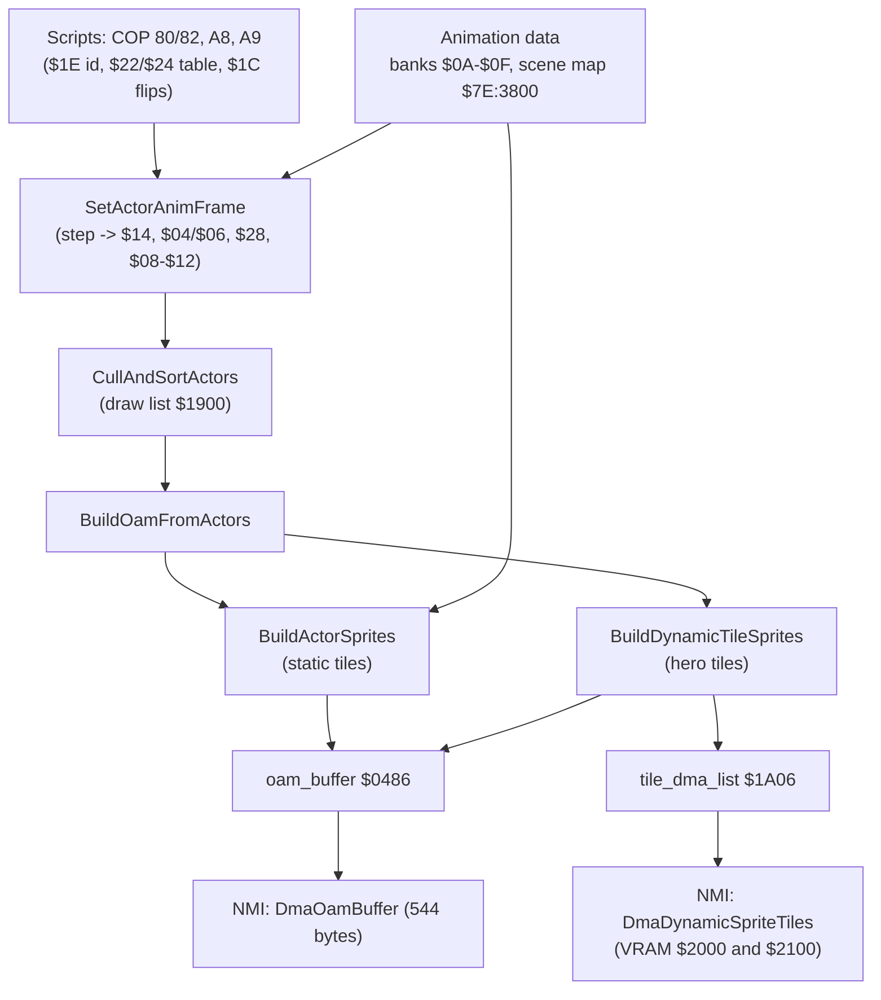

# Sprites, OAM and Animation — From Actor Fields to the Screen

*Part of the [Soul Blazer Code Documentation](README.md)*

> How an actor's animation id, step and table become sprites on the screen: the animation lists, steps and frame records, the spritemap entries, the draw list that decides which sprite sits in front, the OAM buffer the NMI copies, the hero's streamed tiles, and the scene and effect banks the frames come from.

**Source:**
[`engine_actor_scheduler_and_sprites.asm`](../../extracted/system/engine_actor_scheduler_and_sprites.asm) (`BuildOamFromActors`, `BuildActorSprites`, `BuildDynamicTileSprites`, `SetActorAnimFrame`, `EndAnimation`) ·
[`engine_vblank_nmi.asm`](../../extracted/system/engine_vblank_nmi.asm) (`DmaOamBuffer`, `DmaDynamicSpriteTiles`, `DmaSpriteTileRecords`, `DmaAnimatedTileStrip`) ·
[`cop_actor_fields_animation.asm`](../../extracted/cop_handlers/cop_actor_fields_animation.asm) (the animation, flip, priority and table commands) ·
[`lib_animation.asm`](../../extracted/library/lib_animation.asm) (`NextFrameRecord`, `CopyFrameData`) ·
[`data_anim_player_unarmed.asm`](../../extracted/system/data_anim_player_unarmed.asm) ·
[`data_anim_player.asm`](../../extracted/system/data_anim_player.asm) ·
[`data_anim_weapon_overlay.asm`](../../extracted/system/data_anim_weapon_overlay.asm) ·
[`data_anim_palette_cycles.asm`](../../extracted/system/data_anim_palette_cycles.asm) ·
[`data_anim_effects.asm`](../../extracted/system/data_anim_effects.asm) ·
[`data_anim_magic.asm`](../../extracted/system/data_anim_magic.asm) ·
[`lib_scene_asset_loader.asm`](../../extracted/library/lib_scene_asset_loader.asm) (`LoadSceneSpritemap`, `ExpandSpritemap`) ·
[`data_scene_asset_lists.asm`](../../extracted/system/data_scene_asset_lists.asm) ·
[`WorldMetaPointers.asm`](../../extracted/system/WorldMetaPointers.asm) (the animation-table column) ·
[`engine_spawn_lairs_death_drops.asm`](../../extracted/system/engine_spawn_lairs_death_drops.asm) (`RunEnemyDeath`, the puffs, `LoadMonsterFromMeta`) ·
[`engine_player_death_and_actor_helpers.asm`](../../extracted/system/engine_player_death_and_actor_helpers.asm) (`HoldActorUntilReleased`) ·
[`player_core.asm`](../../extracted/system/player_core.asm) (`InitPlayerActor`) ·
[`lib_menu_screen_setup.asm`](../../extracted/library/lib_menu_screen_setup.asm) (`LoadEquippedMagicGfx`)

---

## Overview

Every drawn thing in a scene is an actor ([actor-system.md](actor-system.md)), and every actor is drawn the same way. Its script picks an **animation id** (`$1E`, COP 80); the animation table in `$22` (bank `$24`) maps the id to a list of **steps**; each step carries a duration, a velocity and a pointer to a **frame record**; the frame record has a hit box and a **spritemap**: a list of 8 × 8 or 16 × 16 hardware sprites with offsets from the box corner. `SetActorAnimFrame` loads one step into the actor (duration `$14`, velocity `$04`/`$06`, spritemap `$28`, box `$08`–`$12`). Later in the same frame `BuildOamFromActors` walks the sorted draw list and `BuildActorSprites` turns each actor's spritemap into OAM entries; the NMI copies the buffer to OAM. One routine pair draws the hero, the monsters, the puffs, the spell shots and the experience number that floats up from a dead enemy; only the data differs.



The order inside one frame is fixed by `RunMainLoop` (and `RunReducedLoop` for the title, ending and boot scenes): `WaitVBlank`, then with the NMI off `RunActors` (scripts run, `SetActorAnimFrame` is called from them), `CullAndSortActors`, the hit tests, `ScrollCameraByDelta`, and only then `BuildOamFromActors`; `EnableNmi` ends the frame, and the next NMI copies what was built (`DmaOamBuffer` is its first transfer). The cull pass therefore sees the scroll position of the previous frame, and the OAM pass the new one: an actor at the edge is listed by the old scroll and clipped entry by entry with the new one.

This document starts where [actor-system.md](actor-system.md) stops (the sorted draw list) and ends at the OAM and VRAM writes. The hero's own animation ids and poses are in [player.md](player.md); the NMI sequence around the two DMA routines is in [boot-nmi-main-loop.md](boot-nmi-main-loop.md); how a COP command reaches its handler is in [cop-dispatch.md](cop-dispatch.md).

Code addresses are source-ROM addresses (LoROM: bank = file offset ÷ `$8000`, address = `$8000` + the offset inside that bank); the rebuilt ROM places the blocks elsewhere (`rebuilt/layout.json`). WRAM addresses are the game's own. Hardware facts (the OAM layout, OBJSEL) are the standard SNES ones, see the [SFC wiki on sprites](https://wiki.superfamicom.org/sprites).

**Related:** [actor-system.md](actor-system.md) · [player.md](player.md) · [boot-nmi-main-loop.md](boot-nmi-main-loop.md) · [wram-memory-map.md](../wram-memory-map.md) · [cop/index.md](../cop/index.md)

---

## Memory Map

### Code

| Address | Name | Description |
|---------|------|-------------|
| `$00:85C4` | `CullAndSortActors` | Builds the draw list; only its sort key matters here (see Draw order). |
| `$00:86EE` | `BuildOamFromActors` | Draw list to OAM buffer; fills the low and high tables. |
| `$00:8727` | `FillOamOffscreen` | The `PHA` loop that writes `$E080` into all 128 low-table entries. |
| `$00:8761` | `BuildActorSprites` | One actor's spritemap to OAM entries (static tiles). |
| `$00:8832` | `BuildDynamicTileSprites` | The same for a dynamic-tile actor; also queues the tile DMA records. |
| `$00:88F3` | `SetActorAnimFrame` | Loads one animation step into the actor. |
| `$00:89B0` | `EndAnimation` | End marker of a list: step 0, velocity 0, carry set. |
| `$00:83C5` | `DmaOamBuffer` | NMI: 544 bytes from `$0486` to OAM. |
| `$00:84E5` | `DmaDynamicSpriteTiles` | NMI: the two passes of hero tile uploads. |
| `$00:8524` | `DmaSpriteTileRecords` | NMI: one `$40`-byte DMA per record. |
| `$00:8543` | `DmaAnimatedTileStrip` | NMI: one animated background strip into VRAM words `$2060`–`$20DF` and `$2160`–`$21DF` (see VRAM Tiles). |
| `$00:DE7A`–`$00:E2E6` | `Cop80_SetAnimation` … `CopAA_SetPalette` | The animation, flip, priority and table commands. |
| `$02:865B` | `NextFrameRecord` | Colour stepper: loads the next 6-byte record. |
| `$02:86CD` | `CopyFrameData` | Colour stepper: copies the record's bytes to bank `$7F`. |
| `$02:B8FB` | `LoadSceneSpritemap` | Scene load: expands a spritemap to `$7E:3800` or `$7E:F000`. |
| `$00:AA10` | `RunEnemyDeath` | Death script; writes the EXP digits into the popup map. |

### Data

| Address | Name | Description |
|---------|------|-------------|
| `$0A:8000`–`$8CC7` | `PlayerUnarmedAnims` | Hero without a weapon (26 lists). |
| `$0B:8000`–`$941B` | `PlayerAnims` | Hero with a weapon (44 lists); animation table of meta row 0 of every world. |
| `$0C:8000`–`$89F5` | `WeaponOverlayAnims` | The sword actor (44 lists). |
| `$0D:8000`–`$B7FF` | `PaletteAnimLists` | Colour animations (80 lists), read by the record stepper, not by `SetActorAnimFrame`. |
| `$0E:8000`–`$86EE` | `EffectAnims` | Shared puffs and effects (17 lists). |
| `$0F:8000`–`$A461` | `MagicAnims` | Spell and Phoenix shots (54 lists). |
| `$7E:3800` | scene spritemap | The scene's enemy and NPC animations, expanded at scene load (358 of the 469 meta rows point here). |
| `$7E:F000` | EXP popup map | 64 per-slot lists and frames for the experience number (3456 bytes). |
| `$7F:3000` | hero tile sheet | Copy of `graphics_054000`, the source of the hero's streamed tiles. |

### State

| Address | Name | Description |
|---------|------|-------------|
| `$0486`–`$0685` | `oam_buffer` | OAM low table: 128 entries of x, y, tile, attribute. |
| `$0686`–`$06A5` | OAM high table | Two bits per sprite (x bit 8, size), four sprites per byte. |
| `$1900` | `draw_list` | Slot words in draw order, 0 ends. |
| `$1A02`–`$1A04` | tile source scratch | Source address and bank of the dynamic actor being built. |
| `$1A06` | `tile_dma_list` | 3-byte DMA records (source word, bank byte), a 0 word ends. |
| `$03B6` | `tile_dma_pending` | Non-zero: the NMI uploads the records. |
| `$0372`–`$0373` | `scene_sprite_attr` | Default sprite attribute word ORed into new actors; only the high byte is ever written (scene priority). |
| `$1C5C` | `wram_copy_stub` | RAM stub `PHB`, `MVN`, `PLB`, `RTS` used by `CopyFrameData`. |

---

## Actor Fields That Drive Drawing

| Field | Meaning in the drawing code | Cited in |
|-------|-----------------------------|----------|
| `$00`, `$02` | x and y; y is the actor's bottom edge. | `BuildActorSprites` |
| `$04`, `$06` | velocity in pixels per frame, loaded from the step; zeroed by `EndAnimation`. | `SetActorAnimFrame` |
| `$08`, `$0A`, `$0C`, `$0E` | box edges as distances from x, y: left, top, right, bottom. The spritemap origin is the top left corner (x − `$08`, y − `$0A`). | `BuildActorSprites` |
| `$10`, `$12` | box width and height (header words +8 and +10). | `SetActorAnimFrame` |
| `$14` | wait counter; the step's duration; the script runs again when it goes below 0, so a step lasts duration + 1 frames. | `Cop82_WaitAnimationDone` |
| `$16` | bit `$0800` hit stun, bit `$8000` off screen (set by the cull pass). | `BuildActorSprites`, `CullAndSortActors` |
| `$1A` | `$8000` dynamic-tile sprite, `$4000` in front, `$2000` behind, `$0080` not drawn. | `CullAndSortActors`, `BuildActorSprites` |
| `$1C` | OAM attribute word: bit 15 flip Y, bit 14 flip X, bits 12–13 priority, bits 9–11 palette. XORed into every entry's tile word. | `BuildActorSprites`, `CopA2_SetPriority`, `CopAA_SetPalette` |
| `$1E`, `$20` | animation id and step. | `SetActorAnimFrame` |
| `$22`, `$24` | animation table pointer and data bank (also the bank of the spritemap). | `SetActorAnimFrame`, `BuildActorSprites` |
| `$26` | stun counter: negative flashes, positive blinks. | `BuildActorSprites` |
| `$28` | current spritemap (frame pointer + 12). | `SetActorAnimFrame` |
| `$2C`, `$34` | dynamic-tile source bank and address (hero only). | `CopA9_SetDynamicTileSource` |

---

## Draw Order

`CullAndSortActors` gives each listed actor a key: (255 − (y − scroll y)) × 2, so the lower an actor stands on the screen the smaller its key; `$1A` bit `$4000` forces key 0 and bit `$2000` key `$01FE`. The draw list is in ascending key order. `BuildOamFromActors` takes the list from the front, so the first actor gets the lowest OAM indexes, and on the SNES a lower OAM index is drawn in front. That is the whole depth rule: an actor further down the screen covers one further up, `CopA3_DrawInFront` (121 scripts) puts a sprite over everything, `CopA4_DrawBehind` (34 scripts) under everything. When the 128 entries run out, the actors at the end of the list lose their sprites: the ones highest on the screen and the ones marked behind.

The hardware priority bits (bits 12–13 of `$1C`) are separate: they order sprites against the background layers. An actor made from a placement row or a lair record gets them from `scene_sprite_attr` (the scene profile's byte 4, bits 4–5, written by `ApplySceneProfile`), and `CopA2_SetPriority` replaces them (54 scripts; the EXP number uses `$30`, the highest).

---

## BuildOamFromActors

### `BuildOamFromActors`

**When** every frame, after the hit tests and the scroll update, from `RunMainLoop`, `RunReducedLoop`, `RunReturnLoop` and the other frame loops of `engine_boot_main_loop`. **What the player sees**: every on-screen actor's sprites, in the right depth order. **Why** it is a separate pass: the NMI can only transfer a finished buffer, so the whole frame's sprites are built in one go from the sorted list.

It sets `tile_dma_list` to an empty list (`dp$04` = `$1A06`, first word 0), sets `dp$52` and `dp$54` to the scroll position minus 16 (sprites may start 16 pixels off screen), points `dp$4C` at the high table (`$0686`) with four sprites per byte (`dp$4E` = 4), and fills the 512-byte low table with `$E080` (x `$80`, y `$E0`: off screen). The fill is a `PHA` loop (`FillOamOffscreen`, 16 pushes of 2 bytes, 16 passes) with S moved to `$0685`; that is safe only because the NMI is off during the work phase (the same condition as the sort passes, OQ-I005-20). Then `BuildOamLoop` takes slot words from `draw_list` and calls `BuildActorSprites` with X = slot until the list ends (0) or the call returns carry set (the buffer is full, Y = `$0200`). `FlushOamHighBits` right-aligns the last, partial high-table byte (two shifts for every sprite still missing) and stores it. Unused sprites keep `$E080`, so the stale bits of the high table beyond the last byte do not matter.

---

## Spritemap and Entry

### `BuildActorSprites`

**When** once per listed actor per frame, from `BuildOamLoop`. **What the player sees**: the actor's current frame, mirrored if `$1C` says so, flashing or blinking while stunned. **Why** one routine for all: a spritemap holds only offsets from the box corner, so the same data draws the actor anywhere and the same code draws every actor.

It switches DBR to the actor's `$24`, which is why `$28` is a 16-bit offset and why one routine reads the banks `$0A`–`$0F` and the WRAM maps at `$7E`. The origin of the map is x − `$08` − (scroll x − 16) and y − `$0A` − (scroll y − 16) (`dp$16`, `dp$18`). `$1C` goes to `dp$50`; `dp$06` is 0 unless the actor is stunned (`$16` bit `$0800`): with `$26` negative the entries get palette 7 (`dp$06` = `$0E00`) on alternate frames, with `$26` positive the actor is not drawn on alternate frames (OQ-I023-1). An actor with `$1A` bit `$8000` branches to `BuildDynamicTileSprites`.

Per entry (see the table below) the routine adds the entry's y (or the flipped y) to `dp$18` and drops the entry unless the sum is below `$F0`, adds the x to `dp$16` and drops it unless below `$110`, and stores y − 17 (one line less than the position, because the PPU draws a sprite one line below its OAM y), x − 16, the tile word (XOR `$1C`, OR `dp$06`), and two bits for the high table: bit 8 of x (a sprite left of the screen edge) and the size bit from the entry's flags. A dropped entry writes `$E080` but does not advance Y, so it takes no OAM slot and the next entry overwrites it.

### The spritemap entry

**When** read by `BuildActorSprites` and `BuildDynamicTileSprites`; **what the player sees**: one 8 × 8 or 16 × 16 piece of a frame; **why** this shape: the offsets are bytes, so a piece never lies left of or above the box corner, and the two flipped offsets let the mirror image come from the data, not from arithmetic.

A spritemap is a word count followed by that many 7-byte entries (`$28` points at the count):

| Offset | Size | Meaning |
|--------|------|---------|
| +0 | byte | flags; bit 0 = size bit (1 = 16 × 16, 0 = 8 × 8 under OBJSEL `$01`). In the five sprite banks the byte is only 0 or 1. |
| +1 | byte | x offset from the box's left edge |
| +2 | byte | x offset when `$1C` bit 14 (flip X) is set |
| +3 | byte | y offset from the box's top edge |
| +4 | byte | y offset when `$1C` bit 15 (flip Y) is set |
| +5 | word | tile number (bits 0–8) and OAM attributes (bits 9–15: palette, priority, flips), XORed with `$1C` |

The XOR means `$1C` toggles the flips the data already has, and that the low bits of `$1C` would change the tile number; the spawn code keeps them 0 (`scene_sprite_attr` has no low byte, and `InitActorFromPlacement` masks the placement flags with `$C100`).

Worked example, a frame of the scene map `spritemap_0F3595.spm` (Up Above, expanded at `$7E:3800`): the frame at `$3950` has header words 0, `$20`, 8, 8, 8, 8, a count of 2, and the entries `01 00 10 00 00 28 0A` and `01 10 00 00 00 2A 0A`: two 16 × 16 sprites side by side, x 0 and `$10` (mirrored: `$10` and 0), y 0, tiles `$28` and `$2A`, palette 5 (`$0A00`).

---

## Dynamic Tiles

### `BuildDynamicTileSprites` and the two DMA passes

**When** for an actor with `$1A` bit `$8000`: only the hero, set once by `CopA9_SetDynamicTileSource` in `InitPlayerActor` (source `$7F:3000`). **What the player sees**: the hero's frames, whose tiles are not kept in VRAM but copied from a 16 KB sheet every frame. **Why**: the hero has 164 frames of three 16 × 16 pieces (`data_anim_player_unarmed`, `data_anim_player`); instead of holding all their tiles in VRAM, the engine copies only the three pieces of the current frame.

For each entry the routine takes tile bits 0–8 as an index into the sheet, multiplies by 32 (`ASL` × 5), adds the source in `$34` and queues a 3-byte record (address, bank `$2C`) in `tile_dma_list`; the entry's own tile word keeps its attribute bits (`AND #$FE00`) but gets a new tile number from `dp$02`, which starts at 0 for the frame and grows by 2 per entry (0, 2, 4, …). `tile_dma_pending` is incremented; the list ends with a 0 word.

In the NMI, `DmaDynamicSpriteTiles` runs two passes over the list on DMA channel 2. Pass 1 sets VRAM to `$2000` and `DmaSpriteTileRecords` copies `$40` bytes per record (two 4bpp tiles, `$20` words) one after the other. Then the high byte of every record's source is incremented twice (+`$0200` = 16 tiles, the next tile row of the sheet) and pass 2 repeats from `$2100`. So a 16 × 16 sprite with OAM tile number n finds its top row (tiles n and n+1) at VRAM word `$2000` + n × 16 and its bottom row (tiles n+16 and n+17) at `$2100` + n × 16. OBJSEL is `$01` (`ApplyBootPpuLayout`, never written again in `extracted/`): name base word `$2000`, sizes 8 × 8 and 16 × 16. With OAM tile numbers 0, 2, … 14 the layout holds eight records; `BuildDynamicTileSprites` has no guard, but the hero's frames all have exactly three entries (all 164 leaves of the two hero banks), so the hero always occupies OAM tiles 0–5 and 16–21, VRAM `$2000`–`$205F` and `$2100`–`$215F`: 384 bytes per frame.

### `DmaOamBuffer`

**When** first in every NMI. **What the player sees**: the sprites built by the last `BuildOamFromActors`. **Why** it is its own routine: OAM can be written only during vblank, and the work phase builds the whole buffer in WRAM. Channel 0 copies `$0220` bytes (512 low table + 32 high table) from `$0486` to `OAMDATA` with OAMADD 0.

---

## Animation

### `SetActorAnimFrame` and `EndAnimation`

**When** after an animation id change and at each step end: from the wait commands (`Cop82_WaitAnimationDone`, `Cop83_WaitAnimationRepeat`, `Cop9E_WaitAnimationDoneOrJumpIfBlocked`), from the placement and meta spawners (`PlacementAnimFrame`, `LoadMonsterFromMeta`, `HoldActorUntilReleased`) and from the hero code (`ApplyPlayerWeaponPose`, `FacePlayerTowardReturnTarget`). **What the player sees**: the next frame of a walk, swing or puff, with the speed of the step. **Why** one routine: the step carries everything that has to change together (duration, velocity, hit box, picture).

DBR becomes `$24`. The word at `$22` + `$1E` × 2 is the list pointer; the step is at list + `$20` × 8. A negative first word is the end marker: `EndAnimation` zeroes `$20`, `$04`, `$06` and returns carry set. Otherwise:

| Step word | Goes to | With `$1C` flips |
|-----------|---------|------------------|
| +0 duration | `$14` | none |
| +2 dx | `$04` | negated when bit 14 (flip X) is set |
| +4 dy | `$06` | negated when bit 15 (flip Y) is set |
| +6 frame pointer | `$28` = pointer + 12; the six header words go to the box | see below |

Header words of the frame record: +0 left → `$08`, +2 right → `$0C`, +4 top → `$0A`, +6 bottom → `$0E`, +8 width → `$10`, +10 height → `$12`. With flip X the box becomes left = right − width and right = left + width (a mirror about x + width ÷ 2); with flip Y top = bottom + height and bottom = top − height. `$20` is incremented and carry is clear. Because the step's dx and dy become the actor's velocity, **the animation drives the walking speed**: the hero's walk lists (`PlayerUnarmedAnims` list 04 and its relatives) have six steps of duration 3 and dy 2, so he moves 2 pixels per frame for 4 frames per step. A script that calls `Cop82_WaitAnimationDone` is called again when `$14` has run out; carry set from the end marker lets it continue.

### The animation lists, steps and frames

**When** read by `SetActorAnimFrame` (and by the colour stepper, with another record). **What the player sees**: every motion on the screen. **Why** this layout: two table levels keep one list per animation and one leaf per picture, so a walk shares its frames with the opposite walk (list 04 with dy +2 and list 05 with dy −2 of `PlayerUnarmedAnims` use the same six leaves in a different order).

```
table (word per animation id)  ->  list: steps of 8 bytes, a negative word ends
                                       step: duration, dx, dy, &frame
                                       frame: 12-byte header, word count, 7-byte entries
```

Worked example, the unarmed hero standing (`PlayerUnarmedAnims` list 00, one step `unk3 < #00, #00, #00, #00, #00, #00, &binary_050408 >`): duration 0, no velocity. The leaf `binary_050408` is `0000 1000 2000 0000 1000 1000` (left 0, right 16, top 32, bottom 0, width 16, height 16: the box x..x+16, y−32..y), then count 3 and the entries `01 00 00 00 10 00 0A`, `01 00 00 08 08 20 0A`, `01 00 00 10 00 40 0A`: three 16 × 16 pieces at y 0, 8 and 16 (overlapping by half, 32 pixels tall in all) with the tile words `$0A00`, `$0A20`, `$0A40` (tiles 0, 32 and 64 of the sheet, palette 5). Their flipped y offsets are 16, 8 and 0: the same three rows in the opposite order.

### The animation commands

**When** from scripts; counts are the number of scripts using them. **What the player sees**: the effect of the field they set. **Why**: scripts never touch the tables; they set the id and let the wait command step.

| Command | Fields | What it does |
|---------|--------|--------------|
| `Cop80_SetAnimation` (1614) | `$1E`, `$20` = 0, `$18` | starts an animation and continues |
| `Cop81_SetAnimationRepeat` (522) | also `$2A` | the same with a repeat count for `Cop83` |
| `Cop82_WaitAnimationDone` (1623), `Cop83_WaitAnimationRepeat` (529) | `$14` | call `SetActorAnimFrame` once per run; yield while a step runs, continue at the end (`Cop83` after `$2A` rounds) |
| `Cop9D_SetAnimationClearBlocked`, `Cop9E_WaitAnimationDoneOrJumpIfBlocked` (51 each) | `$16` bit `$0004` | the walk loop: jump away when the tile test blocked the actor |
| `Cop87_ToggleFlipX`, `Cop96_SetFlipX`, `Cop97_ClearFlipX` (45, 226, 310) and the Y forms | `$1C` bits 14, 15 | mirror the actor; the flips also feed the velocity and box of the next step |
| `Cop8F_FacePlayerX`, `Cop90_FacePlayerY` | `$1C` | flip toward the hero |
| `CopA2_SetPriority` (54), `CopAA_SetPalette` (11) | `$1C` bits 12–13, 9–11 | the byte is the high byte of the attribute, already in place |
| `CopA3_DrawInFront`, `CopA4_DrawBehind` and their clears | `$1A` bits `$4000`, `$2000` | the sort key 0 and `$01FE` |
| `CopA8_SetAnimationTable` (37) | `$22`, `$24` | switches the table and bank (the effects bank `$0E:8000`, the magic bank, the EXP popup map) |
| `CopA9_SetDynamicTileSource` (1) | `$34`, `$2C`, `$1A` bit `$8000` | the hero's streamed tiles |
| `CopA5_JumpByFlipState` (25) | `$1C` | a four-way jump on the flips, then clears them: the flips double as a facing state |

---

## Animation Banks and Scene Maps

### The six fixed banks

**When** selected by `$24` and `$22`: the hero by `ApplyPlayerWeaponPose` (`$0A` unarmed, `$0B` armed), the other banks by meta rows or `CopA8`. **What the player sees**: the hero, his sword, the colour effects, the puffs and the spells. **Why** separate banks: the hero's frames (164 leaves of three 16 × 16 pieces) are streamed, the sword's and the spells' are static sprites, and the effects are shared by every scene.

| Bank | Lists | Steps | Leaves | Entries per leaf | Used by |
|------|-------|-------|--------|------------------|---------|
| `$0A` `PlayerUnarmedAnims` | 26 | 116 | 64 | 3 (all 16 × 16, dynamic) | the unarmed hero |
| `$0B` `PlayerAnims` | 44 | 184 | 100 | 3 (all 16 × 16, dynamic) | the armed hero; meta row 0 of the seven worlds |
| `$0C` `WeaponOverlayAnims` | 44 | 120 | 42 data blobs | 1–5, mostly 8 × 8, static tiles `$20`–`$5F` | `RunWeaponLayer` (the sword actor) |
| `$0D` `PaletteAnimLists` | 80 | 686 | 593 | not sprites | 69 meta rows, through the colour stepper |
| `$0E` `EffectAnims` | 17 | 83 | 28 | 1–12 | `CopA8` (`$8000`, `$0E`) in `RunAppearPuff`, `RunMonsterAppearPuff`, `RunEnemyDeath`, `RunHazardPuff`; 4 meta rows |
| `$0F` `MagicAnims` | 54 | 264 | 124 | 1–16, static tiles `$60`–`$9F` | 8 scripts: seven in `player_spells_level_up` and the shared start of the Phoenix shots in `player_core` |

The counts for `$0A`, `$0B`, `$0C`, `$0E` and `$0F` were recounted from the data in I050; the counts for `$0D` are those of its block note. One blob of the weapon bank, `binary_060836`, holds a 28-byte leaf that a step points to followed by four 21-byte leaves that no step names (OQ-I050-4).

### Scene spritemaps at `$7E:3800`

**When** at every scene load, for each asset command `$01` (`LoadSceneSpritemap`, 47 commands naming 30 files). **What the player sees**: the scene's own enemies and NPCs: 358 of the 469 meta rows have the table pointer `$7E3800` (`WorldMetaPointers`); the others are the hero (7), the effects (4), the colour lists (69) and none (31). **Why**: a scene needs only the animations of its own actors, so they are kept compressed in the ROM and expanded into WRAM when the scene starts, and the pointer cache (`asset_cache_spritemap`) skips the expansion when the next scene uses the same map.

`ExpandSpritemap` decompresses the stream (`DecompressQuintetLz`) to `$7E:3800` when the command's first operand byte is 0 and to `$7E:F000` otherwise. The file is position dependent: its pointers are absolute RAM addresses. In `spritemap_0F3595.spm` the first ten words (`$3814`, `$381E`, …) are the animation table, the lists follow (`$3814`: one step of duration 0, dx 0, dy 0, frame `$3950`, then `$FFFF`), then the frames. So a scene map is **a complete animation table, its lists and its frames in one blob**, and the meta rows' animation column (`+5`), table (`+8` = `$3800`) and bank (`+A` = `$7E`) address it exactly like a ROM bank.

---

## The Experience Number

### The EXP popup map at `$7E:F000`

**When** `RunEnemyDeath` of every enemy except the boss (`RunBossDeath`). **What the player sees**: after the death puff and the Gem drop, the experience the kill gave floats up as a one to four digit number and holds. **Why** a patched map instead of a font: the digits are ordinary 8 × 8 sprites; the script only writes the digit tiles into a prebuilt frame, so no text engine is involved.

`spritemap_0F0CEE.spm` (3456 bytes, loaded to `$7E:F000` by the only asset command whose first operand is not 0; it sits in the list of area 0, scene `$0A`, the title scene by static reading, OQ-I043-2) holds a table of 64 words, 64 lists of one step each (duration `$0F`, dx 0, dy −1, one frame) and 64 frames of 42 bytes. A frame has the header 0, `$14`, 8, 0, 8, 8, the count 4 and four 8 × 8 entries at x 0, 4, 8 and `$C` (tile `$C8`, palette 4). The slot of the dying actor, (X − `$0800`) ÷ 64, is both the index into the table and the animation id.

`RunEnemyDeath` first makes the actor a plain puff (`$16` = `$0300`, `$1A` = 0, `$1C` = `scene_sprite_attr`), may spawn a Gem pickup (`RunLargeGemPickup`, `RunMediumGemPickup`, `RunSmallGemPickup`) and plays animation 03 of the effects bank; then it applies `CopA3_DrawInFront` and `CopA2_SetPriority` `$30`, selects the map with `CopA8` (`$F000`, bank `$7E`) and lifts the actor 16 pixels (`CopA0_AddY`). It reads the EXP word of the meta row (`+3`, BCD) and the first step's frame pointer from the slot's list (`$7EF000` + slot × 2, then `+6`); the first entry is at frame + `$0E`. The value picks the digit count (`$1000` or more four, `$0100` three, `$0010` two, else one), the count goes to the frame's count word (`$7EEFFE` + offset), `WriteHighNibbleDigit` and `WriteLowNibbleDigit` store the tile ids from `ExpDigitTiles` into the low byte of each entry's tile word (`$7EF005` + offset, 7 bytes apart), and the actor's x is shifted by +5, +3, +1 or −1 so the number stays centred. The animation then plays (one step: 16 frames, rising 1 pixel per frame), and `COP 1B` waits `$10` more frames before `FinishEnemyDeath`. Why 64 frames: the digits are written into the frame itself, so two enemies that die together must not share one, and every slot has its own.

---

## Effects and Table Switching

### The appear, death and hold effects

**When** `RunMonsterAppearPuff` (a lair monster arrives), `RunAppearPuff` (about 150 scene scripts for objects that appear), `RunEnemyDeath` (animation 03), `RunHazardPuff` (animation `$10`) and `HoldActorUntilReleased`. **What the player sees**: a small cloud where something appears or dies, and an actor held by a lair shown with animation `$0D` until it is released. **Why** switching tables on one actor: a monster is first a puff and then itself; the same slot changes its `$22`/`$24` instead of spawning a second actor.

`RunMonsterAppearPuff` selects the effects bank with `CopA8` (`$8000`, `$0E`), plays animation 00 with the monster's flips kept in `$30`, then applies the meta row's flags and joins `LoadMonsterFromMeta`: bank (`+A`), animation (`+5`), table (`+8`), script (`+B`), a call of `SetActorAnimFrame`, zero velocity, and the script is entered in the same frame. `HoldActorUntilReleased` does the reverse: the effects bank while the actor is held (`COP 80` animation `$0D`), then `CopA8` (`$3800`, `$7E`) and the meta row on release. For an actor in a lair the walkthrough's statement that monsters "pop out" of the lair fits this puff.

---

## Colour Animation

### `NextFrameRecord` and `CopyFrameData`

**When** from `Cop92_StartAnimation`, `Cop93_StartAnimationCount`, `Cop94_AnimTick` and `Cop95_AnimTickRepeat` (21 and 22 scripts) for actors whose table is bank `$0D`. **What the player sees**: colours that rotate or fade (inferred from the data: the source blocks are runs of BGR555 words and the destination is the palette shadow; which scene effect each of the 69 rows runs is OQ-I033-6 and OQ-I026-3). **Why** a second stepper: its record is 6 bytes (hold count, source word, destination colour × 2, length − 1, delay) and its output is a block copy, not a frame.

`NextFrameRecord` loads the record into the work fields (`$26` = hold − 1, `$08` source, `$0A` destination offset, `$0C` length − 1, `$0E` and `$14` delay) and sets carry at a hold of 0. A length byte of 2 adds `$200` to the destination, which lands on the fixed-colour buffer (`coldata_buffer`, `$7F:0200`). `CopyFrameData` patches the operands of the RAM stub at `$1C5C` (destination bank `$7F`, source bank = `$24`) and runs `MVN`; it is the only caller of the stub that `InitFixedState` builds.

---

## VRAM Tiles

### Which OAM tiles hold what

**When** the NMI routines write the VRAM words below and the sprite frames name the tile numbers. **What the player sees**: the right picture only if no two users write the same tiles. **Why** this table: OBJSEL `$01` puts the first sprite name table at word `$2000`, and several writers share it.

| OAM tiles | VRAM words | Content | Evidence |
|-----------|-----------|---------|----------|
| 0–5 and 16–21 | `$2000`–`$205F`, `$2100`–`$215F` | the hero's three streamed pieces | `BuildDynamicTileSprites`, all 164 hero leaves have three entries |
| 6–13 and 22–29 | `$2060`–`$20DF`, `$2160`–`$21DF` | the four slots of the animated tile strip, one refreshed per frame | `DmaAnimatedTileStrip`, `AnimatedStripVramDests`; the effects bank's frames name tiles `$6`, `$8`, `$A`, `$C` (OQ-I050-3) |
| `$20`–`$5F` | `$2200`–`$25FF` | the sword's frames (`data_anim_weapon_overlay`) | which block fills them was not traced (OQ-I050-5) |
| `$60`–`$9F` | `$2600`–`$29FF` | graphics of the equipped spell | `LoadEquippedMagicGfx` copies `$800` bytes to `$2600`; every frame of `MagicAnims` uses tiles `$60`–`$9F` |

The hero's streamed tiles and the strip slots are disjoint: the hero never needs more than OAM tiles 0–5 and 16–21, and the strip starts at tile 6. That settles the collision question of OQ-I043-4 for the sprite side: the two share the word range, not any word.

---

## Walkthrough Cross-Check

| Game term in this document | Walkthrough | Result |
|---|---|---|
| Experience points earned from enemies, shown as a number | `level-up.md`: "Experience Points: EXP., it is earned from beating enemies" | Consistent with `RunEnemyDeath` writing the BCD EXP of the meta row. The walkthrough does not describe the floating number, so that part is not checkable. |
| Gems dropped by enemies | `magic.md`: "There are a number of Gems found in the game, almost all dropped by enemies" | Consistent with the pickup spawned in `RunEnemyDeath` (rates in [combat-damage-and-enemy-records.md](combat-damage-and-enemy-records.md)). |
| Monsters appear from a Monster Lair | `06-dr-leos-lab.md`: the Toy Soldiers "from the nearby monster lair will all pop out in a single group" | Consistent with `RunMonsterAppearPuff`; the walkthrough does not mention the cloud. |
| The orb of light around the hero | `magic.md`: "a fireball will shoot out of the orb of light surrounding you" | Consistent: the orb is its own actor (`soul_orb_actor`, [player.md](player.md)) drawn by the same routines. |
| Eight spells (Flame Ball, Light Arrow, Magic Flair, Rotator, Spark Bomb, Flame Pillar, Tornado, Phoenix) | `magic.md` | Consistent in count: eight scripts select `MagicAnims` (seven in `player_spells_level_up`, the Phoenix shots in `player_core`). Which script is which spell was not matched here. |

No DISCREPANCY between the walkthrough and the ROM was found. Three notes of earlier iterations were corrected in I050 (`plans/extracted-audit/edits/I050.json`): the `DmaDynamicSpriteTiles` part note (candidates "bosses and large monsters": only the hero is dynamic), the `w2_effect_player_overlay` block note ("dynamic tile source `$7E3800`": that is its animation table) and the `$0372` comments of `InitActorFromPlacement`, `SpawnLairActor`, `RunMonsterAppearPuff` (the value is the word stored at `$0372`, not the constant).

---

## Open Questions

The questions this document could not settle are in `plans/extracted-audit/questions/I050_questions.md`: OQ-I050-1 (hero-only dynamic tiles, runtime check), OQ-I050-2 (what keeps the EXP map at `$7E:F000` intact), OQ-I050-3 (the effect frames name the animated strip slots), OQ-I050-4 (four unreferenced weapon leaves), OQ-I050-5 (the source of the weapon and effect tiles) and OQ-I050-6 (the sprite budget when many actors are on screen). Answered here: OQ-I049-6 (the EXP popup layout) and the collision part of OQ-I043-4. Earlier questions this document relies on: OQ-I005-6, OQ-I005-20, OQ-I013-14, OQ-I023-1, OQ-I026-3, OQ-I033-6, OQ-I043-2.

---

## See Also

- [actor-system.md](actor-system.md): the slots, the scheduler and `CullAndSortActors` up to the finished draw list; the actor fields.
- [boot-nmi-main-loop.md](boot-nmi-main-loop.md): the frame order around `BuildOamFromActors`, and the NMI that calls `DmaOamBuffer` and `DmaDynamicSpriteTiles`.
- [cop-dispatch.md](cop-dispatch.md): how a COP 80 or 82 reaches `Cop80_SetAnimation` and `Cop82_WaitAnimationDone`, and the exit chain of the wait pair.
- [player.md](player.md): the hero's animation ids, `ApplyPlayerWeaponPose`, `RunWeaponLayer` and the spell actors that use `MagicAnims`.
- [combat-damage-and-enemy-records.md](combat-damage-and-enemy-records.md): the meta row behind the animation columns, the stun that flashes and blinks the sprite, `RunEnemyDeath` and the EXP value.
- [scene-area-warp-loading.md](scene-area-warp-loading.md): the asset commands and `LoadSceneSpritemap` in the scene load.
- [wram-memory-map.md](../wram-memory-map.md): `scene_sprite_attr` and the WRAM map.
- [walkthrough/README.md](../walkthrough/README.md): the game terms.
- [vram-dma-hdma-palettes.md](vram-dma-hdma-palettes.md): the whole VRAM word map around the OBJ tables, the DMA channels `DmaOamBuffer` and `DmaDynamicSpriteTiles` share, and the sprite palettes in the CGRAM buffer.
- [menus-inventory-status-hud.md](menus-inventory-status-hud.md): the HUD and menu icons (BG3 and BG2 pages, not sprites).
