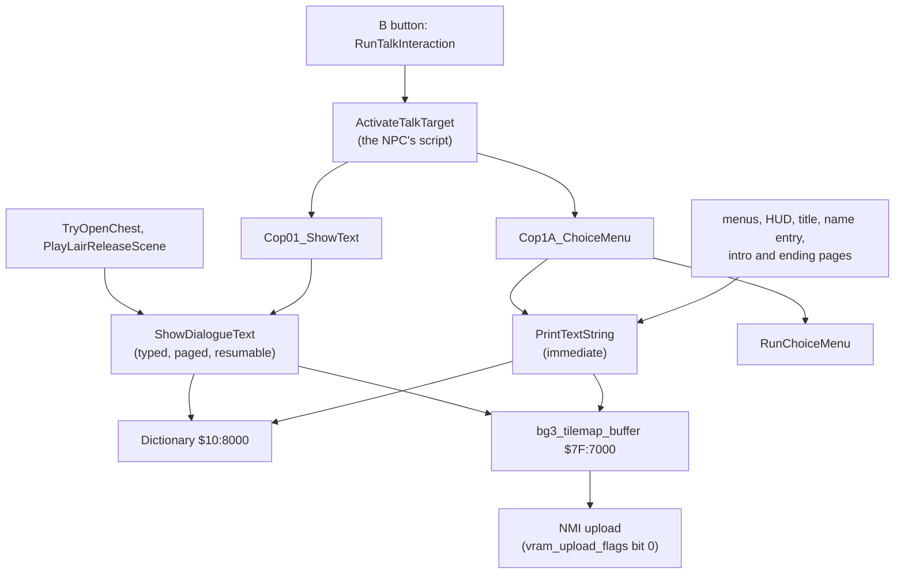
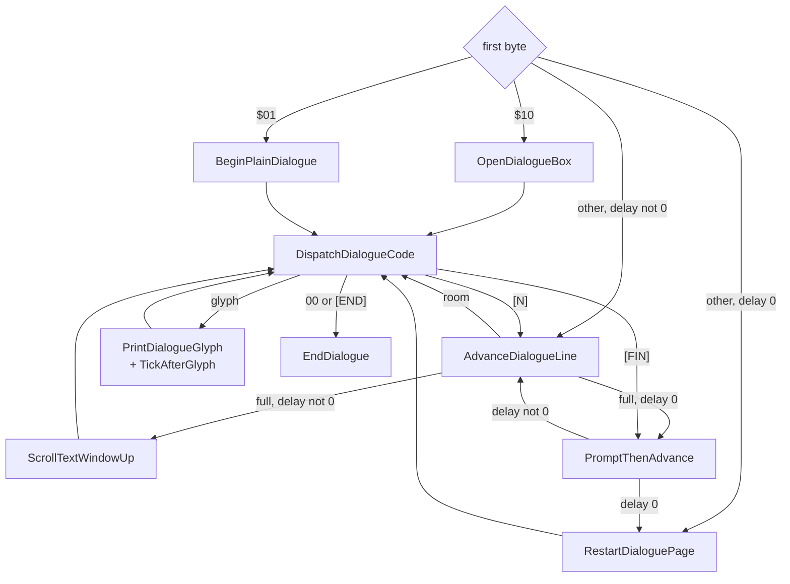

# Text and Dialogue — From a String Pointer to the Text Layer

*Part of the [Soul Blazer Code Documentation](README.md)*

> How every word on the screen gets there: the string format and its control codes, the 128-word dictionary, the two renderers (instant menu text and typed, paged dialogue), the window frames and the two-tile-tall font, and the scripts that reach them: `COP 01`, the choice menus, the B-button talk, the chest and lair messages, the name entry and the story screens.

**Source:**
[`lib_text_render.asm`](../../extracted/library/lib_text_render.asm) (both renderers, the control-code handlers, window frames, `DrawGaugeBar`, the wait helpers, `TextListPointers`) ·
[`data_dictionary.asm`](../../extracted/system/data_dictionary.asm) (`Dictionary`) ·
[`cop_items_stats_text.asm`](../../extracted/cop_handlers/cop_items_stats_text.asm) (`Cop01_ShowText`, `Cop02_PromptYesNo`, `Cop1A_ChoiceMenu`, `Cop3A_EnterPlayerName`) ·
[`lib_choice_menus.asm`](../../extracted/library/lib_choice_menus.asm) (`RunChoiceMenu`, `BlinkChoiceCursor`) ·
[`shared_choice_prompt_texts.asm`](../../extracted/actor_shared/shared_choice_prompt_texts.asm) (the five option windows) ·
[`lib_field_talk.asm`](../../extracted/library/lib_field_talk.asm) (`RunTalkInteraction` and its helpers) ·
[`lib_tile_triggers_and_lair_return.asm`](../../extracted/library/lib_tile_triggers_and_lair_return.asm) (`TryOpenChest`, `PlayLairReleaseScene`, the five chest and lair strings, `NpcNameStrings`) ·
[`lib_banner_texts.asm`](../../extracted/library/lib_banner_texts.asm) (`LevelUpText`, `LocationBannerText`, `LairCounterText`, `LocationNameList`) ·
[`lib_name_entry_and_staff_roll.asm`](../../extracted/library/lib_name_entry_and_staff_roll.asm) (`RunNameEntryScreen`, `ScrollStaffRollText`) ·
[`gv_title_texts.asm`](../../extracted/grass_valley/front_end/gv_title_texts.asm) ·
[`gv_prologue_texts.asm`](../../extracted/grass_valley/front_end/gv_prologue_texts.asm) ·
[`gv_epilogue_texts.asm`](../../extracted/grass_valley/front_end/gv_epilogue_texts.asm) ·
[`gw_woods_actors_01B98D.asm`](../../extracted/greenwood/woods_of_greenwood/gw_woods_actors_01B98D.asm) (`gw_npc_dog_restaurant_01B98D`, the worked example)

---

## Overview

All text in the game is BG3 tiles. Both renderers write tile words into one 32 × 32 page, `bg3_tilemap_buffer` (`$7F:7000`, 2 bytes per tile, `$40` bytes per row), and set bit 0 of `vram_upload_flags`; the NMI sends the page to VRAM (`DmaBg3TilemapPage`, [vram-dma-hdma-palettes.md](vram-dma-hdma-palettes.md)). Nothing else holds text: there is no text object, and erasing means overprinting blanks or a window frame. A glyph is two tiles tall: the lower half is tile *c* at the write cell, the upper half is tile *c* + `$100` one row up, so a line of text uses two tile rows.

A string is a run of bytes ending in `00` or `[END]`. Bytes `$15`-`$7F` are glyphs (the byte is the tile number), bytes `$80`-`$FF` are words of the dictionary, and bytes `$00`-`$14` are control codes that move the cursor, draw windows, insert other strings or numbers, and in dialogue pause, wait for a key or jump to another string. Two renderers read the same format:

- `PrintTextString` is the **menu renderer**: it prints the whole string at once, saves and restores its attribute state, and never waits. 58 call sites in 10 files use it: menus, the HUD, the title and file-select screens, the name entry, `Cop1A_ChoiceMenu` and the intro and ending pages.
- `ShowDialogueText` is the **dialogue renderer**: it types the string glyph by glyph, waits for keys, pages or scrolls the box and remembers where it stopped so that the next string continues the speech. `Cop01_ShowText` calls it for every NPC line, sign and message (608 `COP 01` sites); `TryOpenChest`, `PlayLairReleaseScene` and `RunLairReleaseOnReturn` call it directly.

Because the dialogue renderer waits through `RunSubFrame`, it needs the NMI off and runs only inside a script or an engine routine that already runs with the NMI off (`RunTalkInteraction` switches it off for the whole talk). The menu renderer has no such rule.

This document covers the renderers and everything that feeds them. The location-name table as scene data is in [scene-area-warp-loading.md](scene-area-warp-loading.md) and [areas-and-scenes.md](../areas-and-scenes.md); the BG3 page upload and the DMA are in [vram-dma-hdma-palettes.md](vram-dma-hdma-palettes.md); the frame around a sub-frame is in [boot-nmi-main-loop.md](boot-nmi-main-loop.md); the COP operand rules are in [cop-dispatch.md](cop-dispatch.md).

Code addresses are source-ROM addresses (LoROM: bank = file offset ÷ `$8000`, address = `$8000` + the offset inside that bank); the rebuilt ROM places the blocks elsewhere (`rebuilt/layout.json`). WRAM addresses are the game's own. Strings are quoted the way the extractor prints them: the apostrophe appears as a blank and the period as `-` in most strings (OQ-I008-15).

**Related:** [cop-dispatch.md](cop-dispatch.md) · [actor-system.md](actor-system.md) · [boot-nmi-main-loop.md](boot-nmi-main-loop.md) · [wram-memory-map.md](../wram-memory-map.md) · [cop/index.md](../cop/index.md)

---

## Memory Map

### Code

| Address | Routine | Role |
|---------|---------|------|
| `$00:D7A2` | `Cop01_ShowText` | Script command: show the string at the operand with `ShowDialogueText` |
| `$00:D7BD` | `Cop02_PromptYesNo` | Fixed Yes / No prompt; no script uses it |
| `$00:DA43` | `Cop1A_ChoiceMenu` | Script command: option window, `RunChoiceMenu`, `choice_result` |
| `$00:DE05` | `Cop3A_EnterPlayerName` | Script command: opens the name entry screen |
| `$02:8A29` | `TryOpenChest` | Opens the chest above the player and prints its message |
| `$02:8DBD` | `PlayLairReleaseScene` | The release scene of a freed NPC, with its message |
| `$02:8EA9` | `RunLairReleaseOnReturn` | Prints the release or "cannot be recalled" message on a return trip |
| `$02:99D8` | `RunTalkInteraction` | B button: NMI off, probe, talk script, NMI on |
| `$02:99E4` | `FindAndTalkToActorInFront` | Probe points in front of the hero |
| `$02:9AC4` | `FindTalkableActorAt` | First talkable actor whose box holds a point |
| `$02:9AF9` | `ActivateTalkTarget` | Calls the actor's talk script through an RTL frame |
| `$02:9B1D` | `TalkFacingPlayer` | Turns the NPC toward the hero, runs the script, restores the slot |
| `$02:A281` | `RunChoiceMenu` | The arrow list of a question window |
| `$02:A30B` | `BlinkChoiceCursor` | Blinks the arrow cell |
| `$02:A4EE` | `RunNameEntryScreen` | The blocking name entry screen |
| `$02:A6CF` | `ScrollStaffRollText` | The credits: print a line, scroll the layer |
| `$02:A769` | `PrintTextString` | Menu renderer entry |
| `$02:A782` | `DispatchTextCode` | Control-code ladder of the menu renderer |
| `$02:A7E4` | `PrintGlyph` | One two-tile glyph |
| `$02:A8A2` | `HandleBcdNumberCode` | `[06]` packed-BCD number |
| `$02:A9C9` | `EndTextString` | Exit of the menu renderer |
| `$02:A9DA` | `ReadTextByte` | Next byte; `ExpandDictionaryWord` at `$02:A9E1` |
| `$02:AA48` | `PrintStringWithRuns` | List string with `[14]` runs (`[TBL]`) |
| `$02:AA92` | `PrintStringPlain` | List string without runs (`[02]`) |
| `$02:AABF` | `DrawGaugeBar` | The HP and enemy bar |
| `$02:AB5D` | `DrawWindowFrame` | A bordered, blank window |
| `$02:ABDA` | `EraseWindowFrame` | Erases the window at an origin |
| `$02:AC27` | `ShowDialogueText` | Dialogue renderer entry |
| `$02:AC35` | `InitDialogueState` | Resets the state and picks the way in by the first byte |
| `$02:AC5C` | `OpenDialogueBox` | The standard box for a first byte `$10` |
| `$02:AC6C` | `BeginPlainDialogue` | A first byte `$01`: print at the caller's X |
| `$02:ACF7` | `PrintDialogueGlyph` | Glyph, then `TickAfterGlyph` |
| `$02:AD6E` | `RestartDialoguePage` | Clears the box interior and starts at the top |
| `$02:AD90` | `HandleDelayCode` | `[0E:n]` pause |
| `$02:AF19` | `PromptThenAdvance` | Page-end arrow, then the next line or a new page |
| `$02:AF3B` | `AdvanceDialogueLine` | `[N]`: next line, scroll or page |
| `$02:AF62` | `EndDialogue` | Saves `text_resume_pos`, sets the upload bit, returns |
| `$02:AF6E` | `ReadDialogueByte` | Next byte; `ExpandDialogueWord` at `$02:AF75` |
| `$02:AFDF` | `PrintDialogueString` | List string with a tick per glyph |
| `$02:B00F` | `ClearTextWindowInterior` | Fills the box interior with blanks |
| `$02:B03A` | `BlinkContinuePrompt` | The blinking down arrow |
| `$02:B080` | `ScrollTextWindowUp` | Scrolls the interior up two rows |
| `$02:B0CA` | `FindTextWindowBounds` | Measures a window from its border tiles |
| `$02:B124` | `TickAfterGlyph` | Per-glyph delay and blip |
| `$02:B140` | `WaitFrames` | `RunSubFrame` *A* times |
| `$02:B14A` | `WaitForButtonPress` | Release, then press of B, Y or a direction |
| `$02:B161` | `RunFrameReadButtons` | One sub-frame, returns the pad; `WaitFrameReadButtons` at `$02:B169` |

### Data

| Address | Name | Contents |
|---------|------|----------|
| `$10:8000` | `Dictionary` | 128 words of 12 bytes |
| `$02:BB27` | `TitlePushStartText` | Title screen strings (`TitleCopyrightText` at `$02:BB36`) |
| `$02:BB85` | `IntroPage01Text` | The 14 intro pages (`IntroPage01Text` to `IntroPage14Text`) |
| `$02:C176` | `TileBlockText` | The 4 × 5 tile block of the boot scene |
| `$02:C192` | `EndingPage1Text` | The seven ending pages and `TheEndText` (`$02:C3A4`) |
| `$02:C3B0` | `SaveSlotMenuText` | The file-select window (`SaveSlotLineTemplates` at `$02:C40D`) |
| `$02:C45D` | `NameEntryFrameText` | Name entry strings (`NameEntryGridText` `$02:C485`, `NameEntryCloseText` `$02:C512`) |
| `$02:C516` | `LevelUpText` | Banner strings (`LevelUpClearText` `$02:C527`, `LocationBannerText` `$02:C536`, `LairCounterText` `$02:C547`, `PauseCloseText` `$02:C56A`) |
| `$02:C789` | `TextListPointers` | The nine list strings of `[02:n]` |
| `$02:C7C2` | `LocationNameList` | 128 name pointers followed by the 128 names |
| `$02:CF02` | `ChoiceYesNoText` | The five option windows (`ChoiceYesOnlyText` `$02:CF15`, `ChoiceRecordMoveQuitText` `$02:CF23`, `ChoiceRecordQuitText` `$02:CF43`, `ChoiceStayGoBackText` `$02:CF5B`) |
| `$02:CF74` | `ItemNameList` | Item and magic names (the `[TBL]` list of chests and the equipment window) |
| `$02:D2E6` | `NpcNameStrings` | 53 names of freed NPCs, index `$00`-`$34` |
| `$02:E1DE` | `LairNpcNotRecalledText` | The five chest and lair strings (`LairNpcReleasedText` `$02:E203`, `ChestItemReceivedText` `$02:E216`, `ChestEmptyText` `$02:E232`, `ChestGemsFoundText` `$02:E246`) |
| `$02:E264` | `StaffRollText` | The credits string |

### State

| Address | Name | Role |
|---------|------|------|
| `$7F:7000` | `bg3_tilemap_buffer` | The BG3 page both renderers write |
| `$03E9` | `text_attr` | Tile attribute high byte; starts at `$20` (priority, palette 0); bit 1 = one-row mode |
| `$03EB` / `$03ED` / `$03EF` | `text_window_origin` / `text_window_width` / `text_window_height` | Interior top-left cell, width and height found by `FindTextWindowBounds` |
| `$03F3` | `text_resume_pos` | Line start where the last dialogue ended |
| `$03F5` | `text_blip_flag` | Bit 0: typing click on |
| `$03F7` | `text_last_window_origin` | Origin of the last `[07]` window the menu renderer drew |
| `$03F9` | `text_font_flip` | Bit 7 ORed into every tile number (`[0A]`) |
| `$1B84` | `text_delay` | Frames per typed glyph; 0 = instant |
| `$03C8` | `text_arg` | Parameter of the chest and lair messages |
| `$03D0` | `choice_result` | Index chosen in the last `Cop1A_ChoiceMenu` |
| `$03C4` / `$03C6` | `menu_count` / `menu_blink` | `RunChoiceMenu` option count and blink counter |
| `$1B92`-`$1B99` | player name | 8 characters, `[02:2]` prints it |

---

## The String Format

### Glyphs and the tile word

**When** every printed character goes through `PrintGlyph` (menu) or `PrintDialogueGlyph` (dialogue). **What the player sees**: a letter two tiles tall. **Why** two tiles: the font is drawn 8 × 16, so the byte *c* names the lower half and the engine adds `$100` to reach the upper half.

A tile word is the tile number (low byte) and an attribute (high byte): bits 0-1 are tile bits 8-9, bits 2-4 the palette, bit 5 priority. `text_attr` starts at `$20`. `PrintGlyph` writes tile *c* (ORed with `text_font_flip`) with `text_attr` at the cell, and tile *c* with the attribute + 1 at the cell one row up, then moves 2 bytes right. A row is `$40` bytes, so `[CUR:o]` takes a byte offset and a text row is two page rows. Three switches change the drawing:

- `[03:v]` sets `text_attr = (text_attr & $E3) | v`: the palette bits. `$24`, `$28` and `$2C` are palettes 1-3 with priority; the chest messages print item and NPC names with `[03:24]` and return with `[03:20]`.
- `[09]` toggles one-row mode (`text_attr` bit 1): only the lower tile is written. The HUD strings and the name-entry placeholders use it (OQ-I010-4). In dialogue a one-row glyph at `$CC` or above also draws an overlay tile in the row above (OQ-I010-6).
- `[0A]` toggles `text_font_flip` bit 7, which selects tiles `$80`-`$FF`; 18 strings use it (OQ-I010-3).

For the first page row the upper halves land in the 64 bytes before the page, `$7F:6FC0`-`$7F:6FFF` (OQ-I010-7).

### Control codes

The operand widths are in `us/stringTypes.json`; the table shows what each renderer does with each byte.

| Byte | Extract name | Operands | `PrintTextString` | `ShowDialogueText` |
|------|--------------|----------|-------------------|--------------------|
| `00` | `[00]` | none | end of string | `WaitForButtonPress`, then `EndDialogue` |
| `01` | `[CUR:o]` | word | X and the line start = *o* (`HandleCursorCode`) | the same (`HandleDialogueCursorCode`) |
| `02` | `[02:n]` | byte | `PrintStringPlain` on `TextListPointers[n]` | `PrintDialogueString` on the same entry |
| `03` | `[03:v]` | byte | palette bits (above) | the same |
| `04` | `[04:a,b]` | two words | `DrawGaugeBar`; *a* and *b* are the **addresses** of the current and the maximum value | the same |
| `05` | `[TBL:list,addr]` | two words | `PrintStringWithRuns` on `list[word at addr]` | `PrintDialogueString` (no `[14]` runs) |
| `06` | `[06:n,addr]` | byte, word | *n* packed-BCD digits at *addr*, leading zeros blanked except the last | the same, without typing |
| `07` | `[07:w,h]` | two bytes | `DrawWindowFrame`; stores `text_last_window_origin`; cursor to line start + `$82` | the same, without storing the origin |
| `08` | `[08:o]` | word | `EraseWindowFrame` at *o* | the same |
| `09` | `[09]` | none | toggle one-row mode | the same |
| `0A` | `[0A]` | none | toggle `text_font_flip` | the same |
| `0B` | `[0B:t,&c]` | byte, word | repeat tile *t*, the count is the byte at *c* (`HandleRepeatTileCode`) | skipped with its operands (`SkipRepeatTileCode`) |
| `0C` | `[END]` | none | ignored | ends without a key wait (`EndDialogue`) |
| `0D` | `[N]` | none | next line: line start + `$40` | next line: + `$80`, scrolling at the bottom |
| `0E` | `[0E:n]` | byte | printed as a glyph | `HandleDelayCode`: wait *n* frames, unless `text_delay` is 0 |
| `0F` | `[0F]` | none | printed as a glyph | toggles `text_blip_flag` |
| `10` | `[10]` | none | printed as a glyph | first byte: the standard box; later: clear the box, start a new page |
| `11` | `[FIN]` | none | printed as a glyph | `PromptThenAdvance`: arrow, key, next line or page |
| `12` | `[12]` | none | printed as a glyph | `WaitForButtonPress` |
| `13` | `[JMP:w]` | word | continue the string at *w* | the same |
| `14` | `[14:n]` | byte | *n* blank cells (low tile bytes only) | the same, without ticks |

The menu renderer prints `0E`-`12` as glyphs; whether any menu string contains them is OQ-I010-15. The extractor writes `[::]` where a string has an entry point inside it; it takes no ROM byte, and `[JMP:&label+M]` jumps to it. The five chest and lair messages all end with `[JMP:&ChestGemsFoundText+M]`, which lands on the `[::]` in front of that string's `[12][08:408][END]` tail.

### Dictionary words

**When** every string byte of `$80` or more. **What the player sees**: a common word ("the ", "and ", "because ") followed by one blank. **Why**: dialogue repeats a few hundred words, so each is stored once in `Dictionary` and costs one byte in the string.

`ExpandDictionaryWord` (menu) and `ExpandDialogueWord` (dialogue, with a tick per character) print entry (byte `& $7F`) of 12 bytes, padded with zero bytes, then a blank. Entries `$00`-`$15` are capitalised (`$01` is "A"), `$16`-`$7F` are lower case (`$17` is "a"); the fragments "s", "m", "t" and "-ll" (`$57`, `$46`, `$65`, `$3F`) complete contractions: the extract shows "I m just kidding" (a blank and the fragment "m"), and whether that blank is drawn as an apostrophe is OQ-I012-10. The extract shows dictionary words already expanded into plain text; the dictionary bytes cannot be seen in the `.asm`. Two entries differ from the walkthrough: `$06` is "Deathtole" (OQ-I010-2) and `$0C` is "Liesa" (OQ-I004-5), both DISCREPANCY rows.

### List strings

**When** a string needs text that depends on state: the player name, an item name, a freed NPC's name, the current location. **Why**: the script cannot know the name when it is written, so it names a list and an index.

`[02:n]` reads `TextListPointers` (9 entries): 0 and 1 are the six-tile labels of the HUD and enemy bars (`ListHudBarLabelTiles`, `ListEnemyBarLabelTiles`), 2 is `$1B92` (the player name in WRAM), 3 is `$0447` (the save-slot name field `DrawSaveSlotMenu` fills), 4-8 are the five rows of the title tile block (`ListTileBlockRow1`-`5`). `[TBL:list,addr]` takes a list of string pointers and the address of a **word** index: `LocationBannerText` uses `&LocationNameList` with `$1C6A` (`location_id`), the chest strings `&ItemNameList` and `&NpcNameStrings` with `text_arg` (`$03C8`).

---

## The Menu Renderer

### PrintTextString

**When** a menu, screen or script wants text now. **What the player sees**: the whole string on the next frame, with no typing and no wait. **Why** a separate routine: menus draw many strings in one frame and need no delay, waiting or paging.

It forces DBR to `$02`, so a string lives in bank `$02` or in the WRAM mirror below `$2000` (the player name `$1B92`, the debug buffer `$1F02`); it saves `text_attr` and `text_font_flip` and restores them at `EndTextString`; and it returns X = the last line start, which `Cop1A_ChoiceMenu` passes straight on as the cursor cell. `DispatchTextCode` reads each byte with `ReadTextByte` (which expands dictionary words), runs one comparison ladder over the control codes and sends everything else to `PrintGlyph`. A byte `$0C` falls through the ladder and is ignored.

### Windows

**When** a string contains `[07:w,h]`. **What the player sees**: a bordered box with a blank interior. **Why** one frame layout: every window uses the same border tiles, so other code can find a window by scanning for them.

`DrawWindowFrame` writes tile 1 at the origin, *w* tiles of 3, tile 2, then *h* rows of 7, *w* blanks (`text_attr`:`$20`) and 8, then tile 5, *w* tiles of 4 and tile 6. So *w* is the interior width in tiles and *h* the interior rows; the frame is *w* + 2 columns wide. The origin is the top-left corner; the text cursor moves to origin + `$82` (one column in, and two rows down because the first line's upper halves take the row above it). `EraseWindowFrame` removes a window by scanning for its border tiles. `FindTextWindowBounds` does the same scan to measure a window the dialogue renderer did not draw itself: left to tile 7, up to tile 3, right to tile 8, down to tile 6, writing `text_window_origin`, `text_window_width` and `text_window_height`; the code reads the last two as words and relies on their high bytes being 0 (OQ-I010-9).

### Numbers and bars

`HandleBcdNumberCode` prints *n* digits of a packed-BCD value right to left (tile `$30` + nibble), blanking leading zeros except the last digit; stats are kept as BCD so no binary-to-decimal routine is needed. `DrawGaugeBar` takes the two addresses of the current and maximum value and reads only their low bytes. The bar is ⌈max / 2⌉ tiles of `$1B`-`$1F`; the colour index is 2 × ⌊cur / 10⌋ taken before the clamp to 50 units, into `GaugeColorLadder`, and goes to CGRAM colour 10 (the HP bar) or 14 (the enemy bar). This matches the walkthrough, which says the bar has fifty units and each colour adds ten HP, up to white ([level-up.md](../walkthrough/level-up.md)). A *cur* of 130 or more indexes past the 13-word table (OQ-I010-5).

---

## The Dialogue Renderer

### Three ways in

**When** `Cop01_ShowText` or the chest code calls `ShowDialogueText`. **What the player sees**: a box opens, or text continues in the open box, or text appears at a given place. **Why**: speech arrives as many short strings, and the first byte tells the renderer whether this one starts a box, prints at a position or carries on.

`ShowDialogueText` keeps the caller's DBR (bank `$01` becomes `$02`), and `InitDialogueState` sets `text_attr = $20`, `text_blip_flag = 1` and `text_font_flip = 0`; none of the three is restored. It then looks at the first byte:

| First byte | Path | Result |
|------------|------|--------|
| `$10` | `OpenDialogueBox` | draws the standard box: `[07:16,9]` at origin `$0408` |
| `$01` | `BeginPlainDialogue` | pushes the caller's X as the line start; the string's `[CUR]` replaces it |
| anything else | continue | X = `text_resume_pos`; `AdvanceDialogueLine` when `text_delay` is not 0, else `RestartDialoguePage` |

The standard box is 22 tiles wide inside and 9 rows high, with its corner at BG3 row 16, column 4: the lower part of the screen. The first byte `$10` stands for `[07:16,9]` at `$0408`, so a normal speech string starts `[10]...`; `OpenDialogueBox` does not store `text_last_window_origin`.

### The dialogue loop

`DispatchDialogueCode` is the same ladder as the menu renderer with the dialogue-only codes `0E`-`12` added and `0B` skipped; every handler jumps back to it.

### Typing

**When** after every printed character. **What the player sees**: the speech appears letter by letter with a click per letter. **Why**: one routine, `TickAfterGlyph`, is the single place for the typing speed.

A blank (`$20` or `$A0`) returns at once. Any other character sets `vram_upload_flags` bit 0, waits `text_delay` frames with `WaitFrames` and, while `text_blip_flag` is not 0, requests sound `$07` with `BRK #$07` (OQ-I010-16). `[0F]` toggles the click and `[0E:n]` pauses for *n* frames; `[0E]` does nothing when `text_delay` is 0. Dictionary words are typed character by character too (`ExpandDialogueWord`). With `text_delay` 0 the text is instant and the box never scrolls (below).

`WaitFrames` runs `RunSubFrame` *A* times, one whole frame each: the NMI stays off, but the frame work (actor scripts, sort, scroll, OAM, HUD) runs. Only the hero and the other actors with `$16` bit `$0010` run in a sub-frame; every other actor stands still (`FilterSubFrameActor`, [actor-system.md](actor-system.md)). So while an NPC speaks, the hero keeps being drawn and an NPC without that bit holds its pose.

### Lines, scrolling and pages

**When** a `[N]` byte, a continuation string, or `[FIN]`. **What the player sees**: the next line appears below, or the text moves up one line, or the box empties after a page-end arrow. **Why**: a box holds a few lines, and long speech has to continue without a prompt on every line.

`AdvanceDialogueLine` pops the line start and looks at the tile two rows below it. If that is not the bottom border (tile 4) the next line starts at X + `$80`. If it is, then with `text_delay` 0 the page is prompted and restarted (`PromptThenAdvance`), otherwise `FindTextWindowBounds` measures the box and `ScrollTextWindowUp` copies each interior row from the row two below it and blanks the last two. Counting from `$0408`, the first line starts at row 18 and the border sits at row 26: the standard box holds four lines (derived from the geometry, not watched, OQ-I052-1).

`PromptThenAdvance` (the `[FIN]` code) measures the box, puts the arrow cell at line start + ((width − 1) & `$FFFE`) + `$40` and calls `BlinkContinuePrompt`: the down arrow (tile `$3D`) blinks 16 frames on and 16 off, first while B or Y is still held from the previous page, then until a new press. With `text_delay` not 0 it continues in `AdvanceDialogueLine`; with 0 it goes to `RestartDialoguePage`, which clears the interior with `ClearTextWindowInterior` and starts at the second interior row (the first row takes the upper halves). A `[10]` in the middle of a string does the same restart without the prompt.

`[12]` and the final `00` wait with `WaitForButtonPress`: it first waits until no button is down, then until B, Y or a direction is pressed (mask `$CF`), and consumes the press (latch `$032B` bits `$C0`), so a held button cannot skip a page.

### Ending and resuming

`EndDialogue` stores the line start in `text_resume_pos`, sets `vram_upload_flags` bit 0 and returns with the last text still on screen. Nothing erases the box there. A string that starts with neither `$10` nor `$01` picks up at `text_resume_pos`, which is how one speech is built from several `COP 01` strings. The box is removed by a string that ends with `[08:408]`: the shared tail `asciistring_01EC46` (`[12][::][08:408][END]`, in `gw_watching_over_world_return_prompt_texts`) and the tail of `ChestGemsFoundText` are two examples, and 11 files contain the code (OQ-I010-14, OQ-I052-3).

### Speed: text_delay

`text_delay` is set to 3 once at boot by `InitFixedState` (called from `BootGame`). Speech scenes write other values with word stores while the renderer reads a byte (OQ-I010-1): `RunEnding` sets 6 (after Deathtoll), the Lisa epilogue writes 7 in `gv_npc_lisa_epilogue_01B33A` and then 5, 1, 5, 2 and 5 in `code_01B38A`, `code_01B3DD` and `code_01B438`, the dock scenes of Magridd's castle write 4 and then 3 (`mc_dock_dr_leo_hostage_scene_025E98`, `code_025FF7`), and the restaurant dog saves the value, writes 5 and restores it (below). Which scenes run with 0 and whether the scenes restore the old value is OQ-I028-1.

---

## From a Script to the Screen

### Cop01_ShowText

**When** 608 scripts: every NPC line, sign and chest hint. **What the player sees**: the box with the string typed into it. **Why**: all speech goes through one command; the operand is a 16-bit pointer into the script's own bank.

`Cop01_ShowText` reads the word operand into Y, pushes X and DBR, loads DBR from dp `$3A` (the script's bank), calls `ShowDialogueText` and restores DBR and X. The script continues with the next command when the string ends; there is no result. A speech of several strings is several `COP 01`s.

### A worked example: the restaurant dog

`gw_npc_dog_restaurant_01B98D` is the dog of the GreenWood restaurant; its talk script `code_01BA28` is a small program built from `COP 01`, `COP 1A` and `text_delay`. The walkthrough tells the same story: the dog offers to show the menu, the special turns out to be the hero, and he admits it was a joke ([03-greenwood.md](../walkthrough/03-greenwood.md)).

| Step | Script | What happens |
|------|--------|--------------|
| 1 | `COP [01] &asciistring_01BA6B` | `[10]` opens the standard box; "This is a restaurant-", `[N]`, the `[::]` marker, "Would you like to see the menu?" and `[END]` |
| 2 | `COP [1A] &ChoiceYesNoText, #02, &code_01BA64` | the Yes / No window is drawn above the speech box (rows 10-15, the box starts at row 16); Y or the answer No jumps to `code_01BA64` |
| 3 | No: `COP [01] &asciistring_01BA8F` | "Come on! At least take a look-" continues in the open box, then `[JMP:&asciistring_01BA6B+M]` repeats the question from the marker, and the script loops to step 2 |
| 4 | Yes: `COP [01] &asciistring_01BAAA` | "Great! Let me tell you our special of the day-------", then `[0E:78]` pauses 120 frames |
| 5 | `APUIO0` = 0, save `text_delay`, set it to 5 | the music handshake port is written around the punch line (OQ-I035-3) |
| 6 | `COP [01] &asciistring_01BAD8` | `[10]` starts a new page: "You!", `[0E:78]` pause |
| 7 | restore `text_delay`, `COP [01] &asciistring_01BAE1` | "I m just kidding! Please don t be offended-", `[FIN]` waits for a key |
| 8 | `APUIO0` = 1, `COP [01] &asciistring_01BB03` | `[0E:8]`, `[10]` new page: "This restaurant is famous for delicious food and fruit drinks!", then `[JMP:&asciistring_01EC46]`: wait for a key, erase the box |

Three of the machinery's rules show here: a string that starts with `[10]` clears the box and begins a new page, a string that does not carries on in the line after the last one, and the box is closed by the shared tail, not by the script. The first page has three lines (a fourth line would still fit); the "Great!" string then adds a fourth and the following `[N]` is the one that scrolls (derived, OQ-I052-1).

### Option windows and the choice menu

**When** `Cop1A_ChoiceMenu`: 27 scripts (18 Yes / No, 6 Stay / Go back, one each of the other three). **What the player sees**: a small window with an arrow in front of one option; Up and Down move it, B confirms, Y cancels. **Why**: one command serves every question; the question itself is the `COP 01` speech before it.

`Cop1A_ChoiceMenu` has three operands: `&string` (the option window), a byte option count and `&Code` (the target when the player cancels). It prints the window with `PrintTextString` (which returns X = the arrow cell of the first option), calls `RunChoiceMenu` with the count, erases the window at `text_last_window_origin` with `EraseWindowFrame`, sets `vram_upload_flags` bit 0, and either stores the chosen index in `choice_result` (`$03D0`) and skips the jump, or jumps. The script reads `choice_result` afterwards: in the example `LDA choice_result; BNE code_01BA64` treats 0 (Yes) as the fall-through.

`RunChoiceMenu` takes A = the count (the high byte is the start index) and X = the arrow cell. `BlinkChoiceCursor` draws the arrow (tile `$2B`, 24 frames on, 8 off) or a blank into the cell and its upper half. B returns carry clear (sound `$18`), Y returns carry set (sound `$07`); the arrow stays on the answer when the menu closes.

| String | Where | Option lines |
|--------|-------|--------------|
| `ChoiceYesNoText` | origin `$288` (row 10), 4 wide, 4 high | Yes, No |
| `ChoiceYesOnlyText` | `$308` (row 12), 4 wide, 2 high | Yes |
| `ChoiceRecordMoveQuitText` | `$208` (row 8), 7 wide, 6 high | Record, Move, Quit |
| `ChoiceRecordQuitText` | `$288`, 7 wide, 4 high | Record, Quit |
| `ChoiceStayGoBackText` | `$288`, 8 wide, 4 high | Stay, Go back |

The layout rule of the five strings: every window starts in column 4 and its bottom border lands on row 15 (origin row + *h* + 1); *w* is the widest option line including its leading blank (the arrow cell); *h* is two tile rows per option; options are separated by `[N][N]`; and the trailing `[CUR:c]` draws nothing, because *c* = origin + `$82` is the first arrow cell that `PrintTextString` hands back in X. The count in the COP operand must equal the number of lines; the string does not carry it. "Record / Move / Quit" is the Master's menu in Up Above (the walkthrough: the northern square lets you save and later move on, [01-in-the-beginning.md](../walkthrough/01-in-the-beginning.md)); "Stay / Go back" is used by six return prompts (for example `ms_npc_fairy_return_prompt_021EFB`).

### Talking: the B button

**When** `DispatchFieldButtons` sees B pressed. **What the player sees**: the person, animal or sign in front of the hero speaks; nothing happens when nobody is there. **Why**: talking needs no marker: any actor whose `$16` has bit `$0040` and a script address in `$30` can be spoken to.

`RunTalkInteraction` switches the NMI off, runs `FindAndTalkToActorInFront` and switches it on, because the talk script drives its own frames (boxes, menus). The facing code from `GetPlayerFacing` (0 up, 1 down, 2 right, 3 left; none while an animation id `$2C` or more plays) picks the probe point relative to the hero's (x, y):

| Facing | Probe point | Notes |
|--------|-------------|-------|
| 0 up | (x + 8, y − `$10`) | a second probe at (x + 8, y − `$20`) when the tile type at (x, y − `$20`) is 6 (OQ-I009-7) |
| 1 down | (x + 8, y) | |
| 2 right | (x + `$10`, y − 8) | |
| 3 left | (x, y − 8) | |

`FindTalkableActorAt` walks the actors from `actor_list_tail` through the `$3E` links and accepts the first one with `$16` bit `$0040` whose box holds the point (x is the left edge, y the bottom edge). `ActivateTalkTarget` then needs `$30`,X (the script address that `Cop17_SetOwnParam` stored; 0 means nothing to say) and calls it through an RTL frame: it pushes bank `$02` and `ReturnFromTalk` − 1, then the script bank (byte +`$D` of the actor's meta entry) and `$30`,X − 1, so the script's final `RTL` returns to the talk code and the script runs with X = its slot like any other. An actor with `$16` bit `$0008` goes through `TalkFacingPlayer` first: it copies the whole 64-byte slot to `$1A1E`, turns the NPC toward the hero with `ChooseFacingAnim` (the animation groups are six long; the facing adds 0, 1 or 2 and flips the sprite for the sides), runs the script, and `RestoreTalkedActor` copies the slot back so the NPC returns to the pose it had. The walkthrough names the button: "speak with him (B Button)" ([01-in-the-beginning.md](../walkthrough/01-in-the-beginning.md)); the same button swings the sword, and how the two are kept apart is OQ-I052-2.

### Chest and lair messages

**When** `TryOpenChest` (the hero faces up at a chest), `PlayLairReleaseScene` (a lair is cleared) and `RunLairReleaseOnReturn` (a return trip to a freed NPC). **What the player sees**: "Nothing inside-", "*name* recieved *item*-", "*name* found *n* GEMs-", "*name* released *NPC*-" or "*NPC* cannot be recalled yet!". **Why**: these are engine events, not actor speech, so the engine calls `ShowDialogueText` itself and passes the variable part in `text_arg`.

`text_arg` (`$03C8`) is the single parameter. `TryOpenChest` stores the content byte of the chest row (0 empty, `$FF` Gems, otherwise the inventory entry) there and the `StoreInventoryEntry` call precedes `ChestItemReceivedText`, whose `[TBL:&ItemNameList,03C8]` prints the item name; for Gems it stores the BCD amount and `ChestGemsFoundText` prints `[06:3,03C8]`, three digits. The two lair strings print `[TBL:&NpcNameStrings,03C8]`, with `text_arg` set to the NPC name index of the lair record (byte +9). The five strings share one tail, `ChestGemsFoundText`: the Gems line, then at its `[::]` marker the key wait `[12]` and the erase `[08:408]`; the other four end with `[JMP:&ChestGemsFoundText+M]`. `[02:2]` prints the player name first ("*name* released ..."), and the ROM spells the chest message "recieved" (OQ-I026-11). `TryOpenChest` waits `$1E` frames with `WaitFrames` after the chest opens, before the box.

### Name entry

**When** once, from `gv_up_above_actors_and_name_entry`, after the Master says you should have a name, through `Cop3A_EnterPlayerName`. **What the player sees**: "Please enter your name-", a 26 × 19 window with the letters A-Z, a-z, digits and a few signs, the name so far with eight placeholders and a cursor; the D-pad moves the cursor, B types the letter, Y deletes, Start finishes. The walkthrough: "You will then get to pick a name for yourself" ([01-in-the-beginning.md](../walkthrough/01-in-the-beginning.md)). **Why** one blocking routine: the COP script just continues when it returns.

`RunNameEntryScreen` is plain BG3 text drawn with `PrintTextString` from three strings, `NameEntryFrameText` (prompt, window, name line, placeholders), `NameEntryGridText` (the letter grid) and `NameEntryCloseText` (erases the window); every change repaints both of the first two, which also erases the old cursor. The cursor is a byte offset in X (the letter is the tile at X + 2) with `name_cursor_col` (`$0441`) and `name_cursor_row` (`$0443`). The grid is 13 columns by five rows; the last row holds the digits, a hyphen, a backspace tile (`$24`) and an accept tile (`$23`), which B also activates. Characters go into the buffer `$1B92`-`$1B99` (8 characters, terminated with 0 at the next byte, OQ-I010-13); the buffer is not pre-filled, and an empty name is ignored by Start. Cursor moves play sound `$07`, a typed letter `$18`. It works with the NMI on or off (`WaitFrameReadButtons`), and the name is later printed by `[02:2]`.

### Title, intro and ending screens

**When** the title actor `gv_obj_title_and_prologue_0066FC` and the ending actor `gv_obj_ending_sequence_00729D` of `gv_front_end`. **What the player sees**: the copyright block and PUSH START, then (if nobody presses Start) 14 story pages that fade in and out; at the end of the game seven ending pages, "THE END" and the credits. **Why**: story text is plain pages, so the menu renderer prints each one at a fixed BG3 position and the actor times the fades.

All of it goes through `PrintTextString`: `TitlePushStartText` and `TitleCopyrightText` (with `[09]`), `TileBlockText` (the 4 × 5 block from list entries 4-8, printed by the boot actor), `IntroPage01Text` to `IntroPage14Text` (each starts with `[CUR:o]` at `$240`, `$280` or `$300` by its line count and breaks lines with `[N][N][N]`), `EndingPage1Text` to `EndingPage7Text` (720 frames per page for the first four, 1080 for the last three) and `TheEndText`. `SaveSlotMenuText` draws the file-select window; the four slot lines come from `SaveSlotLineTemplates`, which is four 20-byte strings (`[CUR]`, `[02:3]` the slot name, `[06:2,0450]` the level, `[06:1,0452]` the area column: one digit, the world number 1-7, see [save-and-load.md](save-and-load.md)).

The credits are `StaffRollText`, drawn by `ScrollStaffRollText` (called with Y = the string by `gv_obj_staff_roll_007638`, which saves X itself): one line per `[N]` every 32 frames, scrolling BG3 and reusing the rows that have scrolled away. It runs with the NMI off because it calls `RunSubFrame`. The pages are not quoted in the walkthrough, which says only "Enjoy the credits" ([08-world-of-evil.md](../walkthrough/08-world-of-evil.md)); the credits have glyph runs the extractor prints as symbols (OQ-I010-11), and whether the line clear can overwrite visible text is OQ-I010-17.

### Banners

Three banner strings live beside the location table and are only listed here: `LevelUpText` ("LEVEL UP !", palette `[03:24]`, printed at `$216` when the hero gains a level; `LevelUpClearText` overprints ten blanks, see [player.md](player.md)) and the pause banner, where `LocationBannerText` draws a 24 × 2 window at `$186` and the name chosen by `[TBL:&LocationNameList,1C6A]` (the word at `location_id`), `LairCounterText` the 12 × 4 window "Monster Lair / Remaining" with two BCD digits when `no_combat_scene` is 0, and `PauseCloseText` erases both ([boot-nmi-main-loop.md](boot-nmi-main-loop.md)). `LocationNameList` has 128 name pointers followed by 128 names, centred with `[14:n]` runs; ids with no scene profile have a one-byte empty name. The walkthrough says the Start Button shows the number of Monster Lairs in the area ([01-in-the-beginning.md](../walkthrough/01-in-the-beginning.md)); `LairCounterText` is that display.

---

## Walkthrough Cross-Check

| Term | ROM | Walkthrough | Result |
|------|-----|-------------|--------|
| Pick a name | `Cop3A_EnterPlayerName`, no default name in the buffer | "pick a name for yourself ... no default name" | agrees |
| Talk with B | `DispatchFieldButtons` → `RunTalkInteraction` | "speak with him (B Button)" | agrees |
| Lair count | `LairCounterText` on the pause banner | Start Button shows the number of Monster Lairs | agrees |
| HP bar | `DrawGaugeBar`: fifty units, ten HP per colour, white at the top | the same ([level-up.md](../walkthrough/level-up.md)) | agrees |
| Restaurant dog | `gw_npc_dog_restaurant_01B98D`: menu, "special", "You!", "I m just kidding" | a restaurant; the special is Soul Blazer himself; a joke | agrees |
| Gems in text | `ChestGemsFoundText` prints "GEMs" | "GEMs" in chapters 05, 06 and 08 | agrees (this document writes "Gems" for the currency, as the rest of `docs/code/` does) |
| Deathtoll | dictionary entry `$06` "Deathtole" (OQ-I010-2) | "Deathtoll" | DISCREPANCY, carried |
| Lisa | dictionary entry `$0C` "Liesa" (OQ-I004-5) | "Lisa" | DISCREPANCY, carried |
| Chest text | "recieved" (OQ-I026-11) | not quoted | DISCREPANCY, carried |
| Credits | `StaffRollText` | "Enjoy the credits" only | not comparable |

---

## Open Questions

New in this iteration (see `plans/extracted-audit/questions/I052_questions.md`):

- **OQ-I052-1** (GAP): the standard box holds four lines and the fifth `[N]` scrolls it; derived from `AdvanceDialogueLine` and the origin `$0408`, not run.
- **OQ-I052-2** (GAP): B starts a talk and also swings the sword; what keeps the swing from happening when a talk starts is not traced.
- **OQ-I052-3** (GAP): whether every speech that opens the standard box ends with a string that contains `[08:408]` (11 files use the code, 608 `COP 01` sites exist); a box that is never erased would stay until the next scene load.

Carried, still open: OQ-I010-1 (`text_delay` byte or word), OQ-I010-2 and OQ-I004-5 (dictionary spellings), OQ-I010-3 (`[0A]`), OQ-I010-4 (one-row font), OQ-I010-5 (gauge past 130), OQ-I010-6 (overlay tiles), OQ-I010-7 (`$7F:6FC0` region), OQ-I010-9 (window words), OQ-I010-11 and OQ-I010-17 (credits), OQ-I010-13 (name buffer end), OQ-I010-14 (how the box is removed), OQ-I010-15 (codes a renderer does not handle), OQ-I010-16 (sound `$07` and `$18`), OQ-I008-15 and OQ-I012-10 (glyphs printed as other characters), OQ-I011-12 (the slot area word), OQ-I026-11 (chest spelling), OQ-I028-1 (which scenes use which delay), OQ-I009-7 and OQ-I009-8 (the second probe and the facing animations), OQ-I035-3 (the `APUIO0` writes in the restaurant joke).

---

## See Also

- [cop-dispatch.md](cop-dispatch.md): how `COP 01` and `COP 1A` reach their handlers and what the exit chain does with the operand bytes.
- [boot-nmi-main-loop.md](boot-nmi-main-loop.md): `RunSubFrame`, the NMI-off frame structure the dialogue loop relies on, and the pause banner flow.
- [actor-system.md](actor-system.md): the `$16` bits (`$0010` runs in sub-frames, `$0040` talkable), `$30` and the scheduler that runs a talk script.
- [vram-dma-hdma-palettes.md](vram-dma-hdma-palettes.md): `DmaBg3TilemapPage` and the font's place in VRAM.
- [player.md](player.md): the level-up watcher that prints `LevelUpText`, and the hero's sub-frame flag.
- [scene-area-warp-loading.md](scene-area-warp-loading.md): `location_id` and the location table the banner reads.
- [wram-memory-map.md](../wram-memory-map.md): the text variables `$03E9`-`$03F9`, `$1B84`, `$03C8`.
- [areas-and-scenes.md](../areas-and-scenes.md): the area and scene names the banner prints.
- [cop/index.md](../cop/index.md): the command catalogue.
- [walkthrough/README.md](../walkthrough/README.md): the game terms.
- [menus-inventory-status-hud.md](menus-inventory-status-hud.md): the menus, the status screen and the HUD, which call `PrintTextString` for every window and number.
- [spc-interface.md](spc-interface.md): the sound driver behind `BRK`, and the `APUIO0` writes around the restaurant dog's joke (`code_01BA28`).
