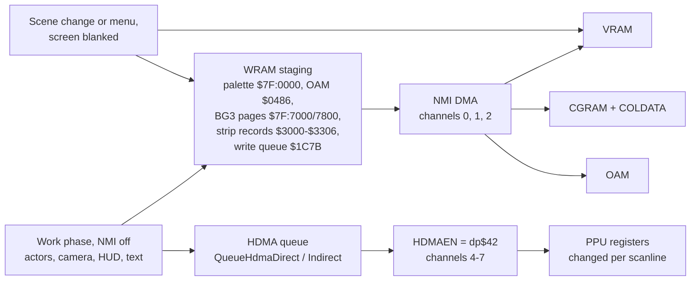

# VRAM, DMA, HDMA and Palettes — Where Pixels and Colours Live

*Part of the [Soul Blazer Code Documentation](README.md)*

> What sits where in video memory, which DMA channel carries what and when, how the map reaches the tilemaps while the camera moves, where the 256 colours are staged and who writes them, and how the four HDMA channels of the queue give the game its water waves, gradients, split screens and the circle windows of the souls.

**Source:**
[`engine_vblank_nmi.asm`](../../extracted/system/engine_vblank_nmi.asm) (the transfer routines of `HandleVBlank`) ·
[`lib_system_helpers.asm`](../../extracted/library/lib_system_helpers.asm) (`ResetHdmaQueue`, `QueueHdmaIndirect`, `QueueHdmaDirect`, `HdmaDmapByRegister`, the NMI switches, `ApplyBootPpuLayout`) ·
[`lib_hdma_window_effects.asm`](../../extracted/library/lib_hdma_window_effects.asm) (`QueueBg3ScrollHdma`, the four soul effects, `BuildSoulOrbCircleWindow`) ·
[`lib_map_scroll_and_redraw.asm`](../../extracted/library/lib_map_scroll_and_redraw.asm) (strip records, `UploadScrollStrips`, `StepSweepRedraw`) ·
[`lib_scene_asset_loader.asm`](../../extracted/library/lib_scene_asset_loader.asm) (`LoadSceneGraphics`, `LoadScenePalette`, `LoadMode7Map`, `ApplySceneProfile`) ·
[`lib_scene_profile_data.asm`](../../extracted/library/lib_scene_profile_data.asm) ·
[`data_scene_asset_lists.asm`](../../extracted/system/data_scene_asset_lists.asm) ·
[`lib_menu_screen_setup.asm`](../../extracted/library/lib_menu_screen_setup.asm) ·
[`lib_menus.asm`](../../extracted/library/lib_menus.asm) (`OpenEquipmentMenu`, `SaveCgramBuffer`, `RestoreCgramBuffer`) ·
[`data_menu_palettes_and_groups.asm`](../../extracted/system/data_menu_palettes_and_groups.asm) ·
[`lib_boot_and_scene_init.asm`](../../extracted/library/lib_boot_and_scene_init.asm) (`LoadBootGraphicsBuffers`, `RunIrisTransition`, `InitSceneState`) ·
[`data_iris_and_icon_tiles.asm`](../../extracted/system/data_iris_and_icon_tiles.asm) ·
[`engine_title_file_select.asm`](../../extracted/system/engine_title_file_select.asm) (the Mode 7 hook) ·
[`gv_front_end.asm`](../../extracted/grass_valley/front_end/gv_front_end.asm) (title split, ending bands, colour ramps) ·
[`lib_animation.asm`](../../extracted/library/lib_animation.asm) and [`data_anim_palette_cycles.asm`](../../extracted/system/data_anim_palette_cycles.asm) (colour stepper) ·
[`lib_text_render.asm`](../../extracted/library/lib_text_render.asm) (`DrawGaugeBar`) ·
the HDMA actors of the worlds (listed in the catalogue below)

---

## Overview

VRAM, CGRAM and OAM are written only in two situations: with the screen blanked (a scene change, a menu opening) and in the NMI's vblank. The work phase stages everything in WRAM and the NMI sends it ([boot-nmi-main-loop.md](boot-nmi-main-loop.md) has the order). HDMA is the one hardware path that changes PPU registers during the picture. This document is about the *what and where* of those transfers.

Three families of writers share VRAM: the **loaders** (screen blanked, NMI off, no timing limit: `LoadSceneAssets`, the menu loaders), the **NMI** (a fixed budget per vblank: BG3 page, strips, hero tiles, one animated strip, the write queue) and **HDMA** (no VRAM at all: it rewrites PPU registers line by line). Colours have one staging area, the CGRAM buffer at `$7F:0000`, which the NMI sends whole every frame, so any code can change a colour by storing a word.

Code addresses are source-ROM addresses (LoROM: bank = file offset ÷ `$8000`, address = `$8000` + the offset inside that bank); the rebuilt ROM places the blocks elsewhere (`rebuilt/layout.json`). VRAM addresses are word addresses. Hardware facts (DMA and HDMA modes, window and colour-math registers) are the standard SNES ones: [SFC wiki registers](https://wiki.superfamicom.org/registers) and [fullsnes](https://problemkaputt.de/fullsnes.htm).

**Related:** [boot-nmi-main-loop.md](boot-nmi-main-loop.md) · [scene-area-warp-loading.md](scene-area-warp-loading.md) · [sprites-oam-animation.md](sprites-oam-animation.md) · [wram-memory-map.md](../wram-memory-map.md)

---

## Memory Map

### Code

| Address | Name | Description |
|---------|------|-------------|
| `$00:8342` | `HandleVBlank` | NMI: `HDMAEN = 0`, the transfers below, then `HDMAEN = dp$42`. |
| `$00:83C5` | `DmaOamBuffer` | Channel 0: OAM. |
| `$00:83EA` | `DmaCgramAndFixedColor` | Channel 1: CGRAM, then three `COLDATA` writes. |
| `$00:8421` | `DmaBg3TilemapPage` | Channel 2: one 2 KB BG3 page. |
| `$00:846E` | `WriteScrollRegisters` | BG1, BG2, BG3 scroll words (not a DMA). |
| `$00:84C8` | `UploadMapStripBuffers` | Two calls of `UploadScrollStrips`. |
| `$00:84E5` | `DmaDynamicSpriteTiles` | Channel 2: the hero's tiles, two passes. |
| `$00:8543` | `DmaAnimatedTileStrip` | Channel 2: one animated background strip. |
| `$00:858B` | `FlushVramWriteQueue` | CPU writes of queued (address, data) pairs. |
| `$02:985E` | `ResetHdmaQueue` | Empties the HDMA channel queue. |
| `$02:986E` | `QueueHdmaIndirect` | Programs the next channel for an indirect table. |
| `$02:988A` | `QueueHdmaDirect` | Programs the next channel for a direct table. |
| `$02:989D` | `WriteHdmaChannelRegisters` | Shared tail of the two queue routines. |
| `$02:9695` | `QueueBg3ScrollHdma` | Queues the BG3 scroll table every frame. |
| `$02:96C3`, `$02:96E2`, `$02:9707`, `$02:972E` | `RunSoulOfLightEffect`, `RunSoulOfRealityEffect`, `RunSoulOfDetectionEffect`, `RunSoulOfShieldEffect` | The four soul window actors. |
| `$02:975D` | `BuildSoulOrbCircleWindow` | Builds and queues the circle (`WH0`, `WH1`). |
| `$02:810B`, `$02:8163`, `$02:81C2` | `BuildScrollStrips`, `BuildColumnStrip`, `BuildRowStrip` | Work phase: fill the strip records. |
| `$02:820E` | `RedrawBackgroundsAtEntry` | Draws both maps completely at a scene change. |
| `$02:857D`, `$02:8640` | `UploadScrollStrips`, `DmaStripChunk` | Send one column record and one row record. |
| `$02:8EEA` | `StepSweepRedraw` | One line of the sweep redraw into the write queue. |
| `$02:9062`, `$02:90C6` | `LookupBg1TileAndVramAddr`, `LookupBg2TileAndVramAddr` | Map byte and tilemap address of one metatile. |
| `$02:B43F`, `$02:B532`, `$02:B6EA` | `LoadSceneGraphics`, `LoadScenePalette`, `LoadMode7Map` | Loader commands that write VRAM and the CGRAM buffer. |
| `$02:B759` | `ApplySceneProfile` | Writes `TM`, `TMW`, `TS`, `TSW`, `CGWSEL`, `CGADSUB`, `BG1SC`, `BG2SC`, `BGMODE`. |
| `$02:B9AC` | `InitHardwareAndClearWram` | Zeroes the PPU registers and all WRAM except the stack page. |
| `$02:BADA` | `ApplyBootPpuLayout` | The default layer layout written once at boot. |
| `$02:B176`, `$02:B18C`, `$02:B1A2`, `$02:B1AE`, `$02:B1B7` | `EnableDisplayAndNmi`, `ForceBlankNmiOff`, `EnableNmi`, `DisableNmi`, `WaitVBlank` | The blanking and NMI switches. |
| `$02:9B97` | `OpenEquipmentMenu` | Saves and restores the screen around the menu. |
| `$02:A3EA`, `$02:A400` | `SaveCgramBuffer`, `RestoreCgramBuffer` | 512-byte copies to and from `$7E:6000`. |
| `$02:A32B`, `$02:A390`, `$02:A416`, `$02:A43D`, `$02:A450`, `$02:A463`, `$02:A49C` | `SetupMenuBg2Screen`, `ExpandMenuTileGroups`, `LoadMenuBg2Graphics`, `LoadMenuPalette`, `LoadItemPagePalette`, `RestoreSceneBgGfxAndPalette`, `LoadEquippedMagicGfx` | The menu's graphics and palette handoff. |
| `$04:F19F` | `LoadBootGraphicsBuffers` | Boot: three graphics blocks into WRAM buffers. |
| `$04:F223` | `QueueAnimatedTileStrip` | Once per frame: asks the NMI for one animated strip. |
| `$04:F6EE`, `$04:F87C` | `ClearBg3Buffer`, `RunIrisTransition` | BG3 clear; the iris. |
| `$00:EB7F`, `$00:EBA8`, `$00:EBF1`, `$00:ECA0` | `UpdateTitleMode7`, `WriteMode7Matrix`, `BuildRotationMatrix`, `Mode7Multiply16x8` | Title Mode 7. |
| `$02:AABF` | `DrawGaugeBar` | Sets the gauge colour in the CGRAM buffer. |

### Data

| Address | Name | Description |
|---------|------|-------------|
| `$02:96AD` | `Bg3ScrollHdmaTable` | 22 bytes: BG3 vertical scroll bands. |
| `$02:98BC` | `HdmaDmapByRegister` | 64 DMA-mode bytes, one per PPU register `$2100`-`$213F`. |
| `$01:FDC4` | `CircleHalfWidths` | Half-widths of the circle of radius `$40`. |
| `$09:8000` | `IrisFrames` | 32 tile masks of the iris. |
| `$09:8800` | `IconTileRecords` | 128 icon records of four tile words. |
| `$09:F000`, `$09:F100`, `$09:F200`, `$09:F300` | `ItemPagePalette`, `MenuBgPalette`, `MenuTileGroupMap`, `MenuSpellPalettes` | Menu palettes and the icon group map. |
| `$01:FB88`, `$01:FBA0` | `MagicGraphicsPointers`, `MagicPalettePointers` | Per-spell graphics and palette sources. |
| `$01:FB2F` | `GaugeColorLadder` | 13 gauge colours by tens of HP. |
| `$04:F258` | `AnimatedStripVramDests` | The four slots of the animated strip. |
| `$00:EA86`, `$00:EA8B` | `gv_hdma_title_bgmode_006A86`, `gv_hdma_title_tm_006A8B` | Title split tables. |
| `$03:B284`, `$03:B24E` | `gv_hdma_gradient_table_01B284`, `gv_hdma_gradient_table_01B24E` | Fixed-colour gradient tables. |
| `$04:A471` | `ms_hdma_coldata_table_022471` | Mountain of Souls gradient table. |
| `$05:8000` | `SceneAssetLists` | The asset records; VRAM pages and palette destinations are operands. |

### State

| Address | Name | Description |
|---------|------|-------------|
| `$7F:0000` | `cgram_buffer` | 512 bytes, 256 BGR555 colours; sent to CGRAM every NMI. |
| `$7F:0200` | `coldata_buffer` | Three raw `COLDATA` bytes (`$7F:0200`-`$7F:0202`). |
| `$7F:7000`, `$7F:7800` | `bg3_tilemap_buffer`, BG2 icon page | The two 2 KB tilemap pages the NMI can send. |
| `$7F:1000`, `$7F:3000`, `$7F:C000` | boot graphics buffers | Animated strip frames, the hero's tile source, the menu-restore copy. |
| `$7E:6000` | LZ staging | Decompression target of graphics; also the CGRAM backup of the menu. |
| `$7E:3000`-`$7E:3306` | strip records | BG1 column `$3000`, BG1 row `$3102`, BG2 column `$3204`, BG2 row `$3306`. |
| `$7E:7000`, `$7E:7800` (and `$7100`, `$7900`) | HDMA tables | Rebuilt every frame by the actors that use HDMA. |
| `$03B8` | `vram_upload_flags` | Bit 0: send the BG3 page; bit 1: send the second page. |
| `$1C7B` | `vram_write_queue` | (VRAM address, word) pairs; address 0 ends. |
| `$1A06` | `tile_dma_list` | The hero's tile records (see [sprites-oam-animation.md](sprites-oam-animation.md)). |
| dp`$42`, `$44`, `$46` | HDMA queue | Pending channel mask, next channel bit, its register offset. |
| `$03C0`-`$03C3` | `tm_shadow`, `cgadsub_shadow`, `bg2sc_shadow`, `w12sel_shadow` | The scene's video settings, kept for the menu return. |

---

## VRAM Layout

### The VRAM word map

**When** every scene change fixes the layout; the registers come from `ApplyBootPpuLayout` (once at boot), `ApplySceneProfile` (every scene) and `InitSceneState`. **What the player sees**: nothing directly; a layer that points at the wrong block shows garbage. **Why** a table: five writers share 32K words and the layout is not stated in one place.

| Words | Content | Set by | Evidence |
|-------|---------|--------|----------|
| `$0000`-`$1FFF` | BG1 and BG2 character data (4 bits per pixel; `BG12NBA` = 0) | asset command `graphics` with VRAM page `$00` and `$10` (30 and 27 commands) | `InitSceneState` stores 0 to `BG12NBA`; `LoadSceneGraphics` writes page `b2 << 8` |
| `$2000`-`$2FFF` | OBJ name table 0 (`OBJSEL` = `$01`); the hero, the animated strip, the sword and the spell sit here | `DmaDynamicSpriteTiles`, `DmaAnimatedTileStrip`, `LoadEquippedMagicGfx`, `RestoreSceneBgGfxAndPalette` | tile-by-tile table in [sprites-oam-animation.md](sprites-oam-animation.md) |
| `$3000`-`$3FFF` | OBJ name table 1 (the table-gap bits of `OBJSEL` are 0, so the second table follows `$1000` words after the first) | asset command `graphics` with VRAM page `$30` (45 commands, the most used page) | `OBJSEL` rule; which OAM tiles use table 1 is OQ-I051-9 |
| `$4000`-`$57FF` | BG3 character data, 2 bits per pixel (`BG34NBA` = 4): the text font (up to 768 tiles); tile 0 doubles as the iris mask | font: the `graphics` command with page `$40` of the boot scene `A00S0C`; tile 0: `RunIrisTransition` | `ApplyBootPpuLayout`; `LoadSceneGraphics` header ("the BG3 text font"); who else writes the range is OQ-I051-8 |
| `$5800`-`$5BFF` | BG3 tilemap, 32 × 32 (`BG3SC` = `$58`) | `DmaBg3TilemapPage` from `$7F:7000` | boot layout |
| `$5C00`-`$5FFF` | the menu's BG2 tilemap (`BG2SC` = `$5C`) while a menu is open | `DmaBg3TilemapPage` from `$7F:7800` (bit 1) | `OpenEquipmentMenu`, `SetupMenuBg2Screen` |
| `$6000`-`$6FFF` | BG1 tilemap, 64 × 64 (`BG1SC` = `$60` + size) | `UploadScrollStrips`, `FlushVramWriteQueue` | `ApplySceneProfile` |
| `$7000`-`$7FFF` | BG2 tilemap, 64 × 64 (`BG2SC` = `$70` + size) | same | `ApplySceneProfile` |
| `$0000`-`$3FFF` (Mode 7 scene only) | Mode 7 map in the low bytes, Mode 7 characters in the high bytes | `LoadMode7Map` (`VMAIN` = 0), `LoadSceneGraphics` with page `$FF` (`VMDATAH`) | title scene `A00S0A` |

Two overlaps follow from the table. First, **with `BG12NBA` = 0 a BG tile number n is at word n × 16, so BG tiles `$200` and up are the OBJ area**: `AnimatedStripVramDests` holds `$2060`, `$2080`, `$20A0`, `$20C0`, which `QueueAnimatedTileStrip` calls VRAM tiles `$206`, `$208`, `$20A`, `$20C` (two tiles each, the second halves `$100` words on). The same words are OBJ tiles 6, 8, `$A`, `$C` of the sprite table in [sprites-oam-animation.md](sprites-oam-animation.md), so the animation can be seen as a background tile and as a sprite tile alike (OQ-I050-3). Second, **the menu replaces `$2000`-`$2FFF`**: `LoadMenuBg2Graphics` DMAs the menu's character set (`graphics_04B000`, `$2000` bytes) there and `BG12NBA` = `$20` makes BG2 read it (OQ-I010-10); on exit `RestoreSceneBgGfxAndPalette` sends the `$7F:C000` copy of `graphics_04D000` back (OQ-I009-13) and `LoadEquippedMagicGfx` refills `$2600`-`$29FF`. The hero's slots and the animated strip are rewritten by the NMI every frame; the sword frames at `$2200`-`$25FF` are not restored by any of these routines (OQ-I050-5).

### What a scene sets and what it leaves

**When** `ApplySceneProfile` runs once per scene, as the first command of the asset record. **What the player sees**: the layers, the colour effect and the view height of the room. **Why** a profile record: twelve bytes per scene instead of a code path (the layout is in `lib_scene_profile_data`; [scene-area-warp-loading.md](scene-area-warp-loading.md) covers the command walk).

The profile writes `TM` and `TMW` from byte 0 (the same value, so a layer that is on the main screen is also window-maskable), `TS` and `TSW` from byte 1, `CGWSEL`, `CGADSUB`, `BG1SC`, `BG2SC` and `BGMODE`; it keeps copies in `tm_shadow`, `cgadsub_shadow` and `bg2sc_shadow`. It does not touch `OBJSEL`, `BG34NBA`, `W12SEL`, `W34SEL` or `WOBJSEL`. `InitSceneState` zeroes `BG12NBA`, `W12SEL` (and `w12sel_shadow`), `W34SEL`, `WOBJSEL` and `MOSAIC` before the assets load and sets `WH0` = 0 and `WH1` = `$FF` at its end, so every scene starts with no window mask and the soul actors (below) set theirs again each time. `OBJSEL` = `$01` and `BG34NBA` = 4 are written only by `ApplyBootPpuLayout`, which also sets `BGMODE` = `$09` (Mode 1 with BG3 on top), `W12SEL` = `W34SEL` = `WOBJSEL` = `$33` (window 1 enabled and inverted on every layer; with the span 0-255 inverted that area is empty), `CGWSEL` = `$82` and `TM` = `$07`; the first scene profile replaces most of that.

---

## DMA

### Who owns which DMA channel

**When** always. **What the player sees**: nothing; two users of one channel in one NMI would corrupt each other. **Why** a table: the hardware has eight channels and the code uses five of them, with a fixed split.

| Channel | User | Mode | Trigger (`MDMAEN`) |
|---------|------|------|--------------------|
| 0 | `DmaOamBuffer` in the NMI; the menu loaders `LoadMenuBg2Graphics`, `RestoreSceneBgGfxAndPalette`, `LoadEquippedMagicGfx` while the screen is blanked | `DMAP0` = 0 to OAMDATA; `1` to `$2118`/`$2119` for VRAM | `$01` |
| 1 | `DmaCgramAndFixedColor` | to CGDATA, 512 bytes | `$02` |
| 2 | every VRAM transfer of the NMI (`DmaBg3TilemapPage`, `DmaDynamicSpriteTiles`, `DmaAnimatedTileStrip`, `DmaStripChunk`) and of `RedrawBackgroundsAtEntry` | mode 1 (word pair) to `$2118` | `$04` |
| 3 | not used: no `MDMAEN` value of `$08` exists in `extracted/` | | |
| 4-7 | the HDMA queue, one channel per call, first call = channel 4 | direct or indirect HDMA | `HDMAEN` = dp`$42` |

`LoadSceneGraphics` and `LoadMode7Map` do not use DMA at all: they copy from `$7E:6000` (or `$7E:C000`) to `VMDATAL` or `VMDATAH` with CPU loops, because the screen is blanked and nothing waits. The VRAM transfers rely on `VMAIN` = `$80` (word step after the high byte). `UploadScrollStrips` is the only NMI routine that writes `VMAIN`: it sets `$81` for a column record and `$80` for the row record that follows, and it sets `$80` even when the record is empty, so the register is `$80` when the NMI ends. `DmaBg3TilemapPage`, which runs before the strips, therefore uses the value of the previous NMI (at boot `InitHardwareAndClearWram` writes `$80`). `LoadMenuBg2Graphics` relies on it as well and does not set it (OQ-I010-8).

### What the NMI sends and what triggers it

**When** every vblank, in the order of [boot-nmi-main-loop.md](boot-nmi-main-loop.md). **What the player sees**: every change of the frame appears here. **Why** a table: the budget of one vblank is the sum of these rows.

| Routine | Source → destination | Bytes | Sent when |
|---------|----------------------|-------|-----------|
| `DmaOamBuffer` | `oam_buffer` `$0486` → OAM | 544 | always |
| `DmaCgramAndFixedColor` | `$7F:0000` → CGRAM from colour 0; then `$7F:0200`-`$7F:0202` → `COLDATA` | 512 + 3 writes | always |
| `DmaBg3TilemapPage` | `$7F:7000` → `$5800`, or (bit 1) `$7F:7800` → `$5C00` | 2048 | `vram_upload_flags` non-zero and the first write-queue word's high byte zero |
| `WriteScrollRegisters` | scroll words → `BG1HOFS` ... `BG3VOFS` | writes | always |
| `UploadMapStripBuffers` | strip records → tilemaps `$6000` and `$7000` | 4 × 64 per record, up to 4 records | record's first word non-zero |
| `DmaDynamicSpriteTiles` | `tile_dma_list` records → `$2000` and `$2100` upward | 64 per record, two passes | `tile_dma_pending` |
| `DmaAnimatedTileStrip` | `vram_strip_src` (bank `$7F`) → `vram_strip_dest` and `vram_strip_dest` + `$100` words | 2 × 64 | `vram_strip_pending` |
| `FlushVramWriteQueue` | `vram_write_queue` pairs → VRAM | 4 per pair | queue not empty |

`DmaBg3TilemapPage` sends one page per NMI. With bit 1 clear it sends the text page and clears all flag bits; with bit 1 set it sends the icon page and clears only bit 1, so a bit 0 set at the same time is sent one frame later. The equipment menu steps through the pages by hand: `RunEquipmentMenu` stores 1 (text page) and later 2 (icon page) and then 1 again in `vram_upload_flags`, with a `WaitVBlank` after each of the last two. The same flag has a quirk: `ClearBg3Page` and `ClearBg3UpperHalf` run with `DBR` = `$7F`, so their final `TSB $03B8` sets a bit in `$7F:03B8` instead of `vram_upload_flags` (OQ-I027-1). Whether a continuous stream of queued writes can starve the page upload is OQ-I005-19; whether the whole NMI always ends inside vblank is OQ-I043-5.

### The VRAM write queue and the sweep redraw

**When** `RunSubFrameMapSweep` runs (a lair released, a plate pressed, an NPC freed), 35 steps. **What the player sees**: the changed part of the map wipes in from the middle of the screen outwards. **Why** a queue and not a strip: the changed cells are anywhere in view, not at an edge.

`StepSweepRedraw` handles one line of 16 metatiles per frame (the order is `SweepStepTable`) and queues four (address, word) pairs for each, 16 bytes per metatile, into `vram_write_queue`; the NMI's `FlushVramWriteQueue` writes them with `VMADDL` and `VMDATAL`. The tile address comes from `LookupBg1TileAndVramAddr` or `LookupBg2TileAndVramAddr`: base (`$6000` or `$7000`) + `(y AND $F8) × 4` + `(x AND $F8) / 8`, plus `$400` when bit 8 of x is set and `$800` when bit 8 of y is set. That is the layout of a 64 × 64 tilemap built from four 32 × 32 screens: the right screen is `$400` words on, the lower screens `$800`. The BG2 twin loads `map_width_pages` without the layer index that `BuildColumnStrip` uses for BG2 (OQ-I051-6).

---

## Map Streaming

### From the camera to the tilemap: strip records

**When** `ScrollCameraByDelta` crosses a 16-pixel line, and once per scene at `RedrawBackgroundsAtEntry`. **What the player sees**: the map keeps drawing in at the screen edge as the hero walks. **Why** strips: each tilemap holds 64 × 64 tiles (512 × 512 pixels) while a map can be larger, and one metatile column or row at the edge is the smallest piece that keeps the visible part complete.

The camera sets a request bit in `scroll_requests` (`$80` BG1 column, `$40` BG1 row, `$20` BG2 column, `$10` BG2 row). In the work phase `BuildScrollStrips` tests and clears each bit and calls `BuildColumnStrip` or `BuildRowStrip`, which place the strip at scroll + `$100` for a positive delta and at the scroll position for a negative one (so the strip is always just outside the visible 256 pixels) and fill one **record** of 258 bytes: a word with the VRAM address (0 = empty) and four 64-byte blocks. The NMI's `UploadScrollStrips` sends the four blocks of a record and zeroes its first word. A column uses `VMAIN` = `$81` (step 32 words: one tile column goes down the screen) and sends to the record's address, `+1`, `+$800` and `+$801`: two tile columns, each in the upper and the lower screen of the tilemap. A row uses `VMAIN` = `$80` and sends to the address, `+$20`, `+$400` and `+$420`: two tile rows, each in the left and the right screen. One strip is therefore one metatile (16 pixels) wide or high, over the whole 64-tile extent of the tilemap. `BuildScrollStrips` is mis-decoded in the extraction (OQ-I005-7, OQ-I026-1), so its part note, not the printed listing, is the reference; it builds the BG2 column only when the BG2 map is at least three pages wide.

`RedrawBackgroundsAtEntry` places the camera on the hero, derives BG2 through the parallax ratios, wraps the BG2 scroll into its map and builds and uploads 32 column strips per layer (32 × 16 pixels = the 512-pixel tilemap width), one at a time through `UploadScrollStrips` with the NMI off. The room is complete before the fade-in. Location `$10` (the Mode 7 title) skips it.

---

## Palettes

### The CGRAM buffer and the fixed colour

**When** every NMI. **What the player sees**: every colour, and a tint over the whole screen. **Why** a buffer: CGRAM can only be written in vblank or forced blank, while the work phase wants to change a colour at any time.

`DmaCgramAndFixedColor` sends all 512 bytes of `cgram_buffer` (`$7F:0000`) to CGRAM from colour 0 on channel 1 and then writes the three bytes at `coldata_buffer` to `COLDATA`. Each of the three is a raw `COLDATA` byte with its own channel-select bits (bits 7-5) and intensity (bits 4-0), so `$E0 | n` sets all three components to intensity n and the other two bytes are normally 0. Colours 0-127 are the eight 16-colour palettes of BG1 and BG2 (4 bits per pixel; BG3's 2-bit text uses 4-colour palettes within colours 0-31 in Mode 1), colours 128-255 the eight sprite palettes. The tint is applied by colour math where `CGADSUB` from the scene profile enables it; which layers take it, and whether it adds or subtracts, was not tabulated per scene here.

### Who writes colours

**When** see the table. **What the player sees**: the scene's palette, the menu's palette, the HP gauge, effects. **Why** a table: the buffer has many writers and the order between them matters (the menu return in particular).

| Writer | Writes | Effect |
|--------|--------|--------|
| `InitHardwareAndClearWram` | all WRAM except the stack page zeroed at boot | black palette |
| `InitSceneState` | `COLDATA` = `$E0` at once, the three `coldata_buffer` bytes = 0, colour 0 = 0; the other colours keep the previous scene's values until the asset commands overwrite them | black backdrop and no tint before the new assets load |
| `LoadScenePalette` (asset command `palette`) | colours [b0, b1) of the source to `cgram_buffer + b2 × 2`; no cache | the scene's palettes |
| `LoadMenuPalette`, `LoadItemPagePalette` | 256 bytes (colours 0-127) from `MenuBgPalette` or `ItemPagePalette` | the menu and the item page |
| `RestoreSceneBgGfxAndPalette` | `MenuSpellPalettes`, 160 bytes at `cgram_buffer + $160` (palettes 11-15); called by `OpenEquipmentMenu` on exit, by `InitSceneState` when `reload_menu_gfx` is set and by the boot actor | the sprite palettes after a menu or a front-end screen |
| `LoadEquippedMagicGfx` | 32 bytes of `palette_07D000 + $20 × n` at `cgram_buffer + $160` | the equipped spell's colours |
| `RestoreCgramBuffer` | all 512 bytes back from `$7E:6000` | the field after the menu |
| `DrawGaugeBar` | one word of `GaugeColorLadder` (index floor(cur / 10) × 2) into colour 10, or colour 14 for the second bar | the HP and enemy gauges: dark blue below 50, lighter above, white from 100 |
| the colour stepper (`NextFrameRecord`, `CopyFrameData`) | blocks from `data_anim_palette_cycles` to `$7F:offset`; a 3-byte block lands on `coldata_buffer` | colour cycling and backdrop fades of the actors that use that bank (inferred from the destination, OQ-I026-3) |
| `gv_fx_coldata_ramp_up_006A25`, `gv_fx_coldata_ramp_down_006A40` | `coldata_buffer` = `$E0` or n, n stepping over 32 frames | the title and prologue fades |
| `HandleFileSelectChoice` | colour 3 (`$7F:0006`) = `$03FF` while the second prompt runs, `$7FFF` again afterwards | the prompt text changes colour (probably erase, OQ-I024-5) |
| `mc_dream_soldier_dialogue_026A4E`, `ms_effect_hdma_coldata_gradient_022457` | colour 0 = `$2C81` or `$1C81` (both dark blue) | the dream scene's backdrop (the Dream Rod scene of the Magridd's Castle airship dock) and the Mountain of Souls backdrop |

### The menu's save and restore

**When** `OpenEquipmentMenu`, X or Select in the field. **What the player sees**: the pause menu appears and, when it closes, the field returns with the same colours. **Why** save and restore: the menu rewrites graphics at `$2000` and the palette, so everything it changes is put back, in a fixed order.

`OpenEquipmentMenu` clears dp`$42` (no HDMA while the menu is open), forces blank, sets `BG2SC` = `$5C`, `BG12NBA` = `$20`, `TM` = 6, `CGADSUB` = 0 and `W12SEL` = 0, saves the four scroll words and `equipped_magic`, calls `SaveCgramBuffer` (512 bytes to `$7E:6000`), then `LoadMenuBg2Graphics`, `LoadMenuPalette` and `ExpandMenuTileGroups`. On exit it puts the scroll words back, restores `BG2SC`, `TM`, `CGADSUB` and `W12SEL` from the scene's shadows, sets `BG12NBA` = 0, and then calls three routines **in this order**: `RestoreSceneBgGfxAndPalette`, `RestoreCgramBuffer` and `LoadEquippedMagicGfx`. The second overwrites the whole colour buffer, including what the first just wrote, and the third paints the spell palette last so it survives. Why the shadows exist: `ApplySceneProfile` stored them, and the soul actors store `w12sel_shadow` too, so a soul window is back after the menu.

---

## HDMA

### The channel queue

**When** every frame, from actors that want a scanline effect. **What the player sees**: water that ripples, a sky that fades, a screen that splits in two modes, a circle that follows the soul. **Why** a queue: several actors need HDMA, and none of them knows which channel is free.

`ResetHdmaQueue` runs at the start of every work phase and sets dp`$42` (the pending mask) to 0, dp`$44` to `$10` (the bit of channel 4) and dp`$46` to `$40` (the register block of channel 4, `$4340`). `QueueHdmaDirect` and `QueueHdmaIndirect` take the PPU register (high byte of A), the table bank (low byte of A) and the table address (Y), program the next channel through `WriteHdmaChannelRegisters`, and add its bit to dp`$42`; the NMI copies dp`$42` to `HDMAEN`. The DMA mode byte of a channel is read from `HdmaDmapByRegister` by register number: 0 for one register (`BGMODE`, `TM`, `WH0`, `WH1`, `COLDATA`), 2 for a register written twice (the scroll registers `$0D`-`$14`). The indirect entry ors `$40` into the mode and sets the data bank equal to the table bank, so a table and the data it points to share one bank; every caller passes `$7E`. HDMA is per frame: an effect stops the frame after its actor stops queueing it, which is why every effect actor queues every frame.

**The budget is four.** Channels 4, 5, 6 and 7 are handed out in order; the fourth call shifts the last bit out of dp`$44` and the carry that remains makes dp`$46` = `$81`, so a fifth call in one frame programs `$4381`-`$4387`, which is not a channel, and adds nothing to dp`$42`: the fifth effect is silently dropped (OQ-I009-9). A frame can need more than four: `QueueBg3ScrollHdma` takes one channel in every location but `$10`-`$12`, a soul circle takes two (`WH0` and `WH1`), and the water effects below take one or two each. `QueueBg3ScrollHdma` runs at the end of each of the five sub-frame runners, so it is queued after the actors of the frame and would be the one to lose (OQ-I051-4).

### The tables

**When** an actor queues a table (`QueueHdmaDirect` or `QueueHdmaIndirect`), every frame. **What the player sees**: the register changes at the line where the table says so. **Why** two shapes: a fixed band list (the BG3 scroll, the title split) is a ROM table, a moving wave needs one data row that the actor rewrites each frame.

Two table shapes occur. A **direct** table is `[line count][data bytes]` groups ending with a 0 count; the data is held for that many lines. `Bg3ScrollHdmaTable` is `14 FC FF, 0C 00 00, 0C 04 00, 01 03 00, 01 02 00, 01 01 00, 01 00 00, 00`: for register `$12` (`BG3VOFS`, a word written twice per line) a scroll of −4 for 20 lines, 0 for 12, +4 for 12 and then +3, +2, +1, 0 for one line each (48 lines). An **indirect** table is `[count][address word]` groups; with the repeat bit set in the count (`$90` = 16 lines, `$A0` = 32, `$C0` = 64) the hardware reads one new data unit from the address per line. The wave actors build 14 groups of `$90` (or 7 of `$A0`) that all point at the same data row, so one row of 16 (or 32) scroll words repeats down the screen, and they rewrite that row every frame from a sine-like table plus the scroll position: the ripple moves because the row's phase moves with `frame_counter`.

### The effects

**When** the actors listed live in their scenes and run every frame. **What the player sees**: the effect in the last column. **Why** HDMA and not a tile trick: each of these changes a PPU register between scanlines, which no tilemap can do.

| Actor | Register (channels) | Table | Effect |
|-------|---------------------|-------|--------|
| `QueueBg3ScrollHdma` | `$12` BG3VOFS (1) | direct, ROM | BG3 offset −4 / 0 / +4 over the top 48 lines (OQ-I042-1) |
| `BuildSoulOrbCircleWindow` | `$26` `WH0`, `$27` `WH1` (2) | direct, `$7E:7000` / `$7E:7800` | window 1 as a circle of radius `$40` around the soul orb |
| `gv_fx_hdma_title_split_006A5E` | `$05` `BGMODE`, `$2C` `TM` (2) | direct, ROM | title: 127 lines Mode 7, then 96 lines Mode 1 with BG3 |
| `gv_fx_ending_hdma_scroll_0074E8` | `$0F` BG2HOFS (1) | direct, `$7E:7800` | ending: BG2 below the first 112 lines is cut into bands that drift at different speeds (OQ-I034-15) |
| `gv_fx_ending_hdma_wipe_00758C` (builder `gv_fx_ending_queue_wipe_0075E7`) | `$2C` `TM` (1) | direct, `$7E:7000` | ending text curtain: layers `$17` above the line, `$13` below |
| `we_fx_ending_tm_curtain_0055C6` | `$2C` `TM` (1) | direct | World of Evil ending: BG1 off in the first 143 lines |
| `se_effect_seabed_wave_hdma_0FA874` | `$0D`, `$0E` (2) | indirect | seabed water shimmer, horizontal and vertical |
| `se_effect_sanctuary_wave_hdma_0FA7C4` | `$0F` (1) | indirect | sanctuary water shimmer, horizontal |
| `gw_effect_wave_hdma_01E9D3` | `$0D`, `$0E` (2) | indirect | Woods wave, 7 groups of 32 lines |
| `gw_effect_water_ripple_hdma_01EAFB` | `$0F`, `$10` (2) | indirect | Lostside water ripple, 14 groups of 16 lines |
| `we_fx_bg2_hofs_wave_01EEF3` | `$0F` (1) | indirect | World of Evil horizontal wave, 4 groups of 64 lines |
| `we_fx_bg2_vofs_wobble_01F063` | `$10` (1) | indirect | World of Evil vertical wobble, 7 groups of 32 lines |
| `we_fx_battle_bg2_hofs_bands_01F14F` | `$0F` (1) | direct, `$7E:7800` | Deathtoll's room: 12 BG2 bands moving with `frame_counter` |
| `ms_effect_hdma_bg2_shear_02230A` | `$0F` (1) | direct, `$7E:7800` | Mountain of Souls (`A0BS01`): BG2 unmoved in the top 143 lines, sheared below by a ramp that follows the scroll |
| `ms_effect_hdma_bg2_wave_02237E` | `$10` (1) | indirect | Mountain of Souls vertical ripple |
| `ms_effect_hdma_coldata_gradient_022457` | `$32` `COLDATA` (1) | direct, ROM | Mountain of Souls backdrop gradient |
| `gv_fx_hdma_gradient_01B273` | `$32` `COLDATA` (1) | direct, ROM | Leo's Paintings: fixed-colour gradient top to bottom |
| `gv_fx_hdma_gradient_01B23D` | `$32` `COLDATA` (1) | direct, ROM | Underground Castle: fixed-colour gradient over the lower part of the screen |

The second column lists PPU *registers* (`$0D` BG1HOFS, `$0E` BG1VOFS, `$0F` BG2HOFS, `$10` BG2VOFS), not DMA channels; the channels are the ones the queue hands out. The notes of the seabed and sanctuary actors say "channels `$0D` and `$0E`" and "channel `$0F`"; they are corrected in I051 (`plans/extracted-audit/edits/I051.json`). Which layer a wave moves depends on the scene: `bg_scroll_swap` exchanges the BG1 and BG2 scroll pairs in `WriteScrollRegisters`, and the Woods actor `gw_effect_wave_hdma_01E9D3` adds the BG2 scroll words (`scroll_bg2_x`, `scroll_bg2_y`) into tables for `$0D` and `$0E` (OQ-I051-7).

### The soul circle windows

**When** a soul has joined: each of the four effect actors polls its bit in `souls_flags` every frame and acts once the bit is set (Light `$02`, Detection `$08`, Shield `$04`, Reality `$10`). **What the player sees**: a circle of radius 64 pixels around the orb of light that follows the hero, and inside it the soul's effect. **Why** an actor per soul: the effect belongs to the scene, not to the hero, and the scene's meta entries (flags `$2010`) are how a scene gets code.

`BuildSoulOrbCircleWindow` (`COP 91` makes it the re-entry point, so the setup below runs once) turns the orb's position into screen coordinates (x − `scroll_bg1_x` + 8, y − `scroll_bg1_y` − 8, clamped to 0-`$FF` and 0-`$DF`), writes two direct tables, `$7E:7000` (left edges, `WH0`) and `$7E:7800` (right edges, `WH1`), and queues them with `QueueHdmaDirect`. Each entry covers two lines and takes its half-width from `CircleHalfWidths`; the left edge is clamped at 0 and the right at `$FF`. Above the circle the lead-in lines have `$FF` for both edges, and the table ends with one line of `$FF` / `$FF` and the end byte (after that HDMA stops and the registers keep `$FF`). Each soul sets its own window and colour registers once, before the shared tail:

| Soul | `W12SEL` | `WOBJSEL` | other | Reading of the register bits (static) |
|------|----------|-----------|-------|----------------------------------------|
| Light | 0 | `$30` | `CGWSEL` = `$12` | colour window 1 enabled and inverted; colour math is prevented outside the colour window, i.e. inside the circle |
| Reality | `$20` | 0 | `bg2_offset_x` = `bg2_offset_y` = 1 | BG2 window 1 enabled, not inverted: BG2 is masked inside the circle |
| Detection | `$20` | 1 | `bg2_offset_x` = `bg2_offset_y` = 1 | as Reality; `WOBJSEL` bit 0 (invert) is set without its enable bit (bit 1), so no sprite masking |
| Shield | `$33` | 0 | `TMW` = 0, `TSW` = 3, `CGWSEL` = `$82`, `COP B0` spawns `DestroyHazardsNearOrb` | BG1 and BG2 window 1 enabled and inverted, on the subscreen only; not read to a picture here |

The bit layout is the standard SNES one: in `W12SEL` bit 0 inverts and bit 1 enables window 1 for BG1, bits 4 and 5 do the same for BG2; in `WOBJSEL` bits 0-1 are the sprite window and bits 4-5 the colour window; `CGWSEL` bits 5-4 = 1 prevent colour math outside the colour window. The reading of Reality and Detection agrees with the walkthrough's own tip, which gives the same result as the soul by *"disabling BG#2 (usually) in an emulator"* (`items.md`, Soul of Reality and Soul of Detection): both souls mask BG2 inside the circle. The Light reading (colour math withheld inside the circle) fits the walkthrough's dark Light Shrine, where the same emulator tip applies. These are readings of the register bits, not runtime checks: a proposed answer to OQ-I042-2, with the check asked for in OQ-I051-2. Two details are open: the tables hold `$FF` / `$FF` outside the circle, a window one pixel wide at x = 255, not the "full-width line" the old note says (OQ-I051-3), and the circle takes two of the four HDMA channels (OQ-I051-4).

### Why the title is two screens

**When** the title actor has finished the zoom, until the player presses Start. **What the player sees**: the zooming Mode 7 picture with the title sprites on top, and below it the copyright line and PUSH START as text. **Why** HDMA: Mode 7 has no text layer; `gv_fx_hdma_title_split_006A5E` switches `BGMODE` from `$0F` (Mode 7) to `$09` (Mode 1 with BG3 priority) at line 127 and `TM` from `$11` (BG1 and sprites) to `$14` (BG3 and sprites), so BG3 text shows below the picture without a second layer.

This works because Mode 7 uses VRAM words `$0000`-`$3FFF` only (the 128 × 128 map in the low bytes, 256 characters of 64 bytes in the high bytes) and BG3 sits at `$4000`-`$5BFF`. `UpdateTitleMode7` runs at the end of every NMI in location `$10`: `BuildRotationMatrix` multiplies `m7_scale` by the sine and cosine tables with the PPU multiplier (`Mode7Multiply16x8`), `WriteMode7Matrix` writes the *previous* NMI's shadows to `M7A`-`M7D`, `M7X` and `M7Y` (the picture lags one frame), and then the new matrix is copied into the shadows. The angle `m7_angle` is never written, so the picture zooms and pans but does not rotate (OQ-I024-4). The page-`$30` sprite block of the same scene is written over words `$3000`-`$3FFF`, which are also the lower quarter of the Mode 7 map and the characters `$C0`-`$FF`; the picture only uses the top 127 lines (OQ-I051-10).

---

## Transitions That Touch VRAM

### The iris

**When** `RunIrisTransition`, for return trips (transition type `$80` and above). **What the player sees**: the screen closes and opens, but not as one circle around the hero: tile 0 of BG3 is rewritten with one of 32 masks and the BG3 page is full of tile 0 (`ClearBg3Buffer` fills it with `$2000`, "tile 0 with the priority bit"), so the same 8 × 8 mask repeats over the whole screen. **Why** a data table: one 16-byte write per step changes the whole screen, so the shape of each frame is data in `IrisFrames`, and no HDMA table has to be set up.

Each frame is 16 bytes, a 2-bit-per-pixel 8 × 8 tile (two bytes per row, the first plane `FF` or `00` here). Frame `$00` fills the tile (`FF00` on all eight rows, colour 1), frame `$01` has a 2 × 2 hole in the middle (`E700` on rows 3 and 4), the hole grows with each frame until at frame `$17` only the left and right columns remain (`8100` on all rows), those thin away, and frame `$1F` is all zeros. Every cell of the screen therefore shows a filled square that opens into a hole, which reads as a dissolving grid. `RunIrisTransition` runs frames `$1E` down to 0 for the way out (31 steps) and 0 up to `$1F` for the way in (32 steps), two sub-frames per step, and writes the 16 bytes to VRAM word `$4000`. The way out first sets `scene_loading`, clears the BG3 buffer and sets `vram_upload_flags` bit 0. After the way in, tile 0 is all zeros, the blank tile the text needs. The old notes of `RunIrisTransition` and `IrisFrames` ("a circle closes on the player", "a circle that closes in on the screen") are corrected in I051; the colour of the squares is OQ-I051-11.

### Fades and mosaic

**When** `PlayTransitionOut` and `PlayTransitionIn` run around every scene change (`ChangeSceneIfRequested`). **What the player sees**: the screen darkens or pixelates and returns. **Why** register-only transitions: they need no VRAM or palette work, so they cost no vblank time.

The other two transition kinds use no VRAM or palette write: `PlayTransitionOut` and `PlayTransitionIn` step `INIDISP` brightness from `$0F` to 0 and back (types 0 and 1, and 8-`$7F`), and the mosaic types (4 and 5) also write `MOSAIC` = ((brightness xor `$0F`) × 16) + 3 (BG1 and BG2) in 16 steps of two sub-frames. In use are type 0 (fade), type 4 (mosaic, 23 scripts) and type `$80` (iris, return trips). The title and prologue fades are a different mechanism: they step `coldata_buffer`.

---

## Walkthrough Cross-Check

| Game term in this document | Walkthrough | Result |
|---|---|---|
| Soul of Light lights the dark part of a dungeon | `items.md`: "Lights up the darker area of the Light Shrine, the only place that is actually dark enough to warrant the use of this"; `03-greenwood.md`: "Down here on B1F, if you do not have the Soul of Light, you will be effectively blind" | Consistent with `RunSoulOfLightEffect` (a colour-window circle around the orb, no layer masked). DISCREPANCY: the old note of `RunSoulOfLightEffect` says the soul lets the player see in "Woods of GreenWood B1F and Lostside"; the walkthrough gets the soul in the Woods of GreenWood and needs it on B1F of the Light Shrine, which the player enters from the Lostside marsh (OQ-I051-1, note corrected). |
| Soul of Reality reveals passages hidden in the Castle of King Magridd | `items.md`: "can reveal passages hidden in the Castle of King Magridd ... or by disabling BG#2 (usually) in an emulator" | Consistent with `W12SEL` = `$20` (BG2 window); the BG2 reading is a static decode. |
| Soul of Detection reveals invisible enemies in Dr. Leo's Laboratory | `items.md`: "invisible enemies ... only found in the Town Models in Dr. Leo's Laboratory ... disabling BG#2" | Consistent: the same `W12SEL` = `$20` as Reality. |
| Soul of Shield protects from the magma bombs on Durean | `items.md`: "protects you from the magma bombs on Durean in St. Elles" | Consistent with the `COP B0` that spawns `DestroyHazardsNearOrb`; what the Shield window shows is not described by the walkthrough. |
| Title screen, Start, file selection | `01-in-the-beginning.md`: "After hearing the epic title screen music, you can press the Start Button to reach the file selection menu" | Consistent with the title scene `A00S0A` and `EnterFileSelect`; the walkthrough does not mention the Mode 7 picture. |
| X opens the menu, Y closes it | `01-in-the-beginning.md`: "Press the X Button to open the menu ... Press the Y Button to exit the menu" | Consistent with `OpenEquipmentMenu` being reached from X (X and Select are one button in `HandleVBlank`); the closing button is not decoded here. |

One mismatch between a note and the walkthrough was found (the Light Shrine) and is corrected; no mismatch between the walkthrough and the ROM text. The walkthrough does not describe water waves, gradients, the iris or the BG3 scroll table, so those claims rest on the ROM alone.

---

## Open Questions

The questions this document could not settle are in `plans/extracted-audit/questions/I051_questions.md`: OQ-I051-1 (the Soul of Light note, DISCREPANCY, corrected), OQ-I051-2 (the soul windows at screen level), OQ-I051-3 (`$FF` / `$FF` edges outside the circle), OQ-I051-4 (the four-channel budget), OQ-I051-5 (HDMA tables rewritten while the picture that uses them is drawn), OQ-I051-6 (`LookupBg2TileAndVramAddr` and the map width), OQ-I051-7 (registers named "channels", and the layer behind each register), OQ-I051-8 (who writes the BG3 font range after the boot scene), OQ-I051-9 (which OAM tiles use sprite table 1), OQ-I051-10 (the Mode 7 map and the sprite page share words), OQ-I051-11 (the iris colour). Earlier questions this document relies on: OQ-I005-7, OQ-I005-19, OQ-I009-9, OQ-I009-13, OQ-I010-8, OQ-I010-10, OQ-I024-4, OQ-I024-5, OQ-I026-1, OQ-I026-3, OQ-I027-1, OQ-I034-15, OQ-I042-1, OQ-I042-2, OQ-I043-5, OQ-I050-3, OQ-I050-5.

---

## See Also

- [boot-nmi-main-loop.md](boot-nmi-main-loop.md): the NMI sequence these transfers run in, the work phase that fills the buffers, `ResetHdmaQueue` in its place in the frame.
- [scene-area-warp-loading.md](scene-area-warp-loading.md): the asset commands that carry the VRAM pages and palette destinations, the scene change that wraps `InitSceneState`.
- [sprites-oam-animation.md](sprites-oam-animation.md): OAM, the hero's streamed tiles and the table of which OBJ tiles hold what.
- [actor-system.md](actor-system.md): the actors (`RunSoulOf*Effect`, the wave actors) that queue HDMA.
- [player.md](player.md): the soul orb actor that the circle window follows.
- [wram-memory-map.md](../wram-memory-map.md): `souls_flags`, the shadows, `vram_upload_flags`.
- [walkthrough/README.md](../walkthrough/README.md): the game terms.
- [text-and-dialogue.md](text-and-dialogue.md): who writes `bg3_tilemap_buffer` and sets `vram_upload_flags` bit 0 before `DmaBg3TilemapPage` sends it: the two text renderers.
- [menus-inventory-status-hud.md](menus-inventory-status-hud.md): the menu's own video state (BG2 icon page, character data at VRAM `$2000`, the three-step restore) and the HUD strings that use the BG3 page.
