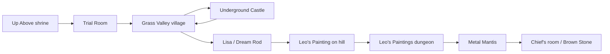

# Grass Valley (`grass_valley`)

*Part of the [Soul Blazer Documentation](../README.md) · code hub: [Soul Blazer Code Documentation](../code/README.md)*

> World index **0** (`MetaGrassValley`): the opening [Up Above and Trial Room](../walkthrough/01-in-the-beginning.md) lead into [Grass Valley](../walkthrough/02-grass-valley.md) (village, Underground Castle, Lisa's dream, Leo's Paintings) and the first boss, **Metal Mantis**.

**Source:** extracted actors under [`extracted/grass_valley/`](../../extracted/grass_valley/) (17 `.asm` files, grouped by area folder); the Master's shrine logic in [`extracted/actor_shared/shared_actor_helpers_bank0.asm`](../../extracted/actor_shared/shared_actor_helpers_bank0.asm) (`cm_npc_master_*`); enemy stats in [`extracted/system/WorldMetaPointers.asm`](../../extracted/system/WorldMetaPointers.asm) (`MetaGrassValley`); walkthrough [ch. 01](../walkthrough/01-in-the-beginning.md) and [ch. 02](../walkthrough/02-grass-valley.md), plus [sidequests](../walkthrough/sidequests.md) where noted.

---

## Overview

Grass Valley is the first full world in the walkthrough. After the title and prologue ([`gv_front_end`](../../extracted/grass_valley/front_end/gv_front_end.asm)), the player meets the Master in **Up Above**, names the hero ([`gv_up_above_actors_and_name_entry`](../../extracted/grass_valley/up_above/gv_up_above_actors_and_name_entry.asm)), completes the **Trial Room** for the Sword of Life, Flame Ball, and Soul of Magician ([`gv_up_above_trial_room_and_lisa_turbo_actors`](../../extracted/grass_valley/up_above/gv_up_above_trial_room_and_lisa_turbo_actors.asm)), then enters the village through the southern warp tile ([ch. 01](../walkthrough/01-in-the-beginning.md)). Chapter 2 alternates **Underground Castle** lairs ([`gv_underground_castle_*`](../../extracted/grass_valley/underground_castle/)), **Grass Valley** town scenes ([`gv_village_actors_*`](../../extracted/grass_valley/grass_valley_village/)), Lisa's story and dream, the hill painting ([`gv_obj_leos_painting_019475`](../../extracted/grass_valley/grass_valley_village/gv_village_actors_019475.asm)), and **Leo's Paintings** ([`gv_leos_paintings_*`](../../extracted/grass_valley/leos_paintings/)) until Metal Mantis falls and the chief grants the **Brown Stone** ([ch. 02](../walkthrough/02-grass-valley.md)).

The `grass_valley` block group holds **world index 0** scripts; `MetaGrassValley` is the type list the combat system uses for this world's actors (see [combat-damage-and-enemy-records.md](../code/combat-damage-and-enemy-records.md)). Conveyor belts and BG2 drift are shared across dungeon scenes via [`gv_multi_area_actors`](../../extracted/grass_valley/gv_multi_area_actors.asm) (meta type `$2C` / `$07`).

---

## Areas and scenes

Scene id = `area/scene` in hex (decimal ids in [`us/groups.json`](../../us/groups.json)). In-game banner names come from `LocationNameList` via `$1C6A` ([areas-and-scenes.md](../areas-and-scenes.md)); ROM spellings below are as the extractor prints them (apostrophe → space).

| Extracted folder / scene key | Scene | `loc` | ROM name (banner) | Walkthrough | Actor file(s) |
|---|---|---|---|---|---|
| `front_end/` (title, prologue, ending) | `00/0A` | `$10` | *(no banner string; front-end)* | Title / prologue ([ch. 01](../walkthrough/01-in-the-beginning.md)) | [`gv_front_end`](../../extracted/grass_valley/front_end/gv_front_end.asm), [`gv_title_texts`](../../extracted/grass_valley/front_end/gv_title_texts.asm), [`gv_prologue_texts`](../../extracted/grass_valley/front_end/gv_prologue_texts.asm), [`gv_epilogue_texts`](../../extracted/grass_valley/front_end/gv_epilogue_texts.asm) |
| `front_end/` | `00/0B` | `$11` | *(front-end)* | Ending crawl | `gv_front_end`, `gv_epilogue_texts` |
| `front_end/` | `00/0C` | `$12` | *(boot scene)* | — | `gv_front_end` ([boot-nmi-main-loop.md](../code/boot-nmi-main-loop.md)) |
| `up_above/grass_valley_shrine` | `00/01` | `$00` | Grass Valley Shrine | Up Above hub for this world | [`cm_npc_master_shrine_menu_00766C`](../../extracted/actor_shared/shared_actor_helpers_bank0.asm) (meta `$55`), `gv_up_above_actors_and_name_entry` |
| `up_above/trial_room` | `00/08` | `$0D` | Trial room | Trial Room | `gv_up_above_trial_room_and_lisa_turbo_actors` |
| `up_above/unnamed_0f` | `00/09` | `$0F` | *(empty)* | Up Above hub map (walkthrough: four paths) | `gv_up_above_actors_and_name_entry` (`gv_obj_up_above_map_walker_006E28`) |
| `up_above/unnamed_10` .. `unnamed_12` | `00/0A`–`00/0C` | `$10`–`$12` | *(empty)* | Overlap front-end scenes | `gv_front_end` (same `loc` ids as title / ending / boot) |
| `up_above/unnamed_13` | `00/0D` | `$13` | *(empty)* | Post-credits Lisa scene (not in FAQ) | `gv_up_above_trial_room_and_lisa_turbo_actors` (`gv_npc_lisa_epilogue_01B33A`) |
| `grass_valley_village/highlands` | `01/01` | `$01` | Grass Valley highlands | Grass Valley village | `gv_village_actors_018000`, `gv_village_actors_019475`, `gv_multi_area_actors` |
| `grass_valley_village/childs_secret_passage` | `01/02` | `$02` | Child s secret passage | Boss preparation cave | `gv_village_actors_019475` |
| `grass_valley_village/treasure_room` | `01/03` | `$03` | Treasure room | Elevator section chests | `gv_village_actors_019475` |
| `grass_valley_village/chiefs_room` | `01/04` | `$04` | The village Chief s room | Brown Stone after boss | `gv_village_actors_019475` |
| `underground_castle/west` | `02/01` | `$05` | Underground Castle, west | Underground Castle parts 1–2 | `gv_underground_castle_actors`, `gv_underground_castle_enemies`, `gv_multi_area_actors` |
| `underground_castle/east` | `02/02` | `$06` | Underground Castle, east | Parts 2–3; Leo's Brush chest | same |
| `underground_castle/lisas_dream` | `02/03` | `$0E` | Lisa s dream | Grass Valley – Lisa | `gv_underground_castle_actors` (`gv_npc_lisa_dream_01A440`) |
| `leos_paintings/paintings_1`–`3` | `03/01`–`03/03` | `$07`–`$09` | Leo s Paintings | Leo's Painting part 1 | `gv_leos_paintings_actors`, `gv_leos_paintings_enemies`, `gv_multi_area_actors` |
| `leos_paintings/tulips_dream` | `03/04` | `$0A` | Tulip s Dream | Optional tulip dream; metal hint | `gv_leos_paintings_actors` |
| `leos_paintings/paintings_4` | `03/05` | `$0B` | Leo s Paintings | Path to boss arena | `gv_leos_paintings_*` |
| `leos_paintings/metal_mantis` | `03/06` | `$0C` | Monster in the paintings | Metal Mantis boss | [`gv_boss_metal_mantis`](../../extracted/grass_valley/leos_paintings/gv_boss_metal_mantis.asm) (lair-spawned) |

Shrines for other worlds (`00/02`–`00/07`) use the same `cm_npc_master_*` patterns in [`shared_actor_helpers_bank0.asm`](../../extracted/actor_shared/shared_actor_helpers_bank0.asm); only the Grass Valley shrine (`00/01`, type `$55`) is in scope here.

---

## Actor files

| File | Role (from block notes) |
|---|---|
| [`gv_front_end.asm`](../../extracted/grass_valley/front_end/gv_front_end.asm) | Boot (`$5B`, scene `00/0C`), title/prologue (`$56`, `00/0A`), ending (`$57`, `00/0B`); SPC upload, Mode 7 title, file-select handoff |
| [`gv_title_texts.asm`](../../extracted/grass_valley/front_end/gv_title_texts.asm) | Title / save-slot strings |
| [`gv_prologue_texts.asm`](../../extracted/grass_valley/front_end/gv_prologue_texts.asm) | Fourteen intro pages |
| [`gv_epilogue_texts.asm`](../../extracted/grass_valley/front_end/gv_epilogue_texts.asm) | Ending pages, staff roll, "THE END" in epilogue scene |
| [`gv_up_above_actors_and_name_entry.asm`](../../extracted/grass_valley/up_above/gv_up_above_actors_and_name_entry.asm) | Master dialogue name entry (`gv_obj_name_entry_voice_00797B`); Up Above hub walker and warp markers (`00/09`) |
| [`gv_up_above_trial_room_and_lisa_turbo_actors.asm`](../../extracted/grass_valley/up_above/gv_up_above_trial_room_and_lisa_turbo_actors.asm) | Trial Magician (`gv_npc_magician_01A7AC`); epilogue Lisa/Turbo (`00/0D`) |
| [`gv_village_actors_018000.asm`](../../extracted/grass_valley/grass_valley_village/gv_village_actors_018000.asm) | Twelve village NPCs freed by Underground Castle lairs (types `$0B`–`16`) |
| [`gv_village_actors_019475.asm`](../../extracted/grass_valley/grass_valley_village/gv_village_actors_019475.asm) | Painting warp, chief, fairies, secret passage, goats, Clubhouse Pass tulip |
| [`gv_underground_castle_actors.asm`](../../extracted/grass_valley/underground_castle/gv_underground_castle_actors.asm) | Lisa dream, elevator (`$0404` water-mill flag), fairies, return-to-village prompt |
| [`gv_underground_castle_enemies.asm`](../../extracted/grass_valley/underground_castle/gv_underground_castle_enemies.asm) | Types `$21`–`25` (Yellow Humanoid through Blue Torch) |
| [`gv_enemy_green_humanoid.asm`](../../extracted/grass_valley/gv_enemy_green_humanoid.asm) | Type `$20` Green Humanoid (lair-only) |
| [`gv_leos_paintings_actors.asm`](../../extracted/grass_valley/leos_paintings/gv_leos_paintings_actors.asm) | Tulip dream, metal-sword fairy hint, HDMA gradients |
| [`gv_leos_paintings_enemies.asm`](../../extracted/grass_valley/leos_paintings/gv_leos_paintings_enemies.asm) | Types `$26`–`29`, `$2E`, `$2F` (paintings roster) |
| [`gv_boss_metal_mantis.asm`](../../extracted/grass_valley/leos_paintings/gv_boss_metal_mantis.asm) | Boss type `$1F`; lair record `$09` |
| [`gv_multi_area_actors.asm`](../../extracted/grass_valley/gv_multi_area_actors.asm) | Push-zone setup for Underground Castle and Leo's Paintings; village BG2 drift |
| [`gv_watching_over_world_texts.asm`](../../extracted/grass_valley/gv_watching_over_world_texts.asm) | Shared fairy "watching over the world" EXP lines |
| [`gv_unreferenced_string_stub_01A4F9.asm`](../../extracted/grass_valley/gv_unreferenced_string_stub_01A4F9.asm) | Unreferenced "I am dreaming." stub beside Lisa dream text |

---

## Roster

NPCs and gift givers by walkthrough name. Lair record indices match [`data_lair_records.asm`](../../extracted/system/data_lair_records.asm) (cited in block notes). The Master at the shrine is not a `grass_valley` file; he is `cm_npc_master_shrine_menu_00766C` in [`shared_actor_helpers_bank0.asm`](../../extracted/actor_shared/shared_actor_helpers_bank0.asm) (Record / Move / Quit after flag `$1B00`).

| Name | Label | Where | Grant / role | Walkthrough |
|---|---|---|---|---|
| Master (voice) | `cm_npc_master_shrine_menu_00766C` | `00/01` | Heal, save, warp hub | [01 – Up Above](../walkthrough/01-in-the-beginning.md) |
| Trial Magician | `gv_npc_magician_01A7AC` | Trial Room `00/08` | [Flame Ball](../walkthrough/magic.md), Soul of Magician (`souls_flags`, item `$11`) | [01 – Trial Room](../walkthrough/01-in-the-beginning.md) |
| Tool shop owner / son | `gv_npc_tool_shop_owner_018353`, `gv_npc_tool_shop_son_0191D2` | Village | Medical Herbs; [Goat's Food](../walkthrough/items.md) (`$19`) | [02 – Lisa](../walkthrough/02-grass-valley.md) |
| Water mill keeper | `gv_npc_water_mill_keeper_0186A2` | Village | Elevator flag `$0404`; [Master's Emblem A](../walkthrough/items.md) (`$2A`, flag `$1A00`) on tile (`$2F`,`$32`) | [02 – Elevator](../walkthrough/02-grass-valley.md); [sidequests](../walkthrough/sidequests.md) |
| Lisa (awake) | `gv_npc_lisa_018A59` | Village | Dream Rod story; [Leo's Brush](../walkthrough/items.md) quest | [02 – Lisa](../walkthrough/02-grass-valley.md) |
| Lisa (dream) | `gv_npc_lisa_dream_01A440` | `02/03` | Dream Rod scene; flag `$0104` | [02 – Lisa](../walkthrough/02-grass-valley.md) |
| Hill painting | `gv_obj_leos_painting_019475` | Village house | Warps with item `$1D` Leo's Brush | [02 – Leo's Painting](../walkthrough/02-grass-valley.md) |
| Village chief | `gv_npc_village_chief_01A098` | Chief's room | [Brown Stone](../walkthrough/items.md) (`$3A`) after switch `$09` | [02 – Rest of Grass Valley](../walkthrough/02-grass-valley.md) |
| Fairy (Recover Sword) | `gv_npc_fairy_recover_sword_01AB4F` | Village highlands | Item `$07` (dialogue: "Recover Sword") | [Metal Monsters sidequest](../walkthrough/sidequests.md) (completed later) |
| Fairy (80 EXP) | `gv_npc_fairy_exp_80_01AC06` | Treasure room | 80 EXP once (flag `$1C01`) | [02 – Elevator](../walkthrough/02-grass-valley.md) |
| Fairy (30 EXP) | `gv_npc_fairy_exp_30_01AC32` | Underground west | 30 EXP | [02 – Underground part 1](../walkthrough/02-grass-valley.md) |
| Tulip (Clubhouse Pass) | `gv_npc_tulip_clubhouse_pass_0197DA` | Village | [Clubhouse Pass](../walkthrough/items.md) (`$1B`, flag `$0206`) | [02 – Boss Preparation](../walkthrough/02-grass-valley.md) |
| Tulip (metal hint) | `gv_npc_fairy_metal_hint_01AD42` | Tulip's dream | Zantetsu Sword hint | [Metal Monsters](../walkthrough/sidequests.md) |

**Chests and fixed pickups** (walkthrough checklist; placement in [`data_chest_lists.asm`](../../extracted/system/data_chest_lists.asm) per [walkthrough crosswalk](../walkthrough-crosswalk.md) §4):

| Item | `loc`/chest | Walkthrough section |
|---|---|---|
| Sword of Life | Trial Room opening chest | [01 – Trial Room](../walkthrough/01-in-the-beginning.md) |
| Medical Herb | Underground west lair | [02 – part 1](../walkthrough/02-grass-valley.md) |
| 12 Gems | Underground west | [02 – part 1](../walkthrough/02-grass-valley.md) |
| Dream Rod | Underground west (`$05` area) | [02 – part 1](../walkthrough/02-grass-valley.md) |
| Iron Armor, 50 Gems | Treasure room `01/03` | [02 – Elevator](../walkthrough/02-grass-valley.md) |
| Leo's Brush | Underground east chest | [02 – part 3](../walkthrough/02-grass-valley.md) |
| Medical Herb | Leo's Paintings | [02 – part 1 / boss prep](../walkthrough/02-grass-valley.md) |
| Strange Bottle | Child's secret passage | [02 – Boss Preparation](../walkthrough/02-grass-valley.md) |

---

## Enemies

Stats: walkthrough tables in [ch. 01–02](../walkthrough/02-grass-valley.md) and [enemy-bestiary.md](../walkthrough/enemy-bestiary.md); ROM HP/EXP from `MetaGrassValley` rows in [`WorldMetaPointers.asm`](../../extracted/system/WorldMetaPointers.asm) (type = row index, e.g. `$1F` = Metal Mantis). Confidence: **A** = name and stats align; **B** = stats match a pool; **D** = known walkthrough vs ROM mismatch.

| Enemy | HP / EXP (walkthrough) | Meta / label | Conf. | Note |
|---|---|---|---|---|
| Green Humanoid | 3 / 1 | w0:`$20` `gv_enemy_green_humanoid_0FAA49` | A | Trial Room + Underground lairs |
| Yellow Humanoid | 4 / 2 | w0:`$21` `gv_enemy_yellow_humanoid_0FAA8F` | A | Spheres (child actors in same file) |
| Walking Bush | 3 / 1 | w0:`$22` `gv_enemy_walking_bush_0FAB9A` | A | Lair types in block note |
| Fly | 3 / 1 | w0:`$23` `gv_enemy_fly_0FAC31` | A | |
| Blue Liquid | 3 / 1 | w0:`$24` `gv_enemy_blue_liquid_0FAC7A` | A | |
| Blue Torch | 5 / 2 | w0:`$25` `gv_enemy_blue_torch_0FACF2` | A | Fireball via `cm_enemy_aimed_shot_*` |
| Yellow Knight | 9 / 5 | w0:`$26` `gv_enemy_yellow_knight_0FAD2A` | A | Leo's Paintings |
| Metal Crawler | 24 / 250 (metal) | w0:`$27` `gv_enemy_metal_crawler_0FAEE5` | A | Needs Zantetsu Sword ([sidequests](../walkthrough/sidequests.md)) |
| Purple Bird | 4 / 3 | w0:`$28` `gv_enemy_purple_bird_0FAF44` | A | w0:`$2E` shares stats (see OQ-I004-11) |
| Green Torch | 9 / 4 | w0:`$29` `gv_enemy_green_torch_0FAFAD` | A | |
| Monster Blocks | 4 / **2** | w0:`$2E` `gv_enemy_monster_blocks_0FB04F` | D | ROM EXP **3** (OQ-I004-4) |
| Spikes | — | w0:`$2F` `gv_enemy_spikes_0FB0D6` | C | Paintings traps; not in ch. 02 bestiary table |

---

## Boss and set pieces

| | Walkthrough | ROM (`MetaGrassValley` `$1F`) |
|---|---|---|
| Name | Metal Mantis | `gv_boss_metal_mantis_0031AD` |
| HP / EXP | 50 / 50 | 50 / 50 (`#06` / `#32` HP, `#32` EXP in meta row) |
| Arena | Leo's Painting boss room | Scene `03/06`, `loc` `$0C`; spawned by **lair record `$09`** (not a normal placement row) |
| Reward | Opens path; chief freed via switch `$09` | Frees `gv_npc_village_chief_01A098` |

Block note: fight arms `boss_fight_active`, map patch id 0, then loops on hero Y for fireball volleys vs arm strikes (`gv_boss_mantis_*` child actors). Walkthrough: sword-only damage on the red side of the conveyor; magic ignored; silver phase when off the belt — static script does not spell out silver immunity (OQ-I034-12).

**Dream / cutscene rooms:** Lisa's dream (`gv_npc_lisa_dream_01A440`, `02/03`); optional tulip dream (`gv_npc_tulip_dream_01A3B0`, `03/04`); post-game epilogue on `00/0D` (`gv_npc_lisa_epilogue_01B33A`, `gv_npc_turbo_01B967`). Prologue and ending text live in the three `front_end` text files.

---

## Sidequest and progression hooks

| Sidequest | In this world | Implementation |
|---|---|---|
| [Master's Emblem A](../walkthrough/sidequests.md) | Grass Valley only | `gv_npc_water_mill_keeper_0186A2`, flag `$1A00`, item `$2A` after wheel flag `$0404` |
| [Defeating Metal Monsters](../walkthrough/sidequests.md) | Metal Crawlers in Leo's Paintings; hint fairy in tulip dream; **Recovery Sword** pickup here | `gv_enemy_metal_crawler_0FAEE5`; `gv_npc_fairy_metal_hint_01AD42`; `gv_npc_fairy_recover_sword_01AB4F` (item granted when quest far enough — see ch. 06 in walkthrough) |
| Magic Bell (eight emblems) | Emblem A above | — |
| Brown Stone / six stones | Chief after boss | `gv_npc_village_chief_01A098`, flag `$1B00` enables Master **Move** menu (`cm_npc_master_*`) |

Progression flags called out in village notes include Lisa story flags `$0104`–`$0302`, painting flag `$0006`, and Underground elevator flag `$0404` (water mill ↔ `gv_obj_elevator_*`).

---

## Walkthrough cross-check

| Term | Walkthrough | ROM / code | Result |
|---|---|---|---|
| Monster Blocks EXP | 2 ([enemy-bestiary](../walkthrough/enemy-bestiary.md)) | w0:`$2E` EXP word `$0003` | mismatch, see **OQ-I004-4** |
| Lisa name | Lisa | Dialogue "Lisa"; dictionary may say `Liesa` | mismatch, see **OQ-I004-5** |
| Recovery Sword | [items.md](../walkthrough/items.md) | Fairy text "Recover Sword"; menu name per item table | mismatch, see **OQ-I004-6** / **OQ-I034-3** |
| Master's Emblem A | Master's Emblem A | String "the Master s Emblem A" (`gv_npc_water_mill_keeper_0186A2`) | mismatch, see **OQ-I004-6** |
| Up Above hub name | "Up Above" | `loc` `$0F`–`$13` have no `LocationNameList` row | unmatched, see **OQ-I001-6** |
| Four 3 HP / 1 EXP types | Distinct names in FAQ | Four meta rows `$20`–`24` with identical HP/EXP | pool, see **OQ-I004-11** (labels resolved via lairs) |

---

## Open questions

| ID | Summary |
|---|---|
| OQ-I001-6 | Up Above `loc` `$0F`–`$13` (scenes `00/09`–`00/0D`) lack banner strings; hub role partly in `gv_obj_up_above_map_walker_006E28` |
| OQ-I004-4 | Monster Blocks walkthrough EXP 2 vs meta EXP 3 |
| OQ-I004-5 | Dictionary `Liesa` / `Deathtole` vs walkthrough Lisa / Deathtoll |
| OQ-I004-6 | Item and emblem display names vs walkthrough (`Recover Sword`, `Emblem A`, `Leaves`, etc.) |
| OQ-I004-11 | Stat-tied enemy pools (four early humanoids; Purple Bird vs type `$2E`) |
| OQ-I034-3 | Recover Sword dialogue vs Recovery Sword (overlap with OQ-I004-6) |
| OQ-I034-12 | Metal Mantis silver immunity phase vs script readability |
| OQ-I034-14 | Hub scene `00/09` boss marker switches `$00B6` / `$012F` |

No new **OQ-I058-?** candidates beyond section 14 and the rows above.

---

## See Also

- [Soul Blazer Code Documentation](../code/README.md) (hub)
- [boot-nmi-main-loop.md](../code/boot-nmi-main-loop.md) (title `loc` `$10`–`$12`, `gv_front_end`)
- [scene-area-warp-loading.md](../code/scene-area-warp-loading.md), [actor-system.md](../code/actor-system.md)
- [combat-damage-and-enemy-records.md](../code/combat-damage-and-enemy-records.md) (`MetaGrassValley`), [data-tables.md](../code/data-tables.md) (lair records)
- [flags-switches-and-inventory-bytes.md](../code/flags-switches-and-inventory-bytes.md), [text-and-dialogue.md](../code/text-and-dialogue.md)
- [Walkthrough ch. 01](../walkthrough/01-in-the-beginning.md), [ch. 02](../walkthrough/02-grass-valley.md), [sidequests](../walkthrough/sidequests.md), [items](../walkthrough/items.md), [magic](../walkthrough/magic.md), [enemy-bestiary](../walkthrough/enemy-bestiary.md)
- [areas-and-scenes.md](../areas-and-scenes.md), [walkthrough-crosswalk.md](../walkthrough-crosswalk.md)
- Next world: [greenwood.md](greenwood.md)