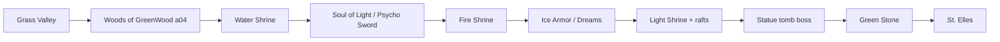

# GreenWood (`greenwood`)

*Part of the [Soul Blazer Documentation](../README.md) · code hub: [Soul Blazer Code Documentation](../code/README.md)*

> World 1: the animal refuge **Woods of GreenWood** and the adjoining **Lostside** marsh shrines, culminating in the **Light, Water, and Fire Statues** boss and the **Green Stone** reward ([chapter 03](../walkthrough/03-greenwood.md)).

**Source:** extracted scripts under [`extracted/greenwood/`](../../extracted/greenwood/) (eight files), walkthrough [03-greenwood.md](../walkthrough/03-greenwood.md), enemy stats in [`MetaGreenwood`](../../extracted/system/WorldMetaPointers.asm) (world index `1`).

---

## Overview

GreenWood is the second overworld block group (`greenwood` in `us/blocks.json`, world index **1**). The walkthrough alternates between the town-like **Woods of GreenWood** (area `04`) and the dungeon **Lostside, A Marsh** (area `05`): Water Shrine → soul and items in the woods → Fire Shrine (including **Light Arrow** magic) → **Ice Armor** → **Leaves of GreenWood** → Light Shrine → boss prep in the woods → **Tomb of a stone statue** boss fight → **Guardian of the Woods** and the **Green Stone**, then warp east to St. Elles.

The `greenwood` group holds **eight** actor/asm units: two woods files (`gw_woods_actors_01B98D`, `gw_woods_actors_01D045`), marsh actors and enemies, the statue boss, shared fairy strings, an unused fixed-gem spawner, and two unplaced enemy prototypes in `gw_enemies_without_placement`. Combat data for every placed monster and freed animal in areas 4–5 is indexed through **`MetaGreenwood`** in [`WorldMetaPointers.asm`](../../extracted/system/WorldMetaPointers.asm) (see [combat-damage-and-enemy-records.md](../code/combat-damage-and-enemy-records.md)).

## Areas and scenes

Scene ids are `(area << 8) | scene` hex (`AA/SS`); location names use id `$1C6A` from [`LocationNameList`](../../extracted/library/lib_banner_texts.asm) (extractor spelling). Details: [areas-and-scenes.md](../areas-and-scenes.md).

| Folder / scene key | `AA/SS` | `loc` | ROM location name (printed) | Walkthrough section | Primary actor file(s) |
| --- | --- | --- | --- | --- | --- |
| `up_above/greenwood_shrine` | `00/02` | `14` | GreenWood Shrine | Master's Shrine of GreenWood | Shared [`cm_npc_master_shrine_menu_00766C`](../../extracted/actor_shared/shared_actor_helpers_bank0.asm) (`MetaGreenwood` type `$4C`; scene scripts live outside this group) |
| `woods_of_greenwood/woods` | `04/01` | `15` | Woods of GreenWood | Woods arrivals, theater, animals | [`gw_woods_actors_01B98D`](../../extracted/greenwood/woods_of_greenwood/gw_woods_actors_01B98D.asm), [`gw_woods_actors_01D045`](../../extracted/greenwood/woods_of_greenwood/gw_woods_actors_01D045.asm) |
| `woods_of_greenwood/moles_hole` | `04/02` | `16` | A mole s hole | Mole hole, Monmo, ribbon ghost | `gw_woods_actors_01D045` |
| `woods_of_greenwood/squirrels_house` | `04/03` | `17` | A squirrel s house | Squirrel hollows | `gw_woods_actors_01D045` |
| `woods_of_greenwood/squirrel_exchanger` | `04/04` | `18` | Squirrel, the Exchanger | Psycho Sword trade | `gw_woods_actors_01D045` |
| `woods_of_greenwood/birds_dream` | `04/05` | `23` | Bird s Dream | Turbo backstory dream | `gw_woods_actors_01D045` |
| `woods_of_greenwood/stumps_dream` | `04/06` | `24` | Stump s Dream | Dream Rod stump puzzle | `gw_woods_actors_01D045` |
| `lostside_marsh/marsh` | `05/01` | `19` | Lostside, a marsh | Exterior, rafts, 150 EXP fairy | [`gw_lostside_marsh_actors`](../../extracted/greenwood/lostside_marsh/gw_lostside_marsh_actors.asm), [`gw_lostside_marsh_enemies`](../../extracted/greenwood/lostside_marsh/gw_lostside_marsh_enemies.asm) |
| `lostside_marsh/water_shrine_1`–`3` | `05/02`–`04` | `1A`–`1C` | Water Shrine | Lostside Part 1 | marsh actors + enemies |
| `lostside_marsh/fire_shrine_1`–`3` | `05/05`–`07` | `1D`–`1F` | Fire Shrine | Parts 2–3, Light Arrow fairy | marsh actors + enemies |
| `lostside_marsh/light_shrine_1`–`2` | `05/08`–`09` | `20`–`21` | Light Shrine | Part 4, Spirit Ball barriers | marsh actors + enemies |
| `lostside_marsh/statue_tomb` | `05/0A` | `22` | Tomb of a stone statue | Boss arena | [`gw_boss_light_water_fire_statues`](../../extracted/greenwood/lostside_marsh/gw_boss_light_water_fire_statues.asm) |

## Actor files

| File | Role | Block-note highlights |
| --- | --- | --- |
| [`gw_woods_actors_01B98D.asm`](../../extracted/greenwood/woods_of_greenwood/gw_woods_actors_01B98D.asm) | Fifteen surface animals in `04/01` | Meta types `$0D`–`$1B`; lair switches `$37`–`$72`; restaurant dog, Woodstin-Trio deer, **Red-Hot Mirror** bird, **Magic Bell** deer, Dream Rod targets |
| [`gw_woods_actors_01D045.asm`](../../extracted/greenwood/woods_of_greenwood/gw_woods_actors_01D045.asm) | Trio, moles, Guardian, dreams, exchangers | Billy shuffle (`$0003`–`$0007`), **Soul of Light** / **Leaves**, **Green Stone** Guardian (switch `$50`), **Master's Emblem C**, **Phoenix** hint bird |
| [`gw_lostside_marsh_actors.asm`](../../extracted/greenwood/lostside_marsh/gw_lostside_marsh_actors.asm) | Fairies, rafts, **Strange Bottle**, fire-bridge heat | Four fairy gems (`$3F`–`$41`, `$4D`); raft system `$39`–`$3C`; `gw_trigger_strange_bottle_01E47B` on tile `($0F,$15)` in Water Shrine 3 |
| [`gw_lostside_marsh_enemies.asm`](../../extracted/greenwood/lostside_marsh/gw_lostside_marsh_enemies.asm) | All marsh/shrine combatants | Meta types `$2C`–`$38`, `$48`–`$49`; lair pools per `data_lair_records` (world 1 range in [data-tables.md](../code/data-tables.md)) |
| [`gw_boss_light_water_fire_statues.asm`](../../extracted/greenwood/lostside_marsh/gw_boss_light_water_fire_statues.asm) | Three-statue boss (`$3D`) | Formation lair record `$50` at `05/0A`; sequential `boss_actor` hand-off; switch `$50` frees Guardian |
| [`gw_watching_over_world_return_prompt_texts.asm`](../../extracted/greenwood/gw_watching_over_world_return_prompt_texts.asm) | Shared fairy EXP / return strings | Ends most animal and fairy dialogues |
| [`gw_actor_fixed_gem_pickup.asm`](../../extracted/greenwood/gw_actor_fixed_gem_pickup.asm) | Unused meta `$3E` gem spawner | No placement in areas 4–5 (gems are chests) |
| [`gw_enemies_without_placement.asm`](../../extracted/greenwood/gw_enemies_without_placement.asm) | Meta `$34`, `$36` leftovers | Documented unused; OQ-I035-11 |

## Roster

Animals use **COP 14** (appear after lair switch) or **COP 3B** (captive plea) as described in the woods block notes; freed creatures tie to **`data_lair_records`** switch words in `$1ADE`.

### Items, magic, and souls (walkthrough grants)

| Walkthrough name | Label | Where | Grant / flag | Walkthrough |
| --- | --- | --- | --- | --- |
| Psycho Sword | `gw_npc_squirrel_exchanger_01E005` | `04/04` | Trades for equipped **Delicious Seeds** (item `$25`) | Soul of Light |
| Soul of Light (soul) | `gw_npc_mole_soul_of_light_01D6AB` | `04/02` / hole | Joins party; souls_flags bit `$02`, flag `$0303` | Soul of Light |
| Ice Armor | chest `15/0C` | `04/01` | [`ChestListLoc15`](../../extracted/system/data_chest_lists.asm) | Ice Armor |
| Leaves of GreenWood | `gw_npc_mole_soul_of_light_01D6AB` (`code_01D803`) | `04/02` | Pickup at dog bones; flag `$0304` | Leaves |
| Light Arrow | `gw_npc_fairy_gem_light_arrow_01E540` | `05/07` | Magic item `$12`; flag `$1C07` | Lostside Part 2 |
| Mole's Ribbon | chest `16/0D` | `04/02` | [`ChestListLoc16`](../../extracted/system/data_chest_lists.asm) | Boss Preparation |
| Shield Bracelet | `gw_npc_mole_roommate_bracelet_01DBE5` | `04/02` | After ghost takes ribbon (`$0403`) | Boss Preparation |
| Master's Emblem C | `gw_npc_squirrel_master_emblem_c_01E1C0` | `04/03` | Item `$2C`; flag `$1A02` | Boss Preparation |
| Green Stone | `gw_npc_guardian_of_the_woods_01D4F9` | `04/01` | After boss switch `$50`; flag `$0507` | Conclusion |
| Strange Bottle | `gw_trigger_strange_bottle_01E47B` | `05/04` | Hidden tile; flag `$0906` | Lostside Part 1 |
| Red-Hot Mirror | `gw_npc_bird_shy_red_hot_mirror_01BDE5` | `04/01` | Item `$32` if Phoenix (`$18`) not owned | Spirit Monsters hook (bird freed Light Shrine lair `$37`) |
| Magic Bell | `gw_npc_deer_master_emblems_01BF32` (fairy child) | `04/01` | All emblems `$2A`–`$31` → item `$40` | [sidequests.md](../walkthrough/sidequests.md) (collection starts here) |

### Notable NPCs and set pieces

| Name | Label | Where | Notes |
| --- | --- | --- | --- |
| Woodstin-Trio (Billy) | `gw_npc_squirrel_billy_01D045`, `gw_npc_deer_woodstin_trio_01BB3F`, `gw_npc_dog_woodstin_trio_01D2F3` | `04/01` | Medical Herb prize; event flags `$0000`–`$0007` |
| Turbo / grave bird | `gw_npc_bird_turbo_grave_01C98A`, `gw_npc_turbo_ghost_01E2FB` | `04/01`, `04/05` | Dream Rod; raft hint after ghost (`$0402`) |
| Monmo | `gw_npc_mole_monmo_01DDB7` | `04/01` → hole `$72` | Flag `$0307` at home tile |
| Phoenix hint | `gw_npc_bird_phoenix_hint_01D615` | `04/01` | Switch `$64` (Metal Scorpion lair, Fire Shrine) | [items.md](../walkthrough/items.md) Phoenix quest |
| Fairy EXP | `gw_npc_fairy_gem_exp_150_01E4C3`, `gw_npc_fairy_gem_exp_180_01E510` | `05/01`, `05/03` | 150 / 180 EXP; flags `$1C05`, `$1C06` |

### Chest treasures (walkthrough checklist)

From [`data_chest_lists.asm`](../../extracted/system/data_chest_lists.asm) and chapter 03 (loc / chest id):

| Loc | Chest id | Content (walkthrough) |
| --- | --- | --- |
| `1A` | `0B` | 50 Gems |
| `1B` | `0E`, `0F` | 150 Gems, Medical Herb |
| `1C` | `10`, `11` | Delicious Seeds, 50 Gems |
| `1D` | `12` | Medical Herb (Fire Shrine) |
| `1F` | `15`, `16` | 100 Gems, 60 Gems |
| `20` | `42` | Flame Pillar (Spirit Monsters sidequest chest; see crosswalk loc `20`) |

Gems and herbs elsewhere match walkthrough tallies; empty placeholder chest in Fire Shrine B1F is a map patch, not a list row.

## Enemies

Stats below are **walkthrough** HP / EXP from [03-greenwood.md](../walkthrough/03-greenwood.md) and [enemy-bestiary.md](../walkthrough/enemy-bestiary.md). ROM records are **`MetaGreenwood` meta type** rows (attack/defence/HP/EXP BCD). Actor scripts are in `gw_lostside_marsh_enemies.asm` unless noted.

| Walkthrough name | HP, EXP (guide) | Meta type · actor label | Confidence | Note |
| --- | --- | --- | --- | --- |
| Water Lizard | 10, 10 | w1:`$2C` · `gw_enemy_water_lizard_0FB0F5` | A | Marsh + Water Shrine placements |
| Mud Man | 12, 11 | w1:`$2D` · `gw_enemy_mud_man_0FB302` | A | |
| Walking Plant | 6, 12 | w1:`$2E` · `gw_enemy_walking_plant_0FB348` | A | Vine children via COP 85 |
| Stone Statue | 13, 12 | w1:`$2F` · `gw_enemy_stone_statue_0FB433` | A | |
| Purple Flower | 3, 6 | w1:`$30` · `gw_enemy_purple_flower_0FB561` | A | |
| Bee / Purple Flower's Bee | 3, 6 | w1:`$30` child `code_0FB57F` | B | Same stats in ROM; walkthrough splits names (OQ-I004-11, OQ-I004-15) |
| Spirit Ball | 40, 1100 | w1:`$33` · `gw_enemy_spirit_ball_0FB5E3` | A | Immunity `$0800` until Spirit Sword |
| Ghost Head | 8, 14 | w1:`$35` · `gw_enemy_ghost_head_0FB695` | A | |
| Green Lizard Man | 8, 14 | w1:`$37`/`$38` · `gw_enemy_lizard_man_chaser_0FB898`, `gw_enemy_lizard_man_wanderer_0FB8DE` | B | ROM 12/12 and 15/15 EXP vs guide 8/14 (OQ-I035-1) |
| Fire Man | 12, 13 | w1:`$48` · `gw_enemy_fire_man_0FB9D6` | A | |
| Metal Scorpion | 30, 350 | w1:`$49` · `gw_enemy_metal_scorpion_0FBABC` | A | Metal bit `$0400`; Psycho Sword paralyze |
| *(floor spears)* | — | w1:`$31` · `gw_enemy_floor_spears_0FB59C` | U | Water Shrine only; no bestiary row (OQ-I035-2) |
| *(unused still/turret)* | — | w1:`$34`/`$36` in `gw_enemies_without_placement` | U | No lair/placement (OQ-I035-11) |

Shared homing shots: [`cm_enemy_aimed_shot_mover_002D96`](../../extracted/actor_shared/shared_actor_helpers_bank0.asm), [`cm_enemy_aimed_shot_body_002D67`](../../extracted/actor_shared/shared_actor_helpers_bank0.asm).

## Boss and set pieces

**Light, Water, and Fire Statues** ([03-greenwood.md § Boss](../walkthrough/03-greenwood.md)): walkthrough **50 HP** and **30 EXP** each (150 / 90 total). ROM meta type **`$3D`** (`MetaGreenwood` row w1:`$3D`): **9** attack, **5** defence, **50** HP, EXP BCD **`$0030`** per statue — matches the guide totals.

| Topic | Detail |
| --- | --- |
| Arena | `05/0A`, loc `22` *Tomb of a stone statue* |
| Actor | `gw_boss_light_water_fire_statues_0033C6` (one root; COP A5 splits by placement flip) |
| Phases | Light (T-bolts) → Water (puddles, flag byte 0 counter) → Fire (flame streams); only one active `boss_actor` |
| End | Last statue death runs `RunBossDeath`; player clears northwest lair **switch `$50`** to spawn **Guardian of the Woods** |
| Reward | `gw_npc_guardian_of_the_woods_01D4F9` grants **Green Stone**; epilogue text at Turbo's grave uses flag `$1F02` after ending |

**Dream rooms:** `04/05` Bird's Dream (`gw_npc_bird_birds_dream_01E241`, Turbo ghost `gw_npc_turbo_ghost_01E2FB`); `04/06` Stump's Dream (`gw_npc_bird_stumps_dream_01E3E2`). **Soul of Light** HDMA effect: meta `$2A` → `RunSoulOfLightEffect` (Light Shrine darkness).

## Sidequest and progression hooks

| Sidequest ([sidequests.md](../walkthrough/sidequests.md)) | Implementation in this world |
| --- | --- |
| **Master's Emblem C** | `gw_npc_squirrel_master_emblem_c_01E1C0` (`04/03`); fairy at `gw_npc_deer_master_emblems_01BF32` explains all eight emblems and later **Magic Bell** exchange |
| **Spirit Monsters → Red-Hot Mirror** | `gw_npc_bird_shy_red_hot_mirror_01BDE5` (freed lair switch `$37`, Light Shrine Spirit Balls); chest at loc `20` for **Flame Pillar** per crosswalk |
| **Phoenix** (three symbols) | Hint: `gw_npc_bird_phoenix_hint_01D615` (Metal Scorpion lair `$64`); mirror bird tests items `$18` / `$32` |
| **Magic Bell** | Deer fairy `gw_npc_deer_master_emblems_01BF32` — not obtainable until all emblems collected (final emblem elsewhere) |
| **Fairy gem EXP** | Standard template `cm_npc_fairy_gem_setup_01B161`; return warp to `04/01` at (`$02E0`,`$01A0`) |

Progression gates: **Soul of Light** for Light Shrine B1F darkness; **Ice Armor** (`15/0C`) for fire bridges (`gw_effect_fire_bridge_heat_01E98D`); **Leaves** (item `$1E`) checked by `gw_raft_leaves_check_01E62A` for marsh rafts.

## Walkthrough cross-check

| Term | Walkthrough | ROM / code | Result |
| --- | --- | --- | --- |
| Boss HP / EXP | 50 HP, 30 EXP each | Meta `$3D`: 50 HP, EXP `$0030` | consistent |
| Green Lizard Man stats | 8 HP, 14 EXP | Meta `$37`/`$38`: 12/12 and 15/15 | mismatch, see **OQ-I035-1** |
| Bee vs flower | Separate bestiary rows | Single meta `$30`; bee is child `code_0FB57F` | mismatch, see **OQ-I004-11** |
| Master's Emblem C print | Master's Emblem C | Item string `the Master s Emblem C` | mismatch, see **OQ-I004-6** |
| Red-Hot Mirror print | Red-Hot Mirror | `the Red+Hot Mirror` (font `+`) | encoding artefact; not a discrepancy |
| Statue positions (L/R) | Water far right, Fire middle | Formation `$20` flip routing (block note) | mismatch, see **OQ-I035-13** |
| Walkthrough "Lizard Men" | Prose name | Labels `gw_enemy_lizard_man_*` | mismatch, see **OQ-I004-15** |
## Open questions

| Id | Summary |
| --- | --- |
| OQ-I004-6 | Item dialogue spelling vs walkthrough (Emblems, possessives) |
| OQ-I004-11 | Pool rows sharing HP/EXP (flower/bee, ghost/lizard man) |
| OQ-I004-12 | Full lair roster ↔ walkthrough area tables; fairy EXP sourcing |
| OQ-I004-15 | Canonical walkthrough enemy/item variant names |
| OQ-I035-1 | Green Lizard Man ROM stats vs bestiary |
| OQ-I035-2 | Floor spear EXP `$3000` and killability |
| OQ-I035-9 | Whether "Tiki" is the grave/raft bird |
| OQ-I035-11 | Unused meta types `$34`, `$36`, `$3E` |
| OQ-I035-13 | Water vs Fire statue screen position vs walkthrough |
| OQ-I035-17 | Return-only fairy grants 1 EXP every talk |

---

## See Also

- Code hub: [../code/README.md](../code/README.md) — [actor-system.md](../code/actor-system.md), [scene-area-warp-loading.md](../code/scene-area-warp-loading.md), [combat-damage-and-enemy-records.md](../code/combat-damage-and-enemy-records.md), [data-tables.md](../code/data-tables.md), [text-and-dialogue.md](../code/text-and-dialogue.md), [flags-switches-and-inventory-bytes.md](../code/flags-switches-and-inventory-bytes.md)
- Walkthrough: [03-greenwood.md](../walkthrough/03-greenwood.md), [sidequests.md](../walkthrough/sidequests.md), [items.md](../walkthrough/items.md), [magic.md](../walkthrough/magic.md), [enemy-bestiary.md](../walkthrough/enemy-bestiary.md), [walkthrough-crosswalk.md](../walkthrough-crosswalk.md)
- Worlds: previous [grass_valley.md](grass_valley.md) · next [st_elles.md](st_elles.md)
- [areas-and-scenes.md](../areas-and-scenes.md), [../cop/index.md](../cop/index.md)