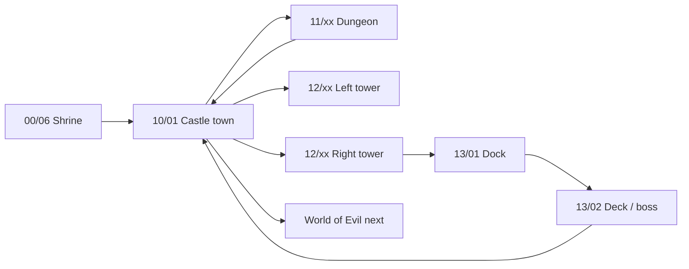

# King Magridd's Castle (`magridds_castle`)

*Part of the [Soul Blazer Documentation](../README.md) · code hub: [Soul Blazer Code Documentation](../code/README.md)*

> World index **5** (`MetaMagriddsCastle`): [chapter 7](../walkthrough/07-king-magridds-castle.md) covers the castle town, dungeon, towers, airship dock, and final world boss **Demon Falcon**.

**Source:** nine extracted blocks under [`extracted/magridds_castle/`](../../extracted/magridds_castle/); enemy and boss stats in [`MetaMagriddsCastle`](../../extracted/system/WorldMetaPointers.asm); walkthrough [ch. 07](../walkthrough/07-king-magridds-castle.md) and [sidequests](../walkthrough/sidequests.md) where noted.

---

## Overview

After Dr. Leo's Laboratory, the player returns to **Up Above** and enters the Magridd shrine (`00/06`, `loc` `$64`), then the restored **Castle of King Magridd** town (`10/01`, `loc` `$65`). The walkthrough alternates the castle surface (keys, armor, souls, emblem H, pre-boss gear) with three dungeon areas: **torture chamber and basements** (`11/01`–`11/03`), **left and right towers** (`12/01`–`12/07`), and **airship dock / deck / soldier's dream** (`13/01`–`13/03`). Clearing lairs frees soldiers, the Queen, Dr. Leo, and King Magridd; equipping passes opens the towers; the dock cutscene grants the **Mobile Key**; the **Demon Falcon** fight on the airship deck ends with the **Black Stone** and the last Master's-shrine portal before the World of Evil.

The `magridds_castle` group holds **world index 5** scripts (meta list `MetaMagriddsCastle`, 62 type rows). Combat enemies live in bank `$1F` (`mc_castle_dungeon_enemies.asm`, `mc_castle_towers_enemies.asm`); town and set-piece actors are in bank `$04`; the boss script is in bank `$00` with other bosses.

---

## Areas and scenes

Scene id = `area/scene` in hex ([`us/groups.json`](../../us/groups.json), [areas-and-scenes.md](../areas-and-scenes.md)). ROM banner names follow `LocationNameList` (apostrophe → space in extracted text).

| Extracted folder / scene key | Scene | `loc` | ROM name (banner) | Walkthrough | Actor file(s) |
|---|---|---|---|---|---|
| `up_above/magridd_castle_shrine` | `00/06` | `$64` | Magridd Castle Shrine | Master's Shrine (Magridd Castle) | Shared Master shrine actors (not in `magridds_castle/`) |
| `castle_of_magridd/castle` | `10/01` | `$65` | Castle of King Magridd | Castle of King Magridd (town) | [`mc_castle_actors.asm`](../../extracted/magridds_castle/castle_of_magridd/mc_castle_actors.asm) |
| `castle_dungeon/torture_chamber` | `11/01` | `$66` | The torture chamber | Castle Dungeon Part 1 | `mc_castle_dungeon_actors.asm`, [`mc_castle_dungeon_enemies.asm`](../../extracted/magridds_castle/castle_dungeon/mc_castle_dungeon_enemies.asm) |
| `castle_dungeon/basement_1` | `11/02` | `$67` | Basement of the castle | Part 2 (B2F) | same |
| `castle_dungeon/basement_2` | `11/03` | `$68` | Basement of the castle | Part 3 (B3F; Emblem B) | same (`mc_obj_floor_spikes_026F30`) |
| `castle_dungeon/dream` | `11/04` | `$69` | A dream 1 | *(unnamed in FAQ)* | No actor file in group; empty chest list |
| `castle_towers/left_tower_1` | `12/01` | `$6A` | The left tower | Left Tower 1F | `mc_castle_towers_actors.asm`, [`mc_castle_towers_enemies.asm`](../../extracted/magridds_castle/castle_towers/mc_castle_towers_enemies.asm) |
| `castle_towers/left_tower_2` | `12/02` | `$6B` | The left tower | Left Tower 2F | same |
| `castle_towers/prison` | `12/03` | `$6C` | A prison | Left Tower 3F (Prison) | `mc_castle_towers_actors.asm` (`mc_npc_fairy_chest_hint_026DD7`) |
| `castle_towers/right_tower_1` | `12/04` | `$6D` | The right tower | Right Tower 1F | `mc_castle_towers_enemies.asm` |
| `castle_towers/right_tower_2` | `12/05` | `$6E` | The right tower | Right Tower 2F | same |
| `castle_towers/right_tower_3` | `12/06` | `$6F` | The right tower | Right Tower 3F | same |
| `castle_towers/dock_corridor` | `12/07` | `$70` | A corridor to the dock | Right Tower 4F (corridor) | `mc_castle_towers_actors.asm` (`mc_towers_bg2_scroll_x_026F44`) |
| `airship_dock/dock` | `13/01` | `$71` | The dock for an airship | Airship Dock cutscene | [`mc_airship_dock_actors.asm`](../../extracted/magridds_castle/airship_dock/mc_airship_dock_actors.asm) |
| `airship_dock/deck` | `13/02` | `$72` | The deck of an airship | Demon Falcon arena | same; [`mc_boss_demon_falcon.asm`](../../extracted/magridds_castle/airship_dock/mc_boss_demon_falcon.asm) |
| `airship_dock/soldiers_dream` | `13/03` | `$73` | A soldier s dream | Elemental Mail dream (soldier) | `mc_airship_dock_actors.asm` (`mc_dream_soldier_dialogue_026A4E`) |

---

## Actor files

| File | Role (from block notes) |
|---|---|
| [`mc_castle_actors.asm`](../../extracted/magridds_castle/castle_of_magridd/mc_castle_actors.asm) | A10S01 town roster (meta types `$18`–`$30`): soldiers, Queen, singers, maids, King; lair switches `$159`–`$195`; flags `$0803`–`$0806`, `$0703`, `$0607`/`$0700`, `$1A07`, `$1B05` |
| [`mc_castle_dungeon_actors.asm`](../../extracted/magridds_castle/castle_dungeon/mc_castle_dungeon_actors.asm) | Harp string pickup (`$0702`), basement fairy (`lair $163`), floor spikes when Elemental Mail (`$0F`) is not equipped |
| [`mc_castle_dungeon_enemies.asm`](../../extracted/magridds_castle/castle_dungeon/mc_castle_dungeon_enemies.asm) | Meta types `$0A`–`$10`: spears, statues, lair monsters (Bouncing Ball, Wraithe, Green Snake, Skeleton Soldier) |
| [`mc_castle_towers_actors.asm`](../../extracted/magridds_castle/castle_towers/mc_castle_towers_actors.asm) | Prison fairy + return prompt; corridor BG2 scroll |
| [`mc_castle_towers_enemies.asm`](../../extracted/magridds_castle/castle_towers/mc_castle_towers_enemies.asm) | Meta types `$11`–`$17`: knights, robots, Mimics, statue shooters, props |
| [`mc_airship_dock_actors.asm`](../../extracted/magridds_castle/airship_dock/mc_airship_dock_actors.asm) | Dock cutscene chain (flags `$0000`–`$0902`, `$0805`), dream scene, key wheel, deck scroll / push zones |
| [`mc_boss_demon_falcon.asm`](../../extracted/magridds_castle/airship_dock/mc_boss_demon_falcon.asm) | Boss type `$09`; lair record `$195` on `loc` `$72` |
| [`mc_return_prompt_and_chest_hint_texts.asm`](../../extracted/magridds_castle/mc_return_prompt_and_chest_hint_texts.asm) | Shared fairy hints and “return to the outside of Magridd Castle” prompt |
| [`mc_unreferenced_string_stub_02623C.asm`](../../extracted/magridds_castle/mc_unreferenced_string_stub_02623C.asm) | Empty stub string (no references) |

---

## Roster

Town NPCs are released by dungeon/tower lairs ([`data_lair_records.asm`](../../extracted/system/data_lair_records.asm)); indices below are from `mc_castle_actors.asm` block notes.

| Walkthrough name | Label | Where | Grant / role | Walkthrough section |
|---|---|---|---|---|
| Ghost soldier (Spirit Sword hint) | `mc_npc_soldier_ghost_hint_023FA8` | Town | Hints torture room; lair `$159` | Part 1 |
| Gaudi's nephew | `mc_npc_soldier_gaudi_nephew_024027` | Town | Dialogue; lair `$15A` | — |
| Elemental Mail sleeper | `mc_npc_soldier_elemental_mail_024259` | Town | Dream Rod → A13S03; gives item `$0F` after flag `$0803` | Elemental Mail |
| Theater singer | `mc_npc_singer_theater_harp_024597` | Town | Harp string (`$1A`, flag `$0703`) → performance | Platinum Card |
| Theater guard / Platinum Card | `mc_npc_soldier_theater_guard_024BC8`, `mc_obj_platinum_card_pickup_024C32` | Town | Item `$28`; flag `$0607` | Platinum Card |
| Queen Magridd | `mc_npc_queen_vip_card_02494A` | Town | VIP Card `$29`; later Super Bracelet `$37` on tile (`mc_npc_queen_gone_bracelet_024978`) | VIP Card; Boss Preparations |
| Left / Right tower guards | `mc_npc_soldier_platinum_gate_guard_024AF4`, `mc_npc_soldier_vip_gate_guard_025080` | Town | Gates need `$28` / `$29`; flags `$0607`, `$0700` | Parts 4, 6 |
| Soul of Reality companion | `mc_npc_soldier_soul_of_reality_0251DC` | Town | Sets `souls_flags` bit `$10`; HDMA effect meta `$04` | Soul of Reality |
| Emblem H soldier | `mc_npc_soldier_emblem_h_025302` | Town | Tile (`$25`,`$0C`): item `$31`, flag `$1A07` | Boss Preparations |
| King Magridd | `mc_npc_king_magridd_025561` | Town | Black Stone `$3F` after boss; lair `$195` / Demon Falcon | Conclusion |
| Harp string (body) | `mc_obj_harp_string_pickup_0269F6` | A11S01 | Item `$1A` | Part 1 |
| Dungeon fairy | `mc_npc_fairy_dungeon_hint_026E9D` | A11S02 | Hint + return prompt; lair `$163` | *(ROM-only text, OQ-I039-10)* |
| Prison fairy | `mc_npc_fairy_chest_hint_026DD7` | A12S03 | Chest hint + return prompt; lair `$184` | Part 5 (Fairy Gem) |
| Dr. Leo (dock) | `mc_dock_dr_leo_025E61` | A13S01 | Speeches; Mobile Key `$23` via `mc_dock_dr_leo_key_handover_025F43` | Airship Dock |
| Lisa | `mc_dock_lisa_question_02670A` | A13S01 / deck return | Yes/No after boss (flag `$0902`) | Conclusion |
| Airship key wheel | `mc_dock_key_wheel_026F57` | A13S01 → A13S02 | Needs Mobile Key equipped | Boss |

**Souls / effects:** recruiting the Soul of Reality soldier enables meta type `$04` → [`RunSoulOfRealityEffect`](../../extracted/library/lib_hdma_window_effects.asm) (hidden tiles and Emblem B, per walkthrough).

**Chests** ([`data_chest_lists.asm`](../../extracted/system/data_chest_lists.asm), walkthrough checklists):

| Item | `loc` / note | Section |
|---|---|---|
| 80 Gems, Spirit Sword (`$06`) | `$66` (`ChestListLoc66`) | Part 1 |
| Medical Herb, Strange Bottle (`$39`), 100 Gems | `$67` (`ChestListLoc67`) | Part 2 |
| Master's Emblem B (`$2B`) | `$68` (`ChestListLoc68`) | Part 3 |
| 80 + 80 Gems, Medical Herb | `$6E`, `$6F` | Part 6 |
| Harp string | Pickup actor, not chest | Part 1 |

---

## Enemies

Walkthrough stats from [ch. 07](../walkthrough/07-king-magridds-castle.md) and [enemy-bestiary.md](../walkthrough/enemy-bestiary.md); ROM from `MetaMagriddsCastle` (+HP hex, +EXP BCD). Confidence: **A** exact match; **C** hazard/object; **D** documented mismatch.

| Enemy | HP / EXP (walkthrough) | Meta / label | Conf. | Note |
|---|---|---|---|---|
| Bouncing Ball | 20 / 900 | w5:`$0C` `mc_enemy_bouncing_ball_0FDFC3` | A | Lair-only |
| Wraithe | 22 / 700 | w5:`$0D` `mc_enemy_wraithe_0FE045` | A | Spirit class `$0800`; needs Spirit Sword |
| Green Snake | 16 / 600 | w5:`$0E` `mc_enemy_green_snake_0FE14E` | A | |
| Skeleton Soldier | 23 / 750 | w5:`$10` `mc_enemy_skeleton_soldier_0FE236` | A | Ch. 07 table; absent from global bestiary (OQ-I004-7, OQ-I039-5) |
| Purple Knight | 30 / 750 | w5:`$11` `mc_enemy_purple_knight_0FE413` | A | Towers |
| Red Knight | 36 / 950 | w5:`$12` `mc_enemy_red_knight_0FE4F2` | A | Towers |
| Mimic | 25 / 1000 | w5:`$15` `mc_enemy_mimic_0FE76C` | A | Fake chests in right tower |
| Bronze Robot | 20 / 800 | w5:`$16` `mc_enemy_bronze_robot_0FE83E` | A | Walkthrough prose sometimes says “Bronze Knights” |
| Chess Knight | 28 / 850 | w5:`$17` `mc_enemy_chess_knight_0FE88E` | A | |
| Wall spear | — | w5:`$0A` `mc_obj_wall_spear_0FDE48` | C | 5 HP, 800 EXP, immunity `$0200`; not in bestiary (OQ-I004-8, OQ-I039-5) |
| Statue shooter | — | w5:`$0B`/`$14` `mc_obj_statue_shooter_*` | C | Fireballs; 0 EXP |

---

## Boss and set pieces

| | Walkthrough | ROM (`MetaMagriddsCastle` `$09`) |
|---|---|---|
| Name | Demon Falcon | `mc_boss_demon_falcon_004BEE` |
| HP / EXP | 90 / 5,000 | **99** (`$63`) / 5,000 |
| Arena | Airship deck | `13/02`, `loc` `$72`; **lair record `$195`** (gate `$018C`) |
| Access | Mobile Key on bow wheel | `mc_dock_key_wheel_026F57` → deck scroll / push zones |

Block note: idle/alert via hero Y (`COP 9B`); random **swoop** vs **strafe + fire column** (`mc_boss_demon_falcon_fire_stream_004CAA`); walkthrough wind matches `mc_deck_push_zone_records_02702B`. After the fight, return to dock (`mc_deck_airship_return_026D80`, flag `$0900`); stern lair frees King Magridd (walkthrough Conclusion).

**Dream / cutscenes:** soldier's dream A13S03 (`mc_dream_soldier_dialogue_026A4E`, Elemental Mail gate); optional dungeon dream `11/04` (`loc` `$69`, banner `A dream 1`, OQ-I004-14); dock hostage scene (Queen Magridd dialogue, OQ-I039-7).

---

## Sidequest and progression hooks

| Sidequest | In this world | Implementation |
|---|---|---|
| [Defeating Spirit Monsters](../walkthrough/sidequests.md) | **Prerequisite:** Spirit Sword here; rest in GreenWood / Lostside | Spirit Sword chest `loc` `$66`; Wraithes `mc_enemy_wraithe_0FE045`; fairy hints `mc_npc_fairy_dungeon_hint_026E9D` |
| [Master's Emblem B](../walkthrough/sidequests.md) | Invisible chest B3F | `ChestListLoc68` item `$2B`; Soul of Reality reveals tile (walkthrough Part 3) |
| [Master's Emblem H](../walkthrough/sidequests.md) | West of castle entrance | `mc_npc_soldier_emblem_h_025302`, item `$31`, flag `$1A07` |
| [Magic Bell](../walkthrough/sidequests.md) | Emblem H collected here; bell exchanged in GreenWood | All eight emblems before fairy in ch. 07 Boss Preparations |
| Eight emblems (set completion) | B and H in castle | See [sidequests](../walkthrough/sidequests.md) |

Progression items: **Platinum Card** / **VIP Card** (tower gates), **Mobile Key** (airship), **Black Stone** (sixth stone), **Super Bracelet** and free **Medical Herb** (pre-final boss).

---

## Walkthrough cross-check

| Term | Walkthrough | ROM / code | Result |
|---|---|---|---|
| Demon Falcon HP | 90 | Meta `$09` HP `$63` (99) | mismatch, see **OQ-I004-1** / **OQ-I039-3** |
| Elemental Armor | Prose name in ch. 07 | Item `$0F` `Elemental Mail`; `mc_npc_soldier_elemental_mail_024259` | mismatch, see **OQ-I004-15** / **OQ-I039-1** |
| Skeleton Soldier | Ch. 07 tables; not in `enemy-bestiary.md` | w5:`$10` `mc_enemy_skeleton_soldier_0FE236` (23 / 750) | consistent with chapter row; bestiary gap **OQ-I004-7** |
| Wall spear | “Spears protruding from the walls” | w5:`$0A` (5 HP, 800 EXP) | unmatched name, see **OQ-I004-8** |
| Lisa | Lisa | Dialogue `Lisa`; dictionary `Liesa` / `Deathtole` | mismatch, see **OQ-I004-5** |
| Master's Emblem B/H | Master's Emblem * | Strings `the Master s Emblem *` | mismatch, see **OQ-I004-6** |
| Mobile Key | A Mobile Key | Item `$23` `a mobile key` | mismatch, see **OQ-I004-6** |
| Super Bracelet | Super / Invulnerable Bracelet | Item `$37`; speech “Invulnerable Bracelet” | see **OQ-I039-2** |
| Scene `11/04` dream | — | `loc` `$69` `A dream 1` | unmatched, see **OQ-I004-14** |

---

## Open questions

| ID | Summary |
|---|---|
| OQ-I004-1 | Boss HP walkthrough vs meta (+9 pattern for Demon Falcon) |
| OQ-I004-5 | Dictionary `Liesa` / `Deathtole` vs walkthrough names |
| OQ-I004-6 | Item display names (`Emblem A-H`, `a mobile key`, possessives) |
| OQ-I004-7 | Skeleton Soldier bestiary gap (meta id now `w5:$10` in block notes) |
| OQ-I004-8 | Unnamed meta rows including w5:`$0A` wall spear |
| OQ-I004-14 | `loc` `$69` / `$5A` both `A dream 1` |
| OQ-I004-15 | Elemental Armor vs Elemental Mail canonical naming |
| OQ-I039-1 | Same Elemental naming at doc level |
| OQ-I039-3 | Demon Falcon 90 vs 99 (refines OQ-I004-1) |
| OQ-I039-5 | Wall spear + Skeleton Soldier documentation |
| OQ-I039-7 | Dock intruder speaker attribution |
| OQ-I039-10 | Dungeon/prison fairies omitted from FAQ prose |
| OQ-I039-11 | Boss attack names vs script phases |
| OQ-I039-12 | Orphan `asciistring_02706C` EXP line in return-prompt file |

No new **OQ-I058-?** candidates beyond the rows above.

---

## See Also

- [Soul Blazer Code Documentation](../code/README.md)
- [scene-area-warp-loading.md](../code/scene-area-warp-loading.md), [actor-system.md](../code/actor-system.md)
- [combat-damage-and-enemy-records.md](../code/combat-damage-and-enemy-records.md) (`MetaMagriddsCastle`), [data-tables.md](../code/data-tables.md) (lairs, chest lists)
- [flags-switches-and-inventory-bytes.md](../code/flags-switches-and-inventory-bytes.md), [text-and-dialogue.md](../code/text-and-dialogue.md)
- [Walkthrough ch. 07](../walkthrough/07-king-magridds-castle.md), [sidequests](../walkthrough/sidequests.md), [items](../walkthrough/items.md), [magic](../walkthrough/magic.md), [enemy-bestiary](../walkthrough/enemy-bestiary.md)
- [areas-and-scenes.md](../areas-and-scenes.md), [walkthrough-crosswalk.md](../walkthrough-crosswalk.md)
- Previous world: [leos_lab.md](leos_lab.md) · Next world: [world_of_evil.md](world_of_evil.md)