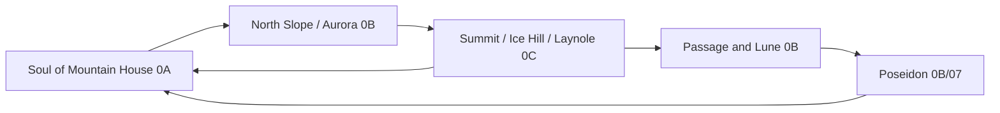

# Mountain of Souls (`mountain_of_souls`)

*Part of the [Soul Blazer Documentation](../README.md) · code hub: [Soul Blazer Code Documentation](../code/README.md)*

> World index 3: ice dungeons from North Slope through Laynole and Lune, the Soul of Mountain House hub, and boss **Poseidon** — walkthrough [chapter 5](../walkthrough/05-mountain-of-souls.md).

**Source:** nine extracted actor files under [`extracted/mountain_of_souls/`](../../extracted/mountain_of_souls/) (three area folders plus two multi-area files); walkthrough [05-mountain-of-souls](../walkthrough/05-mountain-of-souls.md) and [sidequests](../walkthrough/sidequests.md); enemy meta list [`MetaMountainOfSouls`](../../extracted/system/WorldMetaPointers.asm) (68 entries, world index `$03`).

---

## Overview

The Mountain of Souls arc is [chapter 5](../walkthrough/05-mountain-of-souls.md): the hero enters the **Soul of Mountain House** (area `0A`), clears lairs through the **Mountain of Souls** dungeon (`0B`) and **Snow Mountain / Laynole** (`0C`), obtains **Mushroom Shoes** and the **Lucky Blade**, fights **Poseidon**, then frees the **King** and **Nome** in the house. Progression runs Soul of Mountain House → North Slope and Aurora's Ridge → summit ice puzzles → back to the house for shoes → Ice Hill and Laynole → Passage to Lune and Lune lake → optional emblem hunts → Poseidon arena → conclusion (Silver Stone, next world).

The `mountain_of_souls` block group holds **nine** actor assemblies: house NPCs (`soul_of_mountain_house/`), dungeon dreams and effects (`mountain_of_souls_dungeon/`), snow sliding (`snow_mountain/`), and shared fairies, push zones, and most enemies at the group root. Scene loading uses area prefixes `a0A`–`a0C` per [`docs/areas-and-scenes.md`](../areas-and-scenes.md); the world's Up Above shrine is `00/04` (`soul_sanctuary`, location `$3C`). Combat types for this world are rows `$00`–`$43` of `MetaMountainOfSouls` in [`WorldMetaPointers.asm`](../../extracted/system/WorldMetaPointers.asm).

## Areas and scenes

| Extracted folder (scene key) | Area/scene | `loc` | ROM name (extractor) | Walkthrough section | Primary actor file(s) |
|---|---|---|---|---|---|
| `up_above/soul_sanctuary` | `00/04` | `$3C` | The Soul s Sanctuary | Master's Shrine (Mountain) | shared [`cm_npc_master_shrine_menu_00766C`](../../extracted/actor_shared/shared_actor_helpers_bank0.asm) (meta `$3D` on all worlds; not in this group) |
| `soul_of_mountain_house/house` | `0A/01` | `$3D` | `  Soul of Mountain House` (two leading spaces) | Soul of Mountain House | [`ms_soul_of_mountain_house_actors_020000.asm`](../../extracted/mountain_of_souls/soul_of_mountain_house/ms_soul_of_mountain_house_actors_020000.asm), [`ms_soul_of_mountain_house_actors_02100B.asm`](../../extracted/mountain_of_souls/soul_of_mountain_house/ms_soul_of_mountain_house_actors_02100B.asm) |
| `mountain_of_souls_dungeon/north_slope` | `0B/01` | `$3E` | Mountain, North+slope | North Slope | [`ms_multi_area_enemies.asm`](../../extracted/mountain_of_souls/ms_multi_area_enemies.asm), [`ms_multi_area_actors.asm`](../../extracted/mountain_of_souls/ms_multi_area_actors.asm) (push zones) |
| `mountain_of_souls_dungeon/aurora_ridge` | `0B/02` | `$3F` | Aurora s Ridge | Aurora's Ridge | same + [`ms_dungeon_actors.asm`](../../extracted/mountain_of_souls/mountain_of_souls_dungeon/ms_dungeon_actors.asm) (HDMA) |
| `mountain_of_souls_dungeon/old_mans_dream` | `0B/03` | `$40` | An old man s dream | old man's dream (Dream Rod) | `ms_dungeon_actors.asm` |
| `mountain_of_souls_dungeon/passage_to_lune` | `0B/04` | `$41` | A passage to Lune | A Passage to Lune | `ms_dungeon_actors.asm`, [`ms_enemy_ice_maker.asm`](../../extracted/mountain_of_souls/mountain_of_souls_dungeon/ms_enemy_ice_maker.asm) |
| `mountain_of_souls_dungeon/lune_lake` | `0B/05` | `$42` | Underground lake,Lune | The Underground Lake, Lune | `ms_dungeon_actors.asm`, `ms_enemy_ice_maker.asm`, fairy `$3F` in `ms_multi_area_actors.asm` |
| `mountain_of_souls_dungeon/mushrooms_dream` | `0B/06` | `$43` | A mushroom s dream | mushroom's dream | `ms_dungeon_actors.asm` |
| `mountain_of_souls_dungeon/poseidon` | `0B/07` | `$44` | Poseidon | Boss arena | [`ms_boss_poseidon.asm`](../../extracted/mountain_of_souls/mountain_of_souls_dungeon/ms_boss_poseidon.asm) |
| `snow_mountain/summit` | `0C/01` | `$45` | The top of Snow Mountain | Top of Snow Mountain | [`ms_snow_mountain_actors.asm`](../../extracted/mountain_of_souls/snow_mountain/ms_snow_mountain_actors.asm), `ms_multi_area_actors.asm` |
| `snow_mountain/ice_hill` | `0C/02` | `$46` | An ice hill | An Ice Hill | `ms_snow_mountain_actors.asm`, [`ms_enemy_ice_crystal.asm`](../../extracted/mountain_of_souls/snow_mountain/ms_enemy_ice_crystal.asm), push zones |
| `snow_mountain/laynole_ice_field` | `0C/03` | `$47` | Ice field of Laynole | Ice Field of Laynole | `ms_snow_mountain_actors.asm`, `ms_enemy_ice_crystal.asm`, chests in [`data_chest_lists.asm`](../../extracted/system/data_chest_lists.asm) |

## Actor files

| File | Role (verified block notes) |
|---|---|
| [`ms_soul_of_mountain_house_actors_020000.asm`](../../extracted/mountain_of_souls/soul_of_mountain_house/ms_soul_of_mountain_house_actors_020000.asm) | First thirteen house souls (meta `$12`–`$1E`): grandpas, grandmas, boy/girl, King (`ms_npc_king_phoenix_020563`, lair `$103`), Mushroom Shoes giver, Dream Rod mushroom; Phoenix call flags `$0004`/`$0005`, items `$32`–`34` Red-Hot trio. |
| [`ms_soul_of_mountain_house_actors_02100B.asm`](../../extracted/mountain_of_souls/soul_of_mountain_house/ms_soul_of_mountain_house_actors_02100B.asm) | Prison (boy, **Nome**, snail), snail race, **Master's Emblem E** (`ms_npc_snail_master_emblem_e_021A4B`), Lucky Blade hints, Dream Rod old man link (flag `$0707`). |
| [`ms_dungeon_actors.asm`](../../extracted/mountain_of_souls/mountain_of_souls_dungeon/ms_dungeon_actors.asm) | Old man and mushroom dreams, **Emblem F** pickup (`ms_obj_master_emblem_f_021E8F`), HDMA cold/snow effects. |
| [`ms_boss_poseidon.asm`](../../extracted/mountain_of_souls/mountain_of_souls_dungeon/ms_boss_poseidon.asm) | Boss type `$38`, lair record `$103`, attack cycle matching walkthrough boss section. |
| [`ms_enemy_ice_maker.asm`](../../extracted/mountain_of_souls/mountain_of_souls_dungeon/ms_enemy_ice_maker.asm) | Placed Ice Makers (type `$34`) and spike actors for Passage/Lune. |
| [`ms_multi_area_enemies.asm`](../../extracted/mountain_of_souls/ms_multi_area_enemies.asm) | Eight named dungeon enemies (types `$2D`–`$33`, `$36`–`$37`) plus snowball `$31`; lair↔spawn notes (OQ-I037-2). |
| [`ms_enemy_ice_crystal.asm`](../../extracted/mountain_of_souls/snow_mountain/ms_enemy_ice_crystal.asm) | Hazard type `$35` (explodes when hit). |
| [`ms_multi_area_actors.asm`](../../extracted/mountain_of_souls/ms_multi_area_actors.asm) | Fairy gems 300/400 EXP (`$3E`/`$3F`), icy **push zones** (types `$39`). |
| [`ms_snow_mountain_actors.asm`](../../extracted/mountain_of_souls/snow_mountain/ms_snow_mountain_actors.asm) | Ice marker scan and Mushroom-Shoe-gated slide (types `$3A`/`$3B`). |

## Roster

Each freed lair with home location `$3D` spawns one house NPC (see `ms_soul_of_mountain_house_actors_020000.asm` header). Captives use COP 3B until their switch releases.

### House NPCs (walkthrough names)

| Name | Label | Where | Grant / dialogue | Walkthrough |
|---|---|---|---|---|
| King | `ms_npc_king_phoenix_020563` | House, lair `$103` | Thanks, Phoenix lecture, grants Phoenix magic (`$18`); freed when Poseidon dies | Conclusion; [Phoenix sidequest](../walkthrough/sidequests.md) |
| Nome (snail) | `ms_npc_snail_nome_silver_stone_02108F` | Prison, lair `$D6` | **Silver Stone** (`$3D`, flag `$1B03`) | Conclusion |
| Boy (Leo lab hint) | `ms_npc_boy_leo_lab_hint_02100B` | Prison, lair `$D7` | Metal-monster warning | Conclusion |
| Mushroom Shoes boy | `ms_npc_boy_mushroom_shoes_020CC6` | House pond, lair `$E9` | **Mushroom Shoes** (`$22`) | Mushroom Shoes |
| Dream Rod mushroom | `ms_npc_mushroom_dream_rod_020F9B` | House, lair `$DD` | Enters dream `0B/06` with Dream Rod | Boss Preparation |
| Phoenix grandmas (×2) | `ms_npc_grandma_phoenix_east_02032B`, `ms_npc_grandma_phoenix_west_020452` | House corners | Phoenix call choreography when King free | Conclusion; sidequests ch. 8 |
| Snail (Emblem E) | `ms_npc_snail_master_emblem_e_021A4B` | Hidden room, lair `$E8` | **Master's Emblem E** (`$2E`, flag `$1A04`) | Boss Preparation |
| Grandpa (Lucky Blade) | `ms_npc_grandpa_lucky_blade_021263` | House, lair `$FF` | Lucky Blade directions; post-King Nome hint | Part 2 / Conclusion |
| Grandpa (Lune gate) | `ms_npc_grandpa_lune_gate_0217D9` | House, lair `$FE` | Blocks Lune route until **Lucky Blade** (`$04`) equipped | Part 2 |
| Old man (Dream Rod) | `ms_npc_grandpa_dream_rod_0218BF` | House, lair `$FC` | Dream Rod → old man's dream `0B/03` | To Laynole / Boss Prep |
| Snail race cast | `ms_npc_snail_jockey_*`, `ms_npc_girl_race_starter_021ACA` | House track | Optional snail race when five lairs clear | — |
| Other freed souls | `ms_npc_grandpa_*`, `ms_npc_girl_*`, `ms_npc_snail_vehicle_020EE9`, mushrooms | House | Flavour / release map per lair table | Parts 1–3 |

### Dungeon actors

| Name | Label | Scene | Notes | Walkthrough |
|---|---|---|---|---|
| Old man (dream) | `ms_npc_old_man_dream_021D14` | `0B/03` | Buries Magic Armor, 50 Gems, Medical Herb in Aurora's Ridge (flag `$0707`) | Boss Preparation |
| Mushroom (dream) | `ms_npc_mushroom_dream_021DF9` | `0B/06` | Dream exit tile; prison mushroom uses Dream Rod | Boss Preparation |
| Emblem F (trigger) | `ms_obj_master_emblem_f_021E8F` | `0B/05` | Stand tile `($20,$2E)` on Lune island once | Boss Preparation |
| Fairy (300 EXP) | `ms_npc_fairy_exp_300_021ECE` | `0C/01`, switch `$EC` | Return warp to house | Part 1 |
| Fairy (400 EXP) | `ms_npc_fairy_exp_400_021F22` | `0B/05`, switch `$D9` | Return warp to house | Part 3 |

### Treasures (walkthrough checklist)

| Item | Grant site | Record |
|---|---|---|
| 40 Gems | North Slope lair (Yeti group) | Lair reward (not a chest row) |
| 50 Gems, Medical Herb, **Magic Armor** | Aurora's Ridge | Chests loc `$3F` per [`data_chest_lists.asm`](../../extracted/system/data_chest_lists.asm) (`ChestListLoc3F`; crosswalk switch `$25` for armor) |
| **Lucky Blade** | Laynole ice bridge | Chest `47/29` |
| **Strange Bottle** | Laynole north bridge | Chest `47/2A` |
| **Rotator** | Laynole east bridge | Chest `47/41` |
| 300 / 400 EXP | Fairy gems | Actors above (flags `$1E00`, `$1D05`) |

## Enemies

Stats: walkthrough [chapter 5](../walkthrough/05-mountain-of-souls.md) tables and [enemy-bestiary.md](../walkthrough/enemy-bestiary.md). ROM HP/EXP from `MetaMountainOfSouls` (`meta_entry` bytes; EXP is BCD).

| Walkthrough name | HP, EXP (guide) | Meta row; actor label | Conf. | Note |
|---|---|---|---|---|
| Green Lizard | 8, 65 | w3:`$2D` `ms_enemy_green_lizard_0FC72F` | A | Burrowing patrol |
| Undead Caribou | 25, 70 | w3:`$2E` `ms_enemy_undead_caribou_0FC845` | A | Head throw |
| Yeti | 20, 80 | w3:`$2F` `ms_enemy_yeti_0FC8FE` | A | Club chase |
| Fire Bat | 14, 85 | w3:`$30` `ms_enemy_fire_bat_0FC9BC` | A | Also spawned where walkthrough says Cave Bat (OQ-I037-2) |
| Snowball | — | w3:`$31` `ms_enemy_snowball_0FCA35` | U | 40 HP, EXP 2000; no bestiary name (OQ-I004-8, OQ-I033-3) |
| Purple Wizard | 17, 85 | w3:`$32` `ms_enemy_purple_wizard_0FCBDF` | A | Teleport bolts |
| Red Wizard | 20, 100 | w3:`$33` `ms_enemy_red_wizard_0FCDBA` | A | Triple fireball |
| Ice Maker | 24, 70 | w3:`$34` `ms_enemy_ice_maker_0FCFD6` | A | Ground spikes; placed, not lair-spawned |
| Ice Crystal | ?, 0 | w3:`$35` `ms_enemy_ice_crystal_0FD058` | D | ROM HP 24, EXP word `$4000` (OQ-I033-3) |
| Cave Bat | 14, 75 | w3:`$36` `ms_enemy_cave_bat_0FD11B` | A | |
| Green Blob | 12, 80 | w3:`$37` `ms_enemy_green_blob_0FD1E5` | A | |
| **Poseidon** (boss) | 70, 400 | w3:`$38` `ms_boss_poseidon_004299` | D | ROM HP 79 (OQ-I004-1); EXP matches |

## Boss and set pieces

**Poseidon** — walkthrough [Mountain of Souls - Boss](../walkthrough/05-mountain-of-souls.md#mountain-of-souls---boss): 70 HP, 400 EXP, magic-immune, triple fireball → spear (×2) → homing fireballs, fight from south alcove. ROM [`ms_boss_poseidon_004299`](../../extracted/mountain_of_souls/mountain_of_souls_dungeon/ms_boss_poseidon.asm): meta HP **79**, EXP `$0400`, spawn via lair record **`$103`** (home `$3D`, lair loc `$44`, type `$38` per [`data_lair_records.asm`](../../extracted/system/data_lair_records.asm)). Script runs two-round cycles: submerge/rise, random left/right triple fireball and spear, second-side spear, homing pair, dive — matching the guide attack order. Defeat releases the **King** (same lair record); no victory code in the boss file.

**Dream rooms:** Old man's dream (`0B/03`) reveals Aurora chest contents; mushroom's dream (`0B/06`) ties to prison mushroom and Emblem F path. **Ice sliding** on summit and Laynole (`ms_obj_ice_marker_scan_021F52`, `ms_obj_ice_slide_022007`) respects **Mushroom Shoes** on flat ice only; push zones (`ms_obj_push_zone_setup_02220D`) still force slides on slopes.

## Sidequest and progression hooks

| Sidequest | In this world | Implementation |
|---|---|---|
| **Master's Emblem E** | Soul of Mountain House — Boss Preparation | `ms_npc_snail_master_emblem_e_021A4B` after lair `$E8` (hidden path by Master's Shrine lump) |
| **Master's Emblem F** | Boss Preparation (mushroom dream + Lune island) | `ms_obj_master_emblem_f_021E8F` at `0B/05`, flag `$1A05` |
| **Phoenix** (late game) | Conclusion + [sidequests](../walkthrough/sidequests.md) / ch. 8 | King `ms_npc_king_phoenix_020563` orders call (`code_02065C`); grandmas `$18`/`$19`; consumes Red-Hot Mirror/Ball/Stick (`$32`–`$34`) |
| **Silver Stone** | Conclusion → Leo's Lab | `ms_npc_snail_nome_silver_stone_02108F` |
| Master's Shrine travel | All areas | Portal actors use shared `cm_npc_master_shrine_menu_00766C`; house exit to `00/04` |
| Metal Monsters (foreshadow) | Boy in prison | `ms_npc_boy_leo_lab_hint_02100B` |

## Walkthrough cross-check

| Term / fact | Walkthrough | ROM / code | Result |
|---|---|---|---|
| Poseidon HP | 70 HP | Meta w3:`$38` HP 79; `ms_boss_poseidon_004299` | mismatch, see **OQ-I004-1** |
| Poseidon EXP | 400 | EXP `$0400` | consistent |
| Soul of Mountain House name | Soul of Mountain House | Location string with two leading spaces (`$3D`) | consistent (ROM spacing) |
| Ice Crystal stats | ? HP, 0 EXP | Type `$35` HP 24, EXP `$4000`; `ms_enemy_ice_crystal_0FD058` | mismatch, see **OQ-I033-3** |
| Snowball enemy | dodge snowballs (prose) | Type `$31` 40 HP, 2000 EXP; `ms_enemy_snowball_0FCA35` | unmatched name, see **OQ-I004-8** |
| Cave Bat lairs (early) | Cave Bat | Lairs `$CB`/`$CC` spawn type `$30` Fire Bat | mismatch, see **OQ-I037-2** |
| Phoenix summoner | Ch. 5 elderly women; ch. 8 King | King script + both grandmas (`$0004`/`$0005`) | mismatch, see **OQ-I037-1** |
| Boss spawn lair | Poseidon lair before fight | Lair record `$103` → type `$38` | consistent (closes **OQ-I004-13** for this boss) |
| Emblem E / F labels | sidequests.md sections | `ms_npc_snail_master_emblem_e_021A4B`, `ms_obj_master_emblem_f_021E8F` | consistent (current labels) |

## Open questions

| ID | Summary |
|---|---|
| OQ-I004-1 | Boss HP: Poseidon 79 (ROM) vs 70 (walkthrough) |
| OQ-I004-8 | Meta rows without walkthrough enemy names (includes w3:`$31` snowball) |
| OQ-I004-11 | Pool enemies that share HP/EXP (not primary in this world) |
| OQ-I004-12 | Per-area lair spawn roster; Fairy Gem EXP sources |
| OQ-I004-13 | Boss spawn lairs (Poseidon = record `$103` identified here) |
| OQ-I004-15 | Walkthrough-internal naming variants |
| OQ-I033-3 | Snowball and Ice Crystal ROM stats vs bestiary |
| OQ-I037-1 | Who triggers the Phoenix call (King vs grandmas in guide text) |
| OQ-I037-2 | Fire Bat vs Cave Bat at lairs `$CB`/`$CC`; Nome lair `$D6` |
| OQ-I037-8 | Ice marker entry/exit pairing on summit and Laynole |
| OQ-I037-11 | HDMA dream effects and push-zone extents (runtime) |
| OQ-I037-12 | Silent `ms_npc_old_man_dream_girl_021DF8` figure in old man's dream |
| OQ-I037-13 | Poseidon right-side triple fireball `$16` flags |

---

## See Also

- [Soul Blazer Code Documentation](../code/README.md) — hub for engine spokes
- [Actor system](../code/actor-system.md), [scene loading](../code/scene-area-warp-loading.md), [combat / enemy records](../code/combat-damage-and-enemy-records.md), [data tables (lairs)](../code/data-tables.md), [flags](../code/flags-switches-and-inventory-bytes.md)
- Walkthrough: [05 Mountain of Souls](../walkthrough/05-mountain-of-souls.md), [sidequests](../walkthrough/sidequests.md), [items](../walkthrough/items.md), [magic](../walkthrough/magic.md), [enemy-bestiary](../walkthrough/enemy-bestiary.md)
- [Areas and scenes](../areas-and-scenes.md), [walkthrough crosswalk](../walkthrough-crosswalk.md) (audit source: [`plans/doc-audit/walkthrough-crosswalk.md`](../../plans/doc-audit/walkthrough-crosswalk.md))
- Sibling worlds: [St. Elles](st_elles.md) (previous), [Leo's Laboratory](leos_lab.md) (next)