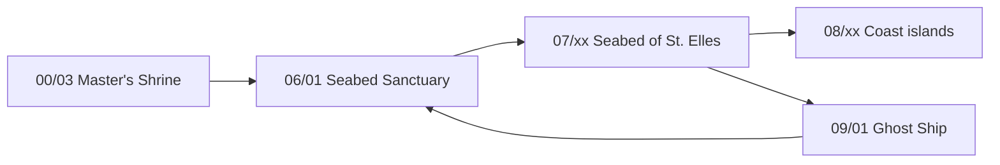

# St. Elles (`st_elles`)

*Part of the [Soul Blazer Documentation](../README.md) · code hub: [Soul Blazer Code Documentation](../code/README.md)*

> World 2 (undersea): walkthrough [chapter 4](../walkthrough/04-st-elles.md); boss **Floating Skull** on the Ghost Ship (`09/01`).

**Source:** twelve blocks under `extracted/st_elles/` (actors, enemies, boss, shared fairy/overlay scripts), [`MetaStElles`](../../extracted/system/WorldMetaPointers.asm), and [chapter 4](../walkthrough/04-st-elles.md). Location ids `$28`–`$34` per [walkthrough crosswalk](../walkthrough-crosswalk.md) section 2 (w2).

---

## Overview

St. Elles is the third major world in progression order. The walkthrough splits it into repeated visits to the **Seabed Sanctuary** hub and six dungeon legs on the seabed and coastal islands, ending with **Floating Skull** on the Ghost Ship. The player clears monster lairs to free dolphins, mermaids, and angelfish; mermaid statues open passages to Southerta, Rockbird Reef, Durean, Blester, and the Ghost Ship; **Bubble Armor** makes underwater areas survivable; **Thunder Ring** clears Blester’s lightning pyramids; **Mermaid's Tears** quench Durean’s volcano; then the queen grants the **Blue Stone** after the boss.

The `st_elles` block group (ROM bank `$0F` plus boss scripts in bank `$00`) holds **twelve** extracted files across five area folders plus two loose world helpers. World index **2** maps enemy and NPC types through **`MetaStElles`** in [`WorldMetaPointers.asm`](../../extracted/system/WorldMetaPointers.asm) (rows `w2:00`–`w2:4E` and combat types `w2:32`–`w2:46`).

## Areas and scenes

| Extracted folder | Scene `AA/SS` | `loc` | ROM name (extracted) | Walkthrough section | Actor placement / scripts |
|------------------|---------------|-------|----------------------|------------------------|---------------------------|
| `up_above` / `st_elles_shrine` | `00/03` | `28` | St- Elles Shrine | Master's Shrine of St. Elles | Shrine warp (not in `st_elles/` group) |
| `seabed_sanctuary` / `sanctuary` | `06/01` | `29` | The Seabed Sanctuary | Arrival, Bubble Armor, statues, conclusion | [`se_seabed_sanctuary_actors_0F8000`](../../extracted/st_elles/seabed_sanctuary/se_seabed_sanctuary_actors_0F8000.asm), [`se_seabed_sanctuary_actors_0F8D58`](../../extracted/st_elles/seabed_sanctuary/se_seabed_sanctuary_actors_0F8D58.asm) |
| `seabed_of_st_elles` / `seabed_1` | `07/01` | `2A` | The Seabed of St- Elles | Dungeons Parts 2–4, 6 (south) | [`se_seabed_of_st_elles_actors`](../../extracted/st_elles/seabed_of_st_elles/se_seabed_of_st_elles_actors.asm), [`se_seabed_of_st_elles_enemies`](../../extracted/st_elles/seabed_of_st_elles/se_seabed_of_st_elles_enemies.asm) |
| `seabed_of_st_elles` / `secret_cave_1`, `secret_cave_2` | `07/02`, `07/03` | `2B`, `2C` | The Secret Cave | Part 6 (Emblem D, gems, herb) | Same actor/enemy files as seabed |
| `seabed_of_st_elles` / `dolphins_dream` | `07/04` | `2D` | A dolphin s dream | Dream Rod + Big Pearl shortcut | [`se_npc_dolphin_big_pearl_0FA106`](../../extracted/st_elles/seabed_of_st_elles/se_seabed_of_st_elles_actors.asm) (in seabed actors file) |
| `seabed_of_st_elles` / `seabed_2` | `07/05` | `34` | The Seabed of St- Elles | Parts 5–6 (north; **Power Bracelet** chest) | Same seabed actor/enemy files |
| `st_elles_coast` / `southerta` | `08/01` | `2E` | Southerta | Part 1 | [`se_st_elles_coast_actors`](../../extracted/st_elles/st_elles_coast/se_st_elles_coast_actors.asm), [`se_st_elles_coast_enemies`](../../extracted/st_elles/st_elles_coast/se_st_elles_coast_enemies.asm) |
| `st_elles_coast` / `rockbird_reef` | `08/02` | `2F` | Shore reef of Rockbird | Part 3 | Coast actor/enemy files |
| `st_elles_coast` / `durean` | `08/03` | `30` | Durean | Part 4 (**Critical Sword**, **Strange Bottle**) | Coast actor/enemy files |
| `st_elles_coast` / `blester` | `08/04` | `31` | Blester | Part 5 (Thunder Ring) | Coast actor/enemy files |
| `ghost_ship` / `ship` | `09/01` | `32` | A ghost ship | Boss (**Floating Skull**, 1 Gem chest) | [`se_ghost_ship_actors`](../../extracted/st_elles/ghost_ship/se_ghost_ship_actors.asm), [`se_ghost_ship_enemies`](../../extracted/st_elles/ghost_ship/se_ghost_ship_enemies.asm), [`se_boss_floating_skull`](../../extracted/st_elles/ghost_ship/se_boss_floating_skull.asm) |
| `ghost_ship` / `servas_dream` | `09/02` | `33` | Servas  dream | Boss preparation | [`se_ghost_ship_actors`](../../extracted/st_elles/ghost_ship/se_ghost_ship_actors.asm) |

Scene ids and names: [`docs/areas-and-scenes.md`](../areas-and-scenes.md), [`us/groups.json`](../../us/groups.json).

## Actor files

| File | Role | Block-note highlights |
|------|------|------------------------|
| [`se_seabed_sanctuary_actors_0F8000.asm`](../../extracted/st_elles/seabed_sanctuary/se_seabed_sanctuary_actors_0F8000.asm) | Sanctuary NPCs (first half): Servas dolphin, Soul of Shield angelfish, dancers, four path statues (Blester/Rockbird), Bubble Armor mermaid, healer | Lair switches `$7C`–`$A4`; freed creatures home at `loc` `$29`; COP `3B` captive / `14` already-free roots |
| [`se_seabed_sanctuary_actors_0F8D58.asm`](../../extracted/st_elles/seabed_sanctuary/se_seabed_sanctuary_actors_0F8D58.asm) | Sanctuary (second half): arrival statue, pearl ride, Magic Flair, queen, Red-Hot Stick mermaid, west guard, HDMA waves | Queen and boss tied to lair switch **`$B6`**; flags `$0502`–`$1B02` |
| [`se_seabed_of_st_elles_actors.asm`](../../extracted/st_elles/seabed_of_st_elles/se_seabed_of_st_elles_actors.asm) | Seabed dolphins (Lue, dream cave), statue gates, fairy EXP 250/300, water current, underwater breath effect | Gates set `$0406`/`$0407`/`$0500`/`$0501`; `se_effect_underwater_breath_0FA64B` enforces Bubble Armor |
| [`se_seabed_of_st_elles_enemies.asm`](../../extracted/st_elles/seabed_of_st_elles/se_seabed_of_st_elles_enemies.asm) | Seabed combat: Sea Urchin–Yellow Seahorse (`MetaStElles` `w2:32`–`w2:37`) | HP/EXP match walkthrough bestiary rows; Hermit Crab shell uses metal-class bit (see cross-check) |
| [`se_st_elles_coast_actors.asm`](../../extracted/st_elles/st_elles_coast/se_st_elles_coast_actors.asm) | Coast fairies (200 EXP, return prompt, pyramid hint), Durean volcano/coals/tears spot, BG2 scroll | Fairy return warp to `06/01`; volcano flag **`$0503`** |
| [`se_st_elles_coast_enemies.asm`](../../extracted/st_elles/st_elles_coast/se_st_elles_coast_enemies.asm) | Island enemies and hazards (`w2:38`–`w2:3F`) | Thunder Ring + pyramids (`w2:38`); Metal Ape lairs `$8E`, `$B9` (Zantetsu) |
| [`se_ghost_ship_actors.asm`](../../extracted/st_elles/ghost_ship/se_ghost_ship_actors.asm) | Servas dream father/son dialogue | Dream flag `$0704`; 1-Gem chest is in ship scene, not this block |
| [`se_ghost_ship_enemies.asm`](../../extracted/st_elles/ghost_ship/se_ghost_ship_enemies.asm) | Purple Worm, Ghost Ship Torch, worm burst | All despawn when boss lair **`$B6`** clears |
| [`se_boss_floating_skull.asm`](../../extracted/st_elles/ghost_ship/se_boss_floating_skull.asm) | Floating Skull boss + hands + fire (`w2:41`) | Lair record **`$B6`**, arena `loc` `$32`; ROM **69** HP / **200** EXP |
| [`w2_effect_player_overlay.asm`](../../extracted/st_elles/w2_effect_player_overlay.asm) | Player overlay effect (`MetaStElles` `w2:30`) | Seabed presentation |
| [`w2_obj_fairy_idle_loop.asm`](../../extracted/st_elles/w2_obj_fairy_idle_loop.asm) | Shared fairy plea/EXP/return strings | “Seabed Palace” return prompt text |
| [`se_unused_enemy_drifting.asm`](../../extracted/st_elles/se_unused_enemy_drifting.asm) | Unused meta type **`w2:33`** | No placement in shipped scenes |

## Roster

### Mermaids, dolphins, and souls

| Walkthrough name | Label | Where | Grant / role | Walkthrough |
|------------------|-------|-------|--------------|-------------|
| Arrival statue (voice) | `se_npc_statue_arrival_hint_0FA014` | `06/01` | Points to Southerta and Bubble Armor (ROM: “Bubble Clothing”) | Arrival |
| Bubble Armor mermaid | `se_npc_mermaid_bubble_armor_0F8B6A` | `06/01` | **Bubble Armor** (`$0B`); heals afterward | Bubble Armor |
| Mermaid's Tears hint | `se_npc_mermaid_tears_hint_0F8D58` | `06/01` | Hints volcano use | Bubble Armor / Durean |
| Anna, Kanna, Nanna (dancers) | `se_npc_mermaid_anna_0F8577`, `se_npc_mermaid_kanna_0F85E1`, `se_npc_mermaid_nanna_0F873E` | `06/01` | Dance trio after lairs | Various dungeon legs |
| Path statues (×4) | `se_npc_statue_rockbird_path_0F8A7E`, `se_npc_statue_durean_path_0F8E99`, `se_npc_statue_blester_path_0F87A9`, `se_npc_statue_ghost_ship_path_0F961C`; gates `se_obj_statue_gate_rockbird_0F9ED4`, `se_obj_statue_gate_durean_0F9F74`, `se_obj_statue_gate_blester_0F9F24`, `se_obj_statue_gate_ghost_ship_0F9FC4` | Sanctuary ↔ seabed | Open Rockbird, Durean, Blester, Ghost Ship routes | After each statue milestone |
| Soul of Shield (angelfish) | `se_npc_angelfish_soul_of_shield_0F80A4` | `06/01` | Soul bit for Durean coals / hazards | Another Mermaid Statue |
| Magic Flair mermaid | `se_npc_mermaid_magic_flair_0F905C` | `06/01` | **Magic Flair** spell (`$13`) | Thunder Ring |
| Pearl ride dolphin | `se_npc_dolphin_pearl_ride_0F8F45` | `06/01` | Ride to **Big Pearl** chest (`29/18`) | Thunder Ring |
| West portal guard | `se_npc_mermaid_guard_west_0F98F5` | `06/01` | Blocks until **Thunder Ring** or queen seen | Thunder Ring |
| Lue | `se_npc_dolphin_lue_0F9B8B` | `07/01` (alcove) | **Thunder Ring** (`$24`); Blue Stone story | Thunder Ring |
| Dream-cave dolphin | `se_npc_dolphin_dream_cave_0F9AFD` | `07/01` | **Dream Rod** → secret cave (`07/04`) | Path Opening |
| Servas (napping) | `se_npc_dolphin_servas_dream_0F8000` | `06/01` | **Dream Rod** → `09/02` Servas dream | Boss Preparation |
| Mermaid queen | `se_npc_queen_0F911E` | `06/01` | **Blue Stone** (`$3C`) after boss lair | Conclusion |
| Medical Herb giver | `se_npc_mermaid_medical_herb_0F82DD` | `06/01` | **Medical Herb** if inventory empty | Path Opening / Boss Prep |
| Red-Hot Stick mermaid | `se_npc_mermaid_red_hot_stick_0F982F` | `06/01` | **Red-Hot Stick** (`$34`) if no Stick/Phoenix | Metal Monsters sidequest (Durean leg) |

### Fairy gems and EXP

| Reward | Label | Lair switch (block note) | Walkthrough |
|--------|-------|--------------------------|-------------|
| 200 EXP | `se_npc_fairy_exp_200_0FA440` | `$A6`, flag `$1D00` | Part 3 (Rockbird) |
| 250 EXP | `se_npc_fairy_exp_250_0FA4C4` | `$7A` | Part 4 (seabed mantas) |
| 300 EXP | `se_npc_fairy_exp_300_0FA494` | `$7F`, flag `$1D06` | Part 5 (north seabed current) |
| Return to Sanctuary | `se_npc_fairy_return_prompt_0FA46D` | (shared tail) | All gem rewards |
| Blester pyramid hint | `se_npc_fairy_pyramid_hint_0FA4F4` | `$B8` | Part 5 |

### Chests (walkthrough treasures; `data_chest_lists.asm`)

| Item | `loc`/chest bit | Scene | Walkthrough |
|------|-----------------|-------|-------------|
| Mermaid's Tears | `29/17` | `06/01` | Bubble Armor |
| Big Pearl | `29/18` | `06/01` (dolphin ride) | Thunder Ring |
| Medical Herb | `2E/1D` | `08/01` Southerta | Part 1 |
| 60 Gems, Medical Herb | `2F/1E`, `2F/1F` | `08/02` Rockbird | Part 3 |
| Critical Sword | `30/20` | `08/03` Durean | Part 4 |
| Strange Bottle | `30/21` | `08/03` Durean | Part 4 (Metal Monsters) |
| Power Bracelet | `34/23` | `07/05` north seabed | Part 6 |
| Master's Emblem D, 80 Gems, empty, Medical Herb | `2B/19`–`2B/1C` | `07/02`–`07/03` Secret Cave | Part 6 |
| 1 Gem | `32/22` | `09/01` Ghost Ship | Boss leg |

Chest lists: [`data_chest_lists.asm`](../../extracted/system/data_chest_lists.asm) (`ChestListLoc29`, `2B`, `2E`, `2F`, `30`, `32`, `34`).

## Enemies

Stats below follow [chapter 4](../walkthrough/04-st-elles.md) area bestiary tables and [`enemy-bestiary.md`](../walkthrough/enemy-bestiary.md). ROM combat fields are in `MetaStElles`; scripts are in the `*_enemies` files.

| Walkthrough name | HP / EXP (guide) | Meta `w2:n` · label | Conf. | Note |
|------------------|------------------|---------------------|-------|------|
| Sea Urchin | 36 / 20 | `w2:32` · `se_enemy_sea_urchin_0FBB1F` | A | Placed, not lair-spawned |
| Jellyfish | 10 / 25 | `w2:34` · `se_enemy_jellyfish_0FBBA3` | A | |
| Hermit Crab | 15 / 22 | `w2:35` · `se_enemy_hermit_crab_0FBC22` | A | ROM shell sets metal-class bit; bestiary “Metal? No” → OQ-I036-8 |
| Manta Ray | 10 / 30 | `w2:36` · `se_enemy_manta_ray_0FBD12` | A | |
| Yellow Seahorse | 8 / 21 | `w2:37` · `se_enemy_yellow_seahorse_0FBE81` | A | |
| Lightning pyramid | — | `w2:38` · `se_obj_lightning_pyramid_0FBF25` | B | Hazard object; Thunder Ring interaction per coast actors |
| Durean vent (lava bomb) | — | `w2:39` · `se_obj_durean_vent_0FBFA1` | B | Soul of Shield bursts `$0301` hazards |
| Walking Tree | 10 / 22 | `w2:3A` · `se_enemy_walking_tree_0FC01E` | A | |
| Monster Rock | 20 / 24 | `w2:3B` · `se_enemy_monster_rock_0FC0E5` | A | |
| Purple Fish | 8 / 20 | `w2:3C` · `se_enemy_purple_fish_0FC14E` | A | |
| Ape | 12 / 23 | `w2:3D` · `se_enemy_ape_0FC296` | A | |
| Metal Ape | 30 / 35 | `w2:3E` · `se_enemy_metal_ape_0FC3E8` | A | Metal bit; Zantetsu required (walkthrough: “Metal Ape”) |
| Tornadic Eagle | 21 / 28 | `w2:3F` · `se_enemy_tornadic_eagle_0FC536` | A | |
| Purple Worms | 5 / 10 | `w2:44` · `se_enemy_purple_worm_004102`; `w2:46` · `se_obj_worm_burst_004248` | B | Two meta rows, same HP/EXP; OQ-I004-11 |
| Ghost Ship Torch | ? / 0 | `w2:45` · `se_enemy_ghost_ship_torch_0041A0` | A | ROM **1** HP; stunned, not killed |
| (unused) | 3 / 0 | `w2:33` · `se_unused_enemy_drifting_0FBB78` | U | No scene placement |

## Boss and set pieces

**Floating Skull** — walkthrough **70** HP, **200** EXP ([Boss section](../walkthrough/04-st-elles.md)); ROM record **`w2:41`** is **69** HP, **200** EXP (`se_boss_floating_skull_003E43` in [`se_boss_floating_skull.asm`](../../extracted/st_elles/ghost_ship/se_boss_floating_skull.asm)). Spawned from lair record **`$B6`** on **`loc` `$32`** (`09/01`). Script spawns link actor, fire spawner, and two hands (~**$63** HP each per block note); attack cycle matches walkthrough rush and mouth fire anchors. Queen **`se_npc_queen_0F911E`** and ship worms/torches watch the same **`$B6`** switch.

**Dream / cutscene rooms**

| Room | Scene | Actors | Walkthrough beat |
|------|-------|--------|------------------|
| Servas's dream | `09/02` | `se_npc_servas_father_0FA23B`, `se_npc_servas_son_0FA3A5` | Father–son dialogue; Servas mentions 1-Gem chest |
| Dolphin's dream | `07/04` | `se_npc_dolphin_big_pearl_0FA106` | Big Pearl opens secret cave route |
| Queen dream mermaid | `06/01` | `se_npc_mermaid_queen_dream_0F96B9` | Sunken-ship foreshadowing |

## Sidequest and progression hooks

| Sidequest | In-world hook | Labels / flags |
|-----------|---------------|----------------|
| [Master's Emblem D](../walkthrough/sidequests.md) | Secret Cave chest quartet | Chest `2B/19`; chapter Part 6 |
| [Defeating Metal Monsters](../walkthrough/sidequests.md) | **Red-Hot Stick** on a captive mermaid; **Strange Bottle** chest on Durean; **Metal Ape** lairs deferred until Zantetsu | `se_npc_mermaid_red_hot_stick_0F982F` (switch `$8E`); chest `30/21`; `se_enemy_metal_ape_0FC3E8` |
| [Summoning the Phoenix](../walkthrough/sidequests.md) | Stick mermaid withholds Stick if **Phoenix** (`$18`) already owned; full ritual is Mountain of Souls (`w3`) | Dialogue in `se_seabed_sanctuary_actors_0F8D58` roster |
| Fairy gem travel | Return prompt warps to Sanctuary hub | `w2_obj_fairy_idle_loop` / `se_npc_fairy_return_prompt_0FA46D`; flag bits `$1D00`, `$1D06`, `$1D07` |

Progression flags cited in block notes include passage flags `$0406`–`$0501`, volcano quench **`$0503`**, queen **`$1B02`** (Blue Stone), and dream completion **`$0704`**.

## Walkthrough cross-check

| Term or fact | Walkthrough | ROM / extracted evidence | Result |
|--------------|-------------|--------------------------|--------|
| Floating Skull HP | 70 HP | `w2:41` HP byte **69**; `se_boss_floating_skull` roster | mismatch, see **OQ-I004-1** |
| Floating Skull EXP | 200 | `w2:41` EXP **$0200** | consistent |
| Bubble Armor name | Bubble Armor | Arrival text “Bubble Clothing”; item `$0B` name in item table | mismatch, see **OQ-I036-3** |
| Hub return name | Seabed Sanctuary | Fairy string “Seabed Palace” (`w2_obj_fairy_idle_loop`) | mismatch, see **OQ-I017-1** |
| Master's Emblem D | Master's Emblem D | Chest item id **Emblem D** / `$2D` (name table spelling) | mismatch (naming), see **OQ-I004-6** |
| Red-Hot Stick | Red-Hot Stick | Item string `Red+Hot Stick` (`$34`) | consistent (encoding `+` for hyphen) |
| Hermit Crab “metal?” | No | Shell state sets `$1A` bit `$0400` | mismatch, see **OQ-I036-8** |
| Metal enemy name | Metal Ape (bestiary) | Same; ch. 06 prose “Metal Gorillas” | walkthrough variant, see **OQ-I004-15** |
| Purple Worms meta rows | One name, two behaviours | `w2:44` worm + `w2:46` burst, same 5/10 | pool, see **OQ-I004-11** |
| Boss lair | Ghost Ship boss lair | Lair **`$B6`**, type `$41`, `loc` `$32` | consistent (static); **OQ-I004-13** |

## Open questions

| ID | Summary |
|----|---------|
| OQ-I004-1 | Boss HP table vs walkthrough (Floating Skull **69** vs **70**) |
| OQ-I004-6 | Item/name spelling (`Emblem` vs Master's Emblem, possessives) |
| OQ-I004-11 | Distinguish `w2:44` vs `w2:46` Purple Worm pool |
| OQ-I004-13 | Boss spawn lair records (Floating Skull uses **`$B6`** statically) |
| OQ-I004-15 | Walkthrough-internal names (Metal Gorillas vs Metal Ape) |
| OQ-I017-1 | Seabed Palace vs Seabed Sanctuary wording |
| OQ-I036-3 | Bubble Clothing vs Bubble Armor |
| OQ-I036-8 | Hermit Crab metal-class bit vs bestiary |
| OQ-I036-9 | Unused `w2:33` drifting enemy purpose |
| OQ-I036-11 | Worm burst trigger height (`se_obj_worm_burst_004248`) |
| OQ-I036-12 | Floating Skull link-actor partner slot |

No new **`OQ-I058-?`** candidates beyond the rows above (already tracked).

---

## See Also

- Code hub: [Soul Blazer Code Documentation](../code/README.md)
- [Scene loading and warps](../code/scene-area-warp-loading.md) · [Actor system](../code/actor-system.md) · [Combat / `meta_entry`](../code/combat-damage-and-enemy-records.md) · [Lair and chest tables](../code/data-tables.md) · [Event flags](../code/flags-switches-and-inventory-bytes.md)
- Walkthrough: [04 St. Elles](../walkthrough/04-st-elles.md) · [Sidequests](../walkthrough/sidequests.md) · [Items](../walkthrough/items.md) · [Magic](../walkthrough/magic.md) · [Enemy bestiary](../walkthrough/enemy-bestiary.md)
- [Areas and scenes](../areas-and-scenes.md) · [Walkthrough crosswalk](../walkthrough-crosswalk.md)
- Sibling worlds: [GreenWood](greenwood.md) → **St. Elles** → [Mountain of Souls](mountain_of_souls.md)