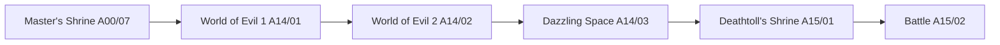

# World of Evil (`world_of_evil`)

*Part of the [Soul Blazer Documentation](../README.md) · code hub: [Soul Blazer Code Documentation](../code/README.md)*

> The seventh and final world (world index 6, `MetaWorldOfEvil`): three outdoor areas plus Deathtoll’s shrine, covered in [08-world-of-evil](../walkthrough/08-world-of-evil.md), ending in a two-phase fight against Deathtoll the Mage and Deathtoll the Demon.

**Source:** [extracted/world_of_evil/](../../extracted/world_of_evil/) (five asm files across `up_above`, `evil_world`, `deathtolls_shrine`) · walkthrough [08-world-of-evil](../walkthrough/08-world-of-evil.md), [sidequests](../walkthrough/sidequests.md) (Phoenix prerequisites) · enemy stats in [`WorldMetaPointers.asm`](../../extracted/system/WorldMetaPointers.asm) (`MetaWorldOfEvil`, 21 rows).

---

## Overview

Chapter 8 is the endgame. The player arrives at the World of Evil Master’s Shrine ([`we_obj_master_shrine_event_01EC4B`](../../extracted/world_of_evil/up_above/we_obj_master_shrine_event.asm)) with six Colored Stones; the stones are consumed and the hub opens the barrier into area `evil_world`. The first two outdoor scenes (`world_of_evil_1`, `world_of_evil_2`) are lair mazes of Purple Bulls, Fireflies, and Wall Tiles; the walkthrough only names **Dazzling Space** (`dazzling_space`) explicitly. There the player needs **Soul Armor** and **Soul Blade** from chests, then crosses to **Deathtoll’s Shrine** for the final boss.

Summoning the **Phoenix** (see walkthrough and [magic.md](../walkthrough/magic.md)) happens in the Soul of Mountain House, but the ROM plays a cutscene in Dazzling Space (`we_obj_phoenix_call_scene_01EE6D`) and arms flag `$0A01`, which also enables Phoenix use once Soul Blade and Soul Armor are equipped. After Deathtoll falls, `RunEnding` in [`we_deathtolls_shrine_actors.asm`](../../extracted/world_of_evil/deathtolls_shrine/we_deathtolls_shrine_actors.asm) leads into the staff roll ([`lib_name_entry_and_staff_roll`](../../extracted/library/lib_name_entry_and_staff_roll.asm) via [`gv_front_end`](../../extracted/grass_valley/front_end/gv_front_end.asm)); see [text-and-dialogue.md](../code/text-and-dialogue.md) and [actor-system.md](../code/actor-system.md) rather than duplicating that pipeline here.

The block group `world_of_evil` in `us/blocks.json` holds **five** extracted files: one enemies file, two area actor/effect files, shrine boss actors, and the Up Above shrine event. World index **6** selects `MetaWorldOfEvil` at scene load ([combat-damage-and-enemy-records.md](../code/combat-damage-and-enemy-records.md)).

## Areas and scenes

Scene id = `(area << 8) | scene` (decimal in `us/groups.json`). Banner names come from [`LocationNameList`](../../extracted/library/lib_banner_texts.asm) (apostrophe prints as blank, as in `Deathtoll s Shrine`).

| Extracted folder | Area/scene (hex) | `loc` | ROM banner name | Walkthrough heading | Actor file(s) |
|------------------|------------------|-------|-----------------|---------------------|---------------|
| `up_above/evil_world_shrine` | `00/07` | `$78` | The Evil World Shrine | Master's Shrine (start) | [`we_obj_master_shrine_event.asm`](../../extracted/world_of_evil/up_above/we_obj_master_shrine_event.asm), shared `cm_npc_master_shrine_menu_00766C` in [`shared_actor_helpers_bank0.asm`](../../extracted/actor_shared/shared_actor_helpers_bank0.asm) (meta `$10`) |
| `evil_world/world_of_evil_1` | `14/01` | `$79` | World of Evil | First area; Red-Hot Ball | [`we_evil_world_actors.asm`](../../extracted/world_of_evil/evil_world/we_evil_world_actors.asm), [`we_evil_world_enemies.asm`](../../extracted/world_of_evil/evil_world/we_evil_world_enemies.asm) |
| `evil_world/world_of_evil_2` | `14/02` | `$7A` | World of Evil | Second area; Soul Armor | same |
| `evil_world/dazzling_space` | `14/03` | `$7B` | Dazzling Space | Dazzling Space; Soul Blade, grind | same (+ Phoenix-call scene meta `$14`) |
| `deathtolls_shrine/shrine` | `15/01` | `$7C` | Deathtoll s Shrine | FINAL BOSS part one (Mage) | [`we_deathtolls_shrine_actors.asm`](../../extracted/world_of_evil/deathtolls_shrine/we_deathtolls_shrine_actors.asm) |
| `deathtolls_shrine/battle` | `15/02` | `$7D` | Battle with Deathtoll | FINAL BOSS part two (Demon) | same, [`we_fx_battle_bg2_hofs_bands.asm`](../../extracted/world_of_evil/deathtolls_shrine/we_fx_battle_bg2_hofs_bands.asm) (meta `$08`) |

Scene-to-area mapping: [areas-and-scenes.md](../areas-and-scenes.md). Load and warp rules: [scene-area-warp-loading.md](../code/scene-area-warp-loading.md).

## Actor files

| File | Contents |
|------|----------|
| [`we_obj_master_shrine_event.asm`](../../extracted/world_of_evil/up_above/we_obj_master_shrine_event.asm) | Meta `$12`: six-stone ceremony (items `$3A`–`$3F`), barrier flags `$1F04`/`$1F05` with Up Above hub, gate speech, post-ending farewell when `$1F02` is set |
| [`we_evil_world_actors.asm`](../../extracted/world_of_evil/evil_world/we_evil_world_actors.asm) | BG2 HDMA parallax (`$06`/`$07`), Dazzling Space palette hazard meta `$04` (`we_obj_dazzling_space_hazard_01EECA`), Phoenix-call pan meta `$14` |
| [`we_evil_world_enemies.asm`](../../extracted/world_of_evil/evil_world/we_evil_world_enemies.asm) | Lair and placed scripts for meta types `$0A`–`$0F`; lair record ids `$196`–`$1A3` noted in block comment |
| [`we_deathtolls_shrine_actors.asm`](../../extracted/world_of_evil/deathtolls_shrine/we_deathtolls_shrine_actors.asm) | Deathtoll Mage `$09`, hand-over `$13`, Demon `$11`, ending TM curtain `we_fx_ending_tm_curtain_0055C6`; embeds `RunEnding` |
| [`we_fx_battle_bg2_hofs_bands.asm`](../../extracted/world_of_evil/deathtolls_shrine/we_fx_battle_bg2_hofs_bands.asm) | Final-battle BG2 band shear (meta `$08`) |

## Roster

There are no freed-soul NPCs in the outdoor World of Evil; progression is lairs, chests, and shrine dialogue. Named roles tie to chapter 8 as follows.

| Walkthrough name | Label | Where | Role / grant | Walkthrough |
|------------------|-------|-------|--------------|-------------|
| Master (menu) | `cm_npc_master_shrine_menu_00766C` | A00/07 | Save / HP refill | Shrine start |
| Master (stones) | `we_obj_master_shrine_event_01EC4B` | A00/07 | Consumes six stones; gate text mentions Phoenix and three symbols | Barrier opening |
| Phoenix call scene | `we_obj_phoenix_call_scene_01EE6D` | A14/03 | Runs when flag `$0A01` set after King’s call elsewhere | Summoning the Phoenix |
| Dazzling hazard | `we_obj_dazzling_space_hazard_01EECA` | A14/03 | 1 HP / 8 frames unless Soul Armor (`$10`) or Phoenix called | Dazzling Space |

**Chests** ([`data_chest_lists.asm`](../../extracted/system/data_chest_lists.asm), lists `ChestListLoc79`–`7B`; crosswalk §4):

| Treasure | `loc`/switch | Item id (inferred) | Walkthrough |
|----------|--------------|-------------------|-------------|
| 200 Gems | `$79` (switches in list) | Gems | First area |
| Medical Herb | `$79` | `$38` | First area |
| Red-Hot Ball | `$79` / `$39` | `$33` | Red-Hot Ball |
| Soul Armor | `$7A` / `$3A` | `$10` | Into the Dazzling Space |
| 100 Gems | `$7B` | Gems | Dazzling Space |
| Soul Blade | `$7B` / `$3B` | `$08` | Dazzling Space |

Spells and key items: [items.md](../walkthrough/items.md) (Soul Blade level 24, Soul Armor, Red-Hot Ball), [magic.md](../walkthrough/magic.md) (Phoenix, 2 Gems per cast).

## Enemies

Walkthrough tables in chapter 8 and [enemy-bestiary.md](../walkthrough/enemy-bestiary.md) list three named monsters for this world. Meta row = type index in `MetaWorldOfEvil` (world 6); script labels are current names in [`we_evil_world_enemies.asm`](../../extracted/world_of_evil/evil_world/we_evil_world_enemies.asm).

| Walkthrough name | HP, EXP (guide) | Meta / label | Conf. | Note |
|------------------|-----------------|--------------|-------|------|
| Purple Bull | 23, 2700 | w6:`$0A` · `we_enemy_purple_bull_0FEA1D` | D | ROM HP **45**; lair records `$197`–`$1A2` |
| Firefly | 23, 3000 | w6:`$0B` · `we_enemy_firefly_0FEB95` | A | Lairs `$196`, `$199`–`$1A3` |
| Wall Tile | 10, 4000 | w6:`$0C` · `we_enemy_wall_tile_0FECD9` | A | Special class: Soul Blade only ([items.md](../walkthrough/items.md)) |
| (pop-up turret) | — | w6:`$0D` · `we_enemy_popup_turret_0FED09` | U | No walkthrough name; fire-wall alcoves (OQ-I004-8) |
| (arc jet) | — | w6:`$0E` · `we_enemy_arc_jet_0FED8F` | U | Two placements in area 2 (OQ-I004-8) |
| (static hazard) | — | w6:`$0F` · `we_enemy_static_hazard_0FEEA5` | U | RTL stub sharing `$0E` stats (OQ-I004-8) |
| Deathtoll the Mage | 100, 0 | w6:`$09` · `we_boss_deathtoll_mage_004D8B` | D | ROM HP **99**, EXP 0 |
| Deathtoll the Demon | 100, 0 | w6:`$11` · `we_boss_deathtoll_demon_005043` | A | ROM HP 100, defence `$FF` |

Record layout: [combat-damage-and-enemy-records.md](../code/combat-damage-and-enemy-records.md). Lair placements: [data-tables.md](../code/data-tables.md) (`data_lair_records.asm`, world 6 range).

## Boss and set pieces

**Deathtoll the Mage** (`we_boss_deathtoll_mage_004D8B`, A15/01, meta `$09`): walkthrough 100 HP and 0 EXP; ROM 99 HP (`$63`), attack `$1A`, defence `$15`, flags `$0200` (invulnerable phases). Fight opens when the hero’s y drops below `$80`; Magic Orbs (`we_boss_deathtoll_mage_orb_*`) match the walkthrough’s homing orbs. Death hands off through `we_boss_deathtoll_mage_handover_004F4D` (meta `$13`) into A15/02.

**Deathtoll the Demon** (`we_boss_deathtoll_demon_005043`, A15/02, meta `$11`): walkthrough 100 HP (RAM note `0x7E08A5` = slot `$02` HP byte); ROM 100 HP, defence `$FF`, flags `$0201`. Fire pillars, crossing scepter lasers, and mouth fireballs are scripted in the same file; pillars drop 5-Gem pickups. Phoenix damage is floored at 1 per hit ([combat-damage-and-enemy-records.md](../code/combat-damage-and-enemy-records.md)).

**Set pieces in this group:** Dazzling Space environmental damage (`we_obj_dazzling_space_hazard_01EECA`); BG2 scroll FX in outdoor areas and battle bands (`we_fx_bg2_hofs_wave_01EEF3`, `we_fx_bg2_vofs_wobble_01F063`, `we_fx_battle_bg2_hofs_bands_01F14F`); Phoenix-call camera pan (`we_obj_phoenix_call_scene_01EE6D`); ending curtain (`we_fx_ending_tm_curtain_0055C6`, text “The World of Evil began to disappear”) before `RunEnding` and the staff roll library.

## Sidequest and progression hooks

| Sidequest ([sidequests.md](../walkthrough/sidequests.md)) | Touch in this world |
|-----------------------------------------------------------|---------------------|
| **Summoning the Phoenix** | **Red-Hot Ball** chest (`$79`/`$39`); after all three Red-Hot items, King in Soul of Mountain House sets `$0A01`; scene actor `we_obj_phoenix_call_scene_01EE6D` in A14/03; Master’s gate speech in `we_obj_master_shrine_event` names Phoenix and three symbols |
| Defeating Metal Monsters | Red-Hot **Stick** (St. Elles); not granted here |
| Defeating Spirit Monsters | Red-Hot **Mirror** (GreenWood); not granted here |
| Master's Emblems / **Magic Bell** | Recommended for final boss ([08-world-of-evil](../walkthrough/08-world-of-evil.md) prep); no emblem actors in this group |
| Fairy Gems | None in World of Evil areas; gems/EXP farming for the boss is via Wall Tiles and Phoenix in Dazzling Space per walkthrough |

Flags this group sets or reads: `$1F02` (ending ran), `$1F03` (gate speech), `$1F04`/`$1F05` (stones and hub barrier), `$0A01` (Phoenix called), scene-local boss flags in A15 (`event_flags` low byte for pillar waves). Details: [flags-switches-and-inventory-bytes.md](../code/flags-switches-and-inventory-bytes.md).

## Walkthrough cross-check

| Term / fact | Walkthrough | ROM | Result |
|-------------|-------------|-----|--------|
| Deathtoll the Mage HP | 100 HP (`08-world-of-evil.md`) | `MetaWorldOfEvil` `$09` HP `$63` (99) | mismatch, see OQ-I004-1, OQ-I040-2 |
| Deathtoll total HP | 200 HP total (`enemy-bestiary.md`) | `$09` 99 + `$11` 100 = 199 | mismatch, see OQ-I004-1 |
| Purple Bull HP | 23 HP | meta `$0A` HP 45 | mismatch, see OQ-I004-2 |
| Shrine banner spelling | Deathtoll's Shrine (prose) | `Deathtoll s Shrine` / dictionary `Deathtole` | mismatch (encoding vs dictionary), see OQ-I004-5 |
| Pop-up hazards | fire-wall alcoves (prose) | meta `$0D`–`$0F`, unnamed in bestiary | unmatched, see OQ-I004-8 |
| Phoenix 1–2 damage | “1 ~ 2 points” vs Demon | defence `$FF`, floor 1 in combat doc | consistent with 1; “2” unsettled (OQ-I049-3) |

## Open questions

| Id | Summary |
|----|---------|
| OQ-I004-1 | Boss HP pattern: Mage 99 vs walkthrough 100; bestiary 200 total vs 199 ROM sum |
| OQ-I004-2 | Purple Bull 23 vs 45 HP |
| OQ-I004-5 | Dictionary `Deathtole` vs dialogue/walkthrough `Deathtoll` |
| OQ-I004-8 | Walkthrough-unnamed meta types w6 `$0D`–`$0F` |
| OQ-I004-15 | Walkthrough-internal naming variants (no ROM action) |
| OQ-I033-2 | Same as OQ-I004-2 (Purple Bull), cited in enemy block note |
| OQ-I040-1 | Hub scripts named “post_ending” for pre-ending barrier step |
| OQ-I040-2 | Whether walkthrough “100 HP” for Mage conflates Demon slot |
| OQ-I040-4 | Orb roles and unnamed boss set pieces |
| OQ-I040-5 | What the Phoenix-call pan shows (parked actor slots) |
| OQ-I040-6 | Exact Dazzling Space hazard timing with/without Soul Armor |
| OQ-I040-14 | Map lair records `$196`–`$1A3` to walkthrough positions |
| OQ-I049-3 | Source of “2” Phoenix damage to final Deathtoll |

---

## See Also

- [Soul Blazer Code Documentation](../code/README.md) · [walkthrough crosswalk](../walkthrough-crosswalk.md) · [Worlds hub](../areas-and-scenes.md)
- Code: [actor-system.md](../code/actor-system.md), [combat-damage-and-enemy-records.md](../code/combat-damage-and-enemy-records.md), [scene-area-warp-loading.md](../code/scene-area-warp-loading.md), [text-and-dialogue.md](../code/text-and-dialogue.md), [data-tables.md](../code/data-tables.md), [flags-switches-and-inventory-bytes.md](../code/flags-switches-and-inventory-bytes.md)
- Walkthrough: [08-world-of-evil](../walkthrough/08-world-of-evil.md), [sidequests](../walkthrough/sidequests.md), [items](../walkthrough/items.md), [magic](../walkthrough/magic.md), [enemy-bestiary](../walkthrough/enemy-bestiary.md)
- Previous world: [magridds_castle](magridds_castle.md)